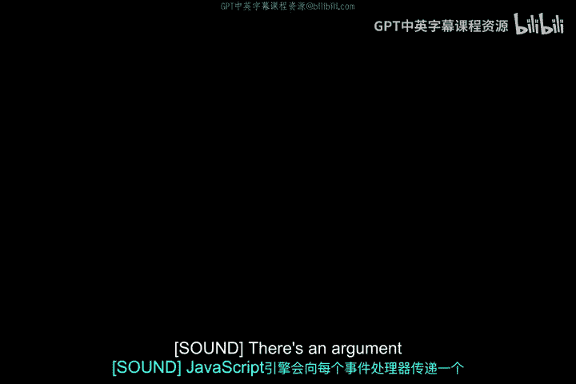
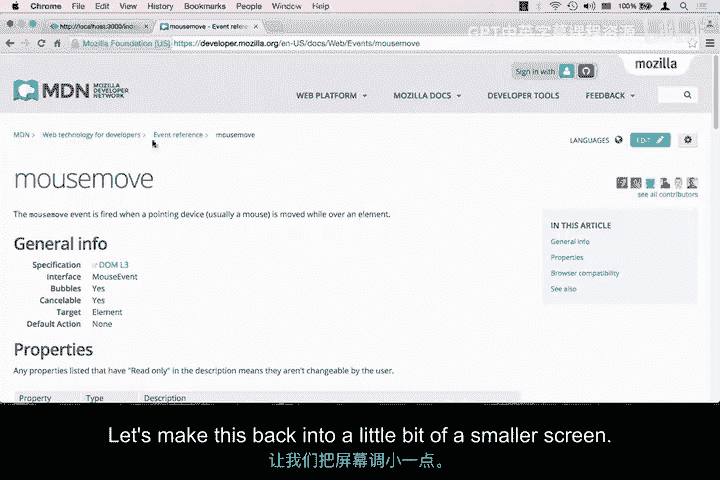
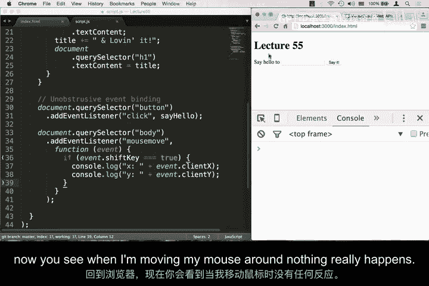

# JavaScript事件处理：P93：27_第55讲 事件参数 🎯



在本节课中，我们将要学习JavaScript事件处理中的一个核心概念：**事件参数**。这个参数由JavaScript引擎自动传递给每一个事件处理函数，它包含了与事件相关的丰富信息，例如鼠标点击的位置、按下的按键等。理解并利用这个参数，可以让我们编写出更强大、更交互的网页功能。

上一节我们介绍了如何为元素添加事件监听器，本节中我们来看看事件处理函数接收到的这个特殊参数。

---

## 事件参数对象

JavaScript引擎会向每一个事件处理函数传递一个参数，通常命名为 `event` 或 `e`。这个参数是一个对象，包含了触发事件的详细信息。

```javascript
button.addEventListener('click', function(event) {
  console.log(event);
});
```

当我们运行上述代码并点击按钮时，控制台会打印出一个 `MouseEvent` 对象。展开这个对象，可以看到它拥有许多属性，例如：
*   `clientX` 和 `clientY`：记录了事件发生时，鼠标指针在**当前视口**内的X和Y坐标。
*   `screenX` 和 `screenY`：记录了事件发生时，鼠标指针在**整个屏幕**内的X和Y坐标。
*   `shiftKey`：一个布尔值，表示事件发生时**Shift键**是否被按下。

即使我们之前没有显式地使用这个 `event` 对象，它始终会被传入事件处理函数。

---

## 不同类型的事件对象

`event` 参数的具体类型取决于触发的事件种类。不同的事件类型对应着不同的事件对象，这些对象包含与该事件类型相关的特定属性。

例如：
*   **键盘事件**（如 `keydown`, `keyup`）会传递 `KeyboardEvent` 对象，其中包含 `key` 属性来告知是哪个键被按下。
*   **鼠标事件**（如 `click`, `mousemove`）会传递 `MouseEvent` 对象，其中包含像 `clientX`, `button` 等与鼠标相关的属性。

我们可以查阅MDN（Mozilla Developer Network）的文档来了解每种事件对象的所有属性和方法。

---



## 实践：使用事件参数

让我们通过一个例子来实践。我们将实现一个功能：**仅在按住Shift键时，在控制台打印出鼠标在页面body区域内移动时的坐标。**

以下是实现此功能的步骤：

首先，我们需要为整个文档的 `body` 元素添加一个 `mousemove` 事件监听器。

```javascript
document.querySelector('body').addEventListener('mousemove', function(event) {
  // 事件处理逻辑将写在这里
});
```

接着，在事件处理函数内部，我们需要判断Shift键是否被按下。这可以通过检查 `event.shiftKey` 属性来实现。

```javascript
document.querySelector('body').addEventListener('mousemove', function(event) {
  if (event.shiftKey === true) {
    // 只有当Shift键被按下时，才执行以下代码
    console.log(`X: ${event.clientX}, Y: ${event.clientY}`);
  }
});
```

现在，保存代码并刷新页面。当你普通移动鼠标时，控制台不会有输出。但当你**按住Shift键并移动鼠标**时，控制台就会持续输出鼠标指针当前的X和Y坐标。松开Shift键，输出便会停止。

这是因为 `if` 语句检查 `event.shiftKey` 的值。当它为 `false`（即Shift键未按下）时，内部的 `console.log` 语句会被跳过，事件处理函数实际上没有执行任何操作。



---


本节课中我们一起学习了JavaScript的**事件参数（Event Parameter）**。我们了解到这个参数是一个包含事件详细信息的对象，其具体类型（如 `MouseEvent`）取决于触发的事件。我们通过一个实践例子，学会了如何访问该对象的属性（如 `clientX`, `shiftKey`）来增强网页的交互逻辑。掌握事件参数是处理复杂用户交互的关键一步。