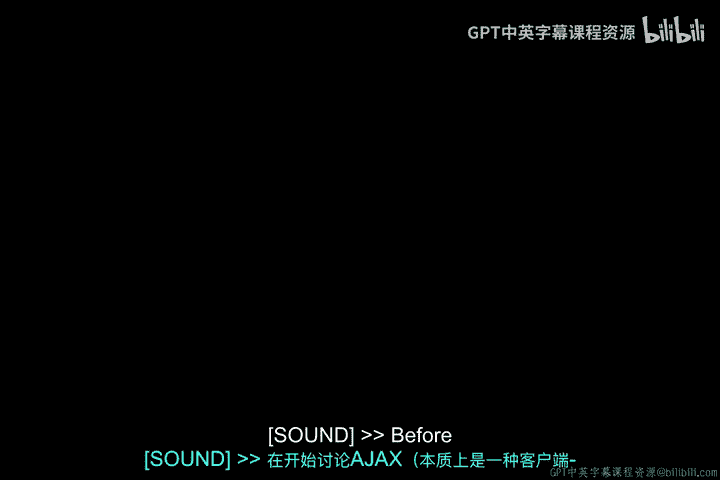
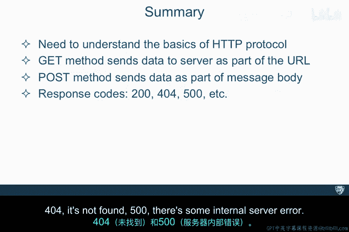

# 约翰霍普金斯大学《Web开发者的HTML, CSS, and Javascript》中英字幕 - P94：28_第56讲 HTTP基础.zh_en - GPT中英字幕课程资源 - BV1WzY6z9EUd

Yeah。

Before we launch into discussion about AjaX， which is essentially a client server communication technique。

 let's talk about the language in which the client that is the browser communicates with a server and the language that they use otherwise known as protocol is HGTP。

 so let's talk about some HTP basics。Number one is what is HTP Well HTP stands for hypertext transfer protocol HTP and it's based on a request response stateless protocol and stateless in this context means that when the server responds to a request from a browser that response does not depend on any previous requests that the browser made In fact as far as the actual language in which the client the browser in the server communicate the server has no idea whether or not the client or the browser has requested anything from it before Now obviously in the real world you need to be able to know that if I clicked to buy a book two minutes ago that when I go to my shopping cart and want to check out that I'm the same person who clicked to buy the book and it's a little bit outside of the scope of this course to explain how that works but the protocol itself。

 the HTP protocol is stateless， theres nothing inherently in it that remembers that you are the same。

Person who requested or made that request between the browser and the server a couple of minutes ago So the way the client server communication works is as follows the client the browser usually opens the connection to the server。

 then the client sends an HP request for a particular resource。

And then the server responds with an HTTP responds to the client usually with the resource that the client requested。

 but sometimes the resource is not found or some other error occurs and then the client that is again the browser usually closes the connection to the server now before we speak about the actual communication language。

 the HTP protocol for a little bit let's talk about how to identify a resource on the web and when we talk about it。

 we have three terms that we need to understand that are kind of thrown around and it's a good idea to understand what they mean。

The first one is uniform resource name otherwise known as UN What a UN is it's a way to uniquely identify a resource or name over a resource The thing about UN is they do not tell us how to get that resource and UNs are very commonly used by organizations who and institutions who want to standardize to maintain some uniqueness of a particular resource within that organization So for example。

 if Coursera wanted to maintain unique names for each course that they have they could make my course or this course you're taking and could generate a string that says HTMLC says JavaScript will developers yakov Hken with the slashes in between and will probably uniquely identify courses or this course within all the other number of courses that they have on the platform It will not obviously uniquely identify my course all over the world but it might uniquely identify within a course。

I a platform？Another term is URI， and URI stands for Uniform Resource Ientifier。

 and what that does is uniquely identifies a resource or location of a resource。

But even though it identifies uniquely the location of resource。

 it still does not necessarily tell us how to get to that resource and the reason it doesn't is because within a Uri the context is usually missing it's very similar to Un except the Uri is much more directory type of structure looking thing so for example a Uri might be slash officialicial underscore web underscore site sindexhtm while if I'm sitting at Cora。

org this will mean a unique URL together put together with a Cora。

org but if you just give me the Uri itself it doesn't really tell me where to get it and if you just come over to me and give me this Uri official website sindexhtml I will not be able to get that resource because I won't know where to go to get it once you kind of take me to where to get it if you take me to Cosera。

org and I start from the route of Cosera。org and I can start searchinglashofficial website s indexdex that HM。

Then I'm able to get it， but yourR right by itself doesn't necessarily tell us how to get that resource。

The last final term is URL and that stands for uniform resource locator。

 And this is something that's obviously thrown around on the web all over the place。

 when you ask somebody for a website address， it's a URL it's a uniform resource locator and URL is a form of URL that provides the information on how to get that resource。

 So for example， if you tell me that it's htp www my side do co slash officialicial website slash index at html。

 I know exactly where to get it because my side do co only exists in one place。

 So I know where to go to get that resource。 So let's take a look at an htp request structure。

 in other words， the actual language that the browser communicates with a server and this is an example of a get request。

 So this request starts with the word get and it's almost like a command I want to get some particular resource and that command is called a method and as many methods we're going to talk about a couple of them。

 then follows。😊，The Ui string so this command has particular parameters you have to pass it so it starts with a get and then you pass it a Ui string and then you pass it a query string。

 which is not a requirement but a lot of times you do see that and a query string is nothing more than a name value pair separated by m percent。

 So for example in the orange box you could see that question mark which is something that starts the query string and you see first equals yaakov m percent last equals Hihen So those a two name value pair parameters and the last part of this command is Htp slash 1。

1 and a long time ago already this point was htp1。0 it's the Htp version the version of our language So this is the command that the browser issues to get at a particular resource on a website。

I'm sure looking at it， you could start seeing that there's something strange about this command。

 Where is the website name How do I know it's a URLri， It's not a URL and the reason it's a Uri。

 not a URL is very simple。 This command is only issued once the browser actually connects to the server so we're ready connected to Coursera org or to my side org and now that we've connected and established the connection to that particular website now were asking for a URL within the context of that website and the way we ask for it is using a particular language and that language is called the protocol。

 it's the HP protocol a good analogy would be if you and I both speak English that's our language that's our protocol when I say hello you say hello back however it's no use for me to stare at my phone and keep saying hello to you if I've never even dialed your number the first thing I need to do I need to dial your number connect our phones need to connect。

Together and once the connection is established， I could then ask you and say hello and ask you questions before then I really can't do anything Well very similar to here the browser first is to make a connection to the server and once it makes the connection it starts the HP protocol starts the language of communication between the browser and the server So what you see in front of you on the slide now is kind of a get command otherwise knows a get request and it's named after the method or the command that is issued as the beginning of this line now there are a number of these methods and let's go ahead and take a look at a couple of them that at least for us is going to be pretty important。

😊，One of them is again the get command or the get method and what that does it says I want to retrieve the resource from a particular location and the way you pass the data using that method is you pass it to the server as part of the UI as you remember we had the query string well that's how you pass the data and the data is not so much to be stored on the server as much as really a way for us to tell the server and identify a particular resource or maybe filter a particular resource the data from that particular resource so we need to pass the data to the server in order to get the data back it's not really for the server to store it necessarily。

The other command or the other method HTP method is post。

 and this method sends the data to the server in order to be processed。

And the data that you sent to the server is sent in the message body Now the server may still respond and most of the time does respond with some sort of response。

 maybe an HTML page， maybe some sort of data， but date data is more viewed as a status or kind of a confirmation that the data that you sent to the server was in fact processed。

 whatever that means stored or some other side effect happened because of it。

 but it's an indication that it was processed Now there's many more methods that we' not covering here。

 but these are good enough just to get an idea of the actual protocol so when we talk about postrequest and the data being sent as part of the message let's go ahead and quickly visualize what that looks like。

So this is a typical post request and you could see there's a post slashing this at HTML。

 but there's no query string the query string and the data that we're passing comes as part of the body of the message so there's a few parts here that actually exists on pretty much every post request which is the first line the post request itself followed by some request headers in this example except character set is telling the server that our browser knows how to process UTF8 character set and after that we have the message body this is where the data is being passed to the server so this is the post request let's take a quick look as to what an HTP response structure is like Well it starts with just a response status line and the response status line has three components first one is the HP version so the server kind of spits back out to version of HP it's communicating。

😊，The second is the response status code， and the third is the English phrase describing that status code。

 and all three parts are separated by a single space。

So a typical HP response may look something like this。 It will start with HtP 1。1200 okay。

 It will follow by some HtP response headers in this case。

 it will tell you what the date of this document is will tell you the content type in this case it's text and HTML and then the body of the message of the body of the response will be HTML Now the message body of the response need not be HTML。

 It can be， for example， plain text Xml or Json something we haven't really talked about yet So let me show you some common response status code。

 one of them is 200 okay and that basically means that the server saying okay I got your request and here's the content you requested another one is 404 not found and in this case the server says I just can't find the resource that you requested4 or3 forbidden and that means that for whatever reason the server thinks that the client your browser is unauthenticated and tries to access a secure。

A resource that requires some sort of username and password or a certificate or something like that。

And another one pretty common is 500 internal server error。

 and usually that happens when some error was raised in a server and was unhandled in the server and it kind of spilled over and now you as the user。

 probably in the browser are seeing 500 internal error。So in summary。

 it doesn't take a rocket scientist to understand that if you're going to be doing client server communication。

 you need to understand at least the very basics of HTP protocol Now remember the get methods sends the data to the server as part of the URL or part of the URL that's going to be important for us as we move forward and the post method sends the data as part of the message body and some common response codes are 200 that's fine。

 the data is coming， 404 it's not found， 500 there's some internal server error。😊。

