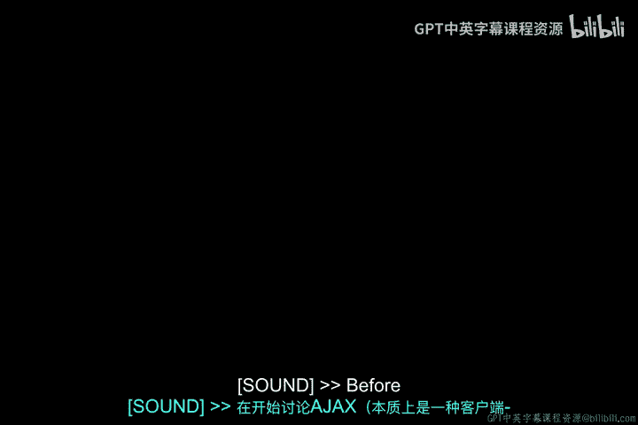
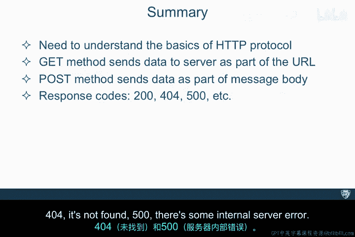

# Web开发基础：第56讲：HTTP基础 🌐



在本节课中，我们将学习HTTP协议的基础知识。HTTP是浏览器（客户端）与服务器之间进行通信所使用的语言或协议。理解HTTP是掌握后续Ajax等客户端-服务器通信技术的关键。

在深入讨论Ajax（一种客户端-服务器通信技术）之前，我们需要先了解浏览器（客户端）与服务器之间通信所使用的语言。这种语言，或者说协议，就是HTTP。因此，让我们先探讨一些HTTP的基础知识。

## 什么是HTTP？ 🤔

HTTP代表超文本传输协议。它是一种基于**请求-响应**的**无状态**协议。这里的“无状态”意味着，当服务器响应浏览器的请求时，该响应不依赖于浏览器之前发出的任何请求。实际上，就客户端（浏览器）与服务器通信的实际语言而言，服务器并不知道客户端或浏览器之前是否向它请求过任何内容。

当然，在现实世界中，我们需要能够识别用户身份（例如，确保两分钟前点击购买书籍的用户与之后去购物车结账的是同一个人）。这涉及到会话管理等技术，超出了本课程的范围。但HTTP协议本身是无状态的，其本身并不包含任何能记住你是几分钟前在浏览器和服务器之间发出请求的同一人的机制。

## 客户端-服务器通信流程 🔄

客户端-服务器通信的工作方式如下：
1.  客户端（通常是浏览器）打开到服务器的连接。
2.  客户端发送一个针对特定资源的**HTTP请求**。
3.  服务器用一个**HTTP响应**来回应客户端，通常包含客户端请求的资源（但有时资源未找到或其他错误发生）。
4.  客户端（即浏览器）通常会关闭与服务器的连接。

在讨论实际的通信语言（HTTP协议）之前，我们先来了解一下如何在网络上标识资源。

## 资源标识：URN、URI 与 URL 📍

在讨论网络资源时，有三个术语需要理解：

*   **统一资源名称**：URN是一种唯一标识或命名资源的方式。但URN不告诉我们如何获取该资源。URN通常被希望在其组织内标准化、保持特定资源唯一性的组织和机构使用。
    *   **示例**：`urn:course:html-css-javascript-web-developers-yakov-haykin`
*   **统一资源标识符**：URI唯一标识资源或其位置。尽管它唯一地标识了资源的位置，但仍不一定告诉我们如何获取该资源，因为URI中通常缺少上下文。它类似于URN，但看起来更像目录结构。
    *   **示例**：`/official_website/index.html`
*   **统一资源定位符**：URL是URI的一种形式，它提供了如何获取该资源的信息。当你在网上向别人询问网站地址时，那就是一个URL。
    *   **示例**：`http://www.mysite.com/official_website/index.html`

## HTTP请求结构 📤

现在，让我们看看HTTP请求的结构，即浏览器与服务器通信的实际语言。以下是一个GET请求的示例：

```
GET /official_website/index.html?first=yaakov&last=haykin HTTP/1.1
```

这个请求以单词`GET`开头，这就像一个命令，表示“我想要获取某个特定资源”。这个命令被称为**方法**。该命令带有特定的参数：首先是`GET`，然后传递一个**URI字符串**，接着是一个**查询字符串**（非必需，但常见）。查询字符串本质上是由`&`符号分隔的**名-值对**。最后一部分是`HTTP/1.1`，表示HTTP协议的版本。

你可能会注意到这个命令中缺少网站名称。这是因为这个命令是在浏览器已经连接到服务器（例如`mysite.com`）之后才发出的。一旦连接建立，浏览器就会在特定网站的上下文中使用HTTP协议来请求一个URI。

## 常见的HTTP方法 🛠️

HTTP有多种方法，以下是两个对我们非常重要的方法：

*   **GET方法**：用于从特定位置检索资源。使用此方法传递数据时，数据是作为URI的一部分（即查询字符串）发送给服务器的。这通常用于告诉服务器识别或过滤特定资源，而不是为了在服务器上存储数据。
    *   **数据传递方式**：作为URI（查询字符串）的一部分。
*   **POST方法**：向服务器发送数据以进行处理。发送给服务器的数据位于**消息体**中。服务器通常会响应，可能是一个HTML页面或一些数据，以确认数据已被处理（例如存储或产生了其他副作用）。
    *   **数据传递方式**：作为消息体的一部分。

以下是POST请求的典型结构示例：

```
POST /process_form.php HTTP/1.1
Host: www.example.com
Content-Type: application/x-www-form-urlencoded
Content-Length: 27

first=yaakov&last=haykin
```

你可以看到，请求行是`POST /process_form.php HTTP/1.1`，没有查询字符串。数据（`first=yaakov&last=haykin`）作为消息体的一部分传递。请求头（如`Content-Type`）告诉服务器如何解析消息体。

## HTTP响应结构 📥

HTTP响应的结构如下：它以一个**响应状态行**开始，该行包含三个部分，各部分之间用一个空格分隔：
1.  HTTP版本
2.  响应状态码
3.  描述该状态码的英文短语

一个典型的HTTP响应可能如下所示：

```
HTTP/1.1 200 OK
Date: Mon, 23 May 2022 22:38:34 GMT
Content-Type: text/html; charset=UTF-8
Content-Length: 138

<html>
<body>
<h1>Hello, World!</h1>
</body>
</html>
```

响应消息体不一定是HTML，也可以是纯文本、XML或JSON等格式。

## 常见的响应状态码 📊

以下是一些常见的HTTP响应状态码：

*   **200 OK**：服务器成功处理了请求，并返回了请求的内容。
*   **404 Not Found**：服务器找不到请求的资源。
*   **403 Forbidden**：服务器理解请求，但拒绝授权访问（通常是因为缺乏认证，如用户名、密码或证书）。
*   **500 Internal Server Error**：服务器内部发生错误，通常是未处理的异常。

## 总结 📝

本节课我们一起学习了HTTP协议的基础知识。要理解客户端-服务器通信，至少需要掌握HTTP的基础。请记住：
*   HTTP是一种基于请求-响应的无状态协议。
*   **GET方法**将数据作为URI（查询字符串）的一部分发送给服务器。
*   **POST方法**将数据作为消息体的一部分发送给服务器。
*   常见的响应状态码包括：**200**（成功）、**404**（未找到）、**403**（禁止访问）和**500**（服务器内部错误）。




掌握这些概念将为学习更高级的Web开发技术（如Ajax）打下坚实的基础。