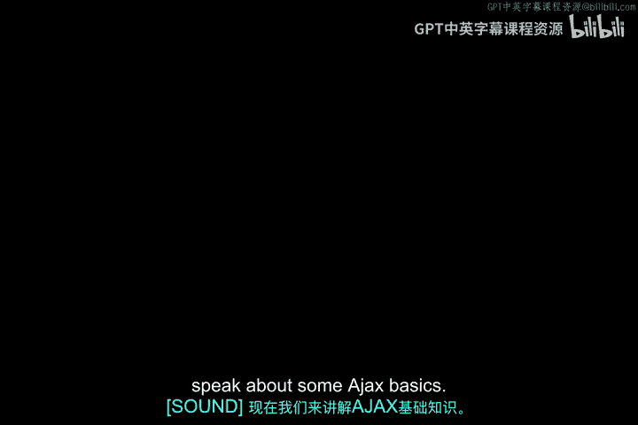
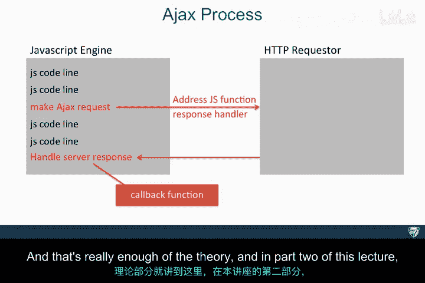

# 约翰霍普金斯大学《Web开发者的HTML, CSS, and Javascript》中英字幕 - P95：29_第57讲 第1部分 AJAX基础.zh_en - GPT中英字幕课程资源 - BV1WzY6z9EUd

Yeah。

So now we're ready to speak about some AjaG's basics。So what is Ajax exactly Well。

 the word Ajax used to stand for asynchronous jascript and Xml。 The thing though。

 is while Ajax started with Xml， and that was the data type that was being sent over the wire between browser and the server back and forth very few apps actually use it nowadays。

 instead， most of the time nowadays， plain text sometimes is just regular Hl and then JO。

 which we're going to talk about later， is used instead of Xml Now why does Ajax exist to begin with Well we can answer that question by taking a look at how traditional web applications worked and what their flow was like。

 a traditional web application started with a web page and usually a user is going to press a button and that is going to generate an Hp request that is going to be sent to the server and the server is going to respond with some response which is going to be a whole new page and that whole new page could be basically 199% identical。

to the original page and there might be only one string really that changed between the first page and the second page。

 but in the traditional web appflow， the entire page with all the same elements need to be returned anyway。

 just to display a minor update。Now in the AGX web appflow。

 you have a web page and it also makes an HP request that is usually sent by JavaScript and that HP request is sent by JavaScript。

 and the server also replies， and its response is a small piece of data that's inserted usually into the current page。

 and the only thing that changes is some minor piece of data。Now obviously this is way faster。

 the response is faster， you use less bandwidth because only a one small piece of data is returned and obviously it's a much nicer user experience as well Now before we go to the process of how AJX works。

 let's remind ourselves what is synchronous versus asynchronous execution since AjaX has asynchronous as its first wordd。

So what is synchronous execution first of all， well synchronous execution is execution of one programming instruction at a time what that means is that you can't start execution of another instruction until the first instruction has finished its execution。

😊，On the other hand， in the asynchronous execution。

 what that means is that it's execution of more than one programming structure at a time。

Asynchronous instruction returns right away。 It sends off its instruction and it's ready to execute the next one right away and the actual execution of that asynchronous instruction is really done in a separate thread or process。

 So at this point you might be wondering if ja is a synchronous language。

 everything in it is executed synchronously house Ajax even possible。 Ajax is asynchronous。 Well。

 let's take a look at a diagram。 While the ja engine lives in the browser it's not the only thing that lives in a browser。

 There are other component software components that also live in the browser。 For example。

 you have an event queue that is responsible for handling and queuing events like a mousecl or browser load or something like that。

 you have an HTML rendering engine that is responsible for taking HTML and knowing how to display it in the browser web page you have webgL which is responsible for letting ja reach。

😊，Out and do some really higherend graphics work and you also have another component that let's call it HP requester and that component is responsible for making Hp requests and while the jascript engine itself is synchronous HP requester is certainly not HP request is asynchronous so armed with this knowledge let's take a look at the Ax process So we have the jascript engine and we have this HP requester component and the jascript engine is going to have some jascript line of code being executed。

 that another jascript line of code being executed and then finally it comes to a jascript line that executes an Ax request So what happens at that point well at that point the Ajax request uses a special jascript object to reach out to the HP requester component and notice what I'm indicating here on the slide is that the next line of ja code executes right away the response of the Hp requester is not weighted on instead when we。

Make the actual AX request and reach out to this HTP requester component， along with our request。

 we pass in an address of a JavaScript function that is going to serve as the response handler for when the response from the other server or this HTP requester comes back。

However， meanwhile， we continue on our merry way and the ja engine keeps executing one line at a time at certain point it's executed all the code it can and its execution stack is empty if at that point the HP requester is done and has received its response from our server it may at that point use that address of that JavaScript function that we give it to start with and reach out back to the JavaScript engine and execute the handling of the response and that's the callback function that's the function that' is going to handle the server response so that's the basic AX process and that's really enough of the theory and in part to of this lecture we're going jump into the code editor and see this in action。

