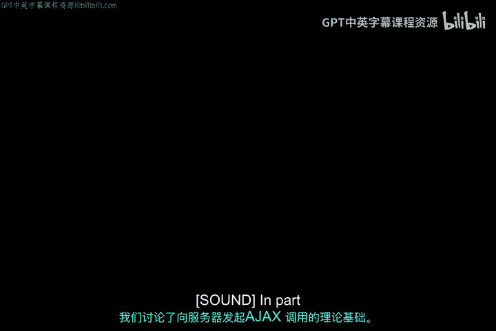
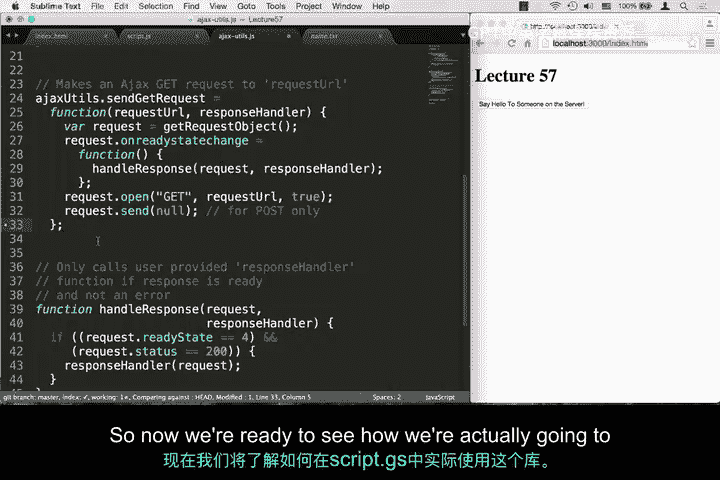

# 约翰霍普金斯大学《Web开发者的HTML, CSS, and Javascript》中英字幕 - P96：30_第57讲 第2部分 AJAX基础.zh_en - GPT中英字幕课程资源 - BV1WzY6z9EUd

Yeah。

In part one of this lecture， we spoke about the theory behind the AJX cult to the server。

In this part we're going to speak about the actual practice of it and show you some code to do it so right now I'm located in lecture 57 so that's lecture folder 57 and I'm looking at actually quite a few files here and there's a couple of new files that I want you to pay attention to number one is Ajax us。

js and this is the file which is going to give us the jascript in order to make those AJx code so we kind of separated it into a separate file so we could see the Ajax procedure in its entirety and then just use it inside the script dogs notice that in HTML the index that HTML I placed the Ajax ujs above。

😊，Js scriptgs is because scriptgs uses things inside of Axsgs which means that I actually have them I have to have them loaded in the browser already before I start using them inside So that's why inside Scrigs that's why I placed them above that Now unlike previous examples where we had the web page click and say hello to whoever was the name that was in the text box this time want to click and say hello and get the name of the person I want to say hello to from the server And for that I actually have something a little data file in the server it's sitting inside the data folder in name Txt and all it is is just says yaovn there's nothing else to it。

 It's just simple text file and I want to verify that I can access or grab that file or the data from that file through the browser while my browser sync is running。

By simply putting the URL in and saying data that's the data folder and it's named that TxT if I say press enterer and I see that that's exactly what gets returned。

 it's a very simple two word string so we could close that for now。Okay。

 so let's close the file Explorer in Sublime text and let's go to our AJxutils。js。

So the first thing I want you to notice is that I'm using the ifffy that immediately invoked function expression in order to wrap my entire code so it comes from all the way here if I scroll down all the way here and I'm passing it the window object that's my global object and that's how we remember it right here global and then what I'm doing is I'm setting up a namespace for my utility so this is Ax utilities and all it is is just an empty object so I can then attach things that I want to expose to the outside world and you could see the very first function here is not attached to my Ax utilities which means that when I expose AX utilities to the outside world meaning outside of this ifffy this function will not be directly available to the user of Ax utilities okay so let's go over what this function does first of all well it says it returns an HTp request object and what it does is it checks what type of object is available to us now the very first if right here is the most important one because this is the most。

😊，Current object or the most current version of the AjaX object there is the rest of them are kind of for the old browser so window that active X object that's something old internet Explorer browsers used and really is not used anymore and's if you want to you could really probably take out this whole thing out of here very few Microsoft Explorer browsers are there that are that old and the last thing is just just in case there's a browser out there that's going to access this that does not support AjaX at all which means this object will not be available neither will this object be available we're going go ahead and pop up a message and alert here on window object which is what this global is pointing to and we'll just say Aja does not support it not necessarily the best message to return but it's good enough it's probably never going happen anyway。

And instead of the object we'll just return null So a point is this is that object that we could use to make request and we're creating here a new XML HP request object and this is where we're going to use in our main function that we're going to write in a minute we're going to see in a minute and the reason we really pulled it out into a separate function is because it's just easier to put all these if statements in a separate place so we don't have to deal with it right in line with everything else Okay so let's take a look at the main function that we really。

 really care about。😊，So that function is attached to AGX Us as you can see I'm defining it as Axuts。

 send get request and what we're going to do in this function is we're going to send a get request to the server。

 so here's how this function is defined there's the function right there and I could see that I really need to put actually a semicollonent the end because this is just an expression right expression of the function。

Okay so let's see what this function is expecting as parameters number one is expecting the request URL Well that makes sense we need to know where to request where to go to make that get request on the server so that's the URL and we're need a response handler function So after the server response the response handler function is what is going to handle the result of what the server returns okay so those are the two arguments we expect to be passed into this function The first thing we're going to do is we're going to get that request object and this is just that function we just spoke about this request object right here so we basically are going to get this new XML HP request object So once we're done with that once we get this request object we're saving it in this local variable and then we setting this request object onready state change to another function So unready state change is a different stages in in the network communication between the browser and the server and we're going to see that in a minute。

SoWhat we're doing in this function is we're calling this handle response and the handle response function is past our request this request object and is past the response handler as well so when the server comes back with a response this is the function that's going to get called every time there's a change in communication state including the very final one that we're completely ready and here's your final response this is the function that's going to get called but we're not done setting up the request the other thing we need to do is actually go ahead and make the open command with a get request so that's the type of request we want that's the method of our request we're going to pass it to URL and we're going make sure to say true here and if you pass false here it will make this request a synchronous request which means the browser will freeze and wait for the response before doing anything else and we don't want that we want this request to be asynchronous in other words the second this request is made we want the browser to continue operating so in the last。

St here is actually to go ahead and send the request。

 So all of these lines right here were really just to set up the parameters of the request。

 what it's going be like。 and this line right here。

 the last line is actually the one executes the request and sends it to the server The reason we're passing an null here is because if this were a post request our parameters request parameters would not be part of the request URL as you remember from the previous lecture but actually we part of the body of the request and this is where you put the body of the request。

 So if you wanted to have name value pairs for the request parameters。

 you would put that string right here or probably save it an object and then kind of paste that whole thing in here Now let's take a look at our handle response function that we provided here So the handle response function you could see takes our original request object and the response handler function that our client meaning our user whoever is using this whole library this whole Axt2 library is。

For us so we're kind of doing some kind of neatty greeditty work that they wouldn't have to do anymore。

 number one is request that ready state。 we want to make sure there's four states in in this request already number one we want to make sure where the last state so it is ready to go we don't have any other lower levelvel network communications going on and what they are really not important but what is important is that you have to check whether or not it's ready state for that's number one and number two is we want to check that our request that status is 200 and this 200 is that response status code that we spoke about previously so 200 means everything's fine and here comes your response and if those two conditions are true only then should we then take the response handler that is the function that the user of this library provided for us and then we could go ahead and pass at the request that the user of this library will start pulling out of this request the response of the server so that is how this response handler is being used。

The last but not least is we want to expose this utility to the global object so we can actually use it and what we're going to do is we're going to change the name of it a little bit。

 we'll say global dot and we'll use the dollar sign because we want to be all fancy obviously dollar sign Ax u so just like jque uses dollar sign we'll also use the dollar sign as part of our variable So dollar sign Ax utilities that's what's going to be exposed to the global object is going to be equal to our Ax u that is the local objects right here in this iffy in this immediately invoke function expression Now I hope you're wondering at least a little bit as to why this crazy setup is being made right here unready state change we're passing it a function expression so we're not executing this function we're just passing the value of this function not the return value but just the value of the function object and we're setting it to this property unready state change and inside of that we calling handle response and that is what is going to get executed since you could see the parentheses around it。

😊，Simply erase this and happily call well we're not going be able to fit in one line here。

 but happily call of this function right here Why not have onread state change equal to handle response Well first of all we need to equal it to a function value not the return of the function so this would have to go away you can't really pass parameters into a function value only when you're executing a function can you pass parameters into it and we're not quite ready to execute this function。

 which is won its value when if we did that this function right here wouldn't really have the request or the response handler available well one way we could take care of it and unfortunately and you'll see why I'm saying unfortunately a lot of people do take care of it is by doing this we could just take the line out of here and make it a little bit more global。

And now our request is available everywhere。 so it doesn't have to be part of these parameters。

 part of these arguments， we could just pull it out of the global part outside of this function。

 And obviously we need to take care of this as well to make it valid syntax。

 So let's take a look as to what we've done。 What will happen now。

 let's say somebody on the page click some button that invokes this send get request。

 This will go ahead and use the request that already has been gotten right here。

 which seems pretty good。 We'll assign handle response， though already stay changed。

 That's that function。 and go ahead and make the request。

 The only thing is this handle response also really wants at least in our case once the response handler function and we're not passing that but that's easy to be remedied by just saying v my handle response。

😊，Or my handler is equal to and we will just equal it to this right so not to do that。

 we could just say this is equal to equal to nu。And once we're done。

 we could just say my handler is equal to response handler。Okay， so now it all it's all complete。

 so at this point， this handle function， handle a response will be able to get the request and we'll also be able to get the response handle so we really don't have to have these arguments to this function the problem is is that this whole thing is being called asynchronously remember with asynchronous means it means that more than one thing it be executing at a time which means once we send this request off and the servers waiting to respond。

 it could wait two，3 seconds before a response。 Well meanwhile。

 either the user or some other ja process can call this again and if it calls it again it' going to end up using the same request object as we use for the previous request and therefore they will crisscross get confused and the response you're going to get is probably not the response that you were waiting for and what you will have is what is called in computer science a race condition In other words there's some code。

is going to be erasing another piece of code and whoever wins is going to override this with its data。

 but the second one will never be able to get to it or will give you the wrong data So this is really going to be a gigantic mess so let's go ahead and do a bunch of ondo。

😊，And put it back the way it was so now we're ready to see how we're actually going to use this library in our scriptgs and that's what we're going to do in part three of this lecture。

😊。

