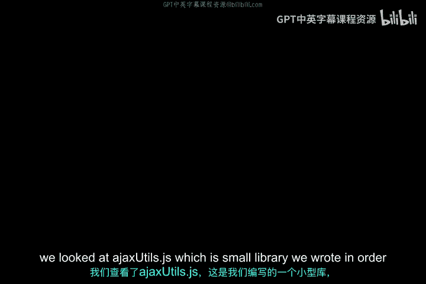
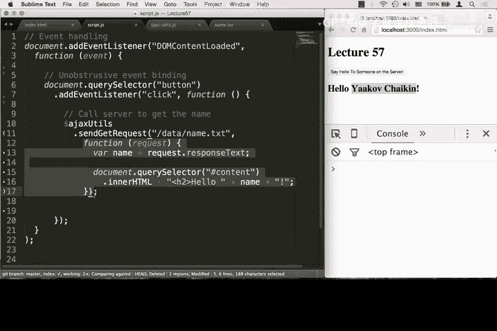

# 约翰霍普金斯大学《Web开发者的HTML, CSS, and Javascript》中英字幕 - P97：31_第57讲 第3部分 AJAX基础.zh_en - GPT中英字幕课程资源 - BV1WzY6z9EUd

Yeah。

So in the previous part of this lecture we looked at Ajxuts。

js which is a small library we wrote in order to make Ajx request to the server and process the response at least somewhat by being able to give our user the user of our library that is and in this case its just us the use of our library to be able to give them the ability to give us a function that he'll be able to pass to us and we'll then get cold when the server returns the response so right now I'm located in script。

js which is located in lecture 57 folder so let's go ahead and close the file Explorer of sublime text and let's take a look at our script。

js again just as a very tiny review Ajxutils。js is where we're defining our Agxuts object to which we have one thing attached which is send request and again send request is expecting a request URL and it's also expecting a response handler function so we're passing in a value of the function and a request URL so let's go ahead and go to our script。

js。see what we're doing here The first thing we're doing is we're adding an event listener for DOm content loaded。

 so which means this only going to execute when the page is loaded all the HTML content but hasn't yet loaded all the CSS or pictures and so on we don't really have any pictures So either way and then what we're doing is if we take a look at our HTML we have this button right here and that's the only button in the entire HTML when we're doing is we're unobtrusively attaching an event binding to that button So we're doing document that query selector and we're saying the button and that's the only button in the document so therefore that's the only one should get returned and we're adding an event listener waiting and click event listener So when the user clicks that button we want't this function right here to get executed So let's say what we're doing here Well first of all we're setting var self equals this and we've seen this before。

😊，So and I'm setting up a name at this point is going to be an empty string and then I'm using our Ax tools to call the server to get that name so I'm saying Axut remember we set it to with a dollar sign let's take a look at it we bound the dollar sign global global sign Axut to our Axut object so the Axut that send get request and we're providing it the URL so we're giving it the URL of slash data slash name that Txt and it wants a handler function remember the response handler function that takes a request object is going to have in it our response from the server it's a little bit weird in javascript that the response object is still called the request but it is so we is going to continue doing it so the function is again we' defining it in line we're not providing a function value but it's an inline function expression and we're saying that this name right here should be return self。

That name that's the name right here and we want to request that response text so request that response text or the response text property of the request object is what holds the response from the server so we want to save that response straight inside solve that name once we called the Ax utilities and send this request now that the name is set we're doing a query selector on the content and remember the content in index index that HTML is just this empty div placeholder so we're calling this content and we're using the ID of that content and we're saying that inner HTMLt should be H2 hello plus self that name that's that name right here。

Plus the exclamation point， so it should say hello and yaakov Hin atan。

 so let's go ahead and save that and let's go to our page and open up our ChromeDevelop tools so we could see the console just in case and let's go ahead and click this button and see what happens。

H not quite what we expected right， says hello and there's nothing there。

 Let's verify that the server communication worked。

 Let's go ahead and print out the self let's do a console。😊，That log。

 And let's print out self that name to see， make sure that self that name actually contains the words yaakkov hhen。

 Let's save that。 Let's go here and we'll say hello again and as you could see yakov hin is returned。

 So what's going on， Why isn't this outputting Ho yakov hhen。 Can you tell what we did wrong。Well。

 what we did wrong was forget that this is an asynchronous call so what's really going on is when we're executing this call right here send request it goes ahead and executes this call and it immediately returns and goes and executes the second line right here remember that visual from the previous lecture that I showed you when the AjaX call gets made to the server the very next ja line gets immediately executed it is not going to wait for the server to respond before it executes this next line and that's because this call is asynchronous so what do we do in this type of case well what we do is we actually have to put all the functionality that is functionality that's based on the response from the server inside of our response handler so we really have to take this whole line out of here cut it out and we'll go ahead and erase our console。

😊，And we'll put it right here。And thats the whole line is going to have to be right here and in this case we don't really need self anymore do we we don't really need to have kind of a global or outside of the lexical scope name we can erase all this and we we just do var in here and say var name equals request that response text and then we're just doing a query selector we don't even need self here either In fact let's see if it actually fits on the next line and it does so we're just saying hello name exclamation point and that's really all that our function or response handler function is supposed to do so right let's go ahead and save that and now when we go to our browser and click hello we actually get hello yakov hikeken and this string yakov hken is coming now from the server so we made the full round circle from setting up the Ax U to making a code to it and remembering that is an asynchronous call so if we're expecting something from it we really。

😊，can't do this after the， we need to do everything to handle that response inside our callback function。

 which is what this handler callback was about。

