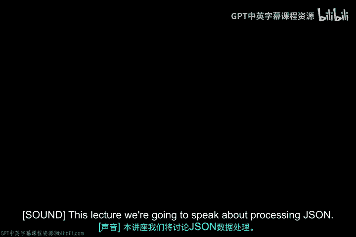
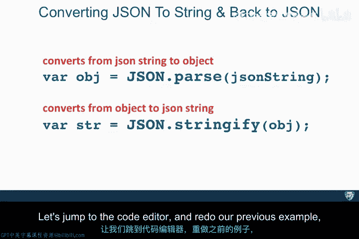
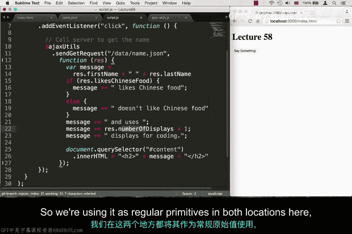
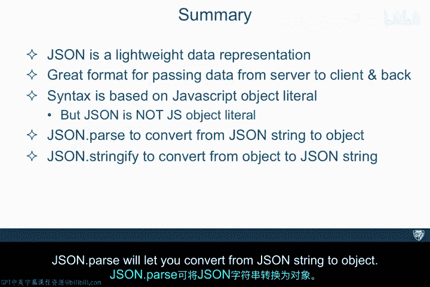
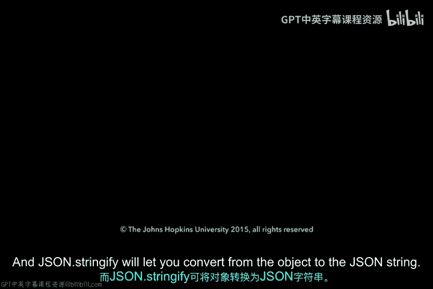

# 约翰霍普金斯大学《Web开发者的HTML, CSS, and Javascript》中英字幕 - P98：32_第58讲 JSON数据处理.zh_en - GPT中英字幕课程资源 - BV1WzY6z9EUd

Yeah。

In this lecture， we're going to speak about processing JO and J is a format that is used pretty widely。

 especially when we speak about passing data between the server and the client。So what is J well。

 Jason stands for JavaScript objectject notation and what it is it's a lightweight data interchange format and this is I'm taking this directly from Json。

org。And it is simple textual representation of data can't really get any simpler than this and it's great for a couple of reasons number one is it's easy for humans to read and write JON and it's easy for machines to parse and generate JON so in a lot of sense this is very similar to XML because it also was pretty easy to write for machines and for humans to read and write。

 but J notation is quite a bit simpler and shorter。😊，And most importantly。

 it is just like XML completely independent of any language any programming language so what's the J syntax rules well they're pretty simple number one is it's a subset of JavaScript objects literal syntax but with a couple of exceptionions number one is the property names must be included in double quotes and the string values must be in double quotes as well。

And that's it。 There's really nothing else to it。 syntax for everything else is exactly like for object literal in jascript。

 Let's take a look at an example。 So here I have an object literal。

 What looks like an object literal but you could see that the property name is included every single property name is inside double quotes。

 and any string values have double quotes around them as well， not single quotes but double quotes。

 All the other value like falses like a number are listed in the same way you would list them in an object literal。

 So this is the typical string that would really go over the wire from the server to the client。

 But even if you're in the browser and you're in your jascript program。

 You could certainly take the string and store it inside a variable。

 All you have to do is put single quotes around it。

 And the reason you put single quotes around it is because you already double quotes inside of that string。

 So this is no different than any other string that you would have in jascript。

 which brings me to a common misconception about。😊，JON is not a JavaScript object literal。

Jason is just a string。 The syntax of JON is based on object literal， but it is not one and the same。

 If you wanted an object in jascript， you would have to take the JON string and convert it to an object and similarly if you want JON you would have to take an object and convert it back into adjacent JON string JavaScript provides a couple utilities for that number one is if you wanted to convert from a JN string into an object you use this JON dot parse function and backward if you wanted to convert from an object to a JON string。

 you use JON do stringify method and yet since we're in computer science where allowed to make up completely arbitrary English words stringify there you go。

Let's jump into the code editor and redo our previous example with JSON coming from the server instead of just a regular string。

Okay， so we're looking at name that JSON file and it is located in lecture 58 data folder and we basically substituted the name that Txt with this name that JSON and this has what looks like a regular object literal except we know it's just a string it's a string that is sitting on the server and you know it's JSON since you could see all the property names are in quotation marks and the strings are also in quotation marks and they are both double quotes so this is the same string we actually saw in the slides。

Let's go ahead and go close the file browser and go to our Axutils。

js and what we're going to do is we're going to enhance them a little bit when we say send date get request。

 we're going to provide one more argument called is JsonN response so we want to preprocess our response in Axutils。

js instead of having to process Json。 parse every time inside of our custom scripts so let's go ahead and do it once so what we're doing here is we're saying is Jason youre as a client of this code we could pass it a true or false or just omit it and it will automatically if you omit it at automatically assume that you want Jason but you could pass a false in here and that will work as well and onread state change property which is going to go ahead inside our anonymous function our closure we're going to pass this is Json response into the handle response function let's go ahead and take a look at this handle response function because it got updated a little bit so now we here passing is JsonN response。

After we figure out that it is time to handle our real response。

 we're going to first check whether or not we need to kind of default it to true So if JON is JsonN response is actually equals undefined then we want to set is Json response to true so if nobody passes us anything will just default the response to be true and then we check that if Jason response is true then the response handler is going to be passed when we execute a response handler that the client of this code in other wordss also us but a different script Js is passing to us here the response handler function we're going to pass to the response handler function is actually going to be already a parsed response is's going to response that text we're going to parse it using JON that parse so what response handler function is going to get as its argument when is going to get called is a JON is a parse JsonN string which at that point will be an object it's going to get a jascript object and in the else if they want。

not to have Json be handled in this response handler which is gonna get them the actual response text and they can handle it whoever is the color of this can handle it however they want。

 Okay so let's take a look at our script Js scriptjs now has the same call as before except this time what we're getting as part of our response handler is not any longer a request it's actually the response Json text that was converted into an object。

 So this res Re response is actually a javascript object So we can now start building up our message。

 So here we're saying Re first name plus re dot last name So we're able to use it just like you would use any regular ja object and in fact we remember that we had a property called likes Chinese food if we take a look at name that Json likes Chinese food was equal to false So we can actually use it inside of statement like a true or false value likes Chinese food。

And it will properly resolve to false in this case because that's what Jason named that Jason returned and message will be said does not like Chinese food。

And the message will continue to be appended to， and finally we could say number of displays。

 and this is supposed to be a number a real number so if we wanted to say something else like plus one。

 we can， but right now let's leave it alone。And when we do this here。

 we can finally say the final message and we'll select our content， which is our。

Wwhichch is our di placeholder in the index HTML page and we could go ahead and put that message in between the opening and closing H2 tags so let's go ahead and do this let's save this and let's go ahead and click say something。

You can see it says yaakov hikingking does not like Chinese food and uses two displays for coding so we could change that。

 we could go to JON name that JON and change that to true to see this in action and we can even change this to say that displays plus one so we're using it as regular primitives in both locations here but we're using it through this RES response object that JON that parse built for us so as we save all that and go back and say say something it says yaov Viking now likes Chinese food which is definitely closer to truth and uses three displays for coding because we edit to the two that was responded to by the JSON and was converted into a number we edit once so now it's three。

So to summarize， JSON is a lightweight data representation。

 it's a great format for passing data from the server to the client and a lot of times back as well from the client to the server。

 if you wanted to give it some more descriptive data。

 the syntax of JSON is based on JavaScript object literal。

 but please remember JSON is not a JavaScript object literal， its just string。

JN that parse will let you convert from JSON string to object。

 and JN that stringify will let you convert from the object to the JSON string。

