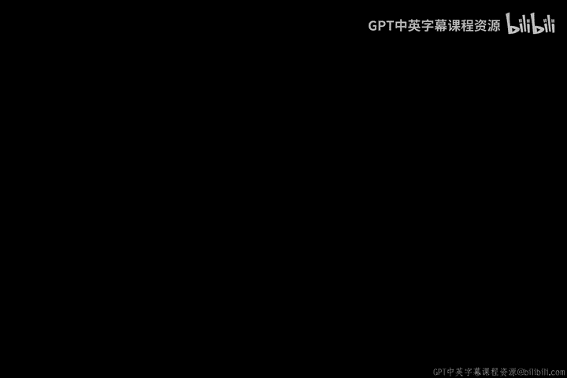
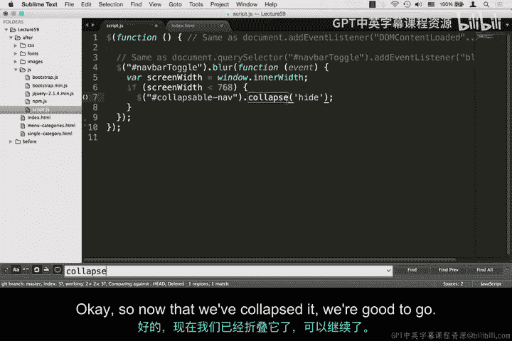

# 约翰霍普金斯大学《Web开发者的HTML, CSS, and Javascript》中英字幕 - P99：33_第59讲 修复移动端导航菜单自动折叠.zh_en - GPT中英字幕课程资源 - BV1WzY6z9EUd

Yeah。

Okay， so now we're back to David Chohu's China Bistro website again and now that we're armed with JavaScript。

 we could do some really neat things with it。Number one is let's go and fix the issue that we left over for the ja part that we couldn't fix before and the issue was this if we squeeze the browser and turn it when the button over here comes up that the menu is now is a collapsed menu and if I click on that the menu comes up but if I click anywhere here I really expect that the menu should collapse by itself but it doesn't so what we need to do is we need to attach and event handler to this button that after we click it the second button loses focus which means I will click right here somewhere so in other words in the jascript event handler speak。

 it's the blur on blur on blur means that the particular element loses focus okay so how do we achieve that So first of all we need to figure out when to do this right we obviously don't want to do anything similar to this on blur when we dealing with these big buttons we only want to do this when。

It becomes this collapsible button， so if we actually turn on the Google ChromeDevelop tools。

We'll be able to tell what the size is and it's very clear that the button comes up around the 7606860 something like that and that's a breakpoint obviously that we had and we've established before so let's go back to our code editor and right now I'm located in lecture 59 in the after folder that's where I'm going to be working from and the before folders again is a copy of the after folder the last time we left over the David Chohu's website in the state that we left that over that's where this before folder is the contents of the before folder R in so what we need to do is we need to go to our script。

js file and I have some code here that I prepared for this particular lecture that we'll go over right now。

😊，Okay so the first thing is we need to do something on blur Well I'm going to talk about this in just a second。

 but before we do we really want this functionality to start when the DOm content is loaded well the thing is is that we would love to do just straightforward ja but we can't because we need to use the jQury library because the collapse menu was what we're trying to do here is a plugin that is based that is hosted in Botrap dogs Botrap mean dogs and it's based on and it's dependent on jQury so can't really avoid this jQury library at least for this particular piece and even though this course doesn't really include jQury library you're certainly now equipped enough with ja to understand what's going on So let me go over in some detail as to what's going on here the jQury function name is actually dollar sign that is exactly right the name of the jQury function is dollar sign so what is's happening here is theres。

A dollar sign and then something is being executed as you could see the opening pars and a closing parent。

 So we're executing a dollar sign function against that。

 Well what that does in jQury dollar sign function is it's the same thing as the document add event listener Dom content loaded which means anything inside of this function that we provided in here that's what that dollar sign function expects in this type of scenario that if you put a function inside of it。

 what's going to happen is it's going to get loaded or this function is going to get executed when Hl has been processed but before all the images and extra resources have been loaded So this is exactly basically the Dom content loaded event So this is what when this code is going to get executed it's really as simple as that So now let's take a look at what's going on here Yet again we're reusing this dollar sign function Well the jquel dollar sign function also has another functionality in that it serves as a。

So if we put something in quotes inside of the pars after the dial sign that becomes or that serves as a selector。

 So really this statement right here is no different then this statement right here that I wrote in the comments。

 which is document that query selector then pound sign nav bar tuggle。

 So what we're doing is we're selecting an element with an ID navbar tuggle。

 And if we go and look at our HTMLl let's go ahead and copy that and look at our index that HTML and let's search for that。

 So this is our button right here， the nabar tuggle that's the button。

 So if that button loses focus and as I told you that means on blur and on blur just means do blur。

 which is exactly pretty much the same as we would do here once we would select it in regular jascript we would say add event listener and blur is the event。

 So this is what basically we're doing here。 we're saying that blur when that happens。

 I want you to execute this function。Right here and this function just says the following。

 I want to first grab the screen width and you see we're doing window that inner width。

 which means it's the width of the browser window itself。

 not the entire screen of the monitor and then if the screen width is less than 768 So we basically checking if we're within that break point where the collapsible button shows up if that's true and that button lost focus what we want to do is again select collapsible nav collapsible nav is that menu and we could take a look at it right now we go to index HTMLl and search for collapsible nav and there it is。

 So this is the collapsible nav。 So you could see this all our menu items right here So point is if we select that and we'll apply this function called collapsell with the value of hide Now this collapsell function。

 and if you copy and we'll go to bootstrap and we'll search for it in here there's the。😊，Collapsegs。

 so this whole thing is coming from inside bootsottrap， but it is a plug to jQury。

 so we can't really avoid jQury， unfortunately at least for this course or fortunately。

 I guess you you now learned a little bit something new Okay so now that we collapsed it。

 we're good to go and if we save that right now and go back to our browser and now if we squeeze the browser to have the button show up if we click on the button。

 the menu shows up。 but if I click anywhere else， the blur event will fire and this whole menu should collapse if I click the menu collapses Great So now we're done with that little nugget and we're ready to move on to make the main part of our web page become much more dynamic。

😊。

