# 约翰霍普金斯大学《Web开发者的HTML, CSS, and Javascript》中英字幕 - P9：8_第4讲 HTML基本文档结构.zh_en - GPT中英字幕课程资源 - BV1WzY6z9EUd

。

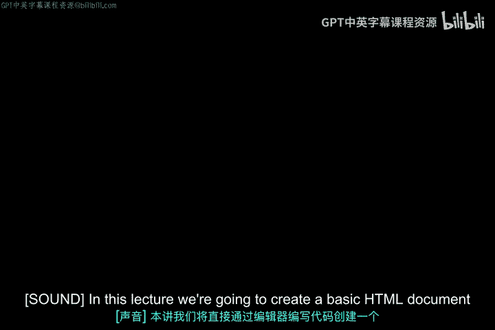

In this lecture， we're going to create a basic HTML document structure by going straight to the editor and coding one up ourselves。

 and then we'll validate it on the W3C web valididator site。😊。

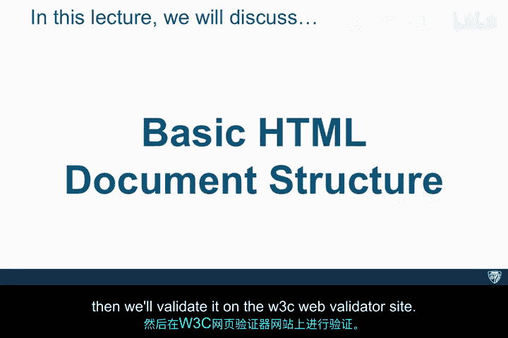

Okay， so I'm in sublime text and I have a document open a file open called doc structure dash before that HTML and it's located in the examples lecture04fold so we have a blank slate in front of us and we can create our very first HTML page so every HTML page should start with the doc type or document type declaration The words doc type or HTML could be in lower or uppercase the only thing you have to watch out for is that there shouldn't be any space between less than exclamation point and the word do type you can have as much space as you want everywhere else。

 but it just doesn't look that great so we'll just keep it to one space。😊，In the past。

 these declarations were pretty complicated looking。

 Certainly not too many people would be able to type them up without copy and paste。 HTML 5， however。

 changed all that。 Now， the declaration is as simple as it can be。

 All it does is tell the browser that it should get ready to render HTML Now。

 I know what some of you might be thinking What else would there be if not HTML。

 There doesn't seem to be any practical purpose for this declaration。😊。

If you're thinking that you're absolutely right， this declaration is really largely historical when HTML standards were first becoming popular。

 the web was full of pages that were not compliant to the standards to help browsers render those older pages correctly。

 browsers use theduct type declaration to distinguish between noncompliant and compliant pages。

Non compliant pages were rendered in what's called thequirks mode。

 and the compliant pages were rendered in what's called the standardss mode。

Now that's all historical but what you need to know today is that if you leave off the HTML page declaration that will signal to the browser that it should treat your pages as one not following HTML standard I'm not going to go into into what that actually would mean in practice but needless to say things will be a bit messed up your layout wouldn't work quite right。

 the styles you apply would work a bit well quirky so to make a long story short。

 always use the simple HTML5ductact tag declaration。😊。

Next goes the HTML tag and that's basically a tag that contains the entire HTML document after the HTML tag goes the head tag the head tag contains items that describe the main content of the page things like what character encoding should the browser use for the main content it can contain author's description of the page page title and whatever other external resources are needed to render the page properly among other things。

 The point is it contains some metadata about the main content Let's write our first meta tagag to specify the character set encoding of our web page while not absolutely required it's always a good idea to specify the character set that the browser should know how to interpret the content of the web page the most commonly used character set is UTF8 Also note that the meta tag is a standalone tag there is no closing meta tagag Next will specify the title of the page the title is one of the tags。

😊，That is actually required to be here Without it， the HTML will be invalid。

After the head tag goes the body tag， the body tag is the root of all content that is visible to the user。

 it is often referred to as a viewport， we can now write our content。😊。

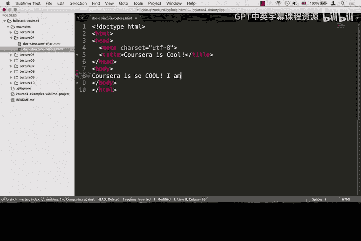

Okay， so let's take a look at how this looks in the browser。Okay and here's our page。

 you could see the content Courses are cool， I'm learning so much and you could see that the title Coursera's Co is also there next let's try to take the code from our page and copy and paste it to validate it inside the W3C validator。

😊。

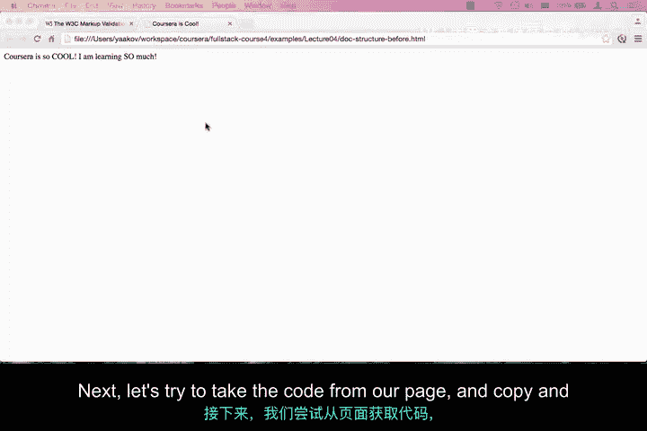

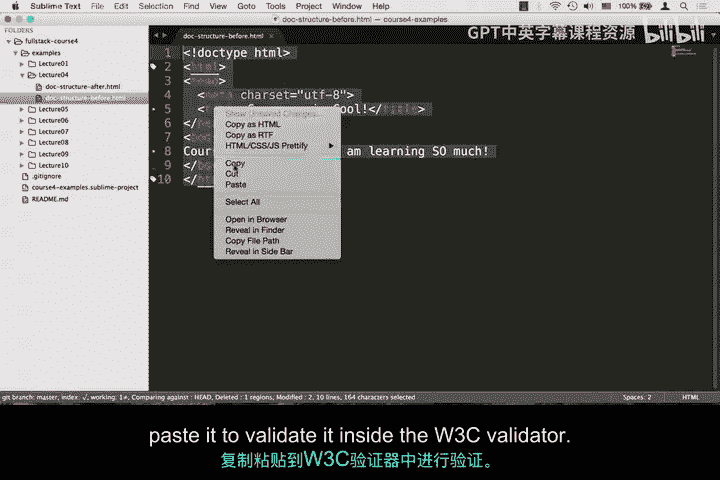

And it says we're valid。

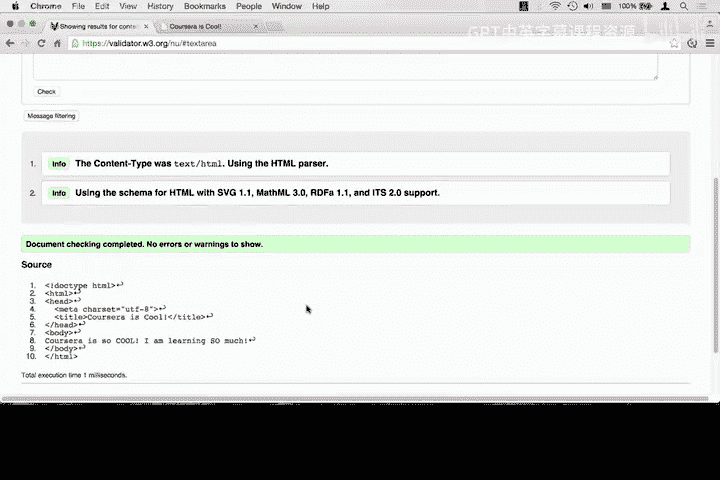

I'm sure you've noticed by now that what we're doing is nesting one HTML tag into another。

 so for example， we could say that the head tag contains the title tag。😊。

One important rule when nesting HTML tags is that you have to close the last opened tag before you close its parent tag if you don't the HTML you wrote is invalid。

 so for example here I have a paragraph and don't worry about what these tags mean at the moment。

 but the paragraph tag P is closed before the last open tag span span is closed after so if we copy and paste this code and place it inside our validator and check it。

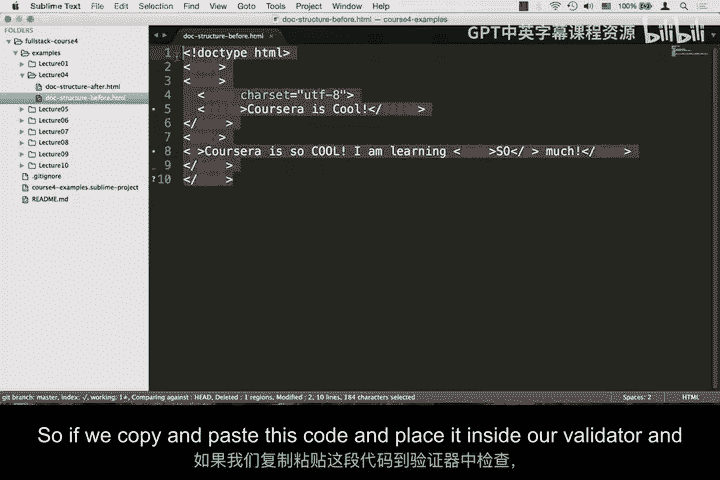

You'll see that it's complaining and saying that the antag P seen， but there were open elements。

 in other words it wants us to close the span tag， which was opened last before we close the outer P paragraph tag。

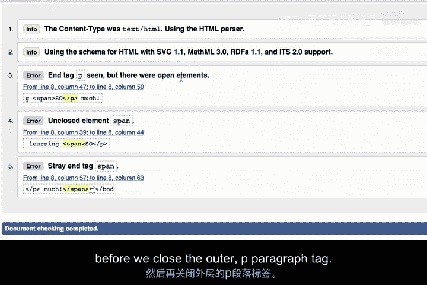

One more note before we move on， when the browser opens an HTML page。

 it always renders or interprets the HTML code sequentially from top to bottom。

 so the doc type declaration gets interpreted first， then the HTML tag。

 then the headtag and on and on until it hits the last closing HTML tag。

This will be important to remember as we progress further into the course。

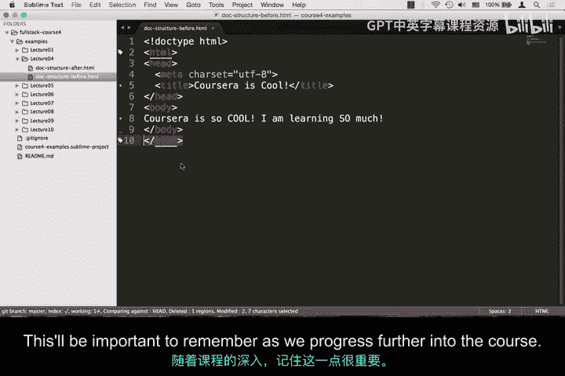

In summary we went over the bare minimum HTML document plus weight at sum we went over the HTML version declaration and remember we always have to use it otherwise the browser will be put into quarks mode and some things will break our first HTML tags we use the HTML metahead title body and actually throw in some paragraph tag as well we went over the fact that HTML is rendered by the browser sequentially meaning top to bottom and it renders it top to bottom as well Next we're going to talk about HTML content models。

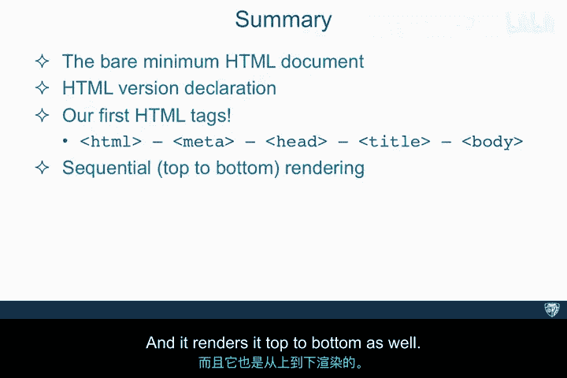

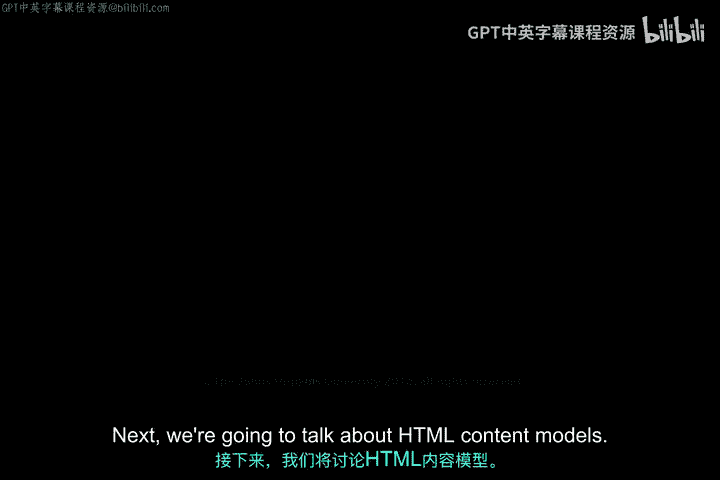