# 【Jonas-Birch】使用C语言从零编写Ping-｜-Ping-From-Scratch-p01-P01_01_用C语言从零编写PING程序--BV1rwBTBUETy_p1-

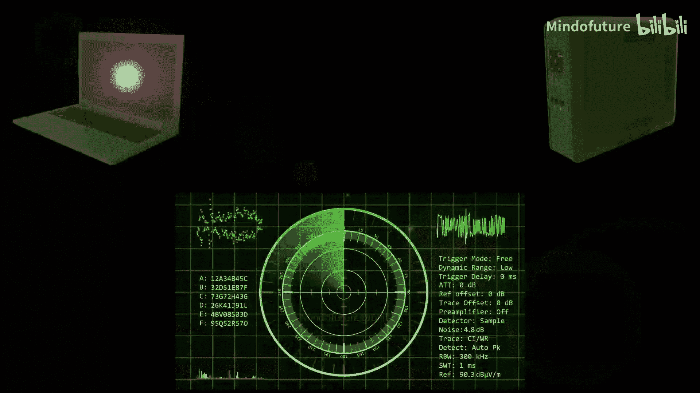

Sub guyss， welcome to today's show。So today we're going to code our own ping。

So ping is a program which sends a packet。To another computer on the Internet。

And it receives a packet back。And that the will。Test the connection like this。

So here I sent five packets and I got five packets back。 and in that way。

 I know that the connection works。So this looks a little bit differently in Windows。

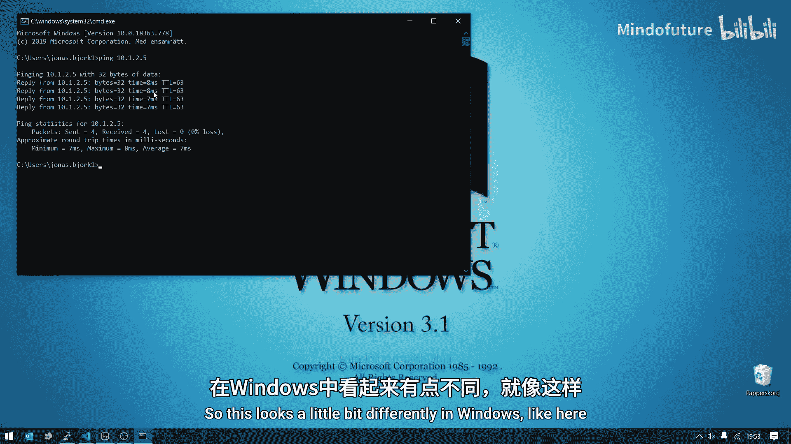

Like here。诶。And in Linux， it looks。Something like this。Pretty similar。But I wan。

 I like how the cisco routers do the p because it's pretty。 well， it's not very bloated。

So if I log into one of my Cisco devices。Look log into my core route。And this is a Cisco CSR。

Which it says right here。But it looks the same on every Cisco device。

 So let's say I ping the same IP address。As you can see。It send one of these or it print。

 one of these exclamation points。 If the packet was successful。However。

 if we were toing something which is not there。Then we can see that it sends one packet。Per second。

 And it。In this case， it does not receive any back so it times out。

 and that is shown by a dot like this。So these are the only thing。I want to print。

And how do we do this， Well， I want to do this really low level。

 I want to create something which is called a bra Ipiece saw kit。

Which basically means that my program will receive every IP packet。Well on the network。

 local area network， basically。诶。And then I will filter out everything which is not interesting。

That is my intention anyway， and there's a really good man page if you do 7 row。

Then you get this Linux IPV4 Ro Sockets API。And。It's rather easy actually you just call this socket to create one and then you get a file file description back。

 So you say AF Inet sock stream and then you can optionally define a protocol so let's say I define I want to have TCP packets then I put the protocol number for TCP here and it will filter so we only get TCP packets。

But I want to get all packets and then do the filtering myself。So that's a general idea。

 And then you can use the send message function， which looks like this。AndSo you pass it。

 the socket file descriptor that you just got。Then， you send。The this， the message。

This is their whole packet。Including IP headers and everything。And。

And then you can optionally specify some flags。All right。

So let's start this the same way as I usually do。I go to my TMP directory。And I use。BashPS。

 which is my program for just creating a template。

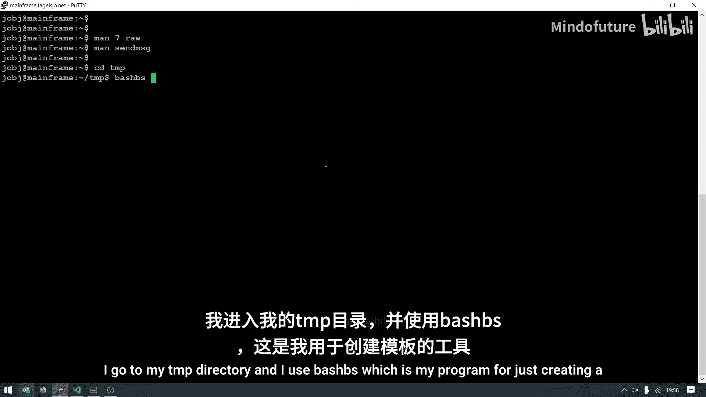

So I don't have to cold everything。From scratch every time。

 And you can find this at the repo in BshPS S。 I also have an entire episode dedicated to that。

 which is called C a build system or something like that。

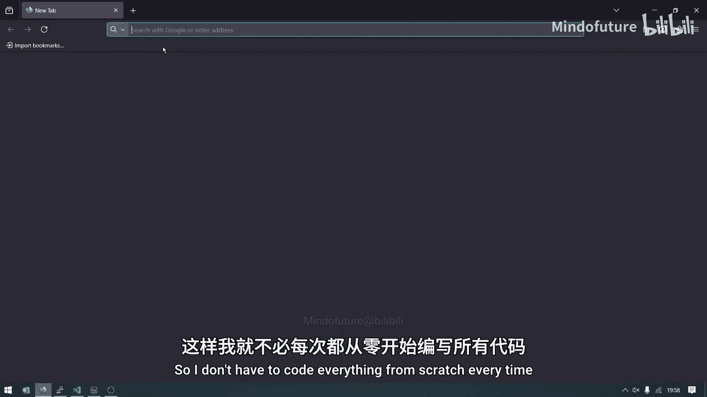

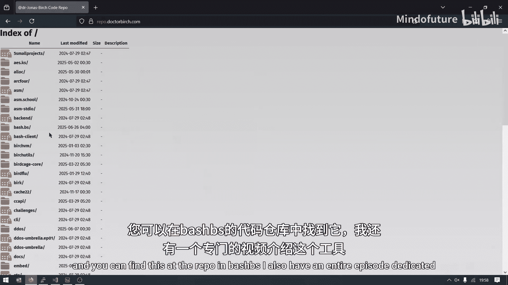

All right， so I'm just going to call this project Ping。Oh， I'm on the wrong machine。 That's right。

Let's go back to Intel 32。Screeen。Andmbsh BS P， and I want to select the default C template。😔。

So now I have a ping directory。Which I am going to set to my home。And by the way。

 I have never used Roa socket before。 I have used a lot of T P。Socketss and some UDP。

 but never any raw sockets， so。Let's figure this out together。😔，Allright， so I'll go to this ping。

And opened in Ed。That way， I would be able to remotely code this thing。

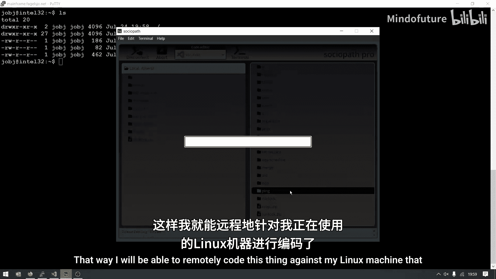

Against my Linux machine that I'm using。 But I think this will be rather portable， actually。

 so you can probably run it inside of your Windows machine。Okay， so now we have this。Fles。

 and you might。Depending on your version， I'm going to set this to C23。

 you can keep it at C2 X if you don't have the latest Gcc version。

 and if that doesn't work either just remove this STD parameter。And then we have ping dot C。

 which is basically nothing。 and then ping dot H， which just includes my bi。

 which you also find in the re bow。Just a couple of utility functions that I use quite a lot。

And then you have some type definitions for different integers， and you have macros for casting。

But I'm gonna change these too。 So this is  one by，2 by，4 by，8 by。Like桑。Okay， so what is a pink。

 P is an ICM packet。So it sends an ICMP0， I think， which is pink。And it receives back in ICMP 8。

Which is paying reply。And these the real names for these are echocho。And echo reply， I think。

But usually it's called pink。So we need to figure out how to create one of these ICMP packets first and foremost。

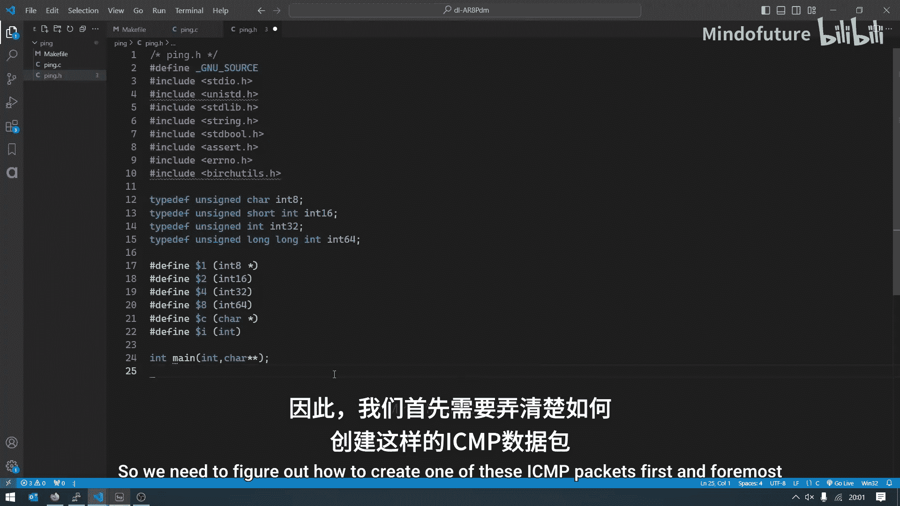

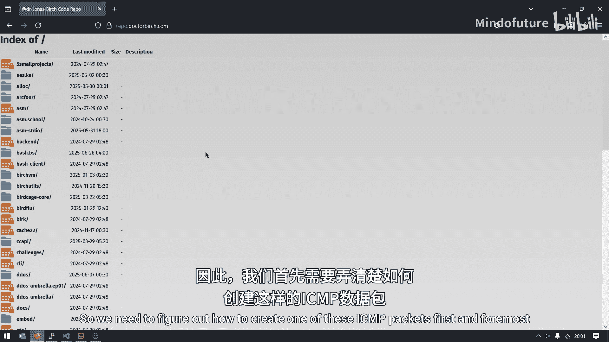

So let's consult Wikipedia if we search for ICMP and we can。

And we go here。We go to the details herey what what it is， it's not that complicated。

Let's make it a little bit。Okay， it doesn't really fit。😔，And。Okay， so we have a type field。

A cold field， a check some。And the check sum is just some mathematical formula to see if the packet has been broken on。

On the way to the computer。And then we have the rest of the stuff。

 So this is depending on the type of ICMP。So let's check this list。 Okay， I've got it mixed up。

8 is the echo request。 So this is the ping。So ICMP 8 is the ping and ICMP 0 is the ping reply。

And we set the type failed to this。And the cold field with set is zero for the echo reply。😔。

And for their ping， we set it to 0 also。So this will be zero。诶。This would be either zero or8。

AndAnd what else， let's see the rest of the header。What do we put in there？m。I actually think。似。

I think we can post whatever inside of there， actually。This page doesn didn't talk a lot about。

The echo。But。I think so， so let's try that。And as we can see， this is so one of these lines。而。32 Bs。

 So4 Bs。So we have a four byte header。And then， we have。诶。The rest of the packet。

 So let's make it easy to make this4 bytes also。诶。And here， we can just put。

The word ping or something。So let's create a data structure for our ping。

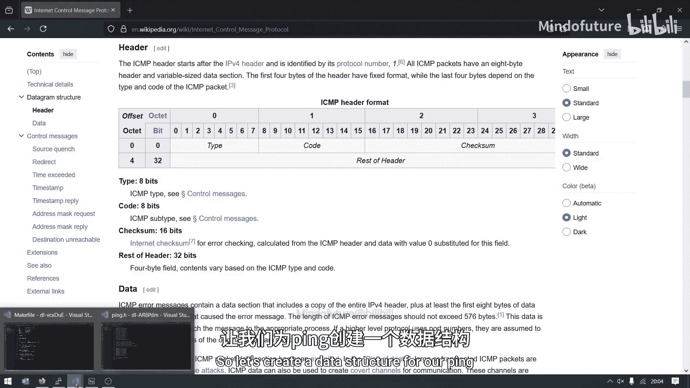

And there are those。What's this now。Oh， I have an old project here。 Let's close this now。

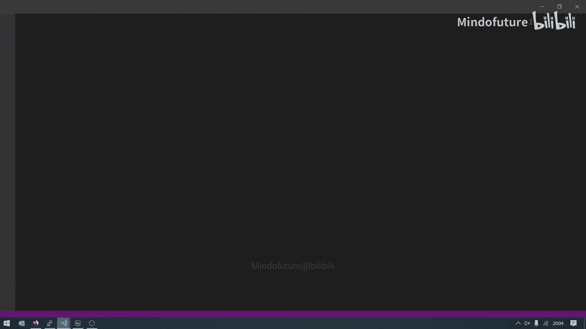

I was experimenting a little bit， with arm assembly。

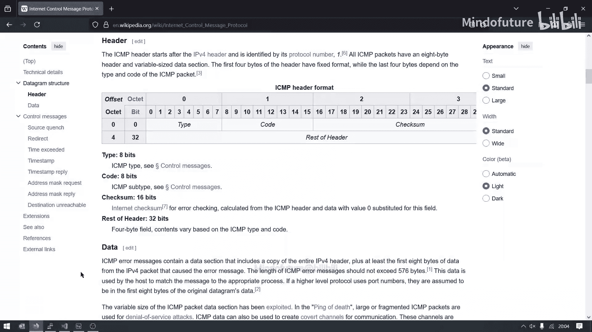

So there is already some implemented ICMP data types and stuff。

But I wan to create my own with with only the bear。Essentials。So。Let's create。Itsstruct。

Let's call it S。Well。Let's say， ICMP。mabe we want to add more i sent p messages later。

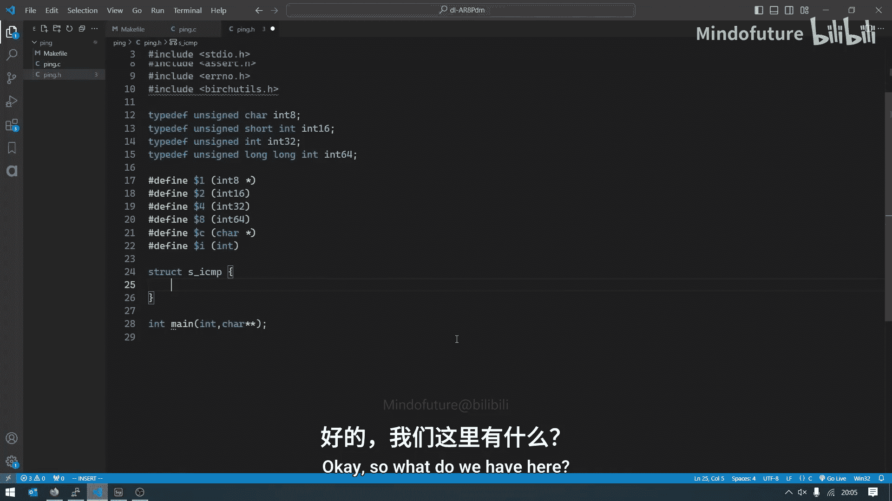

Okay， so what do we have here。 First， we have a。8 bed。

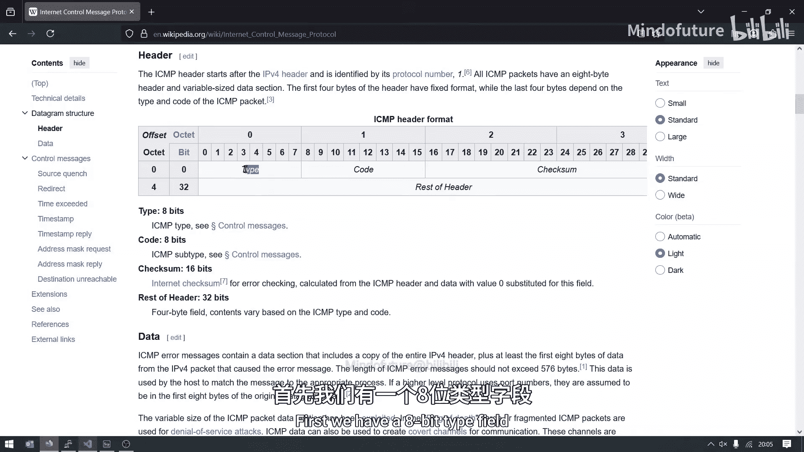

Tight field。So， a't a。

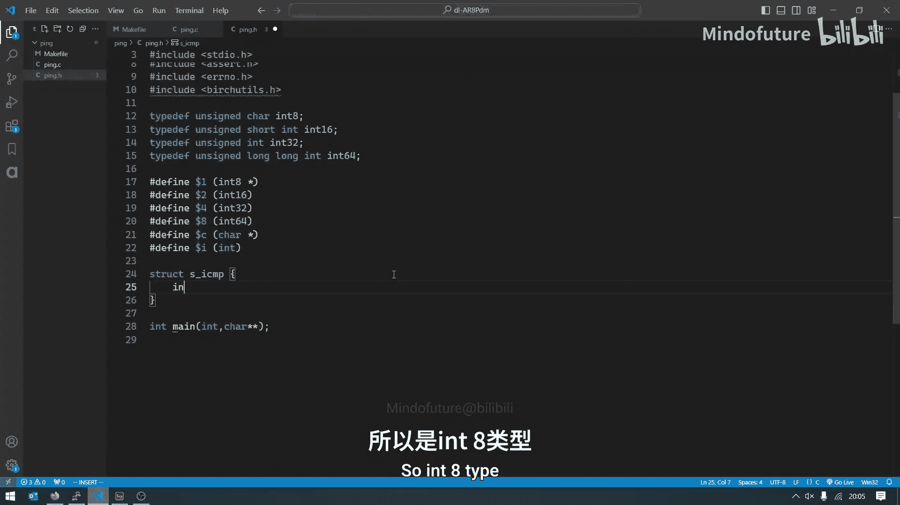

Type。Then， we have。

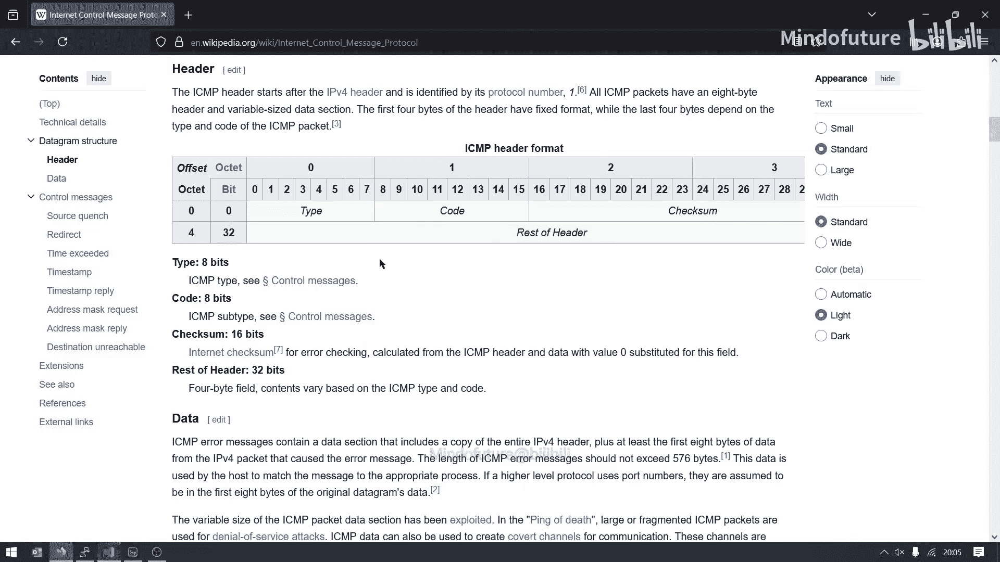

An8 bit code field。

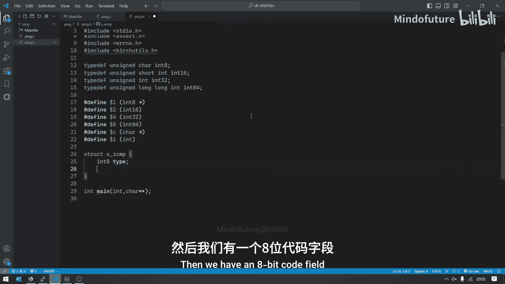

And then the checkum， which is 16 Bs， as it seems。

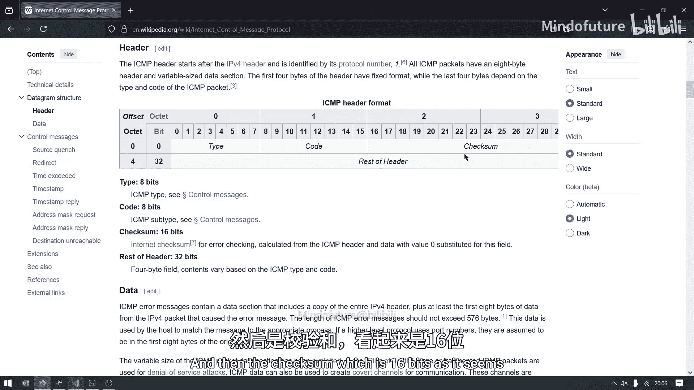

So in 16， check some。And then we have the date that which is the rest here。 So let's say in the a。

Data， and we leave this empty。ね。Right， and let's do a type definition。 So we have astruct S ICM。

Which creates a data type。ICMP。Right， so how do we create one of these things， Well。

 we need a constructor。Constructor function。So， let's say we have a。And。ICM， that's a data type。

 and let's make it a pointer。Mei。😔，I think P。And we need to give it a type field。Cold field。And。

A day that。Pointer。And the length of the data pointer shown in 16 for the length。

So this would be our ICMP constructor function。So， let's create this thing。

So we will have an ICMP make ICMP and in a。えた。In8 code。In a star。Da the。And in 16 size， like so。

So first， we want to check that these are okay， so we need if we don't have a data。And。Or if the。

Size is0。In that case， we wanna return an error。And well cast this as an I point during a zero。And。

Otherwise， we want to construct this thing。So let's create an in 16 N and in an ICM。诶。

Let's say P for pointer or a packet。So let's calculate the size first。

So the size is going to be equal to the size of the structure， sostruct S ICMP plus the size。

 so the size of the data。嗯。And then we set P equal to ICMP like this。Malo。😔，The integer of。

If we don't have a P， we can actually even assert that we have a P。Because if we don't。

 if malllo fails， we are out of memory in that case。

It's probably a good thing to hold altogether together。Alright， so。When we have created this thing。

 let's zero it out。 so we'll use the zero function from bird shield。And we'll give it。And end a。

Casted P。And then we give the M for the size。So now we have an empty structure。

 Let's fill this out with stuff。So P type equal to type。P code is equal to cold。He。And。

Check some We need to calculate。😔，So， let's say we have。EMP。Sck some。That's very long。Mmhm。

Let's just call it check some， for now。And I'm not really sure what we are going to pass this thing。

 but I guess we're going to pass it our pack test。😔，So let's give it P for now。

And maybe we should add the data before that。So。😔，I think we have a copy function inside of our tus。

 maybe not。Memory。Yeah。All right， we don't。Let's create a memory copy function。有亏。

So let's see we put it down here。So， we want to have a void。Copy。

And we want to give this the destination as an in star。

The source also an in8 star and an8 16 for the size。

So this will just copy data from one place to another。So， void clock。In a。Destination in a。

Soce and 16 size。And we need to have an N， and we need to have two pointers。😔。

A source pointer and a desk pointer。So， let's do a for loop。Where we say。

Destination pointer is equal to the destination。Source pointer is equal to the source。

N is equal to size。So that's where we start out。😔，And we will loop as long as n is not 0。

At each iteration， we're gonna。Decrease N。And what we want to do in this loop is we want to set the current position。

Of the destination pointer。Equal to the current position of the source pointer。

And then we want these to。Jump to the next position and we'll put these pluss to the right of the variable。

 which means that it will evaluate this line and then increase them。Which suits us perfect。

 so now we can return。Simful enough。So。Before we calculate the check sum， let's copy into the。The P。

No， let' see。We w to copy into。He。😔，Da的。And we want。Take the address with this。

And we want to copy from the data。Specified。As a parameter。And we want to copy size bytes。

Then we calculate and set the checkum， and now we can safely return P。

So this is our entire thing for creating one of these ICMP headers。Al right。So。

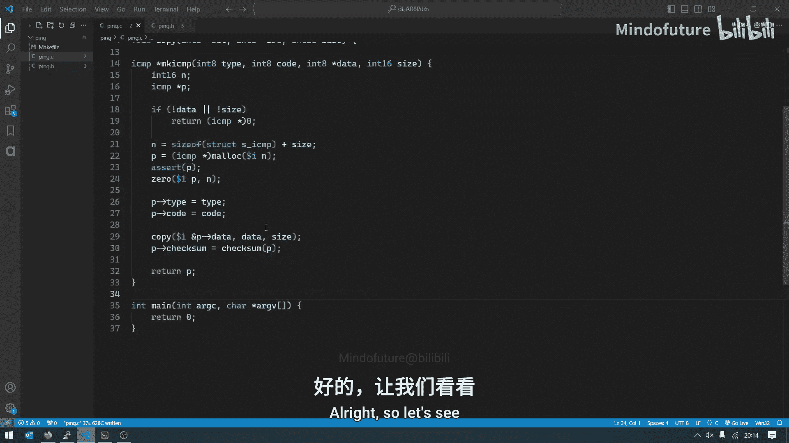

So， let's see。嗯。Let's figure out this。 check， some。

Do they talk about it inside of this。

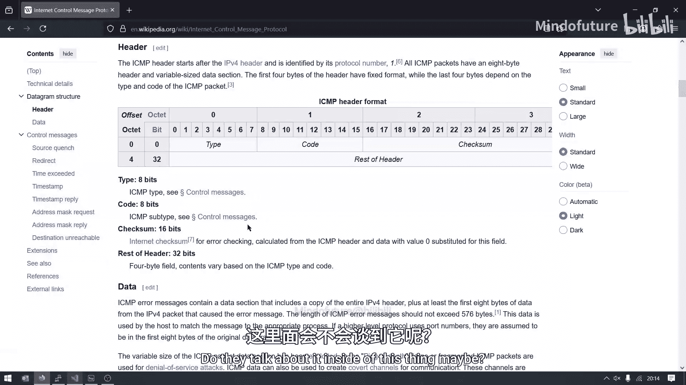

Thing， maybe。We'll be right。

。So up， guys。 We back。So now I have read up a little bit about how the check sum is computed。

And we're getting into that， but first。I would like to change up a few things instead of using one ICMP header。

 I'm going to use two。 So my regular ICMP header will only contain the necessary fields。

So I will not have the check some here， for instance。And。

And then I'm going to create another structure。Let's call this raw。No， not this open。え。Strt S。Rar。

ICM p。And this will contain the real packet。 So here we have the type。And。The code。And the data。

And the tile。So we'll have the in 16 check some。And here， I'm gonna keep the data as an array。

Here I'm going change it to a pointer。So this has really nothing to do with the checkum。

 This is just。A better way to represent it， I think。We'll see how it goes。

ESo we don't need to type this one， actually。And alright。I also w to add。What's it called。Well。

 my head is not remembering right now。But attribute， that's it。

So I want to define an attribute called Pact。Which will be an attribute。

And they are specified like this。So this is just extra metadata information that you can give functions and structures and whatnot。

And in this case， I'm just going to say pack。And what packed means is that it will remove。

 It will not align stuff。 It will make them as small as humanly possible。Okay。

 and I want to change this。 I don't w to type and a code here。I just wanna have。

let's say I have a a variable type， which is called type。Yeah。Let's say， kind。And then we'll。

 define an enum。So， inum。异议。Tai。And I'm gonna have two here。

 but we can add more if we need to support other kinds of。I simply packet it。

But I w to have the echo。And。Yeah。The echo reply。And let's also have some default value。

 unassigned or something。And we would create our own type for this。So。In a。一台。Willll just be tight。

So now we can produce this。Optimize structure。 And then I'm gonna have a。Evaluate function。

 which turns。One of these。Into one of these。And at the same time， it will calculate the checksaw。

So that way， we can store the packets。 And when we receive packets， we can treat them in this。Kind。

And。So it would be a lot easier， especially when we add other protocols as well。

And maybe we can even make。而果呃。Ro back get。A row socket。A library out of this。So。

 let's define a function。Which is going to be called。Well， it's going to return。Thiss。Let's see。

 Do we wanna。Return the structure itself。Or do we want a series of bites。

I guess we want a series of bites。Actually。So， let's say， we have。In a。Star e。爱C病。

And the only argument we're going to take is a pointer to an IC。IC皮。Rightect。

And then we turn it into the structure， and then we turn it into a series of bites。By the way。

 when we use this， we also need to know the size of the data portion。So。

Let's have an in 16 size here。And。Do we really need to know it in this case。No。

 since we are gonna return a series of bites， and this will only be an intermediate。Rture。So。

 we don't。Okay， so now we have a little bit better representation。

So we're not gonna copy anything here。And we are gonna， slightly。Change this thing。

Or we can keep that。来。We're gonna。呃 let's。Remove all of this。 It will be very different。Alright。

 so we're gonna set。P。Mm。Kind。To。The kind。So we're gonna change。 We're not gonna take to。

In8 and longer， we are only gonna take take this kind。Variable。And then， we are going to set。Size。

 which is the size of the payload。So。😔，Like this。And finally， we'll just set the data。

 And now it's a pointer so we can just set it to the data provided。Like so。

And maybe we can even do something like this to indicate that we are not going to change。So。

 let's update this。Signature make SC。 We're going to take a type parameter。And in 16 for the size。

And before that， we will have an intake star for the data。All right。

And I also w to have a show function。Maybe we should divide this up。By。The protocol。

 because we're going to support a couple。 So let's say this is the I MPP part。

And we also want to have the shows avoid。Show I ICNP。It takes an ICMP pointer。

And this is for de buggy。Will have avoid show ICMP ICM。Packet。😔，If we don't have an ICMP。

 we will just return。Otherwise， we'll print some stuff。So， let's see how to best。Do that。

Let's do it like this。Yeah。So， let's say， kind。And then， we have the kind。So。

We can use it as a string for now， since we don't， we only have two different types。

And then we will print the size of the payload。And let's print that as a regular integer， like so。

Then we do new。A new line。So this will be packed。no。😔，Will be。And one of these if expressions。Yes。

The packet。Kd。😔，Is equal to。it go。Wow， that was close。The lightning mostly struck something out here。

Did you hear the explosion？That's pretty cool。Alright， anyhow。 So if the package kind is echo。

We want to。Print decor girl。Otherwise， let's say。Rely。

And then the second argument will just be the integer version of。That good。size。And after this。

 we will have the actual payload data。And for that。

 I'm going to use my hex dump function from bird tus。嗯。Print text， I think it's called。Isn't it。

I just。Real quick。 by the way， this。My code editor doesn't have that file。

 so that's why it doesn't show。But it takes in the pet。Okay。Maybe we should check that as well。嗯。

Let's do it like this。 if we have a。Haad again。Da the field。Or if it points somewhere。

Then we want to print text。Yeah， the pack。对灯。And the size is packet size。And。Do you need the limb。

I don。So， so let's up。0。And then we'll just print another new line。And we're done。Okay。

 so now we can print this thing。Let's update the signature， by the way， for make ICMP。

 because we made this。Co死。Alright， so now we can write the Eval ICMP。

This would be the last step of the ICMP。So。We will have an in8 star。Eval， ICMP。

 And we're only gonna take in an ICMP pack。Same as before we're gonna check that we。Have a packet。

And also。That we have。A packet day done。Otherwise， we return an error。Indicated by。

0 casted to an in date。Al right， so。What do we want to return， We want to return an end。

 So let's create a point of that we all also。Gonna need。And。A size variable for the whole thing。

Including。The day， etc。Mmhmm。And we're going to need one of these truck。So， struck us。Lule。系视片。

And let's call this。Raw packet。Exon。So。We can start by。Feeillling out the fields in this raw thing。

So。Our raw。P。It has a。Cold in type field。So those we need to handle inside of a switch， actually。So。

 let's switch on the packet。Kind。Would have a case for echo。We'll have a case for echo reply。

And everything else we will just raise。An error。So， we'll just return。0al， like so。

And I know this break right here is not necessary。Okay， so in case of let go。We wna set the raw pack。

Packets。Type field。wo。😔，诶。And the code field 0。In case of a reply， will Sir。Type field to 0。

And the code fields to 0。The， those two fields are， are done。Then， we need to say。P。是。Sck some code。

对的。台。Is that all isn't there。Size feel of some kind。Let's go to that Wikipedia page。 ICMP week。

Type code。Jackson no， that all。Right， so let's say to check sum equal to。Check some。And。😔。

The only thing we need to give this is our。系。And now we're going copy all the bys。So。

 let's allocate the other thing。Maybe we cant do that。Yeah， we can， okay。Then let's set the size。

Fieled equal to the size of。s。Yes。Raw ICMP。Plus。The packet。Size， which is the size of the payload。

Then we allocate。This money by。And we can assert。That we have a pain。Let's also clean it out。

 so zero。😔，P。It's啥意思。And then we should copy first。The packet。The structure。So， we do cup it into。Pi。

And we're going to give it the address。Of the raw。P again。And the size of the struck。嚟首。

So now we have copied the headers。 Now we need to copy the actual data as well。So。

 we will increase P。And by the size of。Exstruct this， raw ice， Icy and pain。

And now we can copy and P again。This time， the。Pet。对的。And the packet。Size。Something like this。

By the way， we cannot calculate this jack sum up here。Can we。😔，I think we need to do it down here。

And I guess it's easier since we are gonna need require robot bites。When we calculate to check some。

Maybe we should， actually。嗯。Let's set this。Let's do like this。All up here。

We said it is 0 because it needs to be 0 when we calculate the stuff。And let's define a。

In 16 variable for the check sum。Let's call it check。Since we will have a function called Jackson。We。

啊 never。I don't think it will coide without structure。Okay， so now we have the raw bites。那我。

By the way， we should actually align this size。2，16。Let's see it is 6 bit。Boundary。Which means that。

Yes。If size。Moud。wo。😔，Is 0。 So if this is an even number。We do nothing。Maybe we can。

So if it's an odd number。We increase size by one。And now we can calculate the checks， sum。

And this time， it's going to be based on two things。Well， we give increased P right here。

So we need to have some variable that holds the initial value。Thelet子。Say we have a red variable。

And after the。Aoc。Well set R equal to P。 So we save that thing。嗯。

And then we calculate the checks some based。By red and。Size， we also need to know。Okay。And now。

 we need to put the。Check some in the right place。So let's also create a drug。Yes。Raw IC p。Raw。

Raw pointer。And this row pointer will be pointing towards words。The pe。But。

We need tostruct a cast this， as I struck。Yes。R ICP。Star。and should be the star to the bites of red。

Okay， and why do we do this， Because now if we modify row pointer。Yeah。Check some。Maybe we need to。

Do you reference this。Maybe呢。😔，So if we set this check somehow now to something。

 it will change the bytes。Inside red。So now we can safely return。Read with the updated checksup。

That's the general idea， anyway。So let's see， what did we change here。Can素 didn't change吗？😔。

The at Eval ICMP is now taking。And in a star instead， and a size。Alright。

 so how do you calculate thing Yeah， this thing。So what we need to do。Is。

It sounds a little bit advanced。 We're gonna go through。The whole。Packet， all the。Rar。Data。

Including the header and the data field。And we're going to divide it up in 16 bit。Portions。

And we're going to take them two by two。So let's see say we have A B and then C， D and so on。

And we're gonna take。The addition of A And B， but not。A regular edition。This is something called。

A one complement edition。So， basically， we need to。Do an addition， but we need to save the carry。

 So if we have， let's say。AndA B。Plus。I don't know。8，8。

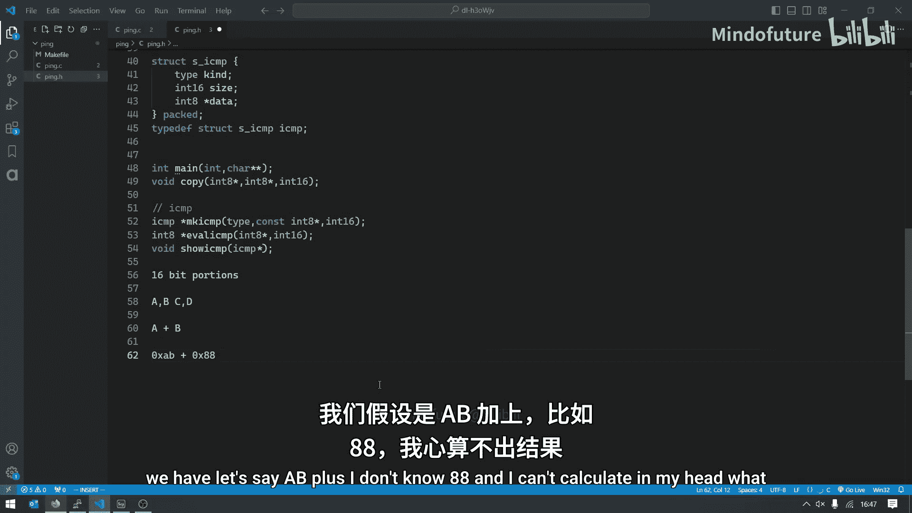

And I can't calculate in my head what that is。 So let's do it here。A A plus。Yeah。AB plus。Yeah。

And then， we turn this back。Okay， so this is the result。

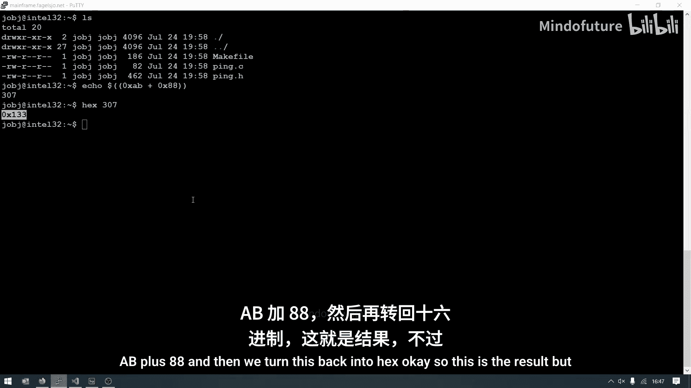

But we are only dealing with。By this is is a byte example。

 but we're going to do the same for the 16 bit things。 But let's say we have two bytes， A And B。

And this will。Resolved to this， which is actually a 16 B number，0，1，3，3，3。And if we only。

Handling bikes。What do we do with this。Well。In this case， we're going to take。And。

We're going to take the results。3，3，3。And we're going to plus one。 So we're going to plus this。

Buy it right here。So the result of this edition is 3，4。So then we。

 and we do this bit by 16 bit numbers， not 8， like it did here。And。Then， we。Plus， all these together。

And at the end， we end up with a sum。And then， we do the。Bit wise one's compliment of that。So。

 basically， if we have。Let's say an8 with let's say4 width number。Let's say we have 0，1。10。

So we basically flip all the bits by the end。 So this will be 1，0。接肉丸。Okay。

 sounds pretty advanced la， but I don't think it's。It's too bad。

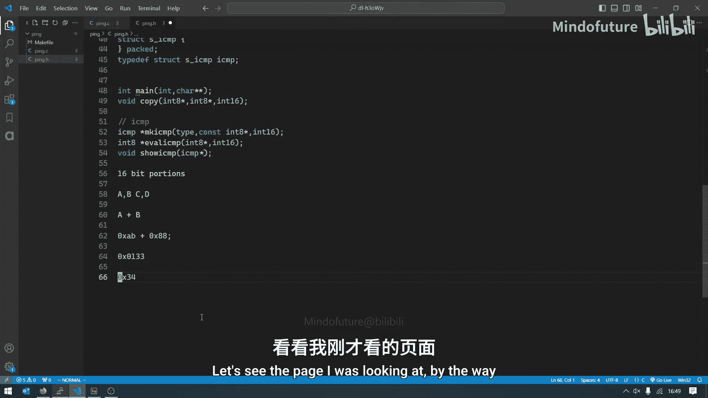

Let's see the page I was looking at， by the way。This RF， 1071。Shows all this stuff。Bte by， by serial。

Okay， so we can actually do it like this。which makes it a little bit simpler。

 but because if we do it like I showed here， then we will end up with AB with CD and then we have to do AB plus CD and this is pretty complicated to know which things to add together。

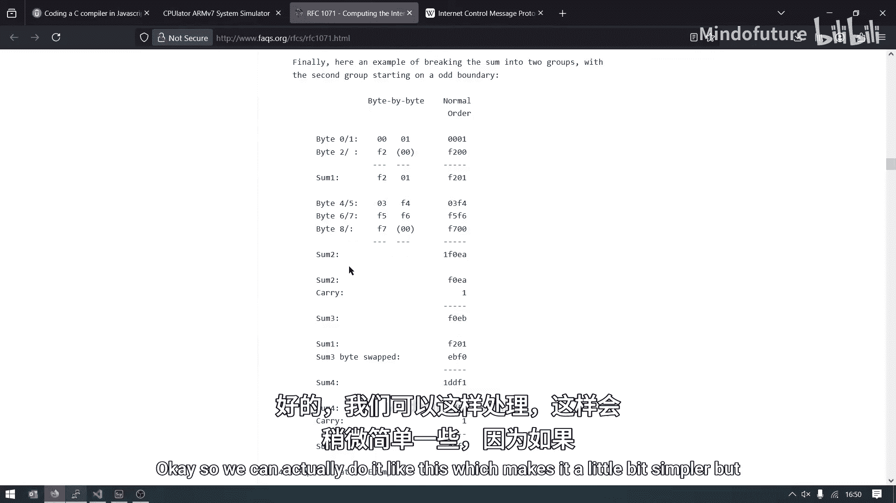

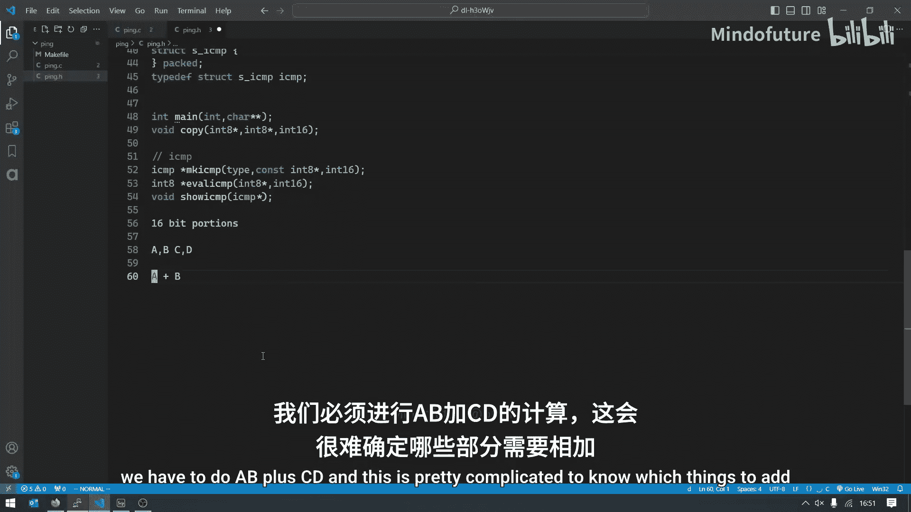

I like this approach， where we just。Yeah。We take all the 16 bit values and just plus them together。

In one go。Yes。Yeah， and just increase the sum。And if we。At the end here。

 when we have ped all of them together。We just take all the overflow here， and add that。To the， okay。

 this is pretty simple， I think。

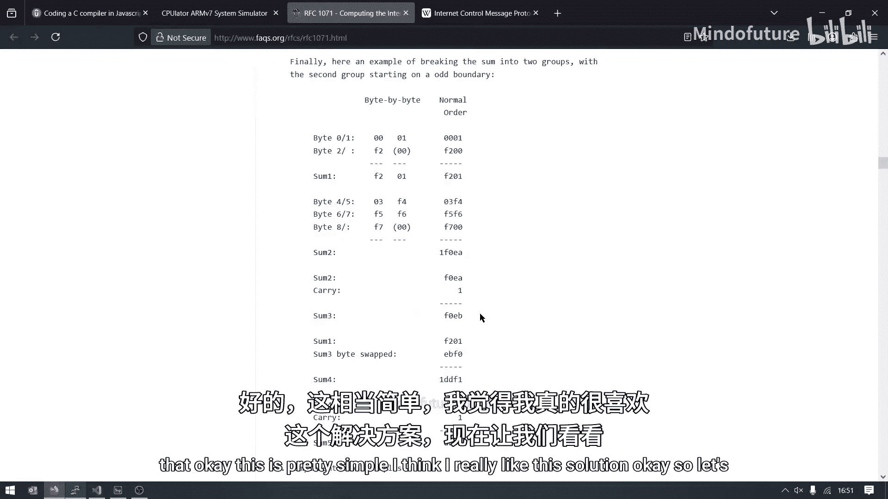

I really like this solution。Okay， so let's see if we can actually do this thing。嗯嗯嗯。😊。

Let's create a signature for。Operation。So we're gonna return in 16。This is a check some operation。😔。

And it's this that takes an intake star in 1816， not the1 I specified down here。

The eval is ICMP still just takes an ICMP pointer。Glad I caught that。Alright， so。嗯。In 16。Check some。

And by the way， I think we can use the same check sum for IP as well。

 so we don't need to develop several of these algorithms。AndSo end a。This is。The packet。 and in 16。

 the size。And this size is already aligned on a 16 B boundary。So。Let's see。We need to have。

An N 16 pointer。Let's call it P。And let's say we have an A and a B value。Or， rather。An accumulator。

And since we are overflowing here， let's make the accumulator an in。32。

OrMaybe it's easier to do both。So both the B value and the accumulator will be。Well be in 32s。

And we're going to need。And in 16 value。I guess an indeed actually would be enough。

 but just to be on the safe side。Where we。Deal with thee。Cumulate。No。

 not to accumulate the way we deal with carry。Okay， so let's see what we need to do。

 We will have a for loop。We set our pointer equal to。Theyin。16 star。哦。The package。

So the first address of the packet。And we're gonna。 let's see。Let's say， we havent。In 16 N， as well。

So we'll set n equal to the size， P equal to this。And we're loo。 We're gonna loo。As long as we have。

A positiveitive n value。At each iteration。At each iteration， we're gonna。Minus M。By。😔，wo。

Since we are。Going through a series of bys。 But we are reading them 16 Bs at a time。

 So 2 Bs at a time。 Then we need to decrease this。And。By2。😔，And how will we increase P。

 I guess we will just。Increase it like this。 And that will jump to the next 16 bit。

Let's also start with a0 accumulator。So， our B value。Is going to be。

What the pointer is currently poing into。And then， we're just gonna。

Increasase the accumulator by the B value。Yeah。We go through， and we just。Fold this old。顶ing。

an increase。This， so we create a sum。But when we are through。

 we need to take care of the carrier as well。So， the carry is going to be。The accumulator。But。

We are only interested in the upper。16 B。Which means we're going end this by。F， F， F， F 0，0，0，0。

That will take。The to。16 bits。And then we need to push them 16 B to the right。

So we get rid of all these zeros。And that is our carry。And then， would just take。Accumulator。No。

 we need to grab the 16 lower as well。So let's say we haven't in 16。So。

Where the sum is equal to the accumulator。 And this time， we add it。This。So we get the lower 16 B。

 and we don't need to shift them anywhere， because theyre。At the right place。And now。

 we can just return。Some。Plus， the cart， no。Not right like this。 We need to invert this as well， so。

This is what were gonna to return。I think。I think it makes sense。Alright。

 so how do we test this thing。First of all， we need to have some string。We need to have a。Packet。

接除胎白审批。And we need to have。The string of bite。R。Let's just call it raw。So first。

 we locate for this string。 and let's say。Let's say it's just the word word hello。So。What will do is。

Mlow。Size fun。We assert that we have a string。We0 out。This string。Let's give it a null terminator。

 So it's easier to print。And then， we'll just string copy。Into this thing。So。Turn this into a jarr。

A copy from。String hello like this。5 bys。Okay， so now we have the data portion of the thing。

 So now we can just do。Packet is equal to make ICMP。We provide。咩几你性片。😔，We provide a kind。

 So let's say this is an echo packet。The data that is our string。The payout size。

Is the five casted du in 16。It's a third that we have a packet like this。Let's show a MP。This packet。

Now， we w to set our。Raw。Equal to E I。We give it the packet。Let's assert。That this is positive。

And then we can print this the same way。 So let's say。Well， we need to have size variable as well。

So the size is going to be equal to the size of。He struck it as。Raw IC andP。Plus。The pack gear。Size。

And then， we can print he。This。Raw packet。Of size。Like this。Then we can free the packet。灯。

We can free the actual packet。And with current return in0。Al right。

 this is the first time we compile this thing。 So there will probably be some error tracking。

 but hopefully。

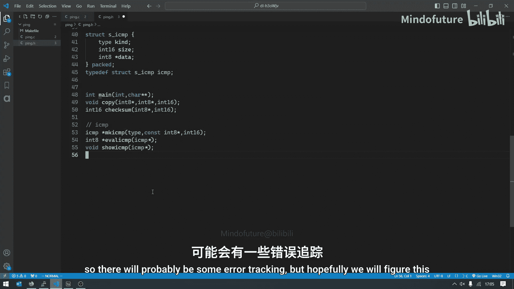

We will figure this out。So， let's run it。Tribute。mm。

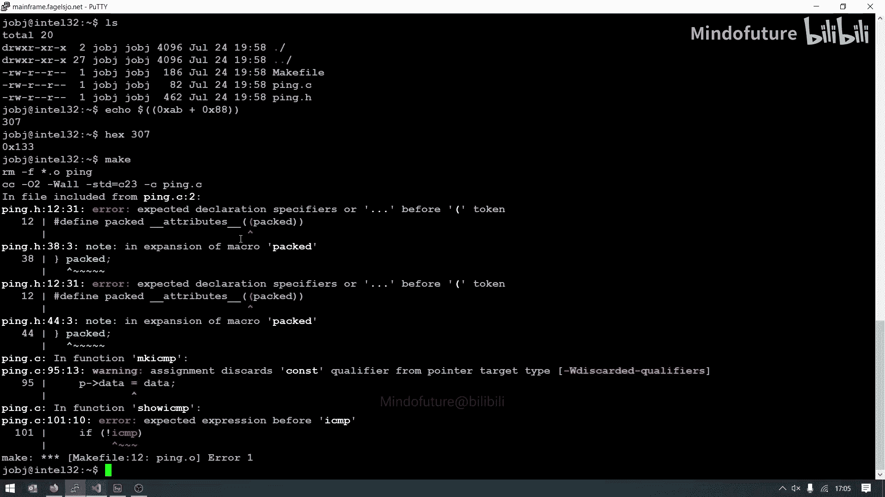

Maybe it's not。On both sides。Maybe不事实。It's usually be a tribute， not flouralous。

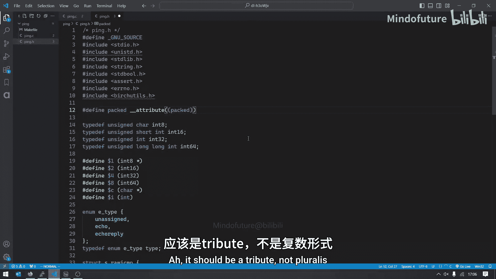

Simon discards cont qualifier。Ped的。Heく。😔。

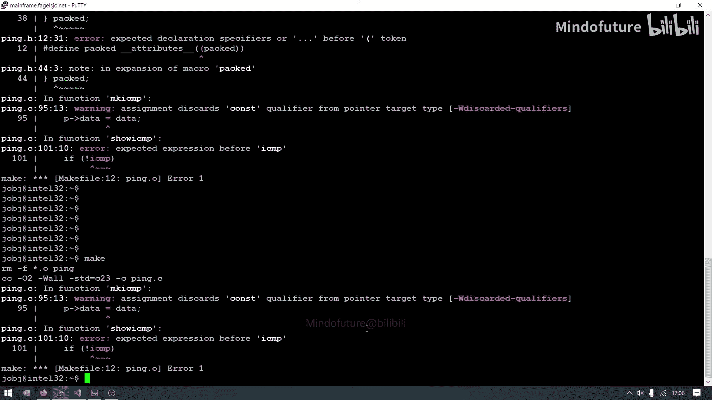

Okay。95。We are not going to change this data inside this function。 so let's just do this。😔。

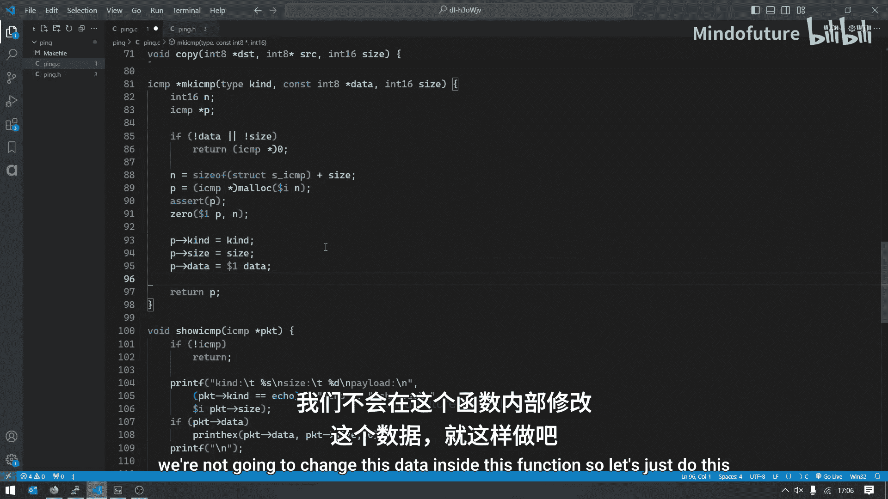

EExpect expected expression before ICMP。

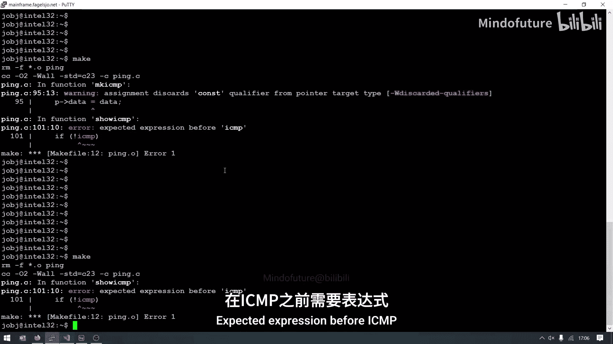

We should check the package。

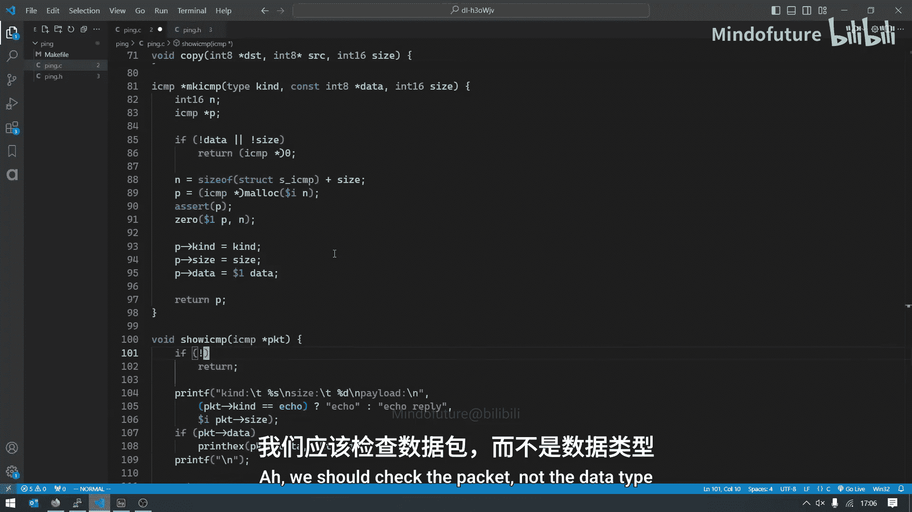

The， the data type。All right， that's not meant too many errors。

 I hope that doesn't mean that there are a lot of other more difficult errors。When we run the thing。

 but。Let's try out。Okay， so the kind is an echo of size 5。 That's right。And this is the payload。48。

65， this seems like ASky characters。Let's。Double chair。Yes， that's history ring。 hello。Okay。

 so this is the actual packet。 in order to make sense of it， I guess we need to go to the。

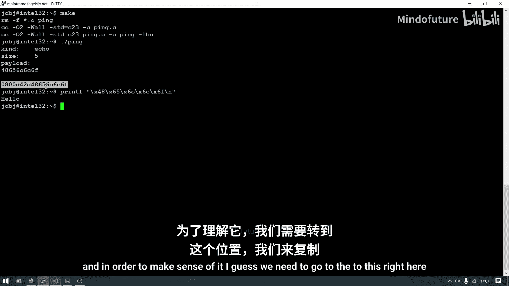

This right here。

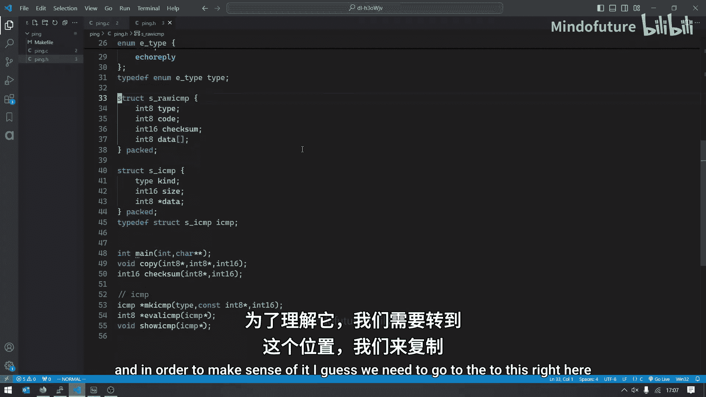

Let's copy。 And let's do F to Deb null so we can have it on screen。Okay。

 so the first is a type field。It's 8 bit。And that is 8。嗯。Which is that that is correct， yes。口。

Often in 8，0。That's correct。Then we have the check sun， which is the most interesting thing， right？

That is D 4，2 D。And I don't know if that is right， but it's something。

It looks like something it could be， right。We will not really know if this is the right checkel until we try to send this pack。

Pack it and see if it come goes through。And。But， everything looks like。It's supposed to。So。Yeah。

 I think that will be all for today。But in the next episode。

 we are going to code the rest of this thing。And I hope you like this because I think this is gonna be a really cool project。

 And it's always good to have code for being able to collect。

Packets and send packets on the level of the networking interface card， really。

So I hope you like this and that you like this episode。 and don't forget to subscribe。

 Thank you for watching。 Thanks for today。

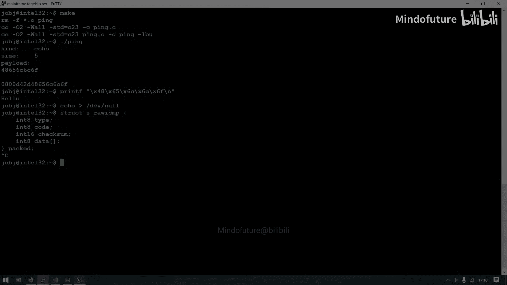