# 【Jonas-Birch】使用C语言从零编写Ping-｜-Ping-From-Scratch-p03-P03_03_发送原始IP数据包_-从零实现PING--BV1rwBTBUETy_p3-

All right guys， welcomecom to today's show。 So let's see if we can create this sendIP function。

And we're gonna have a pool。三来皮。诶呀。And we are also going to have。I。It's called this。

Since it's the main thing。嗯。Okay， so let's see。We need to have some kind of。Well。

 a pointer to this buffer we're going to use。But first of all， let's double check that we have。

What we need。So if we don't have an S。我。If we don't have a。We can instantly。Both。

What the variables do you need。We need to have an in a。And this is going to be the raw packet。

 So let's just call it raw like this。We probably need a couple in 16s for dealing with stuff like sizes and such。

So let's say we have an animal。For now。

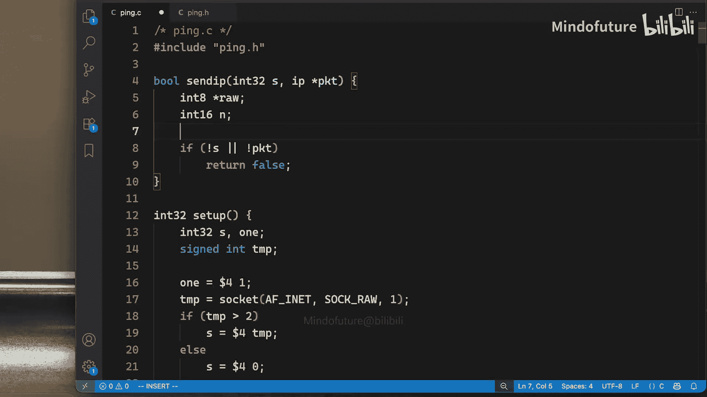

And let's also grab this signature for the send2 function。

 because we can use a whole bunch of different。

System calls to send。 well， IP packets and the like。

So theyre send and send two and send message and they all work slightly different， for instance。

 send message requires us to fill in a huge structure。😔。

And send is probably more like regular TP connections。 but send too。It's promising。

Because here we can just provide the file descriptor。诶。

A buffer containing red we want a sound and its length。Flags， I don't think we're going to use those。

 We need to check that out。And。Here we will put the address in info。

 but since it's going to read it from our header， we probably don't need that。Excuse me。 One second。

 I just need to take a sip of water。Alright， so let's copy this signature。

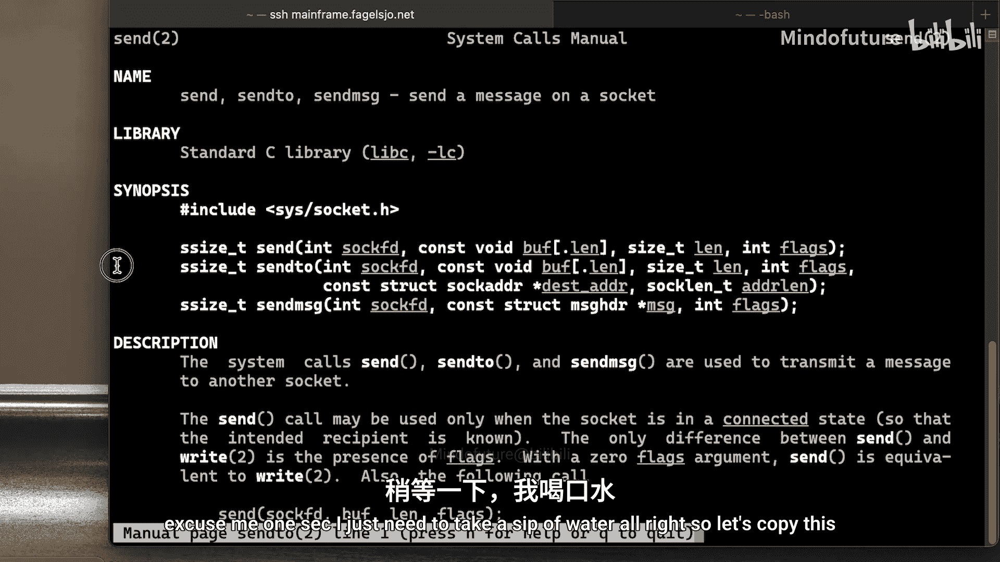

So。Let's go into here。Okay， so if all of this is in order。First， we need to evaluate this IP packet。

So， raw。Should be equal to。一。I think we can just do evil well。Or not yet。So， let's do。Let's do。He。

Because with the other one， the show function， we have this kind of thing。 So it automatically。Act。

 depending。On what。デタタple is。So why not create one for Eval as well？We can just copy to this。普つ？

thatsなく。Okay， that's better。So， this should just be。no。If we have an I。VP。What's the argument。

 by the way。Okay， it just takes。one。あの。Don't need this first thing。We do need this， though。

Maybe wish you。It usually don't matter， but if we are providing some bigger expression。

 we we want to have that support as well。人。And this is cool。嗯。I行骗。And that's it。Alright。

 so now we can just do raw is equal to Eval and we provide the pack。

And now we should have the packet prepared and ready to be sent。Kidan F a。We do， however。

 need to calculate the length。So let's see how we do that。

 We should have created a function for that。😔，Because。私ち。First of all， we have this regular thing。

 but then we have。Well， we don't use the options。But we do however， have payload。So。是。

We need to go into this ICM packet。嗯。Well， let's see how we did it in the example。

So we make an ICMP kit。We make an eye packet。And then， we evaluate a。WithThe I packet。

And we calculate the size as the size of the structure。😔，Plus， the size of the IMP。Structure。Plus。

 the pal of size。 All right， that's not too complicated。诶。And that's why I always save。The。

 the the comments and tests like that。Okay。So， let's say our。自裤。嗯。Or maybe。嗯对。Just to make it so。

Readable as possible。We take the size of astruct S。ろ。系。And with fl。あぞ？ICM。And then with plus。The pet。

Hello。I think let's double check this。So， this is。This is our IP， so we go into the payload。

 which is our type ICMP star。W means this。This whole thing。And we do have aisive。🤧。

And maybe we can even check if。Need to double check that the end is correct。

So now we have the data and we have the size。And I supposed that's all we need。嗯哼哼。来。Let's to learn。

We will end the comment here， instead。Save two lines。So we can put the code here with。Scro me。

We need to take care of the return value as well。 So let's say we have a signed in。嗯。

Should be equal to。三子。Would provide。The inversion。All our。Which reminds me， we did it wrong。

Somewhere。Where was that。我没了。O。So。That's our socket。Then we need to provide our buffer。Which is just。

And then。Ling。So， that's our。Ingerversion of。行。诶。Flags。嗯。We need to think about that。And then。

 we have the。This one， that's the address。But。I don't want to provide it。Here。So， can we do。

It's a con。Well， maybe we can just see。嗯。Let's try this。So do comes。D。And0。

And the address then will also be 0， then。So， this is our sound。co。系嘅。By the way， let's clean out。

pri。Okay。So， we should be able to。Well， we can start by checking。Return value。

And I guess this should be a post。

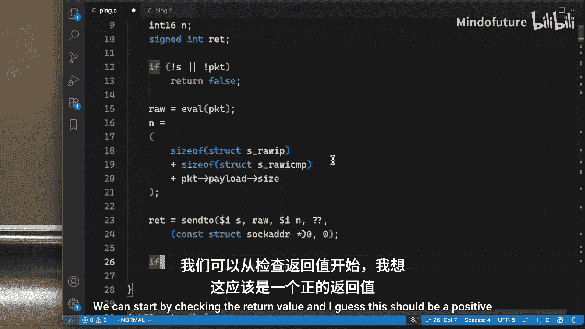

returnturn value。Since it usually tells how much we were able to send or。How much we tried to send。

By0 or-1。 Okay， so let's check for-1。

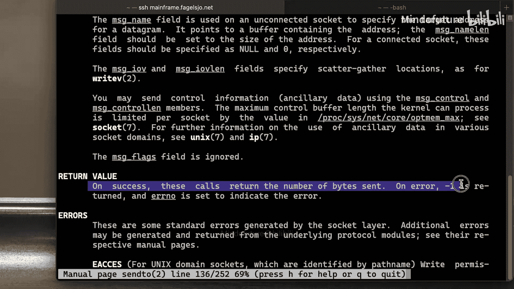

If I will read this。如说。What are we going to do then？I guess we will just。嗯。Let's just return for。おわす。

Doesn't have to be more complicated than that。I already know how many bytes。😔，I'm trying to sound。

Okay。

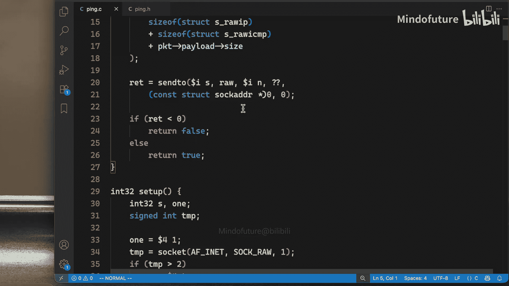

So we need to check this out。Is there any flags that we are。

Wanting to meet。

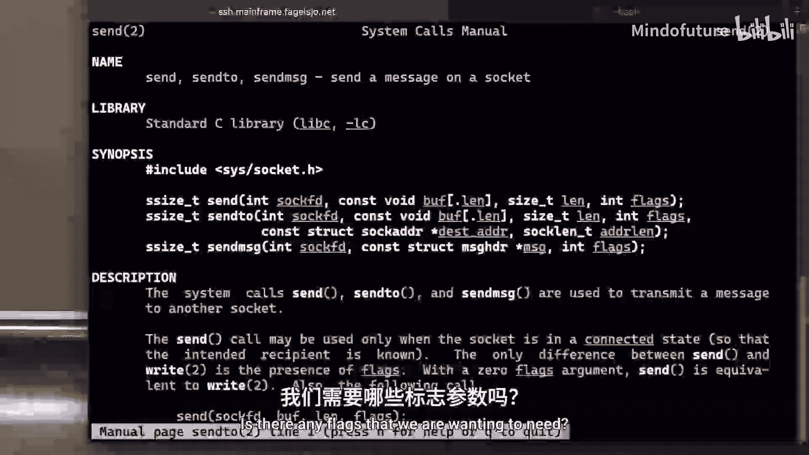

Good English there。The flags argument。Message confirmed do do do do do。Don't出。This one， don't wait。

 So we do it non blockingly。 This we do need to use， at least for the。When we listen for the packets。

Otherwise。We cannot， really。Deal with sending multiple packets at the same time。

But。At this stage， it's easier to test stuff if we do everything sequentially。So。

Let's do something like this。是。It's inside of a comment like this。But。Now， we'll just put。0 here。

Like so。Okay。Let's see if this compiles。

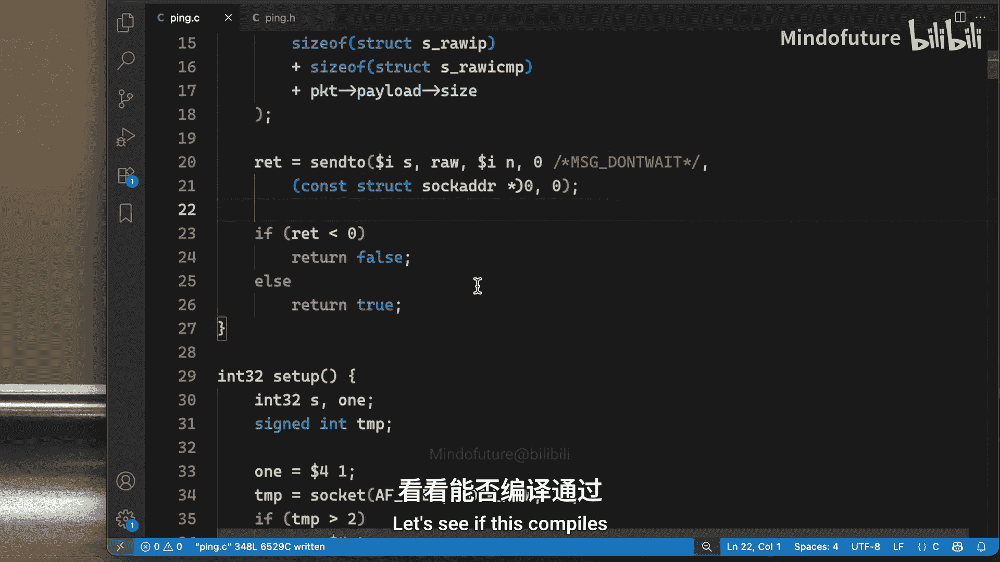

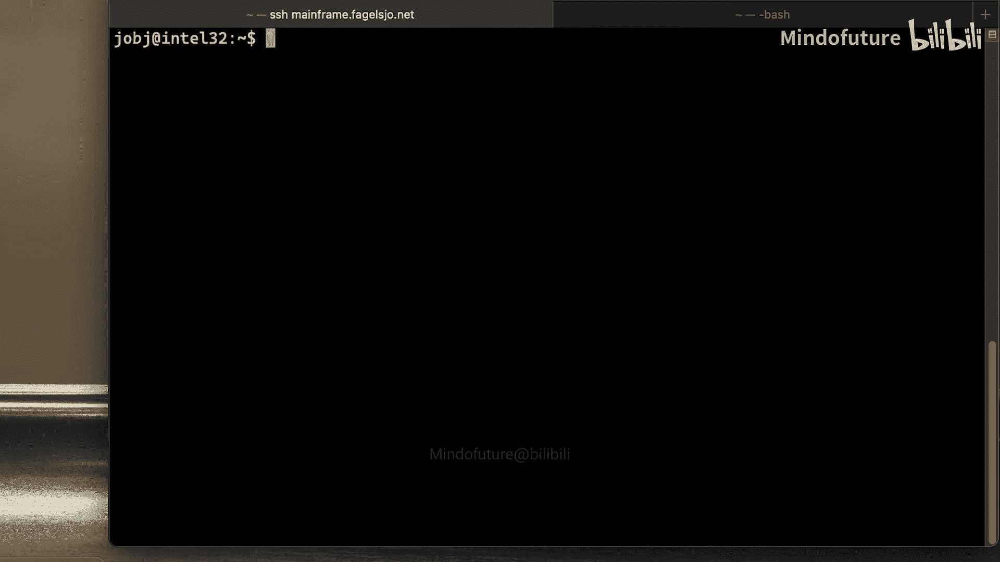

It does。It did。

Nice， it's not often。 it comps on the first try when you try to do。

Completely new things that you have never done before。 I have never worked with。The soets。

And I'm writing this program now for the first time。It'll be interesting to see if it works。

So now we can use our first main again。 So let's call this。This is。嗯。And let's at the bottom here。

Create a regular main， So。Its to。And we exist。嗯。に。And how do we pass this thing。

 and maybe it will evaluate that automatically if you just do。Ne， however， to change。T。

So after we have printed this out。Well to。谁呢。Have next。可么。But if we have an S。

 we want to try to send one of these packets。Let's create。Vable。We need to have。To。

And we need to have a。唔。So， red is going to be equal to。And let's say， we have。嗯。Still send。

And we only need to provide this。The raw packet， which is our。No， let's see here。We。How do we do？

I think it did all the evaluations inside of this， didn't it？Yeah。

 so we just need to sense our structure that's good。😔，And that is our eye。So。I p。便。

I think that's the right one。Make a P iPad， yeah。And then。えこ two。String。And if。True。Otherwise。Yeah。

 something like that。And what are we going to try to pay？응。

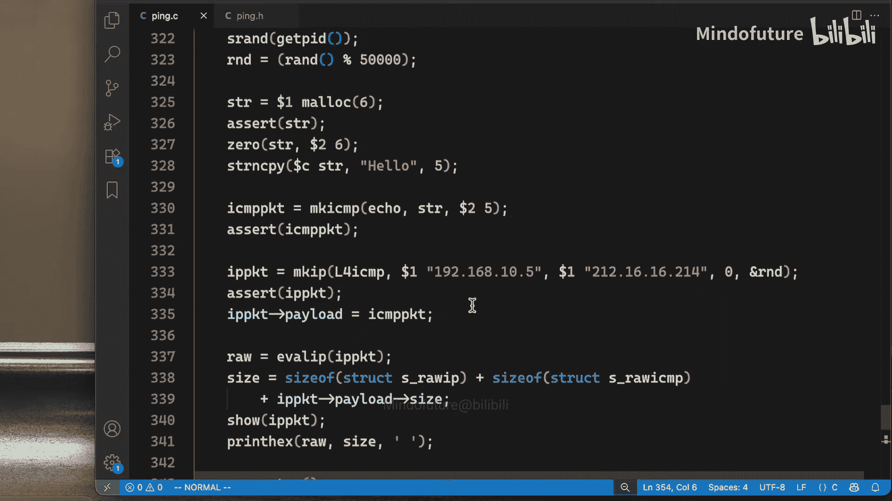

We are not going to be able to see if we get a response back， but we need。

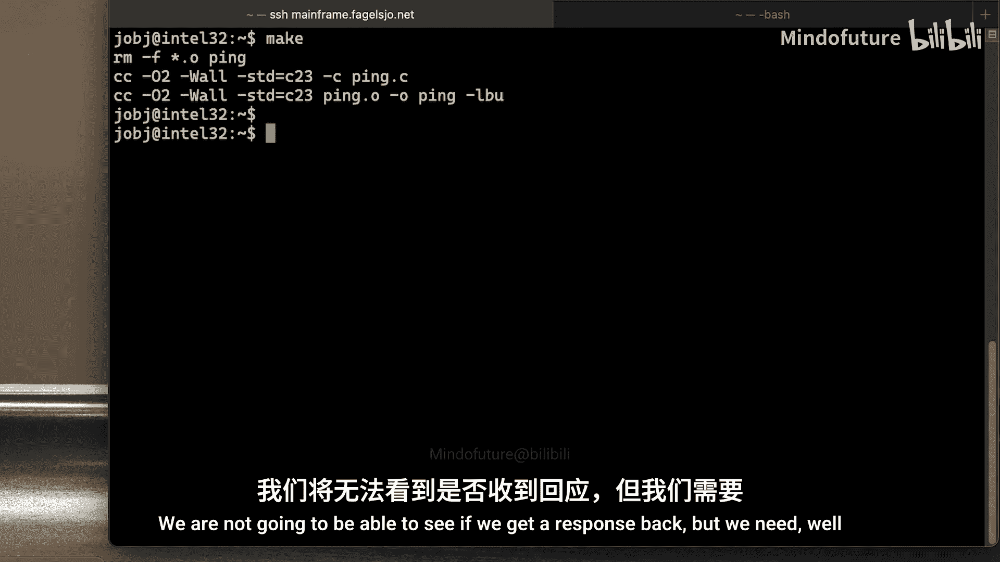

Well， so it doesn't really matter， the only important thing is that we provide real IP addresses in the correct format。

Which we do already。So。Yeah。This is going to work， actually。

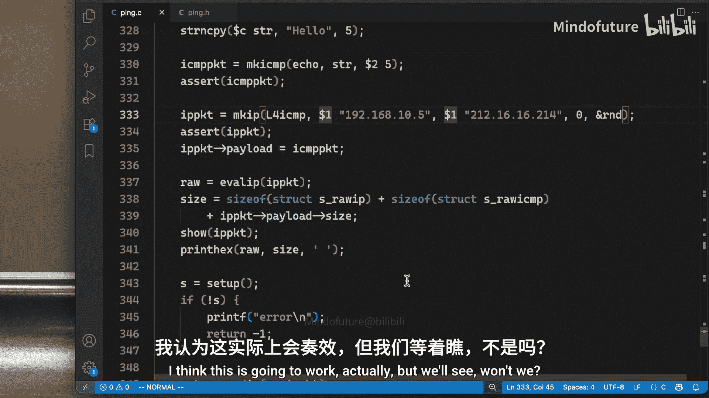

But say onet play。

It compiles。Exciting stuff。They run this。男女的。We get the error， like before。왜프。Red this equal false。

 Okay， we are at least。Closing in here。So， let's look at。And what do we want to grab for， I guess？

interesting thing。Destination address required。we do need to put it there in， after all。

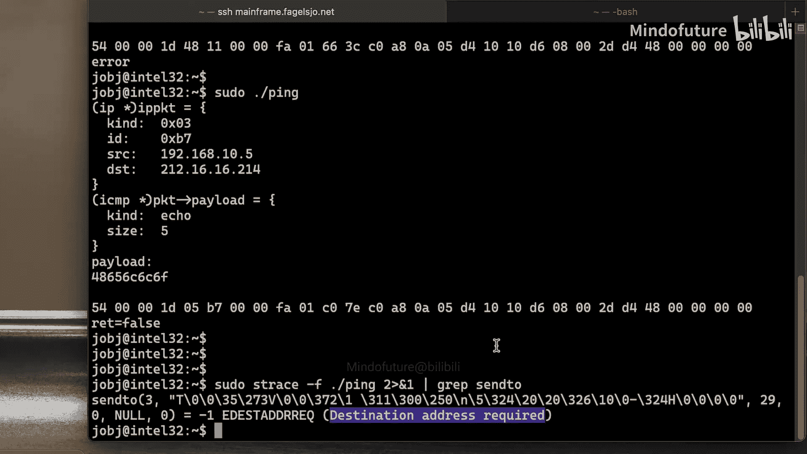

K。Well。

I'm sure it will look at our。Packet anyway， this is probably just so it can find the interface。Okay。

 so let's see。We need to modify this。Sand function， slightly。This one construct so address。Then。

 well provide。Sa。To be。さえ。最そ。Should probably be。Start。By cleaning this out。0 os。Where。And I guess。

 the。This， the actual IP P address is all we need。So。对对。Our。一次。should set our socks in。That rest。

How do we。Store this kind of stuff。So， inside our。Our own I。是了。We have。The destination is an in32。

And this is in the correct network by order already。So we should just be able to。Do something like。

嗯嗯嗯嗯。嗯。T。嗯。How should we cast this thing。S address is' an in the address， I think。是。And then。

 we give it our。百片。ね。Think this should be enough。

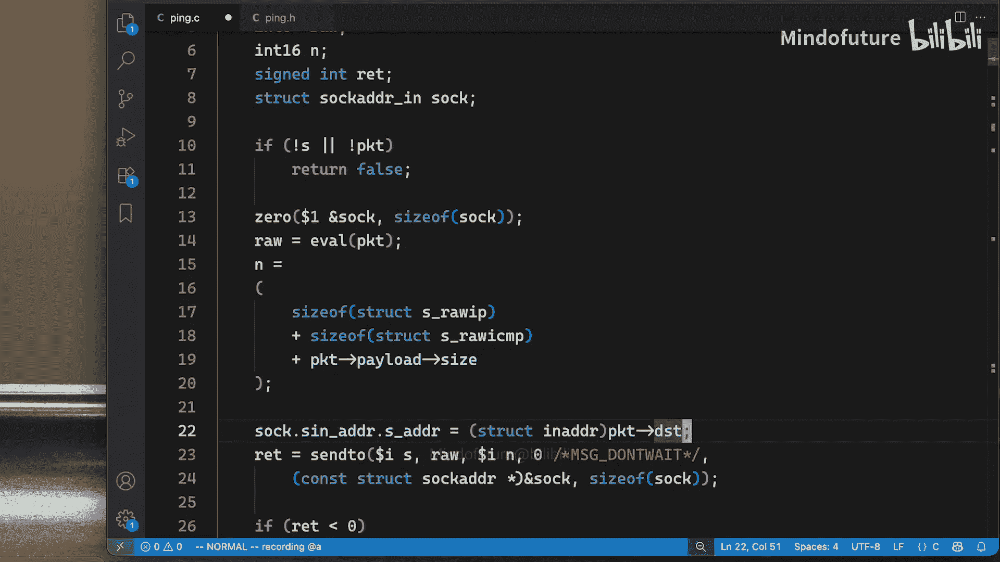

<|OTHER|>Conversion to nonscalealar type requested。That's not in the address。If we go first to the。

死服。Find that。Here， socker in。And this contains the。In the address， Okay。

 so this is okay type in the address。Well， we don't really need to go any deeper than that， I guess。

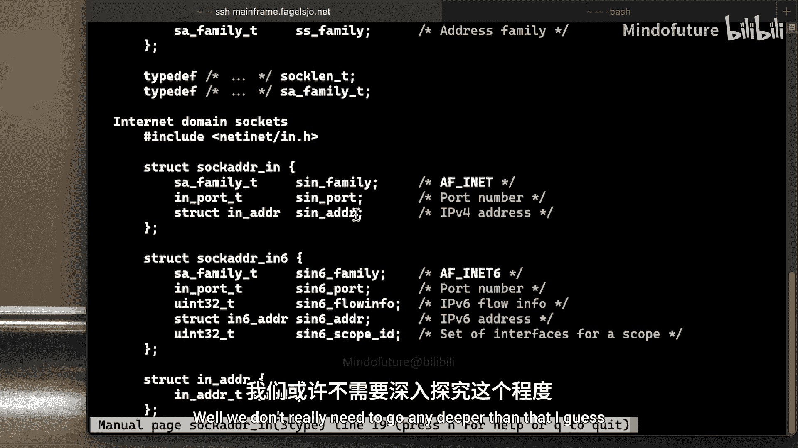

So。Let's jump back on step so we set。address directly。I we should be able to do that。

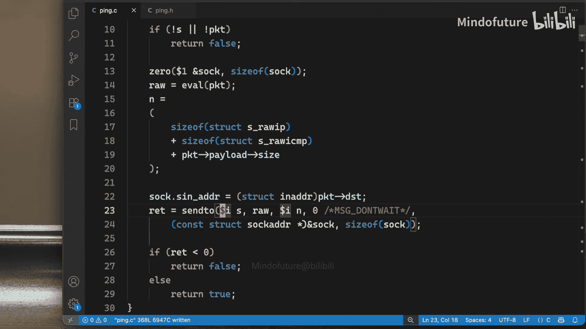

Okay，It's still treating it as。A stretch。That's unfortunately。系咯。Ting。Search for。In address。

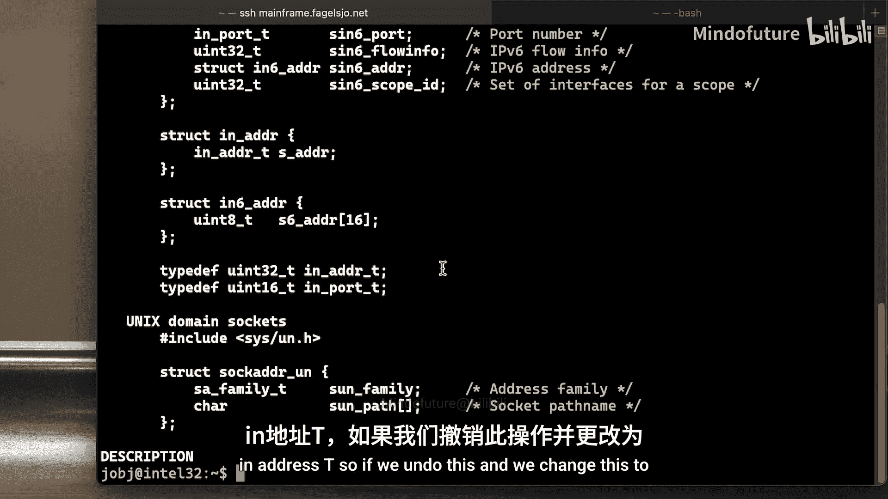

If we undo this。でち。To。嗯。

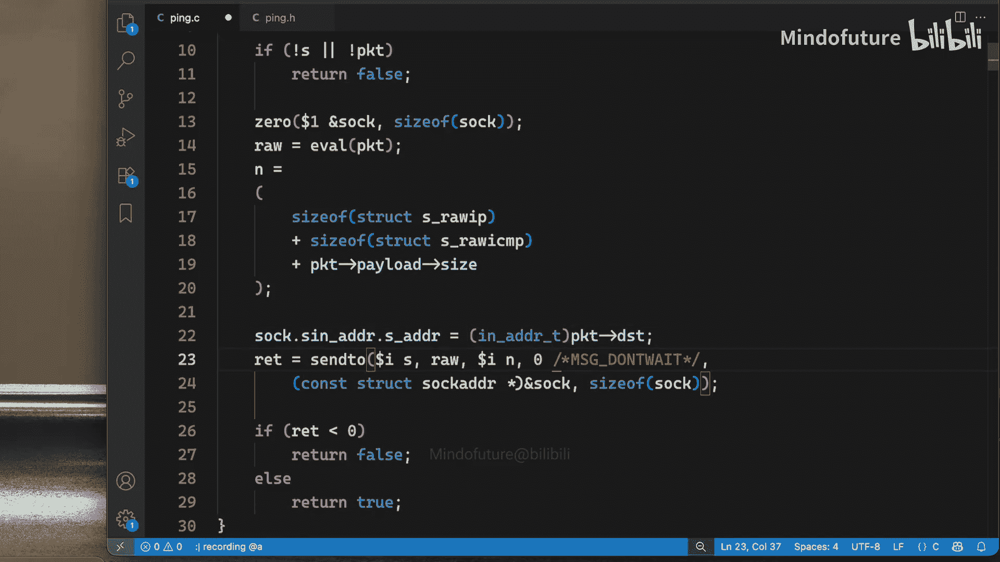

It should fix it， I think。Yes， you did。Good， good， good。Let's。Rth is equal to true。

 What do you say about that？Ladies and gentlemen。嗯。And this is our packet。嗯。Right。

Is a family unspecified。I'm not sure if that is a problem， but I don't think so。系啊。

And then we have the day the。嗯。29。Right。And an IP packet is generally 20 bytes header。😔。

Could the I think P packet be。9 bys， yeah。Doest same。Unreasonable。So。Possibly， we are able to send。

This stuff。But。We need to share。是。Do I have。TC p done。Itsill。K out of this machine。m。What about。是。

Yes。If you don't know what thisum is， it's a packet s sniffer， which works very nicely。嗯是。Let's see。

 we want to look for， let's look for any packet。From。And。SI P address。

And let's first send a regular p just。We get it。And what address does this book。嗯。

It should be reached by this10，1，2 see， okay， that's only one IP address from the other one。😔，いける？

Gbage。Is possible。Perhaps。AndLet's try again。うんど。1 dot 2 dot。没有。We got it。 Okay。

 so this was the regular p。 Let's see if we get something from our own。That's far more interest。

So if we just run this as you。Red s true。AndThey got nothing。Oh， I forgot to change CIP。

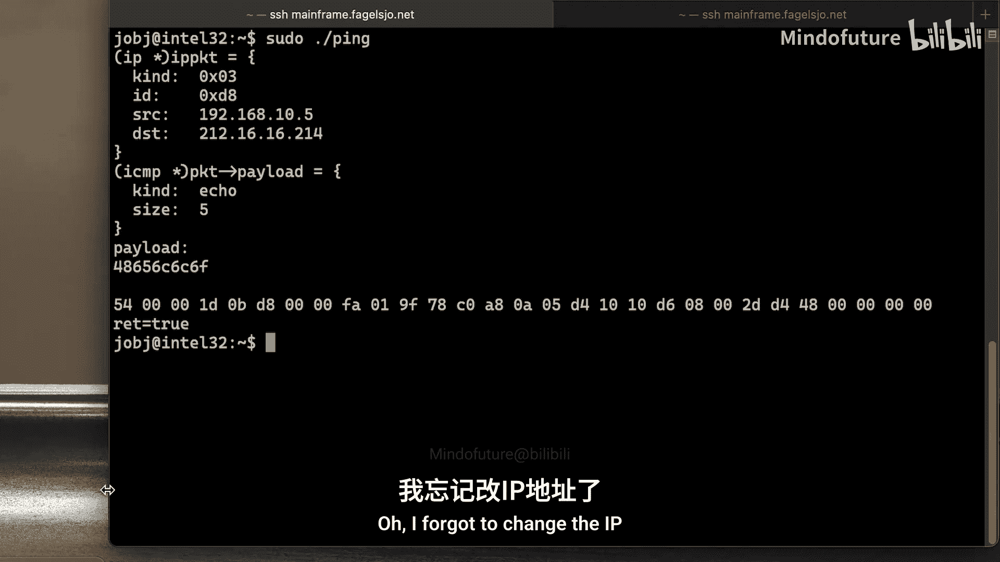

是。So， let's see。We want呢。Where is it。You want to change this destination。This is turned。ですね。From。And。

1。Let's first try。 This is our real I P address。 So let's try with this one first。

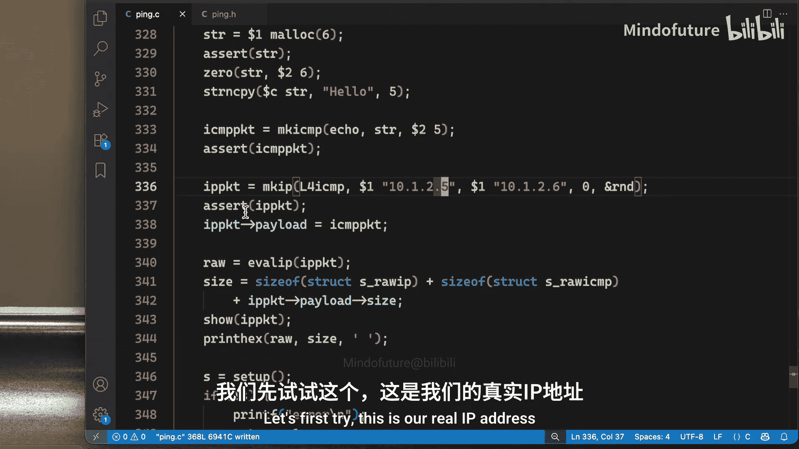

Red equal to true。Have we got something。 Okay， I。Inval。Okay， so what does this mean。

Either that forgot and actual shall。Brooke packet gets due to some header in the wrong order or something。

Or the check some drop。嗯嗯嗯。But we are at least able to send something。Which it reacts to。

 So now there's probably just some bits wrong。At some play through another。Something like that。嗯嗯嗯。

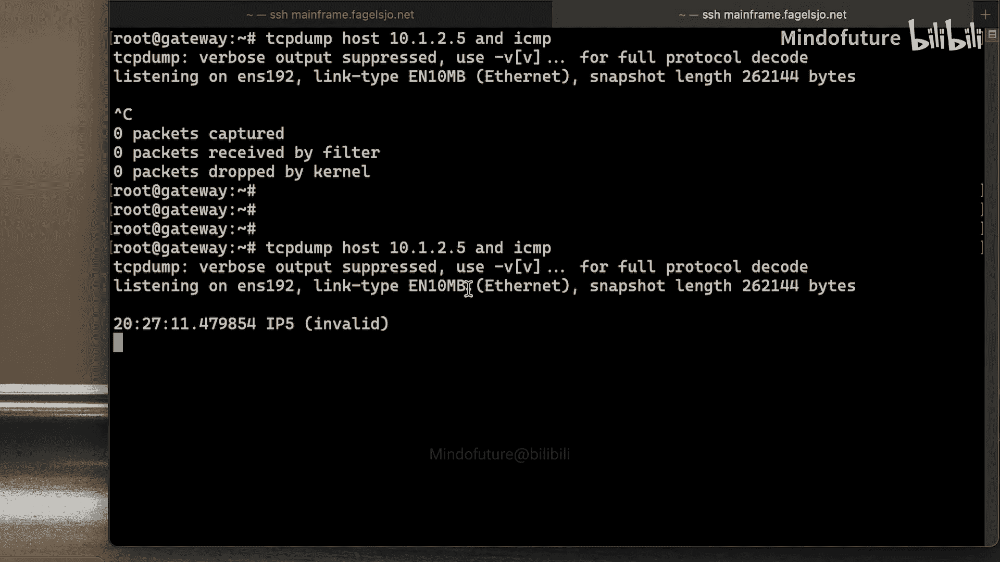

I want to try something first。What is。

We don't send。The IP。Part of咩。So we don't do this， basically。By the way， that reminds me。

This is always thinking that this is ICMP。 The rest we have made generic。

 So we should probably do this generic as well。 Let's。right。Let's highlight this。

Remember to fix that。But that's not our current problem， though。

So if we want to sound just a regular IP pack。With that's say， an M。The payload。

Then we can calculate for this。If we will have a raw I P。And the size will be 0。

And we don't give it a payload。I皮若爱心。Yeah， let's see what happened。

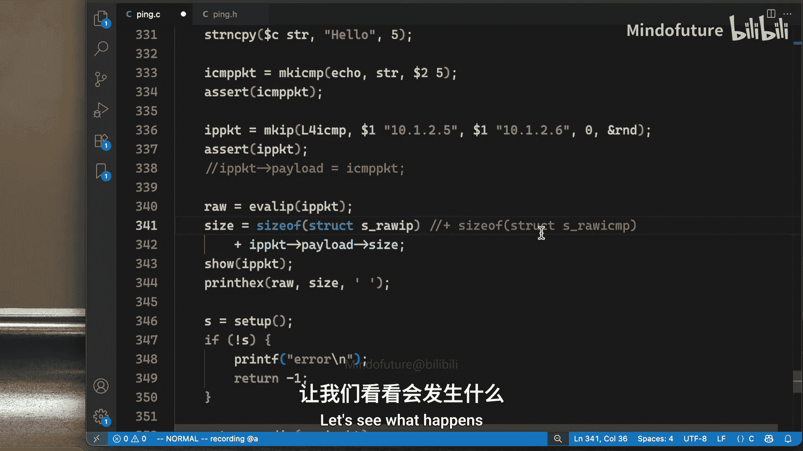

It will still be type， I think， I think So this should probably。Still trigger。

 but let's see if it does。Okay， that did not work very well， did it。

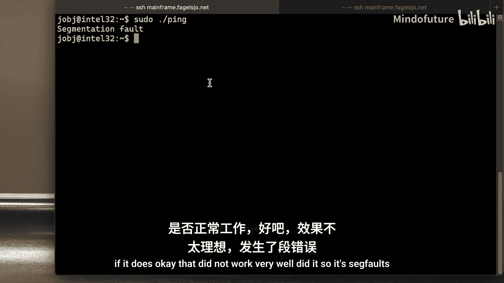

So， it's se faults。Probably because it tries to evaluate。The payload。嗯嗯嗯。

Because we are telling it that it is an ICMP。And now we're telling it。It has no payload。

That's probably why it crashes。 it shouldn't crash， of course。But。Did it anyway。嗯嗯。嗯批。

It's probably somewhere in the Eval I P。Okay， so this is going to be true。 Procol will be one。

By the way。为什么。就。Because。

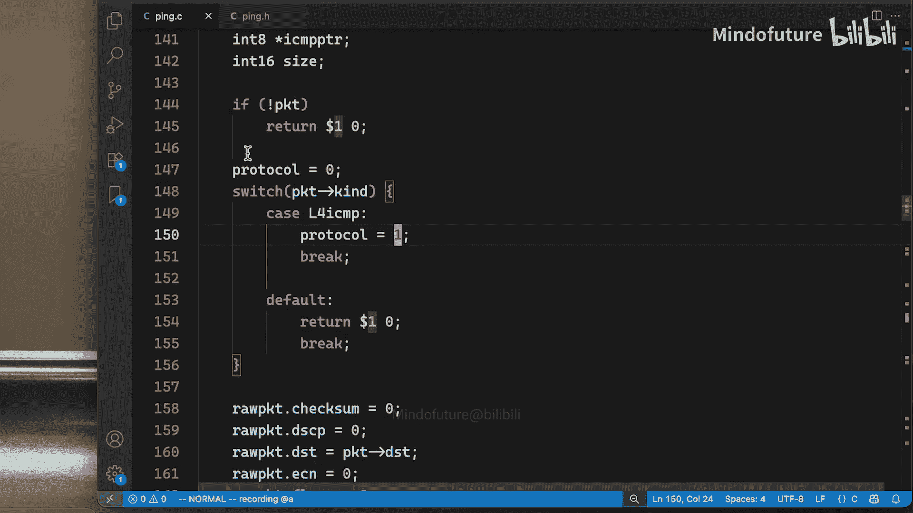

Check how they did it。When we tried to run the regular pin。Tras。です。IPa pro ICM。Is this。

Something which evaluates to one。Yeah。So。That is probably not。

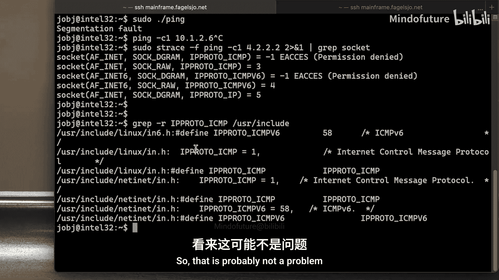

No problem。Because we set the check some to 0。length。Well， here is the problem。

 we calculate the length based off of the packet type。So it's kinda hard to send。

Something completely0。

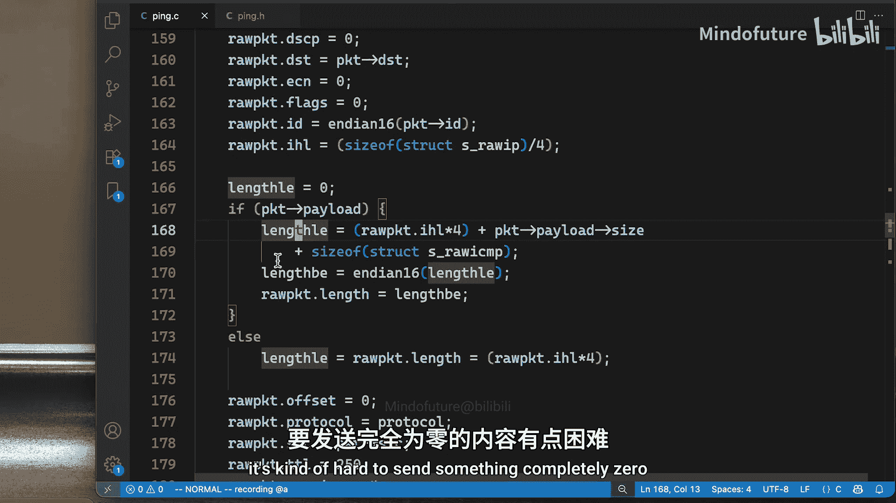

Yeah。

。All right， guys。 welcome back。 So I have been looking through this a little bit。

 and I think I have found。A couple of hours。So， let's start by。Pultting this back in the order。

 we have this before。 So let's remove。These edits。 So it's on the entire。And payload。

I think that was。No this too。

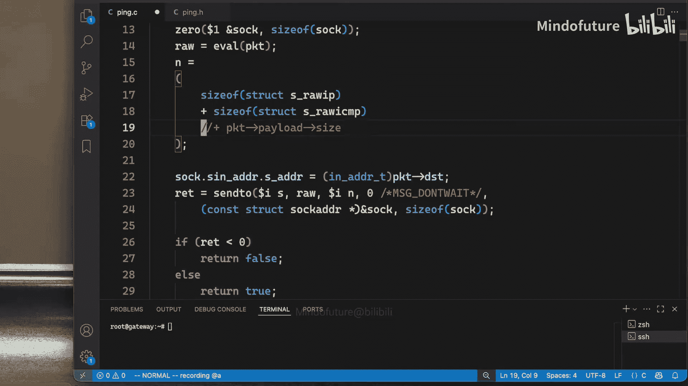

Solow。I know it。Thing。Yeah， we get there because we don't。We're not rude。

 and I just wanted to see that it looked like before， but if we look closely。

We see something weird at the end here。 we have a couple of0 bytes。

 which we shouldn't have because here we should have the payload of the ICMP packet。

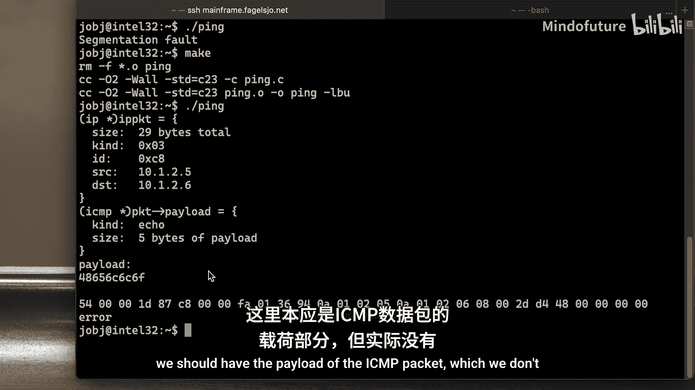

Which we don't。 And the reason for that。

Si。We we。つ。E about I。When we turn the。Structure into a。Theies about。

I made the calculation a little bit bad， when I calculated。

The payload that we are copyping into this。Because。Well， first we eval the as&P and that works fine。

 but when we copy this thing， I'm using the payload size。As the number of bytes to copy。But。

We need to take the header into account as well， right。So instead of this。

 let's reuse our size variable and set this to the size of。The raw I seem you packet。若爱。嗯。And then。

 with plus。配の。蓝一次。No， we can。Here。Besides。All right。

 so this is one of the reasons that this wouldn't have worked。😔。

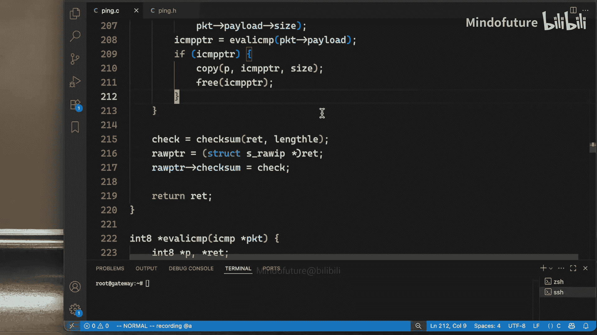

So if we recomped。Are around。Now， we can see that we are sending on the bikes that we should send。

Okay， but this will still fail because that's not reason。😔，For the error。

 it took quite a while for me to be able to interpret that error correctly。 but if we。

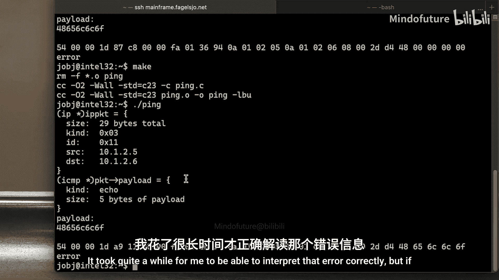

We can use this small terminal here。 I hope it's visible， at least。嗯。To anticipate them。

And we w to grab I see Pe gift， and let there。Let the source be1。2，5。Like声。

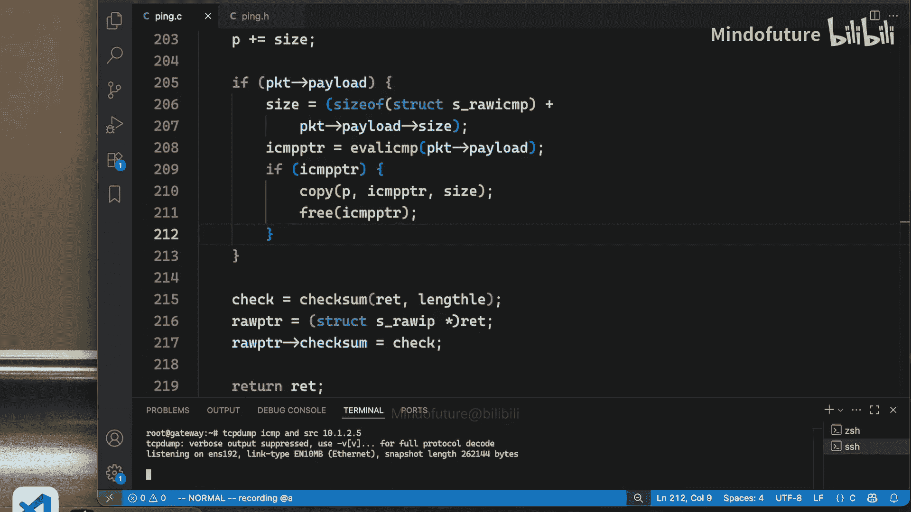

And now we go here and we run this as roots。And we get the true response。

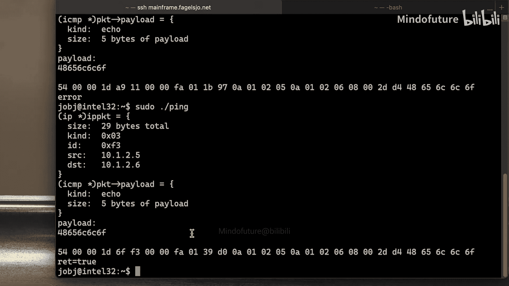

So let's see how this looks。Yes， we get this。And if you look at this。I P 5 is invalid。

And that's a very important clue。If we go into the aurora， I pay packet it。

There's a lot of stuff going on， but the first two here。嗯。It's four bits with a version。

 and it's four bits with the。

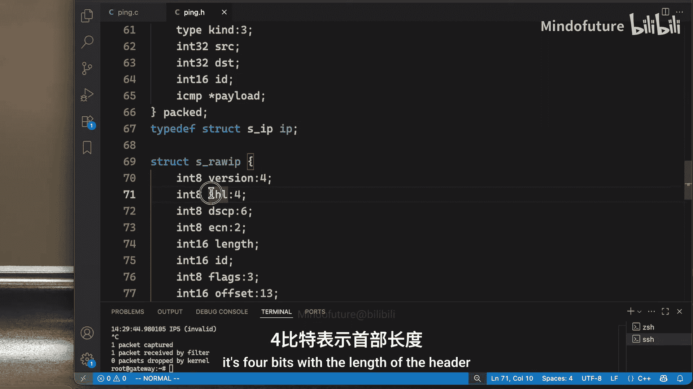

Well， the length of the header。

And if we look at this。This first you buy it here。There is a5。And the four。And the。

The size of the I header。That's。That's 20 bytes。 And this is in。Multiples of four。So。

20 divided by4 should be 5。 So 5 is right。 and 4 is the correct version of the I， but they are。

In the wrong order， as you can see。

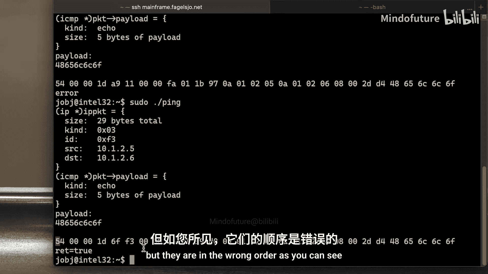

And why does this happen？Because if we look at the。The code。

They are in the right， or the right here。And if you remember。We need to use network by its order。

And I mentioned that if we have one back。We don't have to worry。About that。Because there's not。

Two ways to express this if we have two bytes。Then we can express it like this。 B， B， A， A or A， A。

 B， B。 And this we have already talked about。 But why if we have half a bite like here，4 bits，4 bits。

Then it starts to matter again。Because。We the system is only dealing with one by granularity when addressing。

え？Memory addresses。 So both of these share the same memory address。And this means that we。We need to。

Reverse list to。So if we were to say， in8 IHL。For here is that。Remove this。I think that is in enough。

Alright， then let's see if this works。Let's restart this this PM。

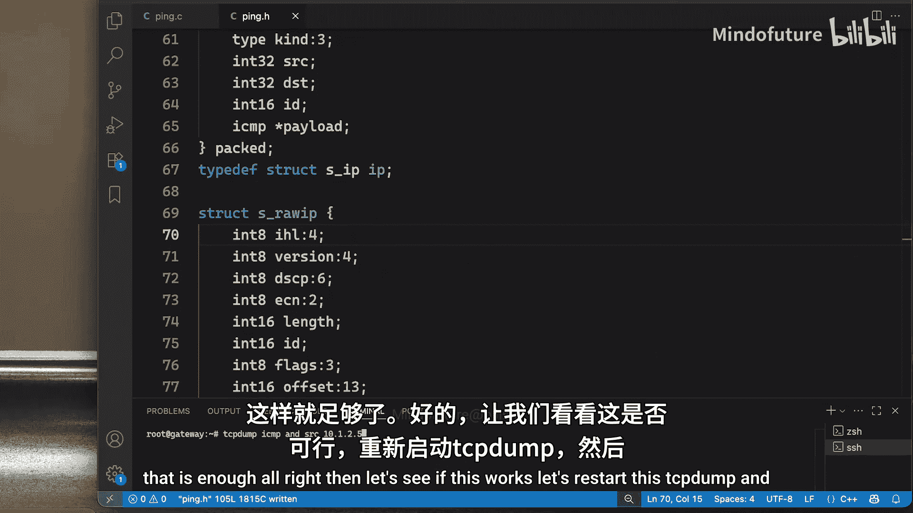

Lets。

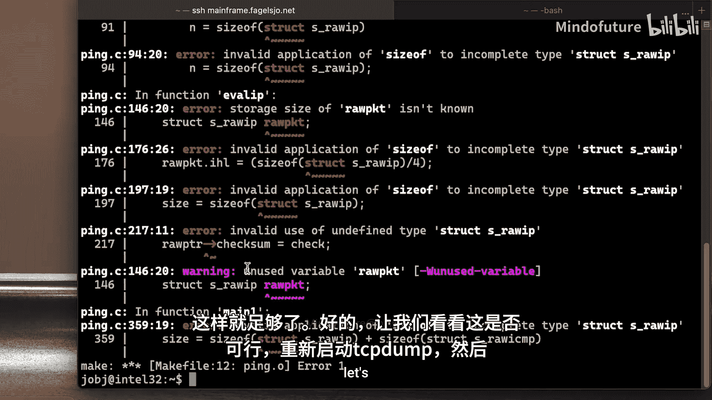

咁系。顶。

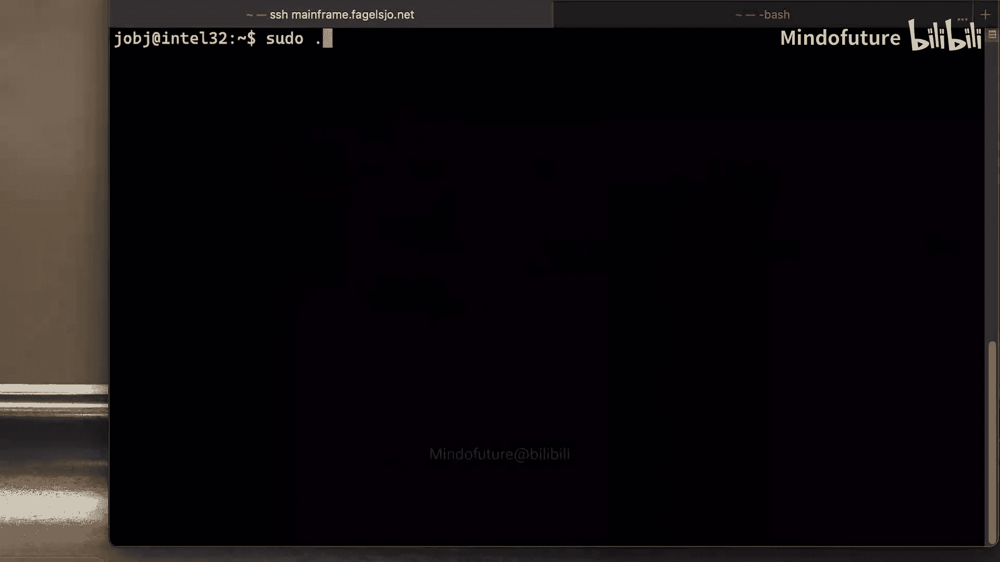

See what happens。

There we go。So we get an I packet。From this I P address to this host name。 And this is the current。

AB running the th。I sample back your request。 I D is this。 See is this。 length is 9。

So now we are successfully able to send。Rural IP packets and ICMP packets。We're just kind of cool。

There's one， though， what's this I D in this C。If we go to the Wikipedia page again。

If you search for right。一一？

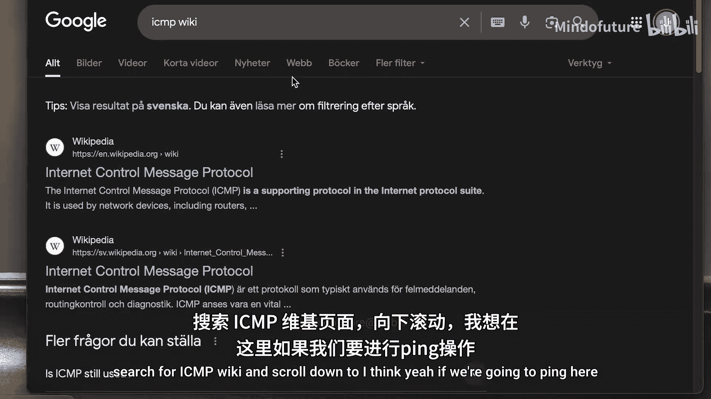

And we scroll down to。嗯。Yeah， if we' go to ping here。Okay。

 so this is the i pay header that we are used to the type field code check some。And all of that。But。

In the payload， where we're currently just sending some garbage。And there。

This is not the official standard， but this is what most uses。

AndSo we have a 16 bit identifier field， which is。It's to。

 if we're running several pings at the same time。This should。诶。Identify the process so speak。

And the sequence number usually starts at the one。And this will increase by one。4 each and every。

A packet that we are sending。So， we should use。This stuff as part of the。The payload。

So how can I do that in an easy enough kind of way？

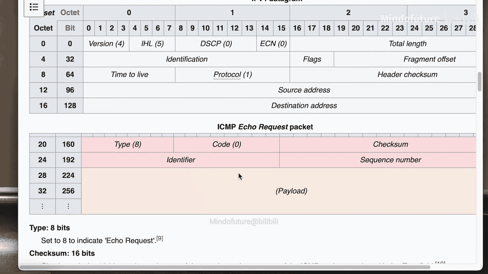

I think the best way would be to create a。S， a new structure。This is a。Well， a pink pe。

And here we're gonna have a 16 with file。For the I。And we're gonna have a 16 B field for。

Sequence number。And then possibly， someday， the。TheIn the。对的。Because usually， there is some。

Random day though similar。Inside this。All right。So。

Let's see if we go to the code where we create this packet， it's currently inside of our main here。

 but this is temporary。And this is what we have inside of the packet。Current。But。😔。

Instead of using this SDR as an in8。Let's say SDR is something else。 It's a stress。St。Like so。

And when we create this thing。To calculate the size first。そ那。嗯。AndSo。Right。And we have。Let's see。So。

Let's say we have4 bys for the be。Something like this。we咩。Size bys， instead。嗯。Exper。

And now we need to fill in these two fields。So。Let's start with the I D。Let's say we set this to。

 I don't know。嗯。5000， perhaps。This can be。Anything， really， Any 16 best number。

But we need to put it inside of the right。え？Back多日。And then we have the C。Same here。

And let's start with the one here。And now， instead of copy it to the SR。

We are going to copy into STR。And we have4 bys。Or three Bs and a theabb at the end。So。

 let's just send ABC。Like this。So this is our new payload。And when we make our ICP， we need to。

没 sure。We use。Size by。he。Think得姐。

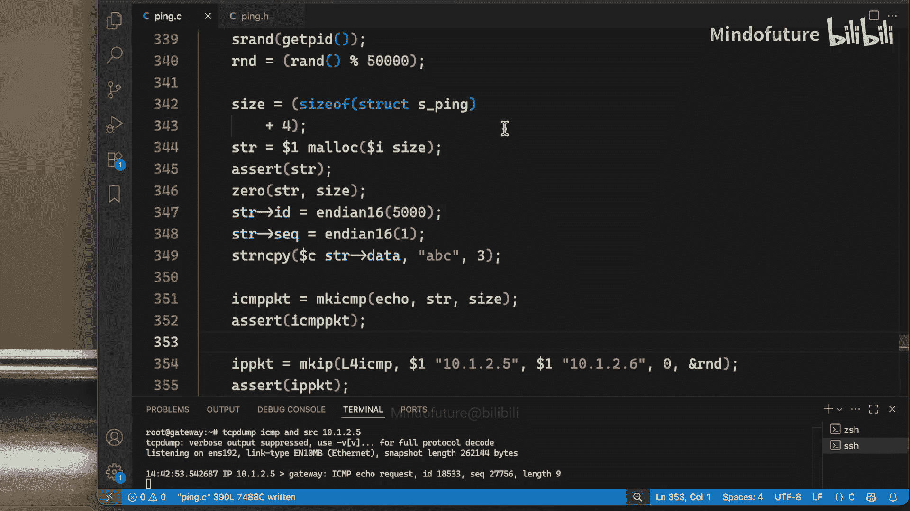

Let'sTry this again。mmm。

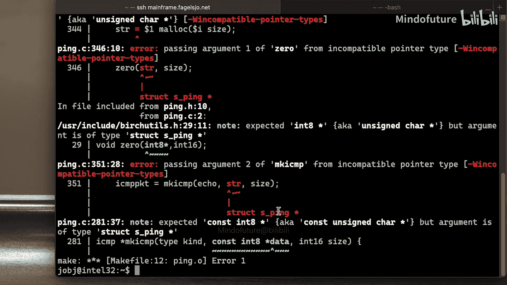

嗯。It's not a string anymore。 We need to change the cast。

So。

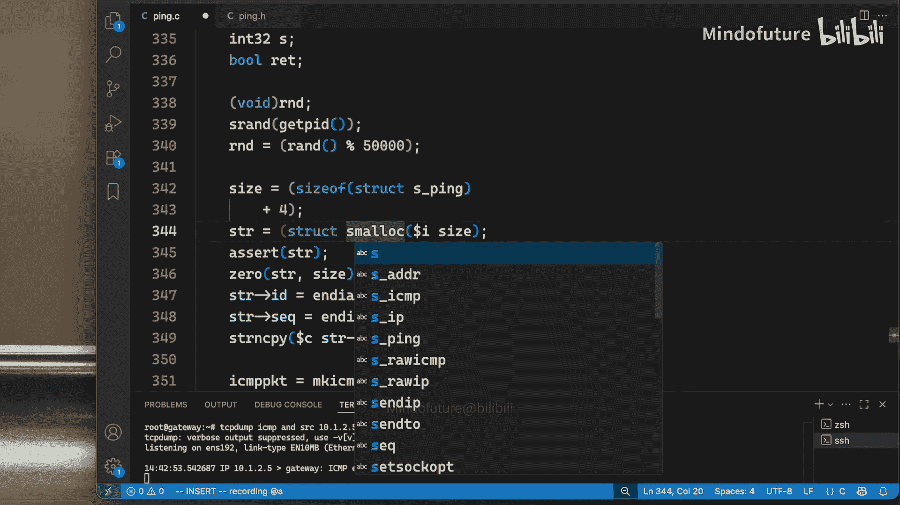

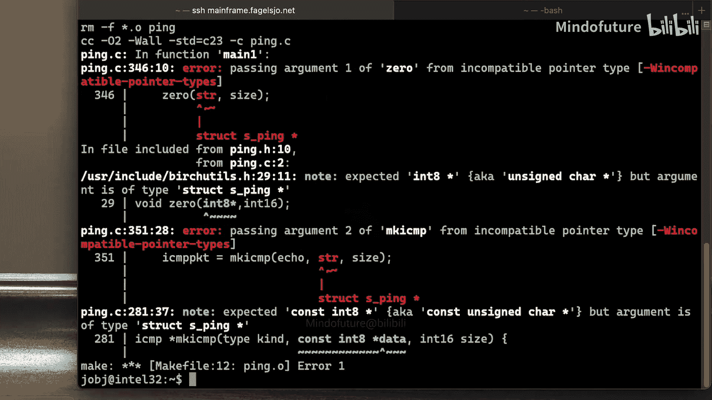

嗯。せよ。Same there， but the other the way around。

So。When we zero it out， we need to turn it into。Okay。

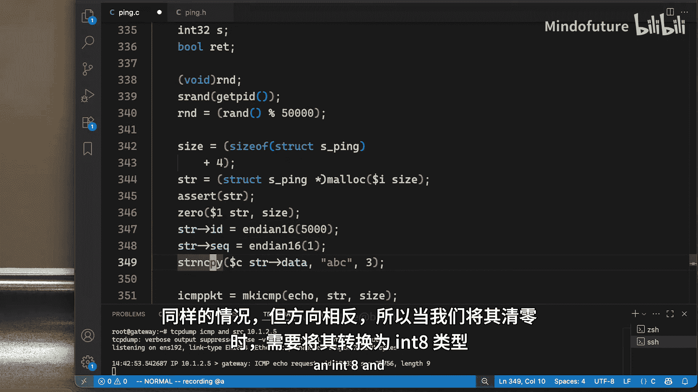

嗯。And no， I think you should。

そNoほ。

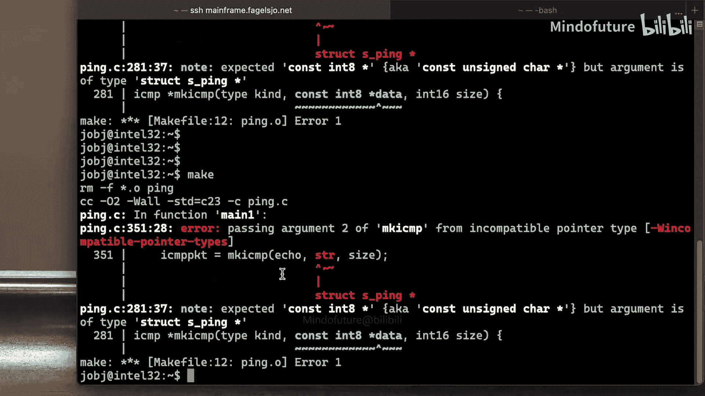

You'd expect a series of bites when we create it as well。So。Yes， yes。いきそ？

Now let's jump down a little bit here。

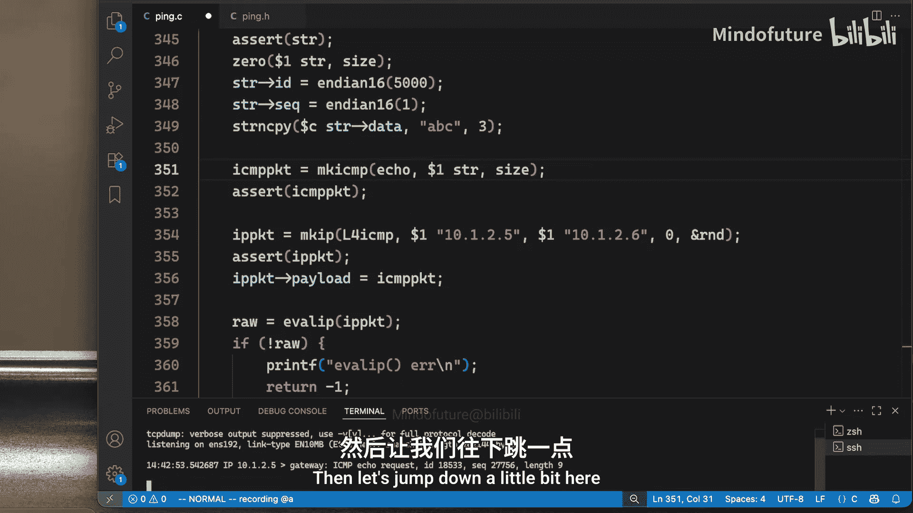

All right。So let's see what happens when we run this。Okay， no error。 It's good。

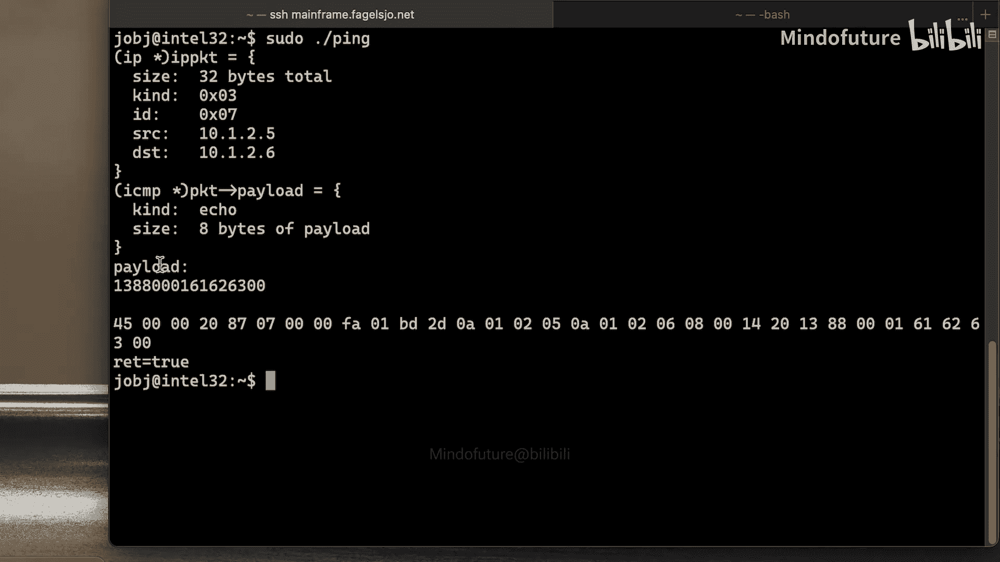

Now we have8 bys of payload。

All right， so if we look at this。There is a package from this I。 I simply echo。

 The I D is 5000 and the C is one。And the length here is the length of the entire ICMP packet。

We can send our packet and next time we will finish this thing。And maybe after that。

 we can start building some really cool stuff with this kind of logic。

So I hope you liked this episode， please like and subscribe。

And hit the bell icon if you want to know when the next one pops。

Thanks for watching thanks for today。

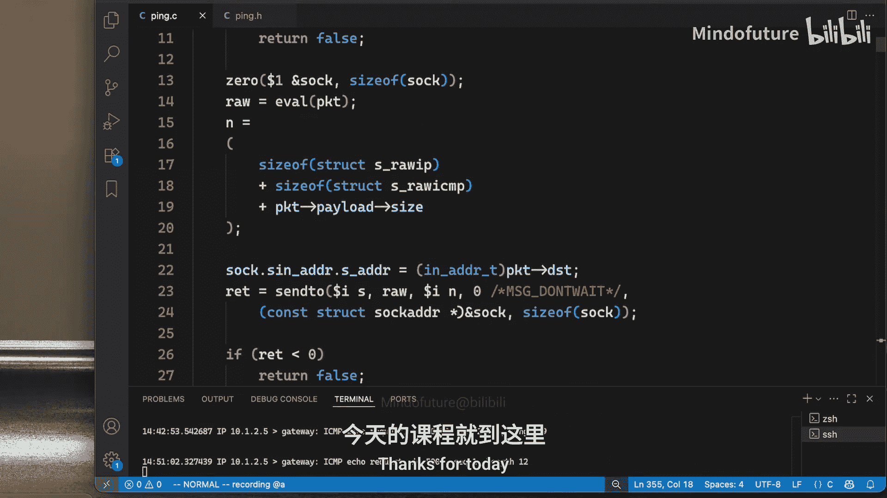