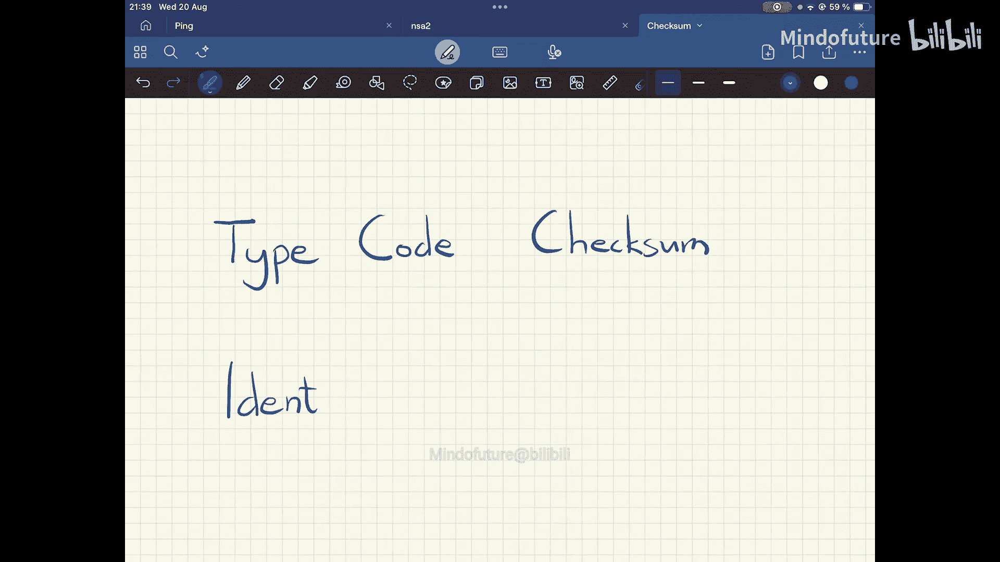
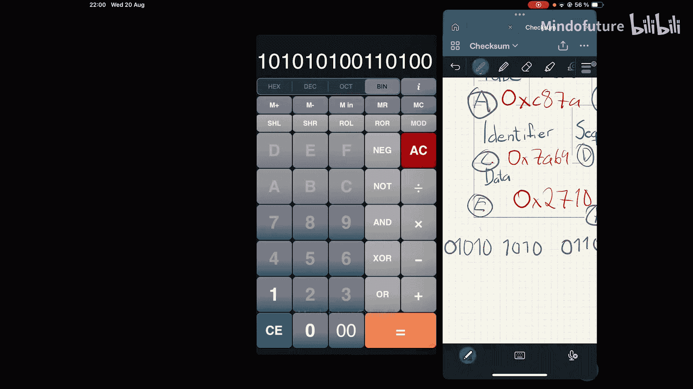
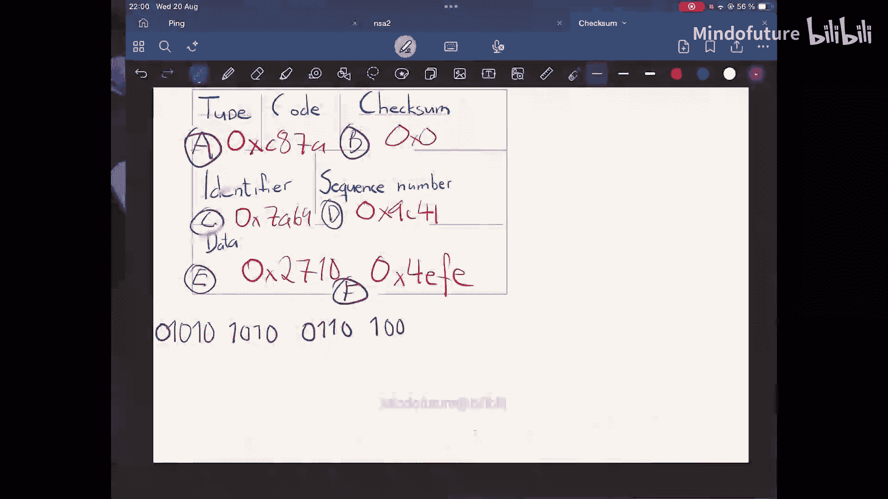
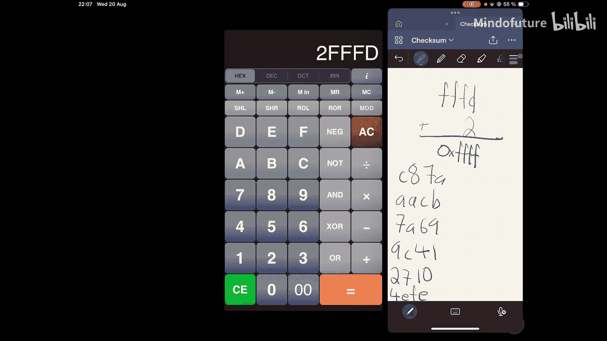

# 【Jonas-Birch】使用C语言从零编写Ping-｜-Ping-From-Scratch-p04-P04_计算互联网校验和--BV1rwBTBUETy_p4-

All right， guys， welcome to today's show。 So today we are going to focus on the Internet checkup。

And we have been talking a little bit about this before。

But today we are going to go in deep in the internet， check some。

So let's start by sketching up a simple ICMP packet。

 so we have something to use for our calculations。

All right， so here we have the sample。Yeah， I simply packet it。

 And this is not a specific application。 I'm just going use this as。An example。

So let's fill out this with data。 If this were to have been a。An echo packet for， for instance。

 the Thai field would have been 8。And the code field would have been zero and so on。

 But I'm going to use slightly bigger numbers just to to make the calculations a little bit more interesting。

So let's say this is a new application and that our type field is going to be 200。😔。

And I'm talking about decimal numbers now。The cold field。Let's say that is going to be 122， say。

And the identifier。Let's say it to。This。31，3，3，7。And the sequence number。I don't know， let's say。

For0。😔，Thousand。One or something。And what should we put inside of the data field， well， in ICMP。

 you can usually put pretty much anything in there。Depending on the application。But。

 I'm going to use a。32 bits。Datafield。And let's say， we put in something like。

If we divide it into 16 bit fields， I want to have 10000。And。20222。 So that's our data。

 just so we have some numbers to work with。 As you have noticed， I。

 I left the check some field empty。😔，And when we calculate this stuff。

 we always assume that the check some field is 0。 And then when all the calculations are done。

 we will replace that0 with the right thing。The first thing we need to do or at least what I am going to do is to change these numbers to hexadecimal numbers。

 just to make it a little bit easier to calculate。😔，So。😔，Let's see。I think I'm gonna do like this。

 So，200。1，22。This number。Alright， so I'm gonna start my。Exodestimal calculator。Here we go。So。

Let's begin by clicking decimal， entering 200 and clicking hes。😔。

And hexodadeciimmal numbers use this pre prefix0 x， and then。Whatever the number is。

So I'm going to follow that standard。What is the next step。Well。

 when we calculate internet check some， we are only dealing with 16 bit numbers。Which means the。嗯。

We have。These two， which is 116 bit number。And this check sum0 is one。

Maybe I can make this a little bit bigger while we do this。The identifier is also a 16 bit number。

Same with the sequence。And then we have these two。え。60 bit numbers， which comprise of the。

32 at data field in this case。All right。So， what I'm gonna do is。I'm gonna remove these。

Borders for now。And clean this up a little bit。And I'm gonna put in the。So in this case。

 it's going to be0 x。See it。7，8。 So these are。Those two combined， right。The check sum is just0 x0。

Identifier is the same as we。Have done there。Sequence number， same there。And this data field numbers。

 I'm going divide into2。So， we have 27，10。And we have 4 E。Fffy。

And I'm also going to give each of these。And。An identifier。So， this first one。It's going to be A。

This is going to be B。And then we have C and D。😔，And以。And if。Okay。

 so how do we do these calculations now。Well， we are going going to。Calculate something。

 which is called。It sounds very advanced。The once。Compliment。S。And。

What that really means is that we are going to sum up these numbers in a specific kind of way。

Far less advanced than it sounds。So， let's just do that。I can remove these at the bottom here now。

So we have some room to work。And now， I accidentally。Did this one as well。 So let me just put this F。

Here。All right， so let's add these numbers up。So。I'm gonna。Make a little。Table here。

For the calculation。 So we have this。We had this。And the resulting check sum number。

Needs to be a 16 bit number。And as you can see， these numbers are quite large。

 so we need to handle what happens when we overflow the 16 bits boundary。Alright。

So we're going have the plus。Prime。😔，Operation， and that's just how the RF for the Internet checks some。

Yeah。Deote this type of one complement sum edition。Allright， so let's do this。

I need to make this line better because I don't have enough room here， I think。😔，So。

 let's do something like。This。Okay， so let's go back to our calculator。

And now I will just try to add this up。😔，To begin with。So what we have is the CA。7， a。😔，Fus。Ciral。

Plus。And then， we have the。7。え。69。We have 9 c，41。We have 27。Teng。And finally， we have4 E F E。

And this is the result。😔，So what I'm going to do is I'm going to。Type it like this。

 I'm going to put the two here。😔，And then， a little bit of space。And then，5。five。th3。2。

And as you know， the 16 bit taximal numbers are up to four digits long。And here， as you can see。

 we have five digits because this overflows and this is what we need to account for when we do the calculations。

So。If we go back to full screen here。And this is where the one complement sum comes into play。

 and this is much easier than you might think what we do is we take this result。The right part of it。

 so。We have 5。five。😔，3，2。And then we have this additional two right here。😔。

And we do a regular p of these two。Which means the result is going to be 5，5。3。😔，4。Okay。

So this is the ones complement some。We need to do one more calculation。

 and we need to take the inverse of this number。So。If we， for example， had something in binary。

 which is1，1，0，1， for instance。If we do this inverse or complement operation。😔。

We just flip all the by bits。So these two ones become zeros。And then a1 and a0。

So that is what we need to do with this number。So， let's。Let me just。Put this number somewhere。

 first。So we。😔，Have it saved？So it's 5，5。3。Or。And now I can clean up a little bit here。

Let's remove this as well。And why did I number these like ABC and so on。 That's just so I can。

Show you that your calculations is based on。We have。Yeah。We have the a。Plus， the B。

 We have the C plus the B。The E plus the F。And then we add those together。Alright， so5，5，3，4。

 let's see if we can turn this into binary。Let's go back to our calculator。😔，And clean this up。😔。

<|OTHER|>The number we heard was in heck。5，5。3，4。And we want it to be in binary。😔，Let' see。So。😔，1，0。

1，0。And then， we have。1，0，100。1，1，0，1。😔，0。😔，S。And these are 15。 So let's add。

Let me just count them 1，2，3，4，5，6，7，8。嗯。And11。12，13，1415。So need add 0。In frontronier。

So now we're going to take the complement of this。So。1，0。😔，1，0，1，0。And then， we have。1，0。😔，1，0。

So that's the first eight bits。😔，And then we have two ones。2 zeros。And then。1，0，1，1。

And I will have only one step left。And that is to。To calculate this binary number and see what we get。

So。😔，1，0，1，0。1，0，1，0。Wenwen。0，0。Wen。😔，0，1，1。And in hexadecial， this is going to become AACB。So。

 if we。Clean out this s in the checkum field。We can put our Internet checks on A A。Xi。😔，Okay。

 so how do we know that this is actually the correct one。Well。

 that's the interesting thing with this。Mathematical formula or whatever。

If we just add all these together。So。I'm talking about this。😔，This， this。

 this and this like we did before， but we also add this。

Then we should get a rather interesting result if everything is correct。😔，So let's see if we can。😔。

Manage that。And the。Some operation， when we add these up， are the same as we did。😔，え。

From the beginning， so it's a one compliment sun。😔，Resulting in a 16 bit number。

So I'm going to put all the different parts right here。And as before， this is a plus prime operation。

😔，All right， so let's see if this is right。Yeah。I'll use my calculator again。And clear this out。

And we will have。嗯。C a。7， a。Plus。诶诶。随便。因 we continue you。😔，With the rest of the numbers。Mmm。

And we have 9 C。41。We have。😔，2，7。K。😔，Finally， we have。For。😔，Yi。FE。

So if we do it like we did it before。😔，We will have a two right here。And then， F， F。Yeah。Di。😔。

And then finally， we did exactly like we did before。😔，You take this FF。Yeah。对。We take the two。

 and we do a regular。Plus， operation。And as we can see， the result becomes the hexelismcimal number。

0 x F。え。え？嗯。And that is how we know that this is correct。

So。If we have calculated the internet checks sum correctly and if the numbers are correct。

We will always get。4 f。As the result。 and that is why this is so commonly used on the Internet。

 not just for IP， but also for TCP， GDPDP。IP itself and a lot of different other protocols because it's very easy to calculate by hand。

 but also with a computer in software and hardware。And。It's very easy to verify that it's correct。

Because all we need is one of these packets， we divide up in 16 bit parts。

And add them all together in a one compliment some fashion。And if we get the result， all F。

We know that this packet is not broken。So I hope you liked this episode， a rather special one。嗯嗯。

So don't forget to like and subscribe。And thank you for watching。 Thanks for today。

