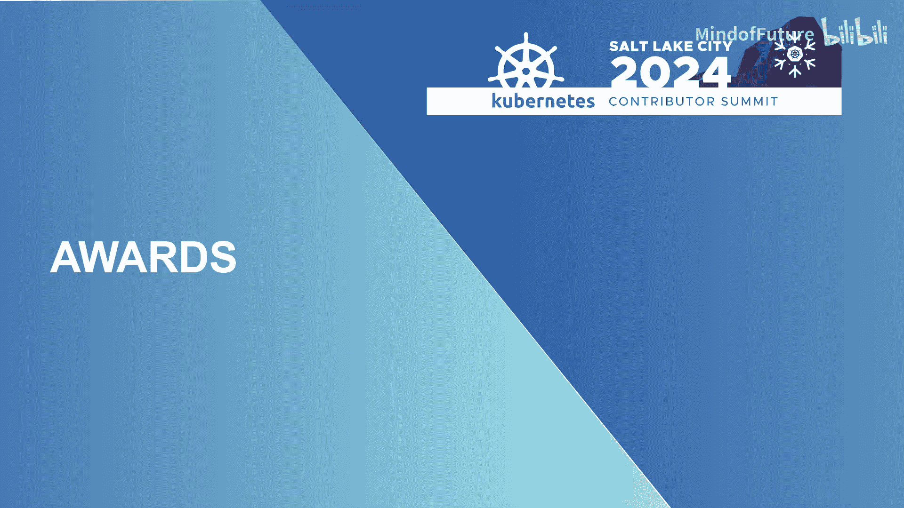
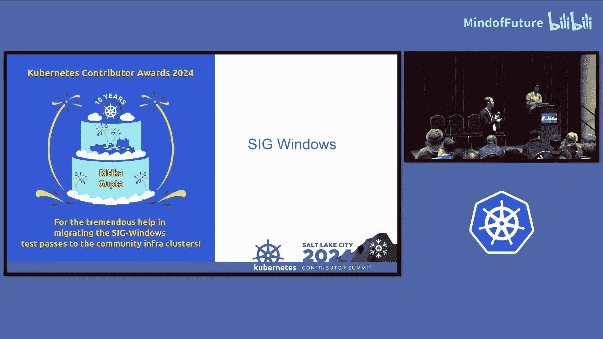

# 【Kubernetes】k8s贡献者峰会（2024北美）-p01-Awards--BV1kq6XYfEsx_p1-

Before we start with the awards， we also want to thank one special person that basically helped us organize the various。

😊。

Thanks， the various contributor summits throughout the years， not from the community side。

 but from the CNCF side。 So Ban。You need to come here。 No， you need to come here。

And I'm really bad at rapping gifts。So who never met Pri Prine basically helps organize all of this from CNC F site and gets annoyed by all of our questions and requests and stuff like this。

 And shes not part of the Mainer Smit team in the future because she has other things to do at Lis Foundation。

 however， we still want to say thank you for all of the events in the past。

 And Josh actually brought and no，😊，You get a cup， A special Kubernetes cup that is。

 you will never get anywhere， except you get them from George。And because I'm bad at rapping gifts。

You get a Kubernetes logo out of Lego that you have to assemble by yourself。 It's 550 pieces。

 and we want to see the result afterwards。Allright。

 And now we want to continue basically honoring people that have done outstanding things in the Kubnetes project for a couple of years。

 but especially for the past last year。And we want basically to start with Si API machinery。

 And we want to honor Maic。 And I'm sorry for butchering all of your names。 I'm really sorry。

 Zakkovich， if you're here， please send up， this is your outposts。

I will not read all of the descriptions because we have 4D awards or something like this。

 So we need to。Be fast。turnI'm going to have to read from the big screen because my eyes suck and also sorry for pronunciation。

 So from SIG API machinery Lucas。Sa。Oh come on， this is why you may have me go second， I'm sorry。

 thank you， Lucas from API machineinery。All right， of course。

 I'm the one that is basically taking the easy names。And this is very。

 very special because this is basically how we started today when we merged the。😊。

The the last missing test， FYI， it is merged now， and we need to fix some things。So。Thank you。

 Stephen。Heyward， for all of the work that you have done。 And this is your applause。From Sig CLI。

 Ma Zuk。All right。From6 class life cycle， we have fan Boa Bofa。Another from Siig cluster Lifecycl。

 Christian Schlaughter。Another one from Si class life cycle is Max Gotier。Thank you。

And from Sig Conribes， Arvin Parek。Also from Si Cons is Jason Bragen Brugenza， thanks。

Another from Sig Contrix Mario。Yeah。😊，Another one from S X is Noah Kviitz。And again， from Contris。

 Cip Kennabar。Another one from Scon X， S arm， We it。😊，From Sig Doocs， Abigail McCarthy。

Another one from Si Talks is Tipesh Gt。 thank you so much。For Sig AD， Ivonne Valdeez。Yes。

 I said if you're here， you can stand up， of course。 That's for you。

Another one from S ATCD is Can Sang。 Thank you。Now there's a ED， Weiffu。Sk instrumentation。

 Catherine Fang， thank you so much。😊，Sick instrumentation Man Ruger。We should have switched this。

 I'm better at German U la。EFor Si Inra， Ricky Zowsky， thanks。Siginra Marco Binch。Sorry。

For syig multi cluster， Mike Morris， thanks。Sig Network， Chuan Tian。ESick network， Damen awar。

Sig Network， Maade。Scry，oky， sorry。So sorry。Also from Sig Network， Dave Prataovsky。

From Sode Peter Hunt。Thanks。Also from Signd， Francesco Romanmani。From Sg releaseese， Meha Belodia。Oh。

Also from Schronny release Wayom Yaov。From Sig scalability， Harsh Kuna。

Also from Six scalability Praique， Georgia。Again， from Six scalability， Justin Santa Barbara。

From 6 scheduling Shengchn。From S security。And Chaman Chapathy。Also from Six security， Ayla Dbury。

From the Six storage， Bafathanan。Also from Six storage， Rawa Shah。From Sig Windows， Ratiika Gupta。

