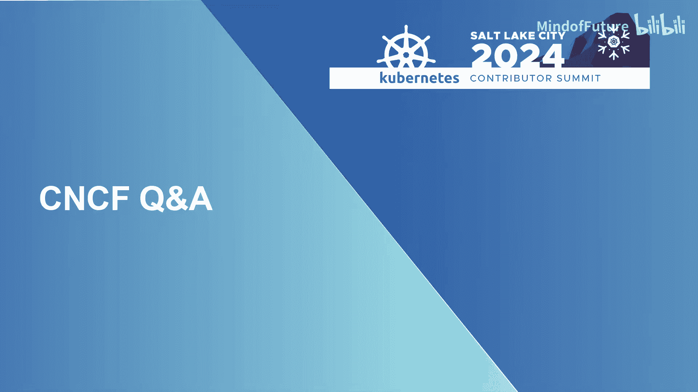
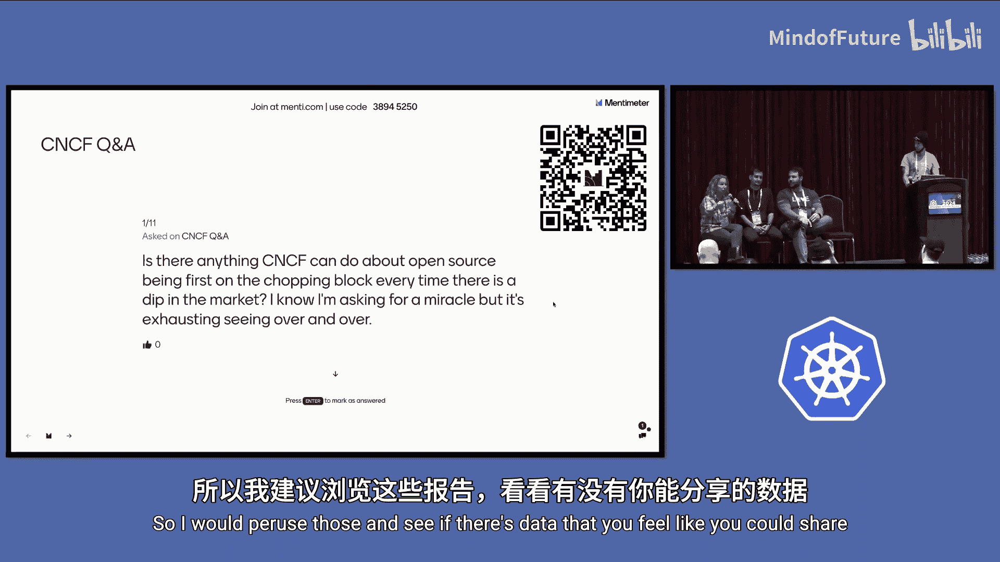
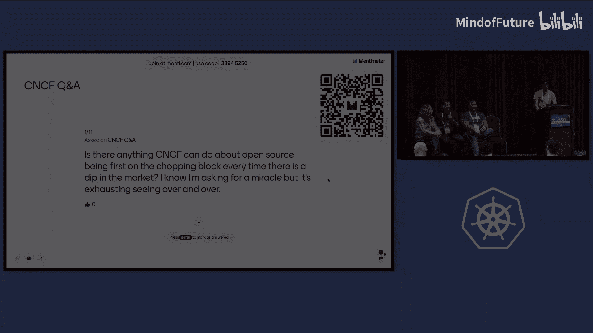

# 【Kubernetes】k8s贡献者峰会（2024北美）-p02-CNCF-QA--BV1kq6XYfEsx_p2-

Hello， I think everyone knows me， but if not my name is Jeffrey Siika， everyone knows me as Gfi。

 I am head of projects at the CNCF that really just means I interact with projects and try and make them super happy。

 whether that's CI or whether that's trying to get an event in Minneapolis。

 you know who knows I have been a Kubernetes contributor since 2018。

 so I like to think I know all of you。

I also helped run the contributor sumummit for a few years。 so yeah， that's me。Who am I？ Well。

 I'm still trying to figure that out。 Hi everybody。 My name is Taylor Doal。

 I'm the head of ecosystem。 I get to work with our end users working within the entirety of the ecosystem。

 So like into its adobes Apples， people that are taking CNCF projects and putting them in their businesses platforms。

 not packaging it up and reselling that。 So end user needs are very different from vendors and just overall very interesting。

 Obviously could talk to you for hours about that。 I started Kubernetes about the same time as G it was really fun。

 I think I got to meet everybody in like San Diego was my first Kecon。

 And now I can't even count how many I've been to， but happy to be here with all of you。😊，Hi。

 I'm Angela Brown。 I am the。Senior Vice President general manager of Events at the Linux Foundation so my team also manages and works with projects on their events so we' have been working with the CNCF team and this awesome community since CNCF started actually we started working on Kubcon before CNCF started so everyone you might work with Vanessa Herrick Tina Krauss and the sponsor showcase things like that they're all on my team and I'm here to answer any questions you have related to events thank you。

Thank you very much。 We already have four questions， which is great。 Let's start with the first one。

 How can we fix the maintenance C free throughout the different projects。😊，Magic。

I don't have a good answer， but what I do have is。A story I was just talking about with Christph and Jeremy about the fact that Bob and I are trying to solve a problem。

 and we have different solutions。It's literally this， we're trying to figure this out。

 It doesn't help that we have a taxonomy problem。When you talk to someone that's a CNCF staff member and you say a maintainer。

 they only mean maintainers CSV， they don't mean a Sig chair。

 and that's coming from Kubernetes that's fundamentally broken， so we're trying to solve。

Keeping that updated and also fixing internal taxonomy。 I don't have a good solution。

 I have possible solutions that we're talking about。 I am happy to get into that， if you want。😊。

I don't know how someone could say yes or no without giving up who they were。い。

I'll close my eyes and someone can shout yes。Yeah， okay。

 so one idea is we might require something like a Yaml file in the community repo for every project。

 the problem is the maintainers。 CSv。Internally， the CNCF has a copy of it。

 and we have the maintainer' emails。 And that's how we add people to service Dek。

 And that's how we add people to things like FSA。And we know that people don't want their email addresses up publicly。

 so one idea is use LFX because LFX requires you to。

 when you log in and create a Linux foundation profile or LFX profile。

 whatever you want to call it you have to set your email in there so we can you know sync up a Github handle with an email and then do what we need to do that's one possibility。

 I don't know if that's a good one or not， it feels clunky。This is。

 this is why Bob and I are kind of going back and forth on this。 Go ahead， Eddie。

But thats that's only for Kubernetes。 This is something we have to consider for all the projects。

 That's kind of the problem。 But， I mean， I agree。 And that's actually an argument in Bob's favor。I。

 I also would like because the question is obviously for me because I said yes。

 I would I would also extend on this and ask the different perspective is。Currently。

 every project that joins。Can define how they define a maintainer。Which basically means that。

 for example， for some projects， you have like， they just dump everyone into this。

 And then all of them have basically voting rights。 And for example， for Kubernetes itself。

 we only have steering in it。 And that's it。 We have， I mean， we have counters and so on listed。

 but without voting rights。 So， and this creates like an。Unbalance of projects。 So like。

 how do we fix the maintain status or the voting， I mean。

 we dont do not necessarily need to fix the maintain status。

 but how do we fix the voting status of different projects， so。

Oh I just said that is a pickle so this is interesting and in my opinion kind of fun years and years ago we actually had certain weights depending on the project like graduated to have a certain way incubating sandbox and whatnot that became way too difficult for Amy to handle when Amy was here and she was the only person really doing TOC and elections and everything and so we moved to this maintainer only kind of move and that was before certain other projects literally dumped their entire maintainer list in Ben may or may not have asked me what Kubernetes should do back in Paris and I may or may not have said do it。

嗯。Mainly because I want to see the world burn， but also I want to use that as a forcing function to try and fix this。

 I think we're in a much better position now with certain automation with the improvements we are trying to make with maintaintainers CSV to be able to move towards this。

 all right， everyone that's a voter can vote on an issue and then you know the majority of Kubernetes says。

 yes， we want to do X。Kubernetes is their vote with a certain amount of weight does X。

 does that make sense？Like it lets everyone in the Kubernetes Project still have their vote and then depending on which way it goes。

 Kubernetes vote goes a certain way。II think those will make sense。Alright， next question。

Are there plans to optimize the TOC appointments or it's not so much appointments by companies？

short answer is yes。That was another topic that was discussed at the TOC meeting today。

They have a couple ideas， it's really not my place to say what those ideas are。

 but the intent is that it will。Kind of minimize， not minimize。

 but there will be more community T O C members and less T O C members that are appointed by the G B。

Any additions to this。If not， we go to。What are the most exciting things on your list for supporting projects。

 Mainers and Kubernetes in 2025。😊，Maintainer summit is one。

 though there are mixed feelings on the maintainer summit。

 I think overall for project and community health， I think it's going to be really beneficial。

 I'm excited about it。U。A lot of the work that Bob is doing in the background that y'all unfortunately haven't been able to see because he left you and then moved over to his better half。

嗯。No， a lot of the work that he's doing is probably going to come to fruition in mid 2025。

 and it has to do with demonstrating and showing like community health， community growth。

 and more importantly， ROI for companies to reinvest more money into open source。Like。

I'm not kidding and he knows because he's doing a presentation with him。

 He was in his room all yesterday just working on charts for one of the talks at the GBB tomorrow or Thursday。

 Thursday， Thursday。So those are the two things I'm really excited for。Yeah。

 and ROI is return on investment， not return on imagination， well， maybe a little。

I thinks the stuff that's been done in LFX so far has been really interesting as well and seeing people's feedback because you can craft up an idea of what you know we see like we have an idea of what we wanted in devts and things and it's been difficult to get certain types of representation of that data or you just pull it down and you work with the raw data on that front so it's been nice to see some of those editions in LFX I just came from a meeting with end user technicaln advisory board where they were talking about Project health and so I think that they were asking like oh which projects are involved and I was like oh all of them but really curious to hear what people's feedback is the end of this year。

 2025 and what's useful that's a big thing that's going to help all of us out in making sense of the community and how different organizations are thinking about which metrics are important you know like entertainment company is going think about things differently they might use these projects differently too so again there are some clear path。

With vendors and stuff， but end users， that's just incredibly difficult because there's so many different ways to utilize。

Showcase that education on that front。 but so yeah， so more of a call to action than things。

 I'm excited for that to get solved in 2025。And I would just add on the event side。

We're making a little bit of a few changes next year。

 we had some KUB days this year that were sort of tested out in Australia。

 Colombia and Japan if you don't already know Kub Day， Japan is turning into a Kubcon。

 Japan next year， they are a bit earlier in their sort of cloud native journey and there's a lot of interest in growing that which I think will be very beneficial both for the community as a whole。

 and for the local community holding Kubcon， Cloud NConhan in Hong Kong this year is something we are going to do again next year I thought it worked really well。

 we were incredibly happy and that not only did we retain a lot of attendees from mainland China which was a concern of some of the member companies and some community members。

But we also brought in a lot of community members from across Asia。

 including countries in Southeast Eastt Asia， like Thailand， for example。

 that we really hadn't seen before， so that is good and then we are going to be doing Coup on India again which we have in just a few weeks that I believe we will be selling out and we'll be moving to a different area。

 Hyderabad in India， obviously a lot of contributors there and with visa issues and just economic and travel cost issues being able to kind of sustain that event there and move it around。

 I think is something that will be beneficial。And then instead of doing the COUB days。

 we did kind of update the KCD program this year， which Katie Greenley， who's back there rolled out。

 and one of the things that's new in this is that CNCF is actually making a financial investment in the KCDs to help those organizers so that we can kind of you know really grow that and help support those organizers as well。

 so from the event perspective。One thing that I want to add because he reminded me with KeepCon China。

There was a kind of impromptu I don't want to call it a maintainer summit。

 but it was a bunch of the local community contributors got together in a room and it wound up being like a 70 person you know mini maintainer summit for like two and a half days and they all voted on what they wanted to talk about and we talked about those you things it was full on conference really cool the number one thing that they wanted to talk about was how projects could talk to other projects and that's something that I've really like thought about and taken to heart and it's something that I've really want to try and work on in 2025 as well。

Additions to this。Then next question。How can a Kubernetes contributor community do more with enthuss。

There are so many options。 I would say there are， I don't want to steal their thunder。

 but I would definitely say stay tuned。 humble humble brag humble plug on Thursday。

 if you catch the keynotes， there's gonna to be some really cool announcements on that front。

 but there will be some pads on that front， ultimately with end users it's the hardest thing to do with those companies and organizations is time right because many end user companies are doing something else they're working in manufacturing。

 they're working on financial products there's just a lot going on。

 So it's difficult for them to take the time to then shift over and focus on things that are happening in cloud native for those of you that are maintainers and working in the space and helping to contribute I think that thinking about some ways that make it easier to share your wins or alpha beta GA features making sense of that so that the end users can be ready to upgrade or take a look at。

😊，The way that that fits into their systems is going to be really helpful and then the end users are going to do a lot more outreach in 2025 as well working with projects。

 feedback to projects， they're working very closely with the TOC I don't want to steal their thunder either but there are some ideas and how to better incorporate these groups together and present that feedback in a meaningful way so that the community can take action on that and it can be a bidirectional feedback type of loop but Bob also has some really good ideas on that front but I don' to steal Hill thunder either he's going to share those soon。

Alright， then。Will all four cube cons next year have maintenance summits。Number five。

 we'll start there。Yes， but probably varying shapes and sizes。

 so like Kubecon India is the first maintainer summit， it has a single。

 really single track and half of it is on conference。London were anticipating it being much bigger。

 Kubernetes is going have its own dedicated track。 And then the summit chairs are going to decide on three or four tracks。

 depending on， I honestly forget。 Unfortunately， the the maintainer summit planning for London is coinciding with。

Us here right now。 So theyre。We haven't decided on that yet。But yes， the plan I can jump in。

 We have tracks and they are already published， and it's6， well。I've been traveling。Be nice。 No。

 the intent is every Cubecon will have a maintainer summit。

 It just might be a single track with conference compared to a much larger maintainer summit。

 It depends on attendance。All right。Can we get Github handles printed on cube con batches without hacking the name fields。

Can we what， Can we get Github handles printed on the conbaes without hacking the name fields。

 So look look at mine。 Yes， yeah， like I type Jeffrey G G Yes， we can。

 registrationistration is not open yet for Europe。 so we could still add that in。 So yes， absolutely。

 yeah。😊，I like feedback。 I like ways we kid I'm not kidding。

 so many people have wanted that for years。 sorry， I didn't know， but yes， yes and yet。 I know。

 I know， but yes。But you're here give them my email address and let them contact me directly。

 sometimes it's the fastest way to things， but not December through March， but yes， absolutely。

Alright， this was easy and fast。 Are there plans to tie CNCF membership to also provide development resources to projects。

😊，Has it been talked about， yes， are there plans， no？That does not mean there is not intent。

 It's just， that is a G B discussion。 Please talk to your G B rep to have them bring it up。😀Yeah。😊。

I will not point。I will not。😀s。But really， is that is a governing board vote that needs to be brought to the governing board。

 that is not something。Staff even really bring up。We， we hear about it。

 and we try and tell like GB people， But it is the GB that has to make that decision。

 They vote on it， not us。Allright， then。I'm maintain Im maintaining an open source and considering applying for the CNCF sandbox。

 I am wondering if there are any mentoring programs available to help align the project to meet the requirements。

😊，That is actually a fantastic question。Right now， no， but the funny thing is。

 I swear half of you are in the meetings with the T O C this morning because you've brought up things that they have as well。

 It's really good validation at the maintainer summit in London， hey， Mario， surprise。

At the maintaintainer sumummit in London the TOC wants to hold a workshop for all projects there about moving levels in addition what they want to do is hold another workshop in the project pavilion for prospective projects on how to apply and what gotchas there may be one of the things that the TOC realizes is there is a massive knowledge gap and people just kind of。

Jump without looking because there's no real resources unless you decide to read a bunch of GiHub issues。

And that's not really sustainable so the TOC does want to address this so there is not one mentorship right now if you reach out to projects at cncf。

o that goes to me that goes to Daniel that goes to Bob you can get time on our calendars and we're happy to talk with you about perspective projects and we are also happy to talk about gotchas but there is no formal mentorship yet。

There will be soon。Also， any maintainer summit related questions that you have。

 I'm one of the chairs， and I'm happy to also answer questions regarding this also in Slack and somewhere there。

Alright， next question is。If we want to open Kecon Korea。

 how would one go about initiating such an event and who would be the responsible or starting the process and what are the requirements。

So a couple things one we are actually going to be doing an open source summit in Korea next year it's going to be a one day we're kind of test in the market and I already spoke to Priyanka and Chris and they said yes。

 please put CNncCF down for a track at that event so we're going to test this out and that's kind of how a lot of these things start right there's a massive investment in a lot of these events and。

The fact is is that certain regions you really you know one you can't necessarily charge the same registration fees。

 you can say in North America and Europe that's a good portion of the money that goes to cover the cost of the event so when we look at starting events in these locations one we want to kind of see like are there local companies that are going to help support this via sponsorship sending people actually sending attendees and everything and do we think the local sort of market is actually interested in this right is the local community interested in this。

 so it's something that our board member on the Linux Foundation board。

 Daniel Park from Samsung has been nudging me about since the beginning of last year and we are pulling the trigger and doing this next November the dates will be out soon and CNncCF will have a track there and then if that goes well then we can look at expanding that out。

Hold up hold up， hold up， pulled up。She was going to say there will also be a KCD in Korea yeah there will also be a KCD in Korea next year and that's all been posted on our blog and then we'll be on the website in the coming weeks。

好。Yeah。But in general， to the question， how is KupCon Japan happening。

 it's really because member companies or companies that were interested in being members really start。

You knowOne， we see the contributions like you see in India and then you also have the members or prospective members and there is that balance of like community in making sure we have you know the financial means to cover the cost of of the event or at least a substantial amount。

 I mean to be honest， a lot of those events are losses and then are kind of it balances out between maybe some revenue that's made by North America and Europe it goes into supporting those events but yeah。

 we always kind of look for these things and certainly it's because people do reach out to us about it that we start really investigating。

Hello， I'm Soku。 I from me。 and Im currently ambassador。😊，In South Korea。

 so when you investigate and try to meet local in South Korea companies。

 I can be helper That would be wonderful to make wonderful exchanges Sure sure Thank you Maybe I can make a survey to bring companies to support the kind of event And we did a Linux Korea forum。

 gosh， it was precovid， everything kind of blends together。 I want to say it was like 201516。

 did you go to that Sure， I participated I love it So we only stopped doing that because Samsung kind of grew their own open source conference and it didn't they were kind of starting to compete with each other a little bit and it didn't really make sense for us but that they have kind of said they've got a different sort of goal on that event now so it changes things up。

But I think a lot have a lot of new companies have really grown since then， you know， at the time。

 it felt like three quarters of our audience for Samsung and LG made sense。

 but I know that there's a lot more activity happening there in new companies that have grown there。

 so we're really excited。 I would definitely love your assistance。 so thank you thank you。Alright。

 does the T G， E， CNNC F as an org have plans for addressing maintain attrition across projects and Kubernetes。

TGE maintainer attrition，Yeah， new maintainers， how's CNCF going to find new Mainers？

GV is going to clone him some。No， I'm not cloning myself。Not again。So it's tough。 It is not。

 There's no single solution。 I hope everyone knows that。

 It's a bunch of small initiatives that we hope moves the needle a little bit。Hi， Nate。

 I'm picking on you。 mentorships， both LF X， Gsck， We use those to try and bring people into our projects。

 We ask the projects to help out with that。End users， we ask end users that are using our projects。

 hey， if you are using it a fair amount， here's how to contribute and then Taylor run workshops to try and bring some end user employees into the fold as well。

Then there's you know talking to folks on the GB， making sure the GB knows， hey。

 we need more maintainers on our projects， what can you do in your capacity to help out？

Then we look to you as projects。 Hey， what do you need， Are there gaps and how can we help， There。

 There is no one，1 answer， Like unfortunately， I don't want to be a doer here， but。Like。

 we need help as well to know what to really address and how to do it。呃。As far as I know。

 we've run new contributor workshops at contributor summits in the past。 and not to quote Bob again。

 but。Those didn't work out well。 And he has the data to prove it。 So we know that idea didn't work。

 But now the online contributor。New contributor orientation that has been successful， if I recall。

So it it's trying to figure out what to do and it's， I don't want to say a shotgun approach。

 but it's there's no one single answer， sorry， hopefully someone else has something nice to say。

Like what Gfi said， there's we did a， it start off with end users。

 And it was a program called Zero to mergeerge。 And that was kind of getting。

Pitely pushing people over the fence on should I or should I not open source。

 And I just give them a nudge I'm like， yes， And then they would come and join a lot of those people went on to become ambassadors and drive changes within their organizations and we've got some data on that too really great。

 I know I I have to check with George actually， there are a couple tracks that we want to connect to that right。

 because it's not enough to just okay， I' now I'm open sourcing。 Okay， great you're contributing。

 Now we're thinking about programs like merge to maintain maintainer camp and some other things and then pull in projects。

 not specific to just Kubernetes， But everything because a lot of these there are every project is different。

 but there' are similar skills， right， bug triage。😊，That's a great。

 Every project needs that if we have people coming in and helping out with those kinds of things and taking advantage of shadow programs that projects have incredible opportunities。

 So it also helps us with the end user focus too because they're also looking for places to get involved and help out and make sense of the space a bit。

 So those are areas that really help out tons of people。

 the other kind of hidden learning on that front that we found out was that by having cohorts of these people that do it。

 it's not an individual journey so they can share things between each other and it's this really great mini community that comes up as they're going through these learnings。

 they can lean on each other too So just another thing I encourage projects think about on that front。

😊，add something sorry so Linux is going through the same thing right I mean a lot of projects are obviously and I do think that the mentorship program is a very good potential avenue right there's a lot of different ways to do this and I know CNCF participates in this and we actually work with Shua Khan who's a Linux maintainer who runs the program and we you know on a various like sort of online learning and things like that to help kind of pull people into similar to the orientation you're talking about and I think there's a couple of things here that I would point out that in talking to her one the biggest challenge that she has is getting mentors for new maintainers in the mentorship program Shua herself will mentor like four to five people at a time while she's running the entire program and contributing herself。

It's a lot and if they don't have the mentors for it。

 then I mean it's hard to get started in so I think that's part of it。

 I think all these programs you're talking about are great too。And I think there's always just that。

 like， there's a fear aspect to people， right， I think for Linux， especially。

 it's like a lot of people， especially if you'd ever been on a mailing list， pre， what20。18，'re like。

 I don't want to participate in that。 And so， and I know this community is so open and welcoming。

 but like。Just sort of like how can someone feel like they're involved or included or they're not gonna to like be new or the odd person out like that they're going to be coached and trained and like not have their handhel but like making it as simple as possible for new people and I think the combination to your point it's not one thing it's gonna to be all these things but I would definitely encourage if there are folks who are willing to mentor encouraging other people you know to mentor because it is it will in the long run help you out and then also all these programs promoting them like we aren't able to reach everybody and it's like the word of mouth that these things even exist is going to get out to more and more people which means eventually we'll have more and more people become maintainers。

The last thing that I'll add because I usually will just spout stuff out。

 then think about it for five minutes and actually come up with a better response。U。

I don't know how many of you have been seeing what George has been doing lately。

 but George has been running around helping projects that have pretty much come to us in dire straits and he is helping them rebuild communities so if you see George at the project pavilion and you want to talk about how to potentially grow new maintainers。

 please go talk to George because that's pretty much been like 50% of his job。

And he is there to help both with kind of coaching how to regrow the community， but also just I mean。

 he might look at your docs and then within five minutes identify a bunch of pain points He's not super technical。

 but he's the best community manager， no offense to community managers in the audience He's the best one that I know like。

I would argue half the people in the room are here for some reason because of George。

I am one of them， yeah， same same， he's got more energy than a lightning bolt that guy。

Were you wanting a mic or were you agreeing？But。I just wanted to say for the record that the first two new contributor workshops were successful in recruiting contributors。

 it just had a steep decline the more than that we had。Sorry， just out of my own curiosity。

 why do you think that was， I know there's a lot of data but I haven't seen it。Part of it。

So part of it was that other programs didn't really exist。And there was a lot of pent up demand。

 and the second one was held in China， where there was really a lot of pent up demand and。

And the problem was by the third or fourth one。A lot of people looked in the new contributor workshop as a way to get a free pass into the contributor summit rather than because they wanted to contribute。

 so they actually got the badge and didn't even go to the workshop。Yeah。

 so when I was saying we have the data， I'm referring to that like Bob has three contributor workshops worth of data where it showed。

 you know， I think it was like 100 people signed up for the contributor workshop。

 so 300 people sorry 100 each you know one over three， I think it was two。

 actually stuck around and did meaningful contributions it was I would say I would say with the success that we've had with Confs for some projects。

You know， if we wanted to， we could revamp the new contributor workshop。

 but we don't actually want to because it's a time conflict for the people running it。

Because I was going to say like one， we're in sort of three areas。

 maybe somewhat four next year where like you could argue there might be pent up demand。

That would be worth testing out again， but maybe also not giving out free passes and figuring out another way to do that。

 But so it was a way for them to get。At the end of the contributor workshop， congrats。

 your' contributor， you get Kubernetes org membership。

 you get a nice exclusive thing and we just never saw them again that's what was happening。

 but I agree maybe it is something that we look into for some of the other regions。

Do we have time for me to go talk about just one or two bits on the mentorship stuff？

I've just been doing the numbers andll be talking I'll be here all week。

 so I'll be talking with folks about it， but I've just done some number crunching for the last year。

And mentees who have participated in the mentorship program have gone on。

 usually between 40 and 50% of mentees continue to contribute in the next year。

 which I'm hoping will help the attrition here， but I also went further back to 2020。

 and of the 14 completed。LFX mentorship terms that we've run。We have on average。

Had one mentee go on to be a mentor， not mentor， sorry。

 one mentee has gone on to become a maintainer。So we've had we've had 14。 it's some have three。

 some have none。 but by and large it's's it's and they don't necessarily go on to be a maintainer of the project that they were a mentee of。

 So it's helping sort of grow that whole maintainer pool。

 But I just wanted to sort of say that were' we're I think that the。

You're looking to help sort of now I understand also that。

Not every project is in a spot where they can mentor folks， but we can help with that too。

 so if you've got questions about how to build out your documentation in a way that is more inviting to new users give me a shout we can help revise and see what we can do about getting any project Kubernetes and otherwise or Kubernetes sub projectsjects even into the mentorship route。

All right。嗯。There are no more questions。Does anyone have any more questions？Yeah，F color。

 middle name， Taylor just wants We got one。Taylor， how long does it take you to write your keynote with all those puns。

I'm saving up for Thursday。Does anyone else think that the light above us looks like the CNCF logo？

一样。Yeah。Yes。Yes a new question。Apparently。I just need to。He has to go through all。Or is it。

I need to go up。Is there anything CNNCF can do about open source being first on the chop being first on the chopping block every time there is a dip in the market。

 I know I'm asking for a miracle， but it's exhausting to seeing it over and over。

It is exhausting on this side of the fence as well this really does go back to what Bob is trying to do showing ROI I don't want to sound like a broken record。

 sorry， but the easiest way to show or make open source not be the first thing Ospos not be the first thing on the chopping block is to show the value to the enterprise。

Now no， no。There is a lot of value。 Again， there is a lot of data showing the value。 The problem is。

 I don't think that's communicated well。 And that's another thing that we're trying to work on。

Not really a panacea， but I think this will help significantly。

There's a lot with the like end user stories。 we were talking about certain people that have you know just it's changed their life not to sound cliche。

 but they've gone from one thing to a completely different experience。

 really successful in having some of the best experiences just out of open source。

 Kubernetes all of these other projects as you see stories like that too let us know we'd love to shine the spotlight on some of those people we have humans of cloud native。

 we've got other programs to really put a highlight and focus on that too again。

 like GP said I don't want to spoil what Bob will share on this front but there's just anytime that something isn't clear。

 or if you have difficulty noting to your CFO or financial team or anything like that。

 please let us know because we're trying to make sense of all of the different ways in which different companies are thinking about how to relay this information this data every companies is a little bit different we believe in open source we'd like to see it flourish on the front and really quick I will also say always feel free to reach out to。

Because the worst thing that we can say is。I don't know or I can't say。

 but most of the time its I'm going to note this and let you know leadership know we have oftentimes we try and help people that have lost jobs。

 try and find new ones like it's an unofficial kind of benefit of being a maintainer。

 but like the job whisper network is real， we try to place our maintainers as best as we can。

That doesn't help losing a job， but。We do try to take care of everybody。

I would just add as a potential resource， so LF research， which has been around。

 I think for three years now， I would go go to Linux Foundation or LF research and look at some of those reports。

 theres one really good one I can think of off the top of my head on Ospos that they're going and getting you know real data that I think can be very useful the latest one they did I personally liked because it was they're going out and getting survey results from like thousands and thousands of community members and whatever it is that they're doing the survey And in the last survey。

 it was actually something that Intel had asked us to do。 So aone who's on。

He's on this board right Yeah okay I know he's on open SSF and there wasn't that you know he's everywhere but they his group had asked to do this and its it is a developer survey and one of the things that I liked about it was the survey results came in on sort of the value of events and how important it was for developers and it was very high so that was really good but there's a lot of other things there that might be helpful to so I would peruse those and see if there's data that you feel like you could share internally that could help to。

