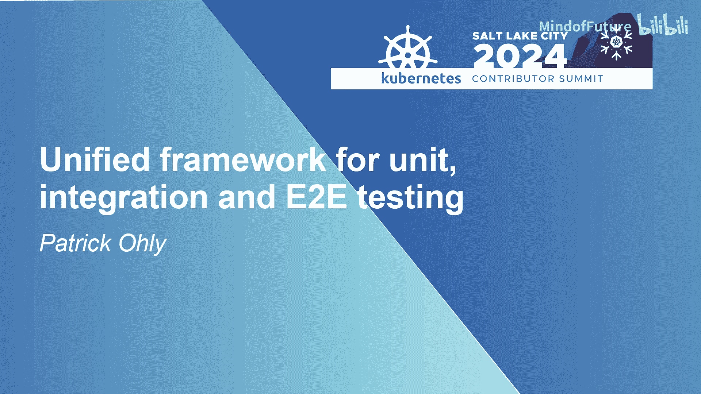
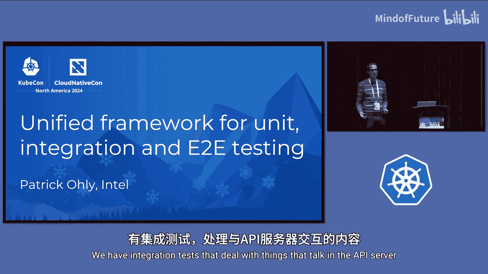
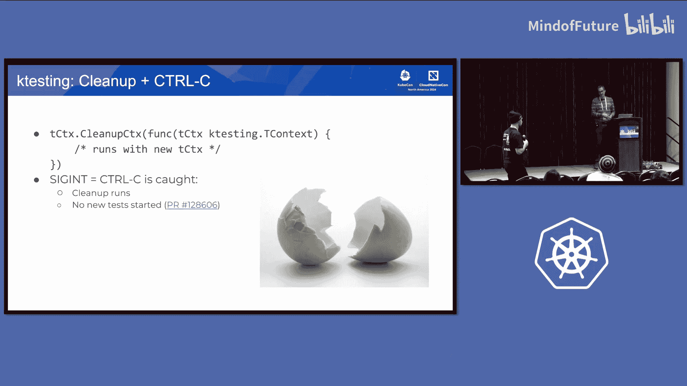

# 【Kubernetes】k8s贡献者峰会（2024北美）-p03-Unified-framework-for-unit-integration-and-E2E-testing--BV1kq6XYfEsx_p3-

So my name is Patrick Oie。 I work for Intel on various topics in Kubernetes。

 One of them is that I am trying to help out in sick testing with testing frameworks。

 mostly around E to E testing。 but there are also other test helpers that we have in Kubernetes that need a maintainer。

 And I'm， I'm one of those who take care of that piece of Kubernetes。

One of the questions that I've been asking myself repeatedly。

 in this talk is an attempt to answer that， why do we not have a unified framework for writing all the tests that we have in Kubernetes。

 We have unit tests。I have the bottom layer for individual packages。

 We have integration tests that talk that deal with things that talk in API server。

 and we have end to end testing for full clusters。 Why is all of it different。

When I did some investigations， I found this one quote， I have read。

 I must have read it five years ago when I started in Kubernetes in one of the comments in the test framework。

 the E in the end end test framework is a comment from the original author， Daniel Smith。

 where he says the eventual goal is to merge this and he was talking about the end end framework with the integration test framework。

 Now that comment is from nine years ago， and nothing has happened since then。And at first glance。

 it makes sense。 it makes sense because both E to E testing and integration testing are very similar。

 In both cases， we have some client who is connecting to an API server， making some changes。

 Check that the expected result happens and then treat that as a test success。 So why。

 why do we have different code pieces for basically writing these very similar tests。And。

Can we do something about it， Is there a technical reason why it hasn't been done。

 Is it perhaps because no one cared。In this talk， I'm trying to figure out together with you whether we can change this。

So the first， your first answer， why it's different， it's fairly simple。

 Uni tests and integration tests are based on the gold test infrastructure。

 Basically a big gold test unit test is also used for integration testing。

 except that we have some boiler plate code， which brings up the API server。But it's ultimately。

 plain goal。Whereas with end to end testing， the decision was made that we need something more complex。

 Pco was brought in as a test framework for writing the end to end tests。

So that LED to to a situation that we have still today。

 but we have different APIs for doing the same thing。

 depending on whether it's an integration test or an E to E test。So my thinking then was。

 what if we had the same API for both and just different backgrounds。

Can we then change all of our helper packages to use that common API and use them in both scenarios。

 And K testing is exactly that。 It's an abstraction layer。We have a question。 That's。

 that's the technical aspect。 Can we do it， The have a question is， should we do it。

And that depends a lot on。Well， how complicated it is， whether we all think that it's a good idea。

 So that's where we will need to have a discussion about among potential users of this other contributors。

 developers in Kubernetes。 And I'm not sure what the answer is。 So I'm。

 I'm really raising that as a question。So to give you an idea what K testing needs to do in this talk。

 I'm going to compare Got and Gingku。 That's for her first half of the presentation。

 And then I'm showing what K testing does to unify a API。Remember， we are talking about frameworks。

 which can be a very contentious topic。 People get very excited about it。

 but let's be excellent to do each other。 not fight among us。 And instead， let's squash some bugs。😊。

就。The comparison that I mentioned， the first thing is that both tests， frameworks。

 environments need a way to figure out what they should be testing， which tests exist。For。

 that's for test registration。With Ginggo， we have API calls called context to group things together inside it our callbacks。

 And ultimately， we have an its statement that says here's one particular test。

 It's actually called a little bit different in Ginggo。 They talk about nodes。

 I'm just calling it tests， because I think that's more familiar。And then in go test。

 we have also support built into a compiler， which is actually fairly convenient。

 You just have a function called test something with a certain signature。

 And then inside that function， you can have subt。😊，嗯。

Rlevant for us is that we can label tests in bininggo。

 and we are using that fairly extensively now to select tests。 We have no such mechanism in go test。

 We need to rely on naming our tests in certain ways， but ultimately， we don't have。

 We just don't have a good way。 We can， we can basically test an entire package。

 but we can't say we want to run this particular test in this particular scenario。 That's。

 that's just not possible with go test。In terms of how it gets built with Gingco。

 we have one directory defining the entire entire binary。

 and it pulls in additional packages with our test definitions。 The end result is a single binary。

 And we are using that indirect release process to actually give our users。

 a single binary that can run for conformance testing， for example。

 So that's a relevant aspect why we need gco of this。Because with gold test。

 we would have to ship multiple different test binaries， one per package， which wouldn't be feasible。

And then another technical aspect that will become relevant when we talk about lock output next is that with ginggo。

 parallelism is achieved through multiple processes。And in each process， at any time。

 we run a single a single test。 So any global output is associated with a test。 whereas with go test。

 we have multiple goal routines， potentially running in parallel。

 which changes with failure behavior。 What what do you do if you need to abt output and is different。

 So that's。Look at the other things。 Yeah， lock output is actually on this slide here。

 It's for per test logging。 I already mentioned that。

 So let me just jump to the second line here because it's a logical conclusion。

 standard output standard standard error in a gco suiteed that could be output from Kello。

 which is extensively used used in， in Kubernetes end to end testing。In client gove。

 we may have output that is relevant for a test and that can that can just go to standard error as usual。

 and Gingko will capture it as per test output。We have another API called Byte to structure the output a little bit。

And that is more difficult with gold test because standard out standard error is basically shared among all currently running tests。

We don't get per output if you do a K call。 And that is a problem。

 in particular with an integration testing。We do have a custom bespoke API， for T lock function。

 you can do per test output， but you have to use this particular call to do it because Van Got knows that this output is to be for the current test and it merges that into its normal output processing and captures it as a test failure。

 for example。So failures， there are different ways to report them。 Again。

 different APIs for the same thing。 Ultimately， in Gnkgo， we have one fail call。 It gets the string。

 and that can be a fairly multiline string It's captured as this is the failure of this test that is currently running。

 And it also abors immediately。So there's no concept in gingko of recording multiple test failures。

 which is sometimes a problem， but ultimately， well if it fails， it fails。 you're done。

 and typically you don't call this fail directly。 You' are using some higher level third party package like Gomega is the preferred one for Gko。

 but you' are not limited to that。 We could also use testify。 but we kind of made a decision。

 But for E to E testing， we use gnkko and goomega and for integration testing。

 we use go test and testify， perhaps or nothing at all。

 We just plain right we just call the T error functions directly。

There are different philosophyhies here。 And that's where some of the discussions can get very heated because some people abhor third party frameworks and just think that got should be just playing gold。

I kind of disagree， but that's where we need to look at the usability and the usefulness of those third party dependencies。

 whether they are justified or not。What I want to call out is that in go test。

 an error or a fatal error are not that different from just logging something and then aorting per test。

So there's no magic that says a test， a go test failed for this particular reason。

 iss your responsibility as a test offer to make sure that your failure really stands out。

 If someone looks at a larger test output， it should be obvious what the problem was and as your responsibility to make that very clear and some people don't。

I've seen people experience people who just call。T fatal with an error string or with an error。

 literally an error。 And， and then it would be very obvious that this is why a test field。

Then another aspect when it gets to more complex scenarios is timeouts。

 How long do you want this particular one small step in your test to run， How。

 how long do you want individual tests to run， Gingo is very sophisticated here。

 We have a pursued timeout that can be said when invoking it。 We can。

 We could define per test timeouts。We don't do that in Kubernet disc currentlyly， but we could。

 And then this timeout， when some specific test runs， it is given a context。

 but literally the context do do context thing in go in goal。

 And that context has a timeout associated with it。

 So this context times out when the test is supposed to stop。 And that's automatic。

With we goal tests， we basically have to write that ourselves。 We can get a per suite timeout。

 And if that expires triggers， it basically kills with the whole process。

 But there's nothing more sophisticated。 We would have to write that ourselves。

Something that exists in both frameworks is deferred cleanup。In Gingko， it was added a bit later。

 but there is now a defer cleanup。The good thing is that it knows that this code needs to run even if a test itself has failed。

It makes sure that this runs with a separate timeout。 it gets to new context。So basically， if you。

 if you have， if you run into a timeout， it basically set aside a certain amount of time to do the cleanup and then runs the cleanup nodes。

嗯。And they， they get a separate time。 also if they also take too long， they get killed， but。

 but a bit later。With G test， there is tea cleanup as an API call。

But the important difference is that it does not run if a s times out， or if you aboard manually。

 itll just stop immediately and none of these cleanup codes runs。

 which can be annoying if you have created temporary files。 They will be left behind。 There's no， no。

 no notion of this needs to run on， on shutdown。So some more features that are common to both with different APIIs spec traces。

 If something fails， you want to know where it faileds。

 Ginggo does spec traces attaches them to a failure message with go test， you just get one line。

You get each output is associated with the line where it was emitted， and you can both in both cases。

 you can mark helper functions that are not exactly related to your test as a helper。

 and they will get skipped when some back tracing goes through the stack。That is this common。

 Ginggo also has a way to say， skip this many levels of frames in your backs。

 but it's bit cumbersome。 I I actually prefer V V helper concept。

 but you need to annotate your source code for that to work。And one final。A feature of being covered。

 I want to introduce here。 And perhaps that's also if even if we don't do anything。

 this is perhaps a useful takeaway for those of you who are running the E to E tests locally。

There is a very useful feature。 If you run it without output。

 just binco run something and it's stuck and it's not doing something for a while。

 You and expect progress。 And you're not seeing anything。

 You can send the E to E test binary a sick user one signal。😊。

And then that will trigger a progress report。 So you will get some output at that point and will tell you exactly which test is currently running what is it polling for most most likely it is polling for something。

 Why is that go mega eventually not proceeding。 It will give you the last failure reason。

 the last check and you will see exactly it's waiting for this event you can go back to checking your cluster with Cu cu and see why it's waiting。

 I do that quite a lot when I'm running E to E tests locally。

 It's less useful in our C because we are not interactively monitoring it。

 But if you you are debugging something。 It it's very useful。

And it integrates with Goomega consistently and eventually because that's。

 that's actually where we have the polling but blocks for test。 it needs to cooperate with Ginggo。

 Ginggo handles the signal。 Gomega provides a report to Ginggo。 That's how it's implemented。

So we've now seen all the things that are common。 We've seen some API definition of some API calls that are different。

嗯。And I'm coming to K testing， which started out as。Just addressing the per test logging problem。

 So I， I， I worked on contextual logging as part of Si instrumentation。And。

Part of the value proposition of contextual logging is that we can have a logger associated with context with a context that we could pass through an integration test。

 And when K log looks at that context， it will extract the logger and that logger could。

In the context of an integration test or unit test output through that T lock function that I introduced earlier。

And the K lock K testing does exactly that。 It implements a log。

That takes the normal lock calls that we are doing in in Kubernetes and outputs in a format that is more or less what you are used to from。

 from Kello。 The source code line is a little bit different because we get a mandatory source code line inserted by go test。

 That's the first part。That's， that's actually determined by by go test itself by the go runtime。

 And then we have head of it is similar。 It's， it's a， it's a date severity level。

 This is an info message and and a timest。 And then the message string plus key value pairs formatted in a human readable format。

So that's the K log K testing。 It's meant to be fairly flexible。 So if you want to use it。

 you have to set it up， you have to configure command line parameters yourself because it doesn't do that automatically。

Then in Kubernetes itself。And it's actually chaoss。 I O Kubernetes test Otes， K testing。 a lot。

 I left out for Kubernetes。 So it's entry not in staging。

 not usable outside of Kubernetes at this point。But it is used in some integration tests in communities already。

 It's basically the opinionated variant of the Koc K testing with a similar API。

 What it what the difference is at this point is just that it automatically adds the normal minus V minus V module command line flex。

So you can run an integration test with minus V5 to see more output from both the API server and the client go or whatever whatever other code you have running in your test。

And another， another nice thing is that it modifies how gomega form its objects。

This is useful for omega。 when it produces a failure。

 it often dumps complete objects that it has been checking。

 and our k Kubernetes types are so complex sometimes that if you do。For S printf， it's not readable。

With jam， we get the familiar formatting of it。 and gomega will give you that。

 We are using that in end to end testing a lot。 The end end suite also does the same thing。

 And here in K testing， I made it so that the integration tests used for same thing。

 So if if you are looking at writing a test today and you want to know how to best format some complex objects。

 I would say gomega format object is way to go because I think it produces the most readable output。

 So again， these are things but you can take away from this talk。 even if we don't do anything else。

 this is useful today。For part。Where it gets interesting is how I extended K testing to achieve this unified API。

 And this is。More experimental， I would say， the contextual logging that's unquestionable。

 The unified API has not been that adopted that widely。Because it's new。

 I still need to do a bit little bit of advocacy around it and see whether it actually is useful。

But for goals that I set out， it basically was an experiment for myself， can。

We write a helper package。 Can we write this abstract API so that we can。

Do all of our other codes for end to end testing and integration testing so that it works in both scenarios。

 because currently we don't。 We have test E to E framework with different helper packages for pop creation。

Waiting for parts， for example。 And we do have similar code over for test integration under test。

 something。 And there's a considerable overlap， in my opinion， that just should be there。

And then the other goal was， we do have quite a few nice things I mentioned for progress reporting in Ginggo。

 Can we do the same thing with integration tests。And timeout handling， for example。

 all of that are things that could be improved on top of what Go gives us if we just find a way to do it consistently。

 What I didn't want to change is how tests get registered。So there's no chain。

 no plan or no intention to get rid of go test for integration testing at all。

 It will just be go test just with additional packages and additional setup to。

 to make it more like into E to E testing。 And the same is for true for E to E testing。

 We will continue to use bingo。 There's no。It's just not feasible to write rewrite everything。

 but we might have a migration path。Current status was。 So I got， I got PRs merged from by。

 by getting it reviewed by interested our fellow developers so that for integration tests。

 you do have everything that I'm going to describe already in in Kubernetes today。For Gko。

 there is a pending PR。The E to E framework。Well have a helper function that gives you basically something that that I'm going to introduce in the next slide。

 But that's pending。 I need。 and I was asked to give this talk specifically so that we do have some broader discussion before we move forward。

Unfortunately I don't see my sick testing colleagues here。

 I think I will have to give this talk a few more times， but I'm happy to do that。So let's。

 let's talk about this new API。 K testing 1 parameter rub them all。 I got annoyed at at one point。

 I was working on an integration test。 It had already， I don't think， I think4 or5 parameter。

 said I had to pass through multiple level different functions until eventually it did something。

 and I wanted a fifth parameter。 I think I wanted to do something with a generic dynamic dynamic client to create arbitrary objects from Ja。

And I found that I had to add a fifth parameters to a whole long call chain。

 and that annoyed me so much， But I decided that I would want to have a specific test context as one parameter that I can pass through that represents all of these things。

The way how it's done is that this K testing T context is an abstract interface。

It implements both the context interface and something that's fairly similar to the testing interface defined by goal。

 it is basically implementing the same methods so you can pass it to anything that expects a context and it also has additional functions to retrieve the other things。

You set it up once at the beginning of a go test， you're basically call k testing in it。

 And I'm introducing as a convention that I'm calling this T context to make it clear that this is not a normal context。

 You know， that you can get other things from it than just using it as a context。嗯。We。

 you can use it like the T instance before， so you can use it with testify。

 You could also call error F on it directly if thats if that see your B。You can do logging with it。

 You can do contextual logging。 So you get a normal go logger or out of it。 if you。

 if you call the logger helper， These are basically accessor functions that give you all the things that you may need at some point in。

 in your implementation。Then cleanup， it abstracts that both both the defer cleanup from Gingko and the tea cleanup under a new tea。

 A T context cleanup context thing。 The difference is that you now get a new context constructed for it。

 It's conceptually the same as in gko where your callback function then runs with a new context that is specific to your cleanup operation with a different timeout associated。

It also adds a signal handler。 So if you aboard an integration test now， K testing will catch it。

 and it will。Cancel the context of what is currently going on。But then we'll still run the cleanup。

So if we need to break up， it will not leave a mess behind。

One change that I found what is needed is that it also needs to prevent new tests from starting because traditionally aoring basically killed for process。

 nothing else ran。 and I found that my initial implementation allowed new tests to start and they aborted immediately。

 So small things to clean up here on my end。The context support for。

 and I'm now talking about for gold test implementation。

 The Gko Gko implementation will basically just be very similar。 It will just use for Gco facilities。

 But this here is specifically for gold test based integration and unit tests。

I mentioned that we have a timeout parameter。And there is a deadline that is communicated through a test as part of the normal T testing。

And the context that is getting set up with K testing is taking that into account。嗯。

It adds automatic cancellation。 So if your test returns， it will cancel that context automatically。

 So any goal routines that you have started and where you have passed that context。

 they will know that they need to stop if you have forgotten to call a specific。

Cancelllation or shutdown method。I'm also using a feature。

In goal that allows us to associate a message with cancellation。

The usual time test context cancel is not very informative。 You often don't know why it got canceled。

 where who who triggered that。And we， we are providing that information for code that cares。 if you。

 if you ever get into a situation where you have an error that is。Timed out。

 Think about whether we can use the context course function to get a better explanation and use that in your。

 in your error messages。Yeah， and then there are， con again， parallels to the the context package。

 There are helper methods that allow you to create new contexts。

With a different cancellation methods， different timeout， different log， different values。

 all of those in this context return a T context and not the goal context。Output。

 I've already mentioned the per logging。I'm also trying to make it more obvious why things f。

 So if you call error here， in contrast to the normal go implementation， it will add an error prefix。

It will add fatal error if it's， if you're using fatal。The time out that gives you information about。

 yeah， this time of this particular timeout triggered。

 you had five minutes and you exhausted you 5 minutes， but you set for yourself。

 and thats will be locked。So I think lots of usability improvements。嗯。

There is one thing with that where I would like to talk more about people who want to use it。

 because I'm not personally quite sure whether it's the right thing。

But I guess we'll just move on for now for the sake of time。

One decision that I made with K testing is that it's not replacing testify or goomegaomega。

 It is just having one assertion function。 And that is expect no error because that's so common throughout all of our code base that I wanted to have something that that is built in。

嗯。Yeah， progress reporting。 I mentioned that this is something that is provided by Gingko and it is not provided by cot。

 I have it implemented in K testing。 It uses the same signal that I mentioned before for Gingko S user 1 getting information is a bit more tricky。

 Gomega eventually work， So if you are using Gomega eventually in your integration test。

 it will give you the same information， but it is blocked on this particular check that it's currently running。

But there has no information about to currently running tests， because Go doesn't provide those。

 I think it could be added。 It may be one of those future to dos。 Another challenge was that。

Un you run go test with the minus V flag for verbalbers。

 you're not actually getting any output until it until it it fails。

 So I added one thing in this pending PR that I am open def TD Y because that's not getting redirected by go test。

 I'm getting a new output stream basically that goes to a console and I'm writing there。

 So I get you can， you can run go test。 and if you later figure out that you need information you're going to get it。

Yeah， that's。Well。With 20 minutes to go。 I think we have a lot of time to discuss for discussion。

 I went through it fairly quickly， so I can go back and talk a little bit more about the details。

 but I wanted to have time for questions， discussions。😊，嗯。

Because we really need to figure out whether we should move forward with this。The。

 the things that I'm uncertain about is。Some of concepts， so。With step。

 I've stepped over that own open no pun intended。 It was completely unintentional。

 That is something where you instrument your source code so that you basically say， okay。

 now I'm doing this。 Now I'm doing that and it's nested。 It basically gives you a trail of。

 of pet pet rums， essentially， So that if something happens， you know that this is how you got there。

But it needs to be used proactively by test offers。And they might just forget about it。

 And it will not be obvious that there is something misin would be useful to have that。The。

 good thing is when if a failure occurs。Somewhere deep down in your call chain。

 you will know exactly how you got there。 You can produce a fairly readable error message that is basically similar to what would happen if you wrapped error messages consistently with。

Multiple steps with colon and separated。 and eventually you will get the inner message。

So my thinking was that this is useful to have because I found it annoying a bit to。

W test helpers where you just return an error message or this whole error returning from a test level that is not really that useful because ultimately what happens is you go down a call chain。

 something happens。You produce an error。 You go back up。 if you're good， if， if you're careful。

 you wrap the error， you go back up to the the test itself。

 and then you have expect no error call that just does the final failure and aorts for test。

 So why not just skip all of this error return values and just abort at the bottom of your call chain。

There are arguments， pro and con in both cases。 If you， if you ab in the bottom。

You can't use this help or Traitionly， you wouldn't be able to use that helper。

In a function that is not expecting to be aorted。 And I think that was the main justification for using this approach in our E to E framework。

So we write generic， reusable functions that return an error。In the E to E framework。

 And then at the top in the tests， we， we check for errors。 But with K testing。

 we could do it differently because one of the things that it does is one of the help us。

Somewhere interesting slides。 I， I skipped over it because。

 I think it got too long is that you can create a test context。That if it's being used。

 will just record for failure。 And then the caller who created that specific specific test context。

 they can just do create the test context。 They call some helper functions。

 And then when they give when they are active again。

 they can they can take look at the test context and see whether anything has been recorded and produce an error from it。

 So we could do the a board at the bottom with K testing。It's just a different way of writing tests。

 I'm not sure which one is better。With the error return。

 it's fairly obvious to most developers that they should wrap the error。

 That is perhaps one argument in favor of that approach， because it's， it's normal。The W step isn't。

Yeah。So I think one of the first of all thank you， this is really a fascinating talk and I appreciate it but I think one of the difficulties of fail at the bottom then is you know as someone looking at the test。

 if I just get this error like failed connection to API server and I don't understand the code path of how it got there。

 then it's like okay which call made it right。You know， I love。

 I love the simplicity of failing at the bottom because you're right。

 Then I don't have to wrap it at every layer。😊，But I also think what you're talking about with the context and maybe the context being able to do some sort of rapping on the way back out。

 or just so you know， the code path it took to get there that I think it's really important to see that to properly debug what's going on。

 So in my mind， that's kind of the big difference between like failing at the bottom。 and， you know。

 if we if we had consistent use of withstep， we wouldn't have that problem。 But I see。

 I see a risk that people forget about that And then we have exactly a problem。 No， no precrs。

 No way。Of seeing where it failed and it will not be obvious。 So if， if I were to make changes。

 perhaps removing this whip step would be the first thing。 And then we just need to decide that。

 yeah， we do， we do return errors and help us。I mean that I think what seems really novel to me and you know I'm sure it's not new per se。

 but in this context is yeah， if you're passing a context all the way down to the bottom and you use that context to fail with a specific message。

 then if there was if there was built into the context a way that it wraps itself on the way back up the failure right then the developer wouldn't have to remember to use you know the with statements or whatever。

 they get it for free almost right I think that'd be really interesting what some some tests some framework tool like testify does that。

 it does take a call a vector at the bottom。And it outputs that in addition to where the。

 the failure event gets locked。As I'm not rewriting。Testify， I'm not doing that。

 But the problem is that you then just get for function names。

 You don't get any logical description of what it is doing。 that that information just isn't there。

And in Gnkgo， you know this is like the extra phrase or the extra string you can add to every like you know call。

 that's supposed to be helping you to know like I was doing this call when that happened， you。

 so I think getting that context in there is really important。

So a few things that we could be doing with this。 if we agree that we want to go forward。Yeah， my。

 my， my personal pet peeve， the thing that triggered the whole thing is actually。

 with one use case that I had， I want to create。Arbitrary objects from a Ja file。

I had written that code once for a thing。Not even sure whether it was the scheduleular proof。

 I had written that called once。 I wanted to use it elsewhere。

 and I couldn't because it was just not using the right framework。嗯。

So we're having one helper package for that， I think would be fairly useful。

 I've seen multiple different people implement that over time。

 And I'm sure if we looked at the test E to E framework and test2 Ts。

 we would find other areas that are just overlapping。

 and we could basically reduce the overall amount of code in Kubernetes。

If we just unified those parts。嗯。So reducing overlap would be one thing。 another logical， or if， if。

 if we are fairly sure about V APII would be to move this Kubernetes key testing into a staging ripple。

Because we， the annoying part right now is we can use it for entry or internal integration tests。

 We can't use it for corresponding integration tests that are in a staging ripple。

Because that would create a dependency between a staging package onto an internal package。

 which we can't do。 if it was in staging， we could。And。I would find it useful。

 but that means committing it to to it quite a bit more strongly than we do right now because creating a staging v is is a responsibility towards watch the community to maintain it。

War so than just having it internally。嗯。Yeah， so I think there are reasons to do more。I， I like it。

 but I'm biased。 I with that much。 I think for a project。

 the biggest advantage would be that hopefully future tests will be better better in the sense that we produce more useful information。

 but they are easier to run。😊，When they are today。 So it's not just about cosmetic changes that would substantially。

 I think it would be some， some substantial differences。And。

If we have a good unified API and good helper packages。

 they might be easier to write if you are writing a new feature incuberators today。

 you are more you're supposed to write unit tests， integration tests and E to E frameworks。

 And if for a new contributor， they basically need to learn different APIs。

 different ways of doing this。Which is not a good experience。

So if we assume that Kubernetes will be around， we'll get new features。It's worthwhile。

On the other hand， Kubernetes has survived nine years with this initial to do。And it has not。

Being a big problem。 It has been。Uable， it has been。 it has worked。

So if we were to do a new initiative here。We wouldn't need other fellow developers。

 I would need fellow travelers who think that this is worthwhile， and help refuge PRs。

I've been relying on some Si testing core techch leads like Antonio， who are just too busy。

 I can't rely on them to review these things。 I， I need other people who are interested。Oh。

Another from a project perspective， one reason to not do it is that this introduces code churn。

 It meanss。 we are， we are quotation marks only touching tests。But tests are important for a project。

If we rewrite existing tests to make them more compact or whatever use the common framework。

 there's always risk associated with that。 we could change the tests so that it no longer tests what it's supposed to test。

And that means that the questionss might slip in into the actual code and go unnoticed because we broke the test without noticing it。

So even if you are just using just modifying tests， it still needs to be done with。

 with enough care that we are not causing problems。So we， shouldn't do that lightly。 I。

 I remember five years ago， when I started。I gave a talk about E to E testing。 and I basically said。

 well， writing E to E tests is a great way to get started in the project。And it is。

 but I was also immediately corrected in that talk by some of my seniors at that time who pointed out that program tests are a big problem for a project。

Test flakes in particular。 I think that's ongoing story。

These are affecting the project in more ways than could be anticipated。 so also for tests。

 we need high quality code。Okay。Thanks again， assuming that this would go forward is the plan to back。

Pourt all the existing tests to this new framework while simultaneously sort of enforced， no。No。

 how do you solve the problem of a naive？Developer coming into the project， writing a new feature。

Being asked to write tests and doing the thing that all developers do。

 which is look at some other tests and copy and paste it and then formulate it to adhere to the actual requirements of their feature。

 but if they're copying and pasting，Test cases that are the old way of doing things and not the new blessed way。

Will they be sort of obstructed by PR reviewers who will say something like， oh。

 you can't write tests this way， write it this way now。And then the developer is like。

 I don't see any references to how this new it。 you know what I mean。

 So without changing the old test， it seems like it would be hard to really。

Make it easier for developers。That， that is a problem。 We， we see that all the time。 And well。

 perhaps we have an answer。So I'm， I'm learning all the the new things that Patrick was talking about。

 We have a document， great document that Patrick updated about how tests should be written with regards to。

Do the failures to make sure that they are properly surfaced。

And in the C and and the failures so that they are actually easier to debug。

My approach is that I've started literally doing what you just said。I'm literally using that。

 that link。 and I'm throwing that ad reviewer during the reviews。

If I'm seeing that someone is using the old way， I'm going to complain。

 this is this is the reference。 you want to look at that。 So if we will be consistent with that。

 there will be more and more test written applying the new rules。On top of that。

 whenever I'm trying to debk any kind of flake。And I see that the current test is。Hard to。

 to reason what could potentially flake specifically in that area or hard to figure out what is the problem。

 I will open PRs， trying to add either either some log statements that will allow to。

Easier identify problems the next time that I'll be debugging this thing。Or ideally。

 if there are potential places。Rewrite them following what Patrick is talking about and。

I know that both Antonia and I， we， we merge something quickly to resolve a flake about the month ago。

 two months ago， something like that。 And the next day， Patrick already had our fix。

 which was basically preventing the the flake， Patrick reroded with the new new tooling in place so that it it is actually maintainable。

 So， yeah， if we。Held each other accountable and make sure that we are teaching everyone across the board。

Then in the long run， it， it should improve。 I'm not saying that if someone picks the wrong test。

Then obviously， that， that's still an option that will happen。 But we just need to me。

 need to be diligent when reviewing those tests。just one quick response。 Great。

 so just I think it would be really important to do this roadshow across all the SIG because you don't want to review every Kubernetes PR that has a unit test or an integration tester and testing it。

 so you'll need to make sure that every SIG， every review， every approver。

Understands and either believes in it or can be nudged to enforce these new rules。I。

 I get pulled into E to E tests just to a review of the E to E test。 occasionallyally。

 if that happens。Yeah， but my bandwidth is my bandwidth is limited。

II try to refrain from doing any logically testing well sometimes I do point out things I did I did it early。

 My earlier effort was focused on the E2 E testing。 And as magic said。

 I wrote an updated document on how update。 We have an existing document about how to write E to E testing。

 And I thought just found that a lot of things were not covered how to write good polling。

 for example， that is tricky。 and our way of doing it with go wait our eight package in Kubernetes is absolutely not ideal。

 It fails several different criteria of observability timeout handling。Progress reporting。

 all of those are missing when you use the weight package with poll compared to omega eventually。

 for example。 So this is one of those cases where it's absolutely justified to to use an external dependency because it's so much better than just pure or go code。

And Ive， I've done all the outreach。 I've written the document。

 I think I've announced it on the de competitive deaf mailing list。

And it's still taking time for people， to adapt。Yeah， but this is a problem。

 And for the integration tests， ideally， the way I would like to see them written is that we actually get built income support from the compiler for doing it。

 because one of the problems right now is I've not， I've not shown you a full test。

 But it basically is all started with test something， you get a tee pointer。

 And then you do this T context initialization。 And then you need to remember that for a reminder of a test。

😊，You're supposed to use T context for error reporting， for example。

Because only then do you get this error prefix， You get all the benefits of unified outputboard and all of that。

 If you go directly to the tee pointer， which you can do， you're not getting that。 So right now。

 in most of many of the integration test， we actually do have added the K testing in it because that is part of the contextual logging。

Thinkhing the per test output， I think， is important enough that we should enable that already now。

 But most of the rest of the test have not been updated。

 So they just do the traditional usage of T as before。嗯。My， in my in one， one of my long term dreams。

 I would like to the compiler to recognize a function that says test。

 something and has a T context as its parameter。And then I want for compiler to generate the boiler play code that I now need to write manually。

 And then， that function only has a T context parameter。

 and everything will be fairly consistent and logical。 and you can't get it wrong。But unfortunately。

 we don't have that。 We don't have support in the compiler for different test functions。

Perhaps I should add a feature request for the go team to work on that。Hey Patrick。

 thank you that' is great and we're getting。Wrappped a little bit around the axle。

 but when the question was asked about backporting existing tests and then tests。

 you answered pretty quickly and pretty hemently no is that a future plan or is this a new paradigm moving forward and will'll keep old tests。

 I just want a little more clarification on your thoughts on what that looks like it would be。

It would be nice for new contributors if they could go into the existing code base and see best practices applied everywhere。

 But from a steering committee member and with my responsibilities for the health of a project。

 I basically have to admit that this is not。It's not feasible。 It's just not possible。To。

 to touch those many lines of code， get all of those changes reviewed from， it's purely pragmatic。

It's， it would be nice if we could。 I just don't think we can。It would create too much。Ct turn。

 it would hide offer the the code origin gets， would get gets get obscured。

 We are having the same discussion in the context of fixing L issues right now。

 because there are L checks that people apply to the Kubernetes code base。

And sometimes these lenders even automatically create the diF to fix those issues。

 and people submit that Ss。And we are getting to the point where we have written up a policy。

 I think it just got merged。 I wrote that up a week before Kubcon， I think it got merged。

 we are basically saying， no， we are not taking your PRs but fixed Li issues because the costs associated with it are real。

 It' maintainers time to review those PRs。 Its code churn。

 its potential cause of rebases of other code touching the same lines。It's not worth it。

In particular， when the fixes are just mostly cosmetic。And this tests， the existing tests may work。

So in that sense， rewriting them is a cosmetic change。

It may be nicer to run them if they are rewritten， but it's not essential。 That's why I would。

 I think the same logic applies as for Val issues。We shouldn't be doing it。

 We should just make sure that what we do for going forward is better。Yeah， so I'm。

 I'm going go in a different direction now and talk about the features I want in K testing。

So you talked a little bit about formatting Yaml and whatnot and being able to print it nicely。

 I think like that's definitely。Toil， when I'm writing tests is。

You know I have a lot of my own boiler play code for interacting with Kubernetes manifest right and I think being able to put that into like the K testing package or putting more of those helpers in there would you know that would go beyond what gnkko is doing beyond what testing is doing and one specific pain point and this is something we do a lot of testing at Redhat and we automate a lot of our testing one thing we found that is a big hassle that would be nice to have in like a testing framework would be when I'm running a test on Kubernetes I'm creating objects and I'm deleting objects and usually when the test is finished the cleanup takes everything away so if it failed I don't know what happened there and I think having helper functions that would allow a developer to say in my cleanup I want you to dump all these objects to some log file or something right because then a developer could see when the test failed this is what the pods look like or this is what the nodes look like or something and I think have you given any thought to features。

Like that this would go into those helper packages that we could write on top of key testing。

And I fully agree with you。 things like creating objects that is so common。

 investing in that area will immediately benefit everyone using those Ha packages。

 and we are not doing that well enough at the moment。 So yeah， absolutely。

 I think creating objects from Jamal， being able to configure what's being done during cleanup with that would be very useful connectinging events。

 lots I I've got lots of thoughts how we can make life easier for ourselves。

 And it's kind of blocked because I don't want to do that just in the existing framework and do it again for integration。

 I want to do it once。 How that would look like， which API is to use， which API design for that。

 We would almost certainly would need a working group again。 We did have in testing。

A working group for I forgot what it was called common tests in something I've had。

 and they did a lot of work on the E2 E framework。 They wound down at some point before they were completely done because they ran of out of manpower。

 out of steam。Everywhere to do that， we might have to do it。Properly into another working group。

With users， that's why it's a working group。 It can't just be a subproach of S testing。

 We are doing that4 other 6。 So we have to have other developers involved。Toge feedback。

 To get it adopted。And perhaps we should。I was just gonna to sort of tack on that you could take this a step further and build some sort of tooling that's doing snapshot testing and that might also solve your problem or help solve the problem about migrating old tests where you can take a snapshot of all the things that the old Test is doing。

 migrate that to the new K testing framework and then compare the snapshot and make sure that that doesn't change。

 but that's you know another several steps down the line。

We have about a minute left if there's one last question。过。

So if we know people who would like to get involved with this， what would you like them to do。

 Would you like them to reach out to you or get involved on the mailing list， come to SG testing。

 what do you think would be a great place to recommend them。

 I think I'm happy to collect interested fellow developers just personally。😊。

I need to talk with sick testing。 I think I need to need to repeat the same talk in a sick testing meeting to convince Avate Lee in sick testing that we should be doing this。

If they give their blessing。Then， I will。Figure out some way forwards。This talk is basically here。

 too。Tell people what is already there。Get feedback。Get get more people involved。

 And if that is if I get this kind of encouragement， I can try to set up something。Good。Yeah。

 Slack works， email is perhaps better because well， both ways， both works。

