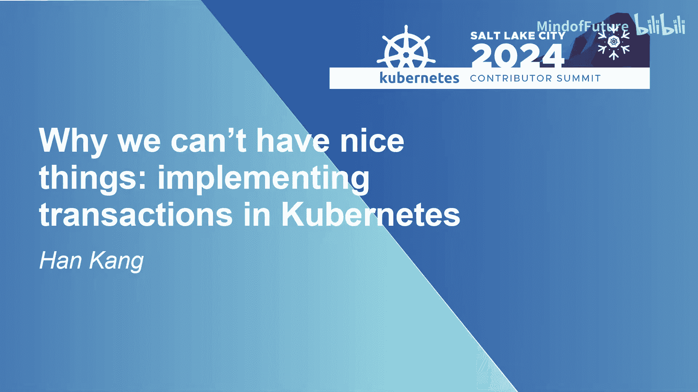
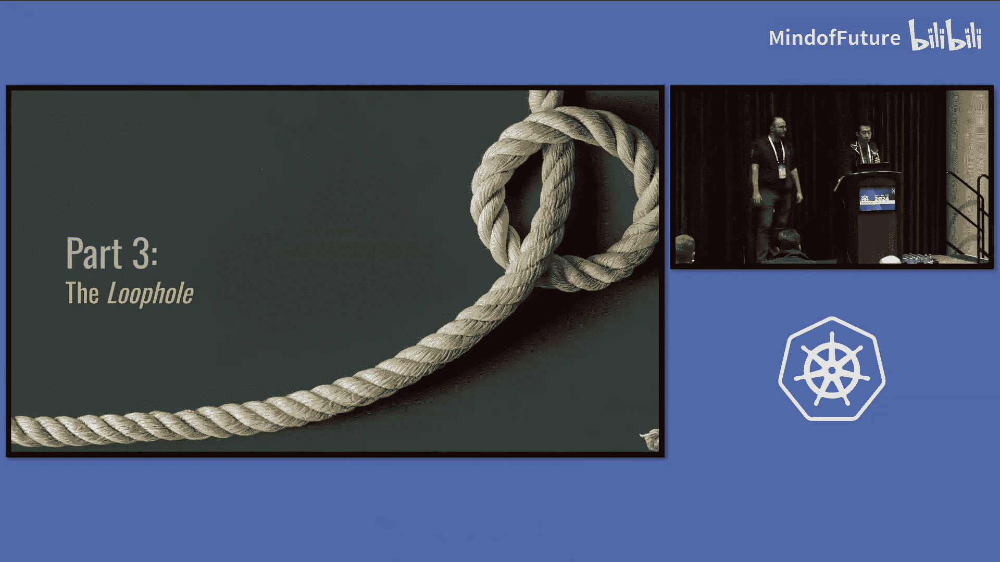
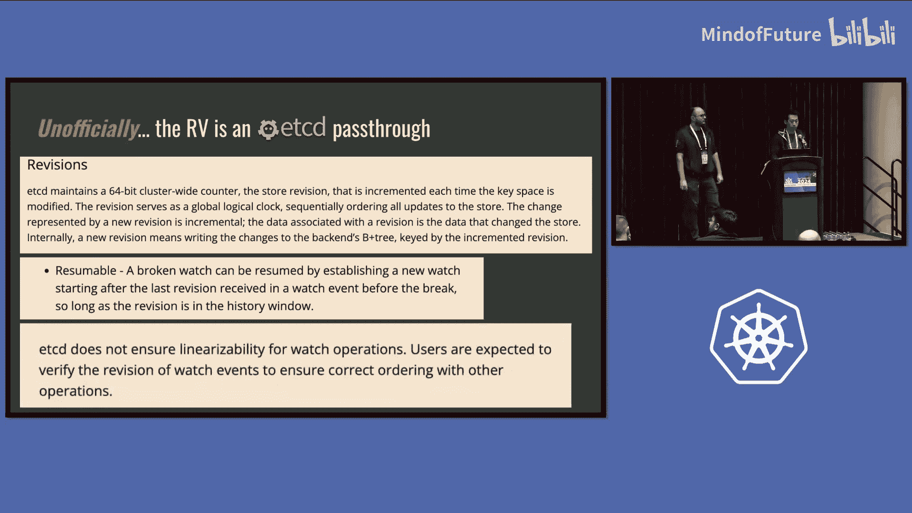
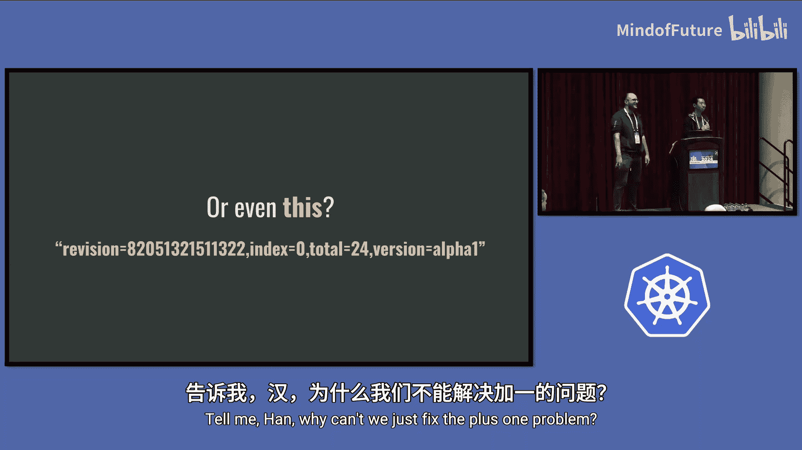

# 【Kubernetes】k8s贡献者峰会（2024北美）-p04-Why-we-can't-have-nice-things：-implementing-transactions-in-Kubernetes--BV1kq6XYfEsx_p4-

Hi， my name is Han。 We're going to be talking。

Merick。We're going to be talking a little bit about transactions and batch rights in Kubernetes today。

This is probably one of my favorite topics， and if you guys think that I am going to implement transactions for you within the space of this talk。

Then I'm sorry you're going to be a little disappointed。whyhy is this not working， there we go。

Because that's not going to happen。呃。However， what I would like to frame this conversation as is。

How would we unlock an order of magnitude improvement on rights in Kubernetes？

And when you think about this question。It seems almost necessary。

That we would need to have batch rights for this to be possible。

It is a necessary but insufficient part of the solution to have like 10 x more rights。

So why can't we have batch rights or transactions in Kubernetes today？It's a great question。

 and we're going to answer that， but first we're going to need a little bit of context。And。

Once weOnce we go through that。We're going to try to answer the question。

 Can we hack around these limitations？So America is going to go into a little bit of context in history for you guys to understand why we can't support transactions or batch rights today。

Okay， so one of the more unique things about Kubernetes is。

Compared to most other you know databases of storage that we use， its。

It allows or it optimizes for controllers being able to view the state of the word and be able to act on it。

This results in a pretty different access pattern that requires us to use a pretty different protocol。

And this is， as you might might heard about list watchch protocol。

 It's a protocol that optimizes the the path where instead of controllers trying to continually list to see what is the state how it differ a controller can just ask about the state and then subscribe to all the history that is changing。

 And this poses a lot of more constraint than on the what we can do than in any other。System。

 so let's look at the watch， specifically the Ker starting from Kubernetes watch。

 the you always start from the list， and you can list based on。No， no， can we grow it？Okay。

 thank you。 so you can do a different type of list request。 You can request a single object。

 a namespace or even entire entire resource type。 And you will then get response。

 That is a snapshot of the state with some resource version attached to it。

 It will be the resource version that was used to at that time that was used to generate the results of the newest version in the that was available。

 And then you can use this research version to open a watch to then to get a stream of events each of the create type of update version。

 and you will get a research version for each of them so that you can know。How up。

 up to date you are and how we can react it also for performance reasons。

 Kubernetes supports so-called bookmarks， which can give you continuous updates if how you are progressing。

 So thats when something breaks， you can not necessarily restart from the beginning。

 but somewhere much much later。And the protocol handles or needs to describes a disconnection。

And during the incon disconnect， you can do two things。

 You can either start from the beginning and do a new list， which can be expensive。

 or you can just continue from the last resource version。And this， this is a pretty simple protocol。

 And it's not technically something unique to Kubernetes。 So if we look at differences。

 what it is different than what you can do in LC CD。There is just as a couple of minute changes。

 You can use， instead of doing a list， you do a range。

 which now if which limits you or put a limitation on Kubernetes that all the objects that you can really list in。

 in Kubernetes needs to be a continuous range。And instead of getting a resource version。

 you will get back a revision。 So this， this revision in Kubernetes maps 1 to one。

 and so Kubernetes just returns the revision returned by SD。

 And the same way you can use the revision to， to open a watch request。

 which is maybe unique about ED， is that instead of getting a list of events， you get batches。

 You get a response that you get a response that can include multiple events at the same time。

And instead of so this will be important in the future。 instead of a bookmark。

 you will just have get progress notifications and all the other things fit one to one to this to the protocol being very similar。

So if you， if we look at the response or in LCD， you will get a repeated set of events that can that can be updated to to the object。

 so there can be a multiple like from one to even hundreds of events within a single response。

While on Kubernetes， it's much simpler if you get an event， it can be either added。

 delete or or a bookmark。 And for every of those every event， you will get one runtime object。

 and runtime object can be usually it I think it differs depending on the event type。

 but it can be just a the end1 Kubernetes object。And this poses a big difference on how we can do batches。

 because in LC C D。It has a full support for multi object transaction transactions。

 You can take 10 different， you know pods and update if， if you could support sub keys。

 you could just update 10 of them at once and get get the same transactions as you would do in Kubernetes just on 10 object at the same time getting the 10 times bigger throughput because all this transaction will be considered done automatically with one right to the disk。

But on Kubernetes， there is zero autoity。 So when you there is some support for， for batching。

 but this requires this is just a promise or a lie that Kubernetes just give you a promise that you can do a batch delete a delete of collection。

 But underneath really this is handled by multiple independent transactions。And the。

The one of the reasons is when you match。When you compare watch and implementation between LCD and Kubernetes。

 the LCD。Transaction will return multi multiple objects with the same revision。

 while on Kubernetes batching， you will get multiple objects with different revision。

 And this becomes when you think about the guarantees on the， on on the watch。 So in both cases。

 you expect that watch will return you an ordered stream of history。

 what happened that each event will， there will be no duplicates on the stream and you will not lose any information。

 So it's reliable。And if something breaks as we discussed about cancellation。

 you can resume it and you can ask for bookmarks。 So， so you will get updates。

 even if nothing happens。 But the main difference is the atity on LCD site。

 you will get if you send one multiple batch transaction with multiple objects。

 you will get one watch response that will include all of the changed objects that will share the revision。

 But on the Kubernetes sites Kubernetes site， you cannot do that because it doesn't each event will be a separate or each transaction will be a separate event。

 So if you use use， try to use the same。诶。Same revision for them。

 Things will not go as wrong because it will be not atomic as a response。

 So this goes into their discussion that。Yeah， so thanks， so yeah。

 we have some key differences in our protocols。Specifically in Kubernetes。

The watch event can only contain a single object。Only a single object。So。

This wasn't actually common knowledge， but we're going to go into the fact that we cannot have。

Objects sharing the same RV in Kubernetes without it invalidating our protocol。

We're going to show this by a proof。Through proof by contradiction。

So we're going to start by assuming the thing that we want to disprove。

And then we're going to show that it can possibly lead to an invalid protocol。

So the thing that we want to disprove is that we can， in fact， share an RV across multiple objects。

 So let's assume that we have five objects。 They all have the same RV。 So we've batch written them。

 right。Now we have a watch open， we've already did on our list。We're screaminging them。

 and we observe one of these rights。Right， we get， we're supposed to get a bunch of watch events。

 Each watch event has a single object。 We only see the first one， and then we get disconnected。

 We know that that's possible。Then we reinitialize the watch because that's what our protocol says。

 right， we take our last observed RV， we plug it back in， and we say， let's resume our watch。

Internally， the API server does this。It actually takes that initial revision。

And it increments it by one。It parses the RV and increments it by one。

 So if we're sharing the same RV。Across five objects。Then that means we're going to skip。

The four other objects are just going to be skipped over。 We're never going to see them。

 So imagine that we have four five pod creations。 We see one， and then we skip the rest of them。

Obviously， the controller is not going to be behaving correctly。

That means our protocol can't be correct。And that means that it is actually invalid for us to be able to share our views。

All of this。Because the Kubernetes Watch event， when we first designed it。

We made it limited to a single object。 Now， this is like standard API design 101， right。

 like use a use a list， don't use single objects， right。Yeah， in this case。

We messed up because we should have used a list that would have and you know。

 if we didn't want to support batch at the time， we could have like just had a list and just sent one object all the time。

But we kind of shoehorned ourselves here。So one of the things that I like I've been thinking about this problem for years。

 frankly， and one of the things that occurs is， why can't we just create another watch protocol。

 right， Why can't we just create a watchbe2。And just fix this error， we could do that， right？

This would be inordinately expensive， inordinately expensive。

 and it would not be backward compatible。 And when I brought this up to David Eeds， he very politely。

 very judgely and very quickly shut it down。So yeah， not super viable。But there is a loophole。

 there is a way that we can get around this problem。

This is our official stance on RVs。RVs are supposed to be opaque。

We're not supposed to assume any order。Right？That means that to any。

Client that is behaving by the rules。They should only ever be passing back the RV that they last saw。

 and it's just an opaque streak。That means。We can do stuff under the hood。Unofficially。

The RV is an SED pass through。The RV is a 64 bit integer。

And each of these things from the SD documentation shows another important attribute about the RV。

Interestingly。In SD。The thing responsible。For incrementing the revision。

Is actually the client and not the server。So the RV is not opaque that CDD。

And you are responsible as a client。To be able to ensure that you can either handle duplicates or that you are incrementing the RV。

It is the responsibility of the client。So can we change the RV safely？Here's the thing。

 When we changed the protocol， when we said the RB was opaque。

 that was a deliberate choice from the Kubernetes community， why。

To make it possible to change the RV， that was the point of it。Right？Otherwise。We could tell people。

Just increment the RV， it's an integer， incremented by one API server will just do whatever you say。

 right？We reserve this。Functionality。Specifically so that we could change the RV。Now。

 what does this mean in practice， though？Violations do happen， there was a survey。Steve couldanoff。

 I believe， did this resource version parsing survey。

When he was investigating stuff like this for KCBep。And violations of it do happen。

But they're very infrequent。And again， only occur when people are doing something which we explicitly tell them not to do。

So what could we do with the RV to fix this？So given an RV， that looks like this。

It's possible for us to do something like this。Right， we could add the index of the batch。

 So if we have more than one object that shares in RV。We could， we could add the index of that。

 And that would allow us to continue to increment and to observe。

To maintain continuity without skipping， skipping。Objects。We could also do this。We could bitri。

And add the index。And this would， this has the additional property that just adding one works here。

Internally in the API server。Yeah， if anyone is doing some clientside parsing。

 this would break because now you don't have a 64 bit int and now you have a 128 bit int， however。

 they're not supposed to be doing that in the first place。We could even go crazier。

We could actually just make it completely structured and just do a little bit of string parsing。

We could version it。So that if we ever needed additional stuff。That we could add it。

But this isn't enough， not in order to get 10 x right through a put。嗯。Why， because。

We're still writing the entire object。 And so the amount of data that you're sending to ED would be constant。

So splitting spec in status and metadata。As different objects in SED。Could probably help them。

What else could we do we want if we were to ever introduce something like this to the RV。

We would have to be very careful about introducing it。

Because now you have two different types of RVs。So what you could do。

I you could introduce this new type of RV。Very slowly。You could introduce。

Being able to read the old and the new version of the RV。

For the entirety of supported version S and Kubernetes， for like three releases or four releases。

And then， switch over rights。That would allow you to support。Everything， once you start writing。

 everything that's supported。Yeah， so。Again， this isn' insufficient。For 10 x right throughput。

 splitting up the object is probably something that we'd want to consider。But yeah。

In order to support transactions。We would need to support multi object rights。

I'm not even sure that we want to support transactions。

But batch rights definitely feels like something that Kubernetes is likely want would want to support in the future。

 So yeah， I'd like to open it up for questions if anyone has any。Hey。

 so two quick questions I think the first one is like you quoted the need for batch rights。

 are you thinking more for like controllers that are trying to create let's say too many positives at the same time trying to optimize for that or the second question is like you've talked about the flexible RV string。

 could that possibly also be used like a vector clock to aggregate information from multiple API servers and render them in one place？

That's a complicated question。系い呃。Wait， can you repeat the first？batch rights。Well。

 I mean atity right like sometimes you want atity of a response second thing is if you want to improve right throughput。

 then basically you want to make the object smaller。

 the things that you're writing smaller and you want to be able to batch all of them right and then you probably also want a more efficient watch response right so So improving your ability to actually stream dis as opposed to entire objects is probably something that we would want and the second part of your question was vector clock。

The second one was about using the RV string format to potentially you know aggregate different API server responses in one place and present them as vector clock so that you you can still rely on the total order as different API servers like what do you mean by different API servers Like imagine you can build a read through proxy the queries different API fans out to multiple API servers and the So you're talking more like ACP similar to KP I'm not sure that this is something that would be supported internally I feel like。

Something that you're describing is like a multic concept。 it would be built on top。 Yeah， I mean。

 it would probably built on top and then you'd have to have different types of controllers that actually did this。

 I think。So I have two questions Also like the first one， like。

 do you think if we just say are we instead of being an opPex string， it's an integer。

 does it make things easier。If we make it an inruder， like yeah， if we actually don't make it opaque。

 yeah。Then we don't have the ability to change anything that were kind of shoehorned into the pass through。

 like it just becomes the global revision in E ED。Right。

 the reason I ask is is like so I worked on the storage version migrator that got merged into 130 and it's an alpha for right now and we essentially moved out of three API into entry but the controller was reholded and one of the assumptions that we made is that it's an yeah and I'm sort of trying to get that through like let's say that goes through or not。

 so like that's one of the requirement for be1 so does that if that goes through like how does it change the dynamics we're very fortunate with the storage version migtor that we control that code。

Right， so we， if， if we do change the RV， then it's on us and we can actually change the way that we're reading the RV so we can support。

 you know， reading a more。Structured RV with multiplepart， right， right。

 And maybe this might be a follow up discussion。 Maybe I'll just reach out to you。

 But what I saw is the， the the complex RV part that you listed on there that's not something that like I had proposed like something like this。

 It just like this is an opEC string and we are converting into an integer。

 So maybe maybe we should probably just think and see if it makes sense。

To do it like this or or like this。Or just the proposal right now in S VM is just convert or pass that to end。

 Yeah， I mean， like， here's the thing。 If you have something like this。

 you can have a sorting function。Which just takes these parts right， and then which。

 But then the parsing of this would be like this would be like the custom paring function that weright Yeah I'm suggesting what I'm asking really here is like if we have some some requirement like this。

 for example， for this case， then maybe we'll have to come up with some general consensus as to what we want to do。

 I mean， generally we're not supposed to par the RV。 But if we were to allow people to parse the RV。

 then I think we should provide a client library。That you know one just use。

 but the problem with this is obviously you have to support many languages and it becomes yeah it becomes a thing Yeah right right。

 Yeah， and I think the other part with the SVM since it's now part of KCM will probably be officially saying or officially defining the meaning of RV right？

Good to probably just think。Yeah， I mean， we're not really changing the meaning of an RV though because it's an opaque string right so like as the client all it's supposed to do is just take the last Ob of RV and pass it back into watch。

 that's the protocol。 And as long as the client is doing that。

Whatever we're doing under the hood is fine。 Yeah， Consider like continue talking。 like it's。

 it's just a。Base 64 encode it Jason。 So clients should not。We don't， it was thepic you。

And called that just for clients to not even people not even to to try to Yeah。

 I think I think let me thank you offline， I think there is some gap in my understanding。

 maybe but I'll reach out to you guys afterward。Tell me， Han。

Why can't we just fix the plus one problem。

What do you mean， why can't we you said in the code we add one Why don why don't we not add the one and just。

 you know， if you ask for a revision， you might get a duplicate of the revision。

 but at least you're guaranteed not to have the edge case。Well。

 it's hard to say whether controllers would act the same way。

And it's possible to implement controllers without using stuff like Laco。And so， duplicate handling。

Would have to be handled by every client。And that's a change in protocol。

Because we don't guarantee no duplicate sorry， we do guarantee we do guarantee no duplicates yeah。

Seems like that was the mistake。 Yeah， that was， that was a mistake to yeah。 I mean。

 it's a mistake in either dimension， I guess。