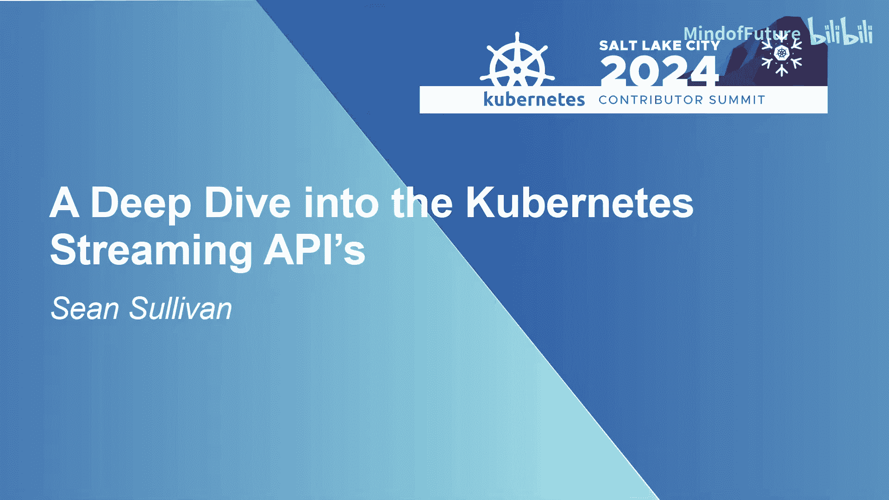
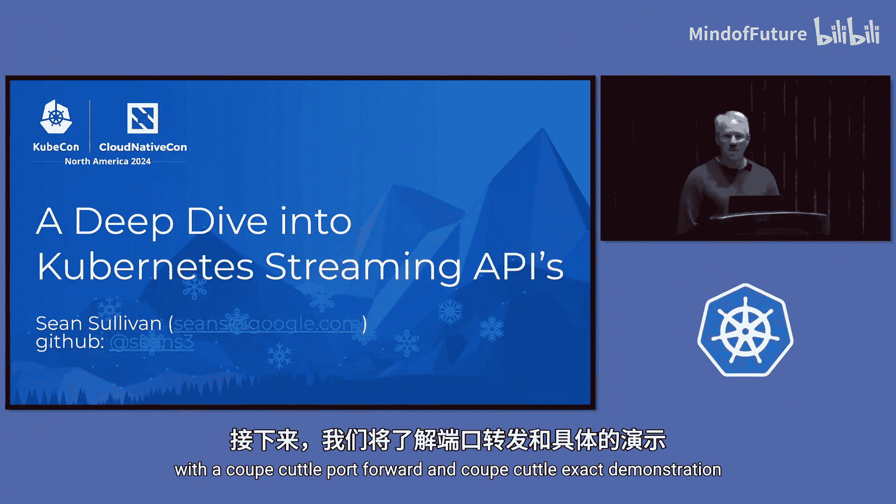
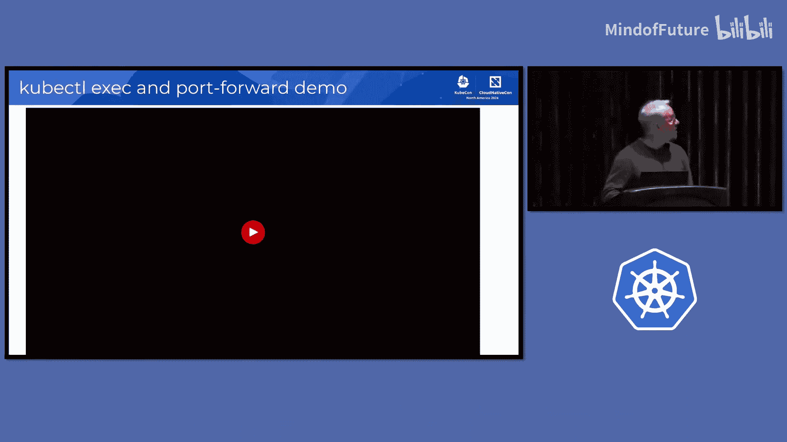
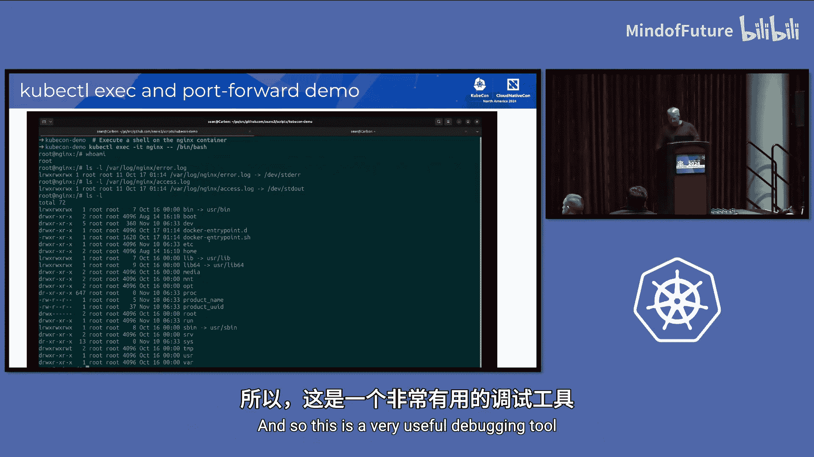
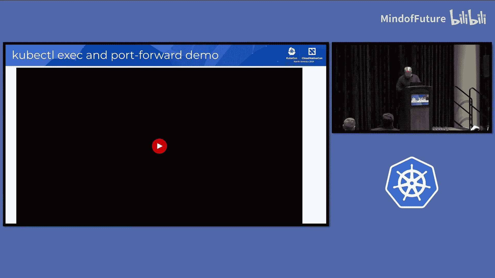
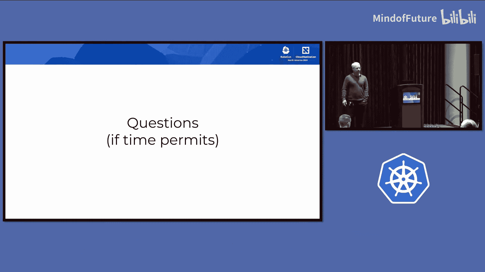
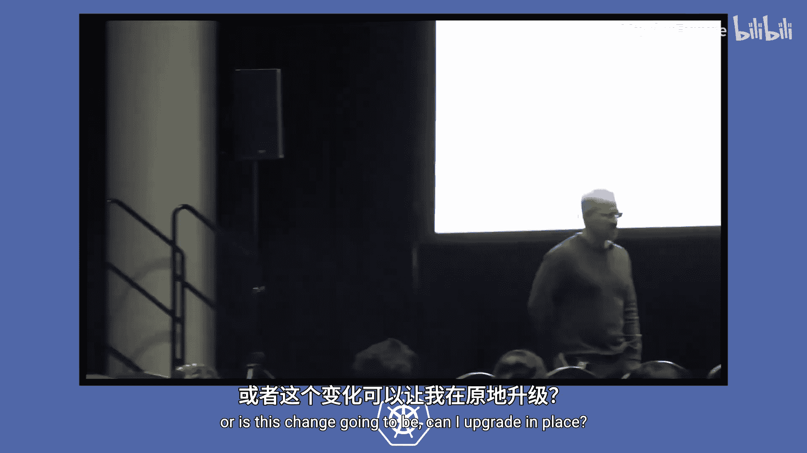
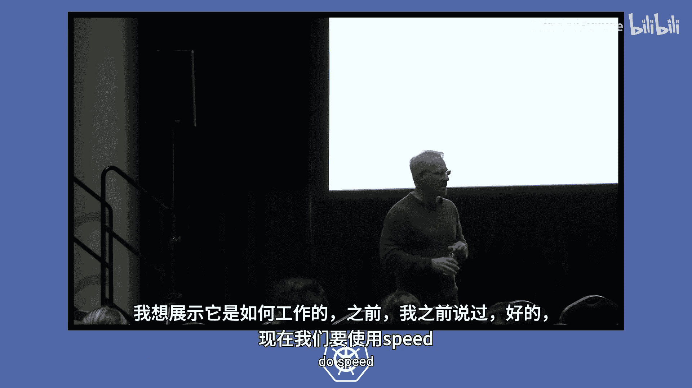
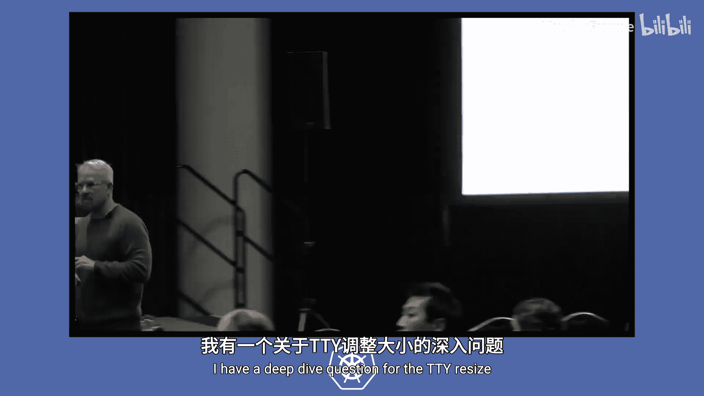

# 【Kubernetes】k8s贡献者峰会（2024北美）-p05-A-Deep-Dive-into-the-Kubernetes-Streaming-APIs--BV1kq6XYfEsx_p5-

I'm Sean Sullivan。

And。Why don't we。Immediately get into the tasty nuggt of the presentation with a coopcuddle port forward and coupcuddle exec。

Demonstrration。

So at the beginning， I'm just going to show that there's what the client and server versions are and what's running。

 the workload that's running in the cluster， just to give us an idea of how this particular cluster is set up。

We've got an N X。Workload running in our。Our cluster。

And the first command that we're going to actually look at is Co cut old port forward。

So when we run a coupcuttle port 4 command， we're creating a long lived。

Streing connection between the client and N X。In the cluster。So with the command。

 we're going to specify what the local port is， as well as what the port is that Engine X is going to be listening to。

In the呃。In the cluster。So。I'm going make this a verbose command so that we could see what the headers are for this particular command that we run。

And you could see that where're。We're specifying。A particular subproto that we're interested in。

So that's the endpoint， the protocol that the client wants is the port4。cade。io。So protocoltocol。

 and then there's going to be a handshake。With。The engine X process to determine what。

What particular subproto is agreed upon， And if it's successful， it returns 101 switching protocols。

 And so now we have a long running。呃。Streaming connection between our client。

 our local client and the N X process running in the cluster。 And so in a separate。Shell。

 we're going to run accal command to， to request the， basically the homeage for in genetics。

And we do it by contacting local port 80，80。 and that's going to be forwarded through that streaming connection。

To Engine X。 And so you could see that we got the homepage there from from Engine X。

And so why don't we move on to exactec commands。And so we'll do a really simple one initially。

 which is we're going to do an exec。 Just we're gonna run the date command on this engine X。process。

 And so I've made it verbosity level 7。 So we could again， we're going to see a lot of。Headers。

 a lot of header information here。What I want to point out is not just the endpoint。

 but we get to specify as query parameterss what the command is， what container we're talking to。

 as well as some of the some of the channels that we're going to need。

 which is standard out and standard error and in the request headers we're asking we're saying that we support multiple versions of a subprotocol。

 and this is the remote command sub protocolcol we're going to get into that in a minute and the response was one on1 switching protocols great。

 you could see that actually at the end there we have the date that came back on the standard output and was shown。

Okay， so this is an involved example in which we're going to show that this particular command when we've created this streaming command。

 we can send stuff through the standard input channel and we see stuff on the standard output channel and we're actually going to send 50 megabytes of the Kub code binary on the standard input channel。

 we're going to echo it onto it and then at this Engine X， we're just going to cat it。

 we're just going to send it back down on the standard output channel。

And then we're going to redirect it into a temp file。 And we're going to say， well。

 did this particular。Binary， this massive amount of data did it come back。

As the same data and so right now we're just looking at so this is the command。

 the coup code X command， we have to do the minus I we have to do minus I because we're using the standard input channel and we're going redirect it into output coup code in the temp directory and so okay we've done that。

 let's have a look at that what we received and it looks like it's the same size let's just do a diF to make sure that that data we sent to Engine X and and received back is the same and it is the same。

So finally， let's execute a shell。 So this is a really useful debugging tool that we could use as we're gonna to jump onto the Engine X。

😊，Pro itself and so when we when we run and we're running bash。

 so who am I running as when I jump on this shell， well， I'm root， I when I'm there。

 I could look at the error log， I could look at the access log， I could look around。

 and and so this is a very useful debugging tool。

So。知。So。What is it that makes these particular APIs different these two particular commands we just saw their streaming commands。

 What does that mean， what is that， how is that different than HTTP， Well。

 most of us know that our Kubernetes exposes an HTTP rest API。

What some of us aren't as familiar with is that there are actually this small subset of APIs。

 which end up being upgraded to streaming connections。

And we just exercised a couple of those APIs in those commands。And。

So we're all pretty familiar with what HCV is。But why would we have streaming commands？ Well。

 it's basically the deficiencies。Of HTTP， which is a request response protocol。

 just aren't going to be sufficient if we're running and interacting with a shell that's all the way in a cluster on a particular workload。

And so。Here's a couple of the characteristics of the streaming protocols or the streaming dynamic。

 which make it more useful than HTP rest in some situations。

 where there's low latency's less bandwidth， for HTP。

 you're going to have headers that for every single request in every single response you're going to have what can be significant header overhead。

 whereas in streaming protocols。We're framing binary， usually binary data with very little metadata。

And with streaming， it's important to note that either endpoint can initiate these data messages。

And it's bidirectional。嗯。咁是你。And so the example， which I think。

Illustrates the best that these streaming protocols are necessary these streaming APIs are necessary。

 was this interaction with a shell on the container。

 it's just not going to be possible to have that type of an interaction if you have to do it through request and response。

Okay， so how do we create this streaming connection？ Well， we start off as an HP request。

And this is kind of a truncated version of what the request looks like when we're trying to do an exec。

And。We have a couple of extra headers。 So we're going to say we want to upgrade the connection and our streaming protocol is going to be speedy 3。

1。And this is。These are the particular subprotocols that this client。

Supports and it's a priority order， so V4 means that we want V4 over V3 and I'm going to get into what a subproto is shortly。

And so after the handshake。If it's successful， then the HTP response is going to say one on one switching protocols。

 Okay， that worked。And these two particular headers are going to be spit back at us the same that we sent to them and the negotiated subprotocol。

 which in this case is the V4 version of remote command。Okay， so what are subprotocols。

 So subprotocols are the what of what of the， what's going into these data。

 the payload of these streaming messages。They're versioned and Kubernetes defines two subprotocols。

 So we define remote command。 and this is for the following three commands， Kcutle Exec。

 Kcutle copy and Kcutle attach。Cupcutto copy actually is implemented through the Exec endpoint。

 so it's kind of the same as exec attaching is attaching to a running process。

 but each one of those three is going to require is going to take advantage of this exact same remote command protocol。

 and the latest version is version 5。For port forward， it supports the Cookpial P forward command。

 which which you the example of in the latest version is V2。

So what exactly is in our remote command subprotocol？We are multiplexing。Up to five channels of data。

 So we've got standard input， standard output and standard error。 that's pretty straightforward。

 If we're going to be interacting with a command on a cluster。

 we're going to have to have those three channels。 and then we also have actually for later versions we added terminal resizing or T TY resizing events。

 and we added an error channel which allows us to get the processes exit code。So。

Those channels of data are going all going over the exact same streaming connection， which is set up。

 And it's being multipleed over that connection。 and then de multied。And。

 and connected to the process that's running in the container runtime。So for Po forward， actually。

 theres one thing that I meant to mention here in our remote command example in this subprotocol is that the number of channels is static。

It can be up to 5， but it's at the beginning， once it's negotiated， it's going to be the same number。

 It's not going， It's not dynamic。Whereas for， for the Port 4 subproto。It is dynamic。

 so we set up in the command in the Kup Coleport4 command。

 we set up that long long long liveve streaming connection， and maybe in a different shell。

 we're going to do a curl and we're going to connect to that。 Well， the number when we do that。

 there are two channels for each one of those forwarded commands。

And that there's a data channel and an error channel。

 But the number of them of these channels running concurrently。Can be infinite。 It could be， I mean。

 obviously， there's resource constraints， but it's not defined。

 if we had 1000 curl commands running at the same time， then we would have 2000 channels。

And so this actually prevents some， this presents some challenges for how we ended up。

 I'll get to it， how we ended up proing the web a different protocol to speedy protocol again。

ll get to that， getting ahead of myself here。Okay， so this diagram is meant to illustrate just kind of the end to end nature of these streaming connections。

 these streaming APIs。 and they， they actually touch quite a few elements。Of the， of the clusters。

 So they're going to start off with a client， usually co control。

 They're going to talk to the API server， which is generally going to just proxy this particular the request and the upgrade。

To the Kubid。The kubt is going to then through the container runtime interface proxy to the container runtime itself。

 So we're talking all the way from the client。Through the API server to the Kubt on the particular node。

 And then while you're on that node， we're going be talking through a Unix socket。

To the container runtime， through the container runtime interface。

 So there's quite a few components that we're touching in this when we're talking streaming APIs。

Okay， so why are， why are we even talking about this， these。

 these streaming APIs have been around for years， Well。

 we're talking about them because we have recently transitioned the streaming protocol from speedy to web sockets。

And that happened as of version 131， the default streaming protocol for any of those four commands that I've mentioned is。

 and it's defined in that kept 4006 is now going to be web sockets。

 it'll fall back to speedy if the server doesn't if the container runtime or the server doesn't support that but。

By default， we're gonna attempt a web socket。ConectUpgrade connection。Okay， so why did we do this？

 This is quite an undertaking。 It's actually， it started years ago。

 and we've we've just recently kind of gotten to a point where it's it's been published。Well。

Speedy has been deprecated for eight years， actually more than eight years。

 and it was never standardized。And so。What we get is we get to a situation where even though we control all of the elements within the cluster。

 there can be some intermediaries。 right， There can be some gateways， proxies。

 load balancers between the client and the API So between， know that。Don't speak this aging protocol。

 And so we've gotten to a point where。Anybody who's using a gateway will probably need to use a more modern streaming protocol。

 which is web sockets。So we should note， however， that。

We've only modified the streaming protocol from the client to the API server。

 So we've implemented for both of these subprotocols。

 We've implemented implemented proxies in the API server that translate or tunnel。

The web socket for translation， it's from to from web socket to speedy。

So there's a stream translator proxy。 And then for port forwarding。

 there's actually a tunneling protocol。 And this is， we did the tunneling， as I mentioned before。

For Port forward， we have a dynamic number of channels。In order to not blow up the API server。

 our design required a tunneling。Translator or tunneling proxy。

And so speedy actually continues to be the within the cluster is the communication protocol and we did that because we've seen this dynamic before where we have to know if we would have changed the container runtime then we would have had to have gotten fixed all of the container runtimes and we've seen that that is actually we've seen that fail several times and so what we decided was。

 well we're going to get 99% of the benefit if we changed just the lag between the client and the API server。

And we keep the rest of the cluster working the same。 We intend to actually move。

The web socket to web socket legs all the way through the entire system。

 But we're starting out with this first leg from the client to the API server。

So this is the updated diagram， which shows illustrates what the cluster looks like。

 and that purple part within the API server， it represents the translation or tunneling proxies。

Which are changing web socket back to speedy within the cluster。So to wrap up。

 I have a bunch of links here to what I think are very useful resources if you plan on digging in more into this particular topic。

 I really wanted to point out one of the blog posts by Sasha Grunnert is it goes into an area that I kind of gave short shrift to。

 which is what happens with the streaming on the node， so between the Kublet。

Through the container runtime to the container。 that's actually a pretty involved process。

 And there's there's a separate blog post altogether that Sasha Grer wrote that I think would be very useful if you're really interested in finding want to know more about streaming as it pertains to the node itself。

 And that is what the。呃。Kubernetes。The container runtime interface streaming explained。By Sasha。Okay。

 so。ItLooks like weve got about five minutes left。Are there any questions？

Go ahead， Mark。I have maybe a naive questions， but it relates to maybe what I'm trying to do。

 It's how does streaming cover I know， watch or。Or at least the kind state of the watch。

 How does it differ？So the watch isn't related to the。

The watch is kind of an HTTP streaming that its we don't actually do use speedy or web sockets for watch So it's a complete a different implementation because it's not bidirectional streaming but one directional stream so HTTP does have streaming。

 but it's in this。Overall paradigm of request and response。 So it fits within HB， whereas。

If you're running， if you're interacting with a shell on a container。

 that's not going to be you know。Request response， that's going to be you know。

 connecting bidirectional。So， so I'm actually not an expert on watch。

 Maybe Han actually answer better like so watch is， is still H TTP， right， It's not。 We're not using。

嗯。I mean， I was assuming so or I'm trying to figure out because there is a pending proposal or because I'm more know what's on LCD side。

And one of the things that was。That is discussed is having a bidirectional or a high level。

 eventually consistent caching or。Let's say。Forcce progress notification on watch to get eventual or strongly consistent caching on the informer site。

 So for that you need to have streaming that's what you have you need to make progress or a PC net we call it progress request notifications which would on Kubernetes side call it a request for a bookmark basically So that would make it based streaming and not necessarily not necessarily。

Every quest response because not always you will get an event back and this is like Thr on ED which also implements a very complicated stream its custom streaming protocol so I was asking in that direction also so it sounds like so。

Currently the watch is an HTTP rest。Call， but。But if you wanted that bidirectional functionality。

 then you would have to do， as we were showing before， youd have to。Upgrade to a streaming protocol。

 and it should be web sockets or something modern， just because speedy， otherwise。

 it's just not going to be well supported。So that was。Back。Back here。

 it was describing this HCTB request， so you're going to have to upgrade to a streaming protocol。

Thanks。So my concern is upgrading from one version of Kubernetes cluster to another。If I have 1。

30 or 1。31， is this change going to force me to？Really install new and migrate or is this change going to be can I upgrade in place I couldn't interpret everything quite to understand so that's a great question so this should be transparent to you so you may have an older coop control which doesn't which isn't asking for web socket upgrade it's going to ask for the previous speedy upgrade and all of that's going to continue to work。

And the other version skew that you may have is you may have like a more recent。

Coup control and an older server。 So if it fails， if it doesn't understand Web socket。

 then it's just going fall back to speedy。 And so we oh， okay， that's going to be upgradegradable。

 Okay， if it's the same， you know， if you have got a coup cut server， which is 1，30。

131 and and the servers 131 then they're both going to speak this web socket and you're going to get up Oh that's what I' want in a long one。

 but okay catch it should be completely transparent to you there's nothing extra that you need to do as a cluster operator or a co cutttle user thank you。

So， so when I showed the demo， we had I showed that we were at 129。 and I did that so that。

 you know thats that was。When we had Spy both in client and the server and so that was for years and years that's how it worked and so it's only recently that we've begun to do this particular implement this particular functionality and so I wanted to show how it worked before before I said okay well now we're going to do speedy。

I have a deep dive question for the TTY Re， why we need that one。

 particularly for the remote command So my understanding is because。

Because of that last example of the when you're running a shell。

 and so it could be that so I didn't actually， I don't really， haven't seen that that often， but。

It's， you know， if your shell on your client changes size。

 then you may need to communicate that to the process because it thinks that it's。You know。

 it has a particular terminal size。Yeah。没有。But yeah， that is a deep dive question。

So that was introduced in version4 of the Re command protocol。Okay。あ保や的。And so， version 5。Yeah。

 so version 5 was the one that we just introduced， and we had to introduce that because。

The on the server side， we didn't deal with。Standard input correctly。

 So there was no half closed signal that signified that the standard input channel was finished。

 And so it would hang。 And so we've recently implemented that half closed signal。

To signify when standard input is finished。