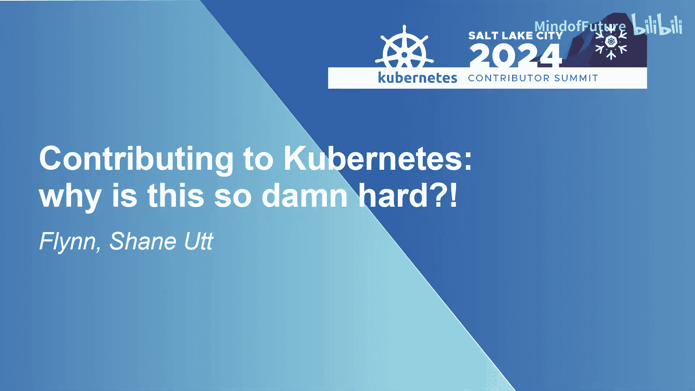
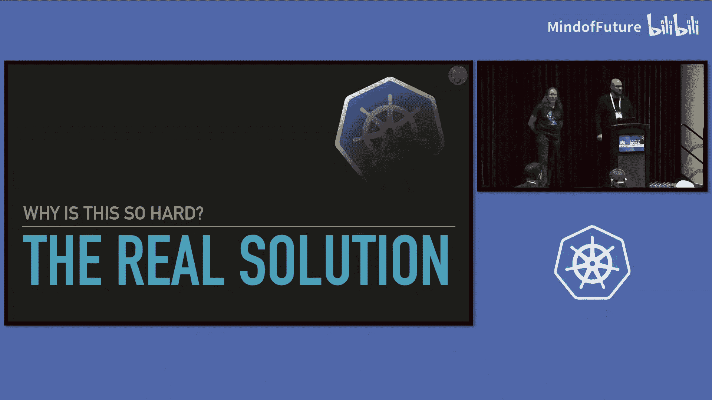

# 【Kubernetes】k8s贡献者峰会（2024北美）-p06-Contributing-to-Kubernetes：-Why-is-this-so-damn-hard？!--BV1kq6XYfEsx_p6-

Welcome to contributing to Kubernetes。 Why is this so damn hard。

I'm Fln。He' Shane。I am by day， anyway。I'm an tech egelist Stlinkerty at Boyoyant。

 He is a seniors principal software engineer for Red Hat。Noted that。For purposes of this talk。

 though， a lot of what we're doing here is based on our work with the Gateway API。

A lot of what we're doing will be informed by what we have done with Gateway API and what we've seen with Gateway API。

You can reach us as Flynn and Shane on all theles。Or by email， if that's your thing。

 I've started a talk before with this bit。 We are not here to tell you that Kubernetes is dead。

 and we should all give up and go back to Mesosphere。

But we're also not here to tell you that everything is perfect and we don't need to change anything。

We will be talking about some things that we believe are problems。

 we'll be talking about some potential solutions。We will be talking to you about what we believe and why we believe it。

We are not really going to be talking to you about how to actually implement the potential solutions。

 because that needs to come from everybody here， not just a couple of guys up on stage。

You heard some of that from the steering committee earlier。With that in mind。

 let's start with the fundamental problem。Which is not change。 He's just going to talk about it。

 I might be a fundamental problem。So the fundamental problem。

 we thought Flynn and I thought long and hard about this。Arguably。

 there are potentially a lot of different problems。

 But what we think with today's ecosystem in Kubernetes。

What it really boils down to right now at this point in time is Kubernetes has had trouble delivering the extensibility that the project needs。

And to be fair and clear， this is a perennial computing problem。 This is not unique to Kubernetes。

 This is tail as old as time。嗯。Did it hit the right thing？One like， I mess something up。

This is what you get for letting the Linux users poke on a Macintosh。I'll get there， hang on。

So at this point， hopefully it stays still， at this point。

 even official functionality is being pushed to use CRDs rather than going directly into core。

 Gway API network policy， multi network， etcter， these are just examples of projects within Kubernetes SIG network。

 that are building with CRDs now， but there are plenty of examples outside of SIG network。

And ultimately， C Ds are not a first class experience。There are technical challenges with C Ds。

 including life cycle management， versioning， upgrading， everything in between。And。

Very problematically， the responsibility of these has for a long time largely landed on the cluster operators。

And in the worst case， the person who really shouldn't have to deal with this， the user。

And as a project， we haven't really caught up with providing the support and guidance needed to do this。

 like we haven't been able to give the cluster operator or in a very scary case。

 the user kind of the tools and the support they need to make this happen well。And yet。

 despite all of that and despite how important CR Ds are now。

 especially for the continued growth of Kubernetes， they are the only happy path。

For contributing for most people， for a lot of people， not all。

And it's extremely difficult if you want to go directly into core。

 like if you can't build with CRDs or there's something that you want to do in core。

 that can take a very long time， and it's especially true if you are a new community member。

And even if you manage to get through that process。

 which we'll talk about more in some of the upcoming slides。

It takes potentially years for whatever you built to be available in clusters。

 which is enough time for somebody to no longer even be working on that anymore。

 be at a different job，Problematic。So ultimately， we see a lot of situations where the project。

 particularly through extensibility， isn't really meeting the needs of the community。

And the community desperately wants to be able to materially participate in Kubernetes。

We're making this quite difficult。 and we also understand that this is a natural problem for a project like Kubernetes that has had such a meteoric rise。

We just need to try and solve it。So this raises a question of why we are the ones who are talking about this。

 the answer is it's personal。Both of us have run into this sort of situation。

 run into difficulties in these areas in a lot of different ways。

Both or as developers who are trying to do things that Kubernetes isn't really supporting。

As community members who are trying to fix the things that it's not supporting。

Leading into being project members or project leads。

 trying to help everybody fix the things that it's not supporting。And being the educators。

 trying to teach people how to get things done。As we look back over these things that we've run into。

 there are a few different areas that we see these things sort of fitting into。

 so we're going to go over some of those now。To start with， we can talk about problems with CRD APIs。

嗯。As Shane mentioned。The platform itself only provides very minimal support for managing CRD APIs。

This ends up in a situation where。Since the platforms aren't doing it。

Then the end users often have to， if you decide you want to use something that relies on CRDs。

 then that is a thing that you as a user are likely to have to install。

 which ends up putting the platforms and the users in this situation thiss kind of the Wild Wild West of CRDs where you may know that you want to use a project that relies on one of these APIs。

But you may have no good way to be guaranteed that the platform you're using will actually support this。

This makes it very difficult for the projects to rely on the extension APIs。

 which in turn makes it very difficult for the users to rely on the project。

Another thing we run into with this。Is it causes a lot of interesting friction when you have multiple projects trying to use the same extension API。

We have。In particular， seen a situation not too long ago that is a good example of this where both LierD and traffic。

 which are two the NCF projects。Both were trying to use Gateway API。

Since they couldn't rely on the platform to deal with this。

 both of them tried to ship the gateway API PCRDs that they needed with the project。

And they were shipping in compatible versions。This is a problem。

ItTurned out that Liery had a way to turn off installing Gateway API CRDs。

 but traffic did not for a while， and so for a little while。

 the only way to deal with this situation was， in fact， to manually hack the traffic helm charts。

This has been fixed。Which is good。The fact that we were ever in the situation， not so good。

And even more fun one。 Suppose youve decided that you don't want to run traffic in Liery anymore。

 and you're going to switch to Envoy Gateway and Eaststio。 So you uninstall Liery and traffic。

 should you uninstall the gateway APIs C Ds at the same time。Because if you do uninstall the CRDs。

Then the API server will happily go and delete every single resource based on those CRDs silently without warning and without confirmation。

Congratulations， uninstalling your project may have just messed up every single user of your cluster。

😊，Great。This is one of the examples where the CRD APIs basically end up fighting with the API server。

Not because anybody intended it that way， just because this is the way things have kind of evolved。

Similar situation arises when。You have platforms， you basically end up where。

You're making everybody duplicates a lot of effort in this situation so you can end up with the platforms trying to go and manage these things on their own right now。

 getting stuck with old versions， Shane and I both got affected by one recently with GK being stuck on Gway API0。

oldd for a while that's also being fixed now I believe but it was an interesting situation to be in。

Liinerty is currently in a situation where Gway API 1。0。Relies on cell validation。

 which relies on Kubernetes 1。25， but LierD has long term support commitments back to Kubernetes 1。

22。So。Going forward with the gateway API is actually。A real challenge in some of these situations。

To be fair， LierD can use newer Gway API CRDs if somebody is installing LiD on a platform new enough to use them。

But。How does LincolnU guarantee that they're there？The answer right now is we make the user do it。

 it's not a great answer。Another interesting situation comes up with experimenting。

One of the best ways to design and implement any sort of software that API is included is through experimentation and feedback。

 put an experimental version of the thing that you want to use out into the wild。

 let your users use it， let them tell you what they think of it。

 and then use that to drive your development iteration。Sometimes when they give you feedback。

 the feedback will be， you've got this completely wrong， please change it entirely。

 they will want you to do a breaking change。Kubernetes doesn't really have good support for breaking changes。

The sanctions method for breaking changes involves using a CRD conversion webbook。

Which we all know and love。Everybody， including SG API machinery。

 tells you oh no don't use conversion webBooks， so we're in a state where the only way to really do breaking changes is to do a thing that nobody recommends。

 which leads us into this world where the recommended design paradigm is to be a perfect API designer。

I personally find this really difficult， maybe some of you have an easier time of it， but you know。

 there's a lot of work around this that people are trying to come up with ways of dealing with it。

 In fact， right after this session， Rob and Nick，I think over in one of the breakout rooms are're going to be talking about CRDs and their challenges specifically。

I do not think we're going to have time for questions after this talk。

 so I would encourage all of y'all to follow us over there。U。

It's still the current state of the world is just get it right the first time and don't ever change anything。

 which is。You know， challenging。It's also worth noting there is a phase in our current enhancement processes that is usually labeled。

Experimental。It's really more like staging。There's a de facto assumption that once you hit experimental。

 you will be proceeding forward。Shane and I looked back。

 we don't believe Gateway API has ever rejected anything once it's become experimental。

 which means that experimental isn't really experimental。True， true。

 we might be succeeding in being perfect API designers。 we got it。I'm going guess not。U。We also have。

 speaking of the enhancement processes themselves。 They have a reputation for being slow and painful。

 And I would like to very clearly point out， I am not just talking about the keptP process here。 Gs。

 the gateway enhancement proposal that we use in Gateway API are also becoming slow and painful。Yeah。

 it's a little bit tricky。 There's a lot of tricky documentation。 There's a lot of obscure rules。

The end result is that。Actually walking through these can be really intimidating， again。

 doubly so if you're new to it。Which is。Challenging to say the least again， let me emphasize。

 this is not just preco stuff。 this applies to CRD APIs as well。But I will say speaking of the core。

 I went back and did some data muing on KPS。At present。

 there seem to be more abandoned cups than stable cups or rejected cups。

Abandonment in this case means I couldn't see any progress on it in at least a year。

Actually getting it kept through to stable。The average looks like it's about a year and a half。

 maybe longer，Is it necessarily unreasonable except for all the outliers that take way， way。

 way longer than that？And the abandoned kepts， interestingly。

Seem to not be spending much less time there， meaning that even the process of taking a cup into a place where you abandon it。

Seems to be a significant amount of effort。Just to abandon it and never have anybody officially say。

 we're not working on this anymore。We would be remiss， of course。

 not to mention dynamic resource allocation here。嗯。

It's a fascinating outlier that QR code will take you to the DRA page itself。

It's interesting because it's an extension mechanism that's trying to go and affect things in core。

 but also ends up kind of messing with CRDs as well in some cases。

And one might expect that because it's having to touch both of these areas。

 that DNARA would get the worst of both worlds。It kind of seems like it's not。I'm not going to lie。

 I have heard a certain amount of cynicism about some of the process around DRA。

 I tends to look at it personally as a nice example of the fact that it actually is possible to get stuff done。

And it would be lovely to go through and learn from some of this stuff。

We will do that as we have and I think we're over to Shane to talk about how we've seen this in the subprojects。

 Yeah， so we've talked about a lot of the problems that we've seen and we have been talking about this mostly。

From the frame of reference of Gway API。 So everything you've seen so far has some kind of connection with our work on Gway API。

 However， we participate in and have been in。Atively involved in other sub projectsjects that have had these kinds of troubles。

For instance， we have the multi network project and Sig network。

 which is the idea that you can have a pod that can have more than one network。

This has really struggled to get through the kept process。

 to the extent that it was in the kept process。In what looks almost like an abandoned state for about two years at this point。

The project has decided to go ahead and try the other route。 Let's go with CRDs。

 and they're having some difficulties with this as well。 There is progress。

 and it's still moving forward。 the meetings are happening， but this is challenging。

 especially since did I hit the wrong button again we both hit it twice。 It's okay。Don't have。Anyway。

So it's。Okay。So it's the little engine that could， like it's going。

 but it has been very painful for this sub project， just trying to get any forward momentum。嗯。

As of late last year and through this year， there was a project called the Kubernetes Network Interface or K and I。

 you may have also heard it as Kubernetes networking reimagined。This project。Originally。

 what it was trying to do was add native networking APIs to Kubernetes。 And I say native is in。

Think C And I， but you can actually co cud get things。 You can actually see it。

 It's there in the API server， and。It has gone through some of some similar pains with， you know。

 being able to get through the kept process。 it was unable to。 And it's ultimately。Not abandoned。

 but。More or less on pause。While we're kind of looking at DRA and DRA is kind of taking the the forefront of like DRA for networking is kind of taking。

The idea forward as to how we would do these sort of things in a different way and we're hoping to come back to it。

And then this isn't exactly a subpro， but it's very related。

 There's the Kubernetes Network Pbing Working Group and PWG。

 which if you don't know and despite the name。Is not actually an official working group within Kubernetes。

 even though it's been around for seven years。And it stayed outside because of these challenges。

 partially in Kubernetes， with contributing and being able to do experimentation like Flynn was talking about。

 It was easier to just go outside。However， just at this Kubcon in particular。

 we are starting some conversations about maybe we can actually bring that in and turn that into something of maybe like the place where experimentations can happen for certain kinds of work。

And also， we're very grateful that a lot of the K And I energy that may have been lost because it kind of hit a brick wall there for a while has started to kind of find its way into this space and also C AndI。

 So it's good that we didn't lose all of that energy。And then in this one。

 I say this one with a heavy heart。So there's the coup Proxy Next generation or KPNG project。

 which was very near and indeed dear to me personally。 This project meant a lot to me。

 I made a lot of friends for this project。 it inspired me in many ways and unfortunately despite its efforts to be the question of coup proxy next generation if you hadn't heard about it was what would the next generation of coup proxy look like like what could we do and there was a lot of energy around experimenting。

 trying new things there was a whole there was a large community building up within our community。

But， ultimately。Because of the problems with contributing and kind of the friction therein。

 this community kind of fizzled out。 It didn't all fizzled out。 I mean。

 I brought some of my energy from there elsewhere in the Sig network。 and we've seen a couple people。

 but it wasn't a great resolution。 and ultimately it ended up being one of these abandoned projects。

 It's actually。To， to try to make， it's the first officially closed subproject in Sig network just to let people know。

 we didn't want to leave it in that abandoned state forever。 And we're starting to try， hopefully。

 to actually say when something's been concluded。 and it was。Very unfortunately， for me。

 the first one， so。All right， so let's talk about some solutions。

 and we get to ramp up this section in terms of speed。

We're going to look at some of these with respect to the areas that we're talking about， CRDs。

 enhancements， things like that， could start with CRDs。And we can kind of start with。

The obvious of there's a certain amount of stuff in the CRD process where we can go through and actually do the radical thing of trying to teach people what works well and arguably more importantly。

 what doesn't work well so that if you're a new project coming into this trying to use the extension API is trying to use the CRD process。

 you don't actually have to start from scratch。This is underway。

 there's some work in SIignnet with the API Exsions Best Praes Guide， that's the QR code for that。嗯。

It's deliberately broader than SG network， and it's actually challenging， harder。

 more difficult than it seems， more harder， oh my God。

Because it requires us as a community to agree on what is best or at least what is good。

Another thing that we can do for CRDs is improving CRD validation。

 this is not about the validation that happens when you apply a CRD。

 this is about the fact that it's not difficult to make a change for a new CRD version that will end up breaking your S objects。

 that is a thing that we can check automatically， we can also do other things we can automate the checks so that when you make a change to a new version of the definition itself。

There are some places where we can catch mistakes ahead of time and hopefully not wound your users。

There's also work ongoing with this Openshift CRD schema checker， that's the link to its GitHub repo。

 that's a thing that CIG API machinery is looking at as an addon for the API server。

 which could be kind of interesting。Another thing that I think we ought to do is， you know。

 there are languages other than go in the ecosystem。 I realize that's a shock to everyone right now。

 when we define CRDs， we define them typically as ghost structures。

 which means that you see idioms there like， oh， there's a pointer。

 that must mean it's something where we have to be able to tell the difference between un and default。

And it would be really nice if those of us working in languages other than go rust。

Could maybe not have to reverse engineer those idioms from Go to be able to effectively use C Ds。

And we are back to shamene。Yeah。So。don't we won't go into the deep details， like we said。

 but the how is not the most important thing here。 But some of the things we thought of solutions wise is that。

We need to give the platforms an effective way to manage extension。Right now。

 it's up to the cluster operator， as we said， or worse case the user to say， well。

 I'm going to go extend the API because I need it for this project and that's not a good situation to be in。

They have to upgrade and manage in the worst case。 And Flynn mentioned this earlier， delete the CRDs。

 Are they responsible for that。嗯。Hopefully not， hopefully not。Ultimately。

 we think we need to give the platform standard and consistent way to manage these expense and APIs for their users。

This would let users be able to rely on the extension APIs in the same way they do the core APIs in the case of the actual users opposed to like the customer operator。

They don't have to think about a CRD。Important caveat。

 we do need to make sure and we've seen this from the perspective of Gateway API。

 we need to be very sure that we protect the ability for developers to do experimentation。

 so whatever we end up doing， let's just make sure that we kind of create a bubble for that。So。

It's to summarize a little bit or what we've decided we think would be a good idea。

 given that we have official extension APIs。 Gateway API is anoffial API。 All things considered。

 Let's actually treat them as official。Let's host them。Catalog them。Validate them and test them。

Maybe we could have Kubernetes s extensions and have a place where we catalog our official extensions so that platform builders can build with this tool and users will get a consistent experience between platform to platform projects know how these things are built。

 and overall it's not just that Wild Wild West of well we'll kind of just each of us do our own thing。

 we'll installRDs in a helm chart， but somebody else will do something different。And that's CRDs。

 So CRDs are like what we're trying to ship because that's the best way to contribute to Kubernetes today。

 but enhancement process still needs some streamlining。

 like we still need to go through the enhancement process。

 even for CRDs to ultimately come up with whatever we're shipping。And。Unfortunately and。

 like enhancement process is documentation， so making that better starts with documentation。

But and we' we've got some the API extensions best practices guide。

 we're working on the Sign network kind of touches on this with like how to make that process as streamlined as possible for somebody。

 particularly who's new， But ultimately， we need to teach people directly as a community。

 how to get started effectively in a way that sets them up for success。

 And this probably needs to not just be a wall of documentation。 but rather like。Verbal。

 something that we communicate in community meetings or Slack or something like that。

And since we are pretty much out of time， Oh are we at of time。

 I think we're going to close with this slide。Yeah， so we in Gateway API。

 we've had this concept that we've shared around before verbally about champions。

 allies and shepherds， and it amounts to basically putting people before process So I also heard at the steering committee AMA。

 right？Yeah and the general idea with this is it's kind of a framework for don't inundate new people with like here go read the docs and stuff like that。

 but rather tell them here's a framework in which you can kind of try to see if you can build an enhancement it doesn't have to be just for enhancements。

 but for the purposes of enhancements you have champions which is a role where somebody is driving this thing forward and it can be more than one。

 it doesn't have to be like one champion for any project Allies are stakeholders that support it。

 they may be not driving as hard as the champions out in front。

 but ultimately they are meaningful contributors to whatever it is and shepherds。

 which are the maintainers， they're the ones who need to be kind of helping you get there and eventually having you actually figure out all that documentation。

 but that not be a barrier to entry it to you even getting started。

And if you can do this and you can find allies， you'll find a way forward if you find， importantly。

 as a note here， that you do this process or if you reach out and you don't see anybody。Actually。

 this might not be the right time for that enhancement， which is good feedback as well。And yeah。

 we do need to stop。Everything we've talked about so far is the easy part。

 the hard part is going through and changing the focus on extensibility so that it is a priority within the community。

That is going to take all of us。Everybody here， everybody in the community。

 as you also heard at the steering committee AMA。So yeah， come help out。Thank you。

