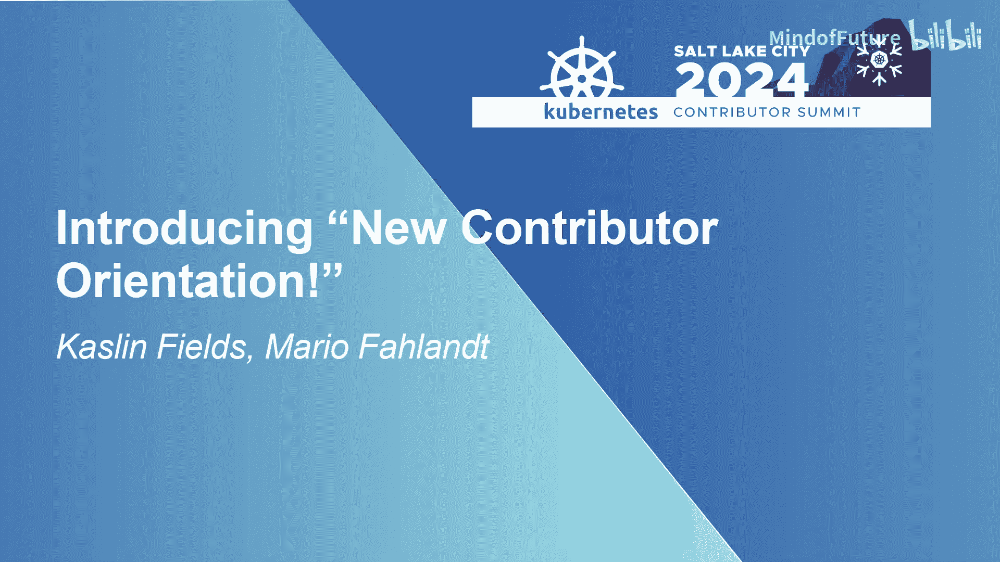
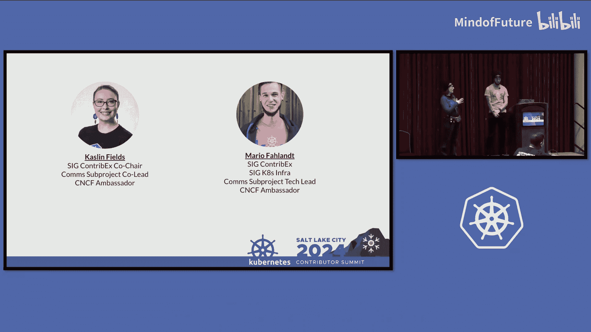
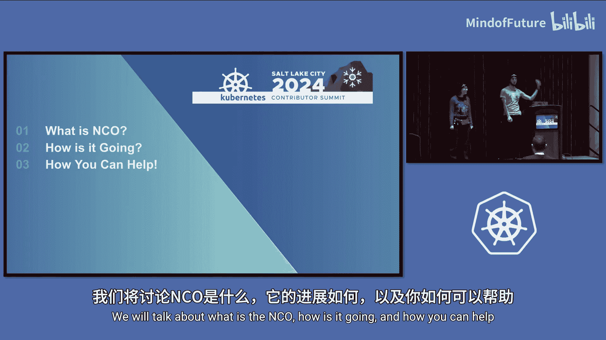
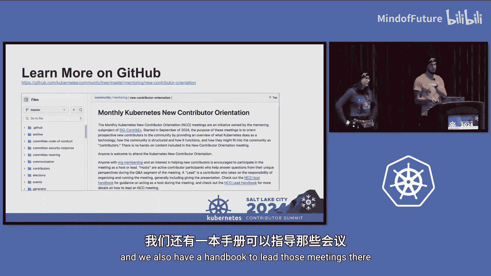
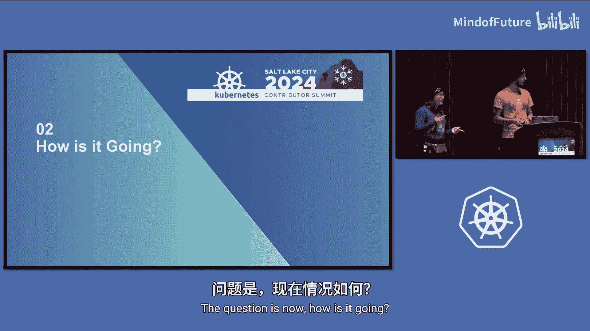
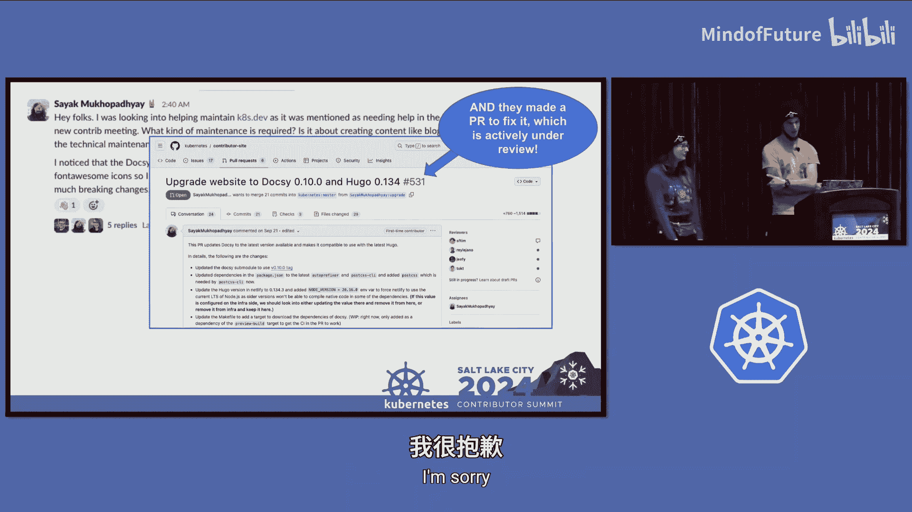
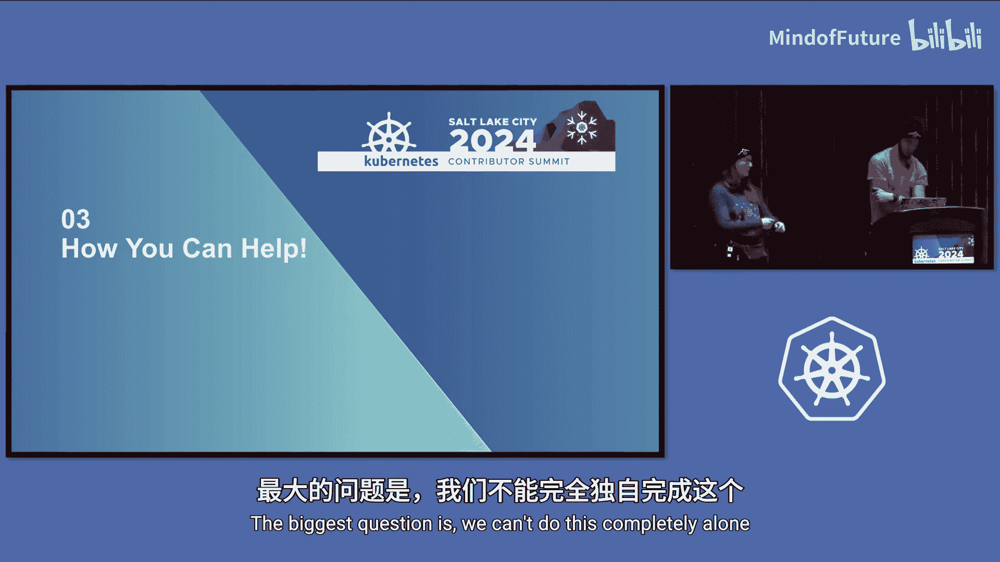
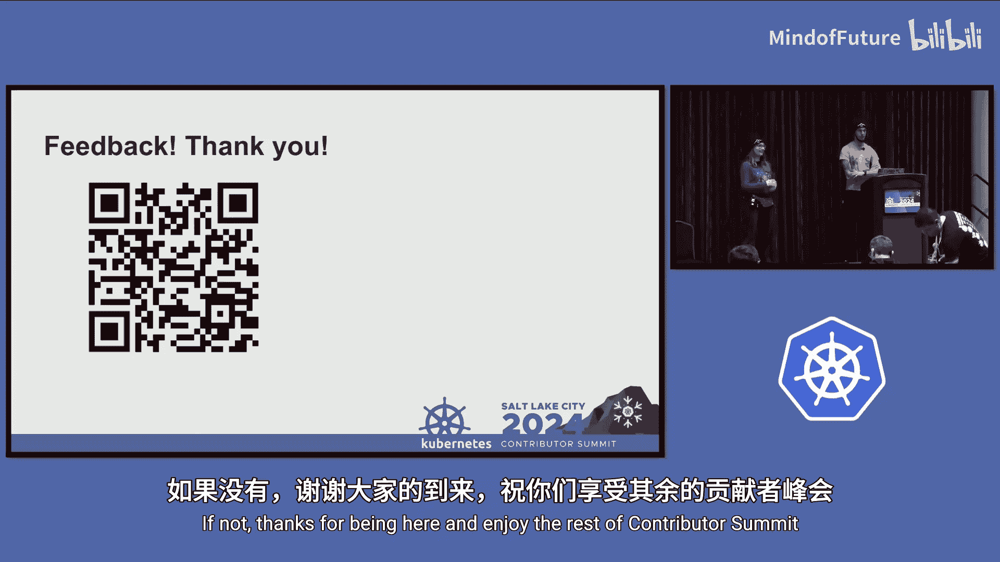

# 【Kubernetes】k8s贡献者峰会（2024北美）-p07-Introducing-＂New-Contributor-Orientation!＂--BV1kq6XYfEsx_p7-

I'm Mario here I'm very nice to be here。 I'm part I am in Conraback and I'm also in Si Inra。

 and I'm the one that is doing the finance report every Sunday。

 which I need to do today and I'm also in the Com up project and with me， I have the amazing Casle。😊。

Hello。I'm Kasine Fields and I am now a manager at Google that's interesting but I am a co-chair of the Special interest Group for Contrior Experience and also a colead of the Conor Com subpro and one of the founding folks who helped to put together this new contributor orientation Yeah so basically what is theNCOO we were talking about what is CNNCOO。

 how is it going and how you can help。😊。

Yeah， so what is CNCOO Yes so new contributor orientation is a new initiative run out of the Special interest group for Con experience。

 our mentoring subpro， and the idea of it is to orient new contributors in the community by providing them with a brief overview of what Kubernetes does。

 how the community is structured and how they might fit into it。Yeah。We have。Settleled on a date。

 which is not yet completely fixed。 but kinda， we try to run it every third Tuesday of a month。

In two different time zones， because the problem is for a lot of folks。

 And we figured this out that if we only run meetings on American friendly time zones。

 we have the problem that a lot of folks are not。Or cannot participate。

 So we figured out that we do some， sometimes slot for， which is EMA friendly and one that is an aEC。

 of course， and also that is American friendly。 It is a one hour session。

 and we consisted of 40 minutes with presentation。And we have 20 minutes of Q And A based on how many people are。

 The funny thing is， I think the first meeting we overextended by another 20 minutes because there were so many questions。

 Anyone can attend and all of the sessions are getting recorded and published to YouTube。

 So you can even reference them after， after those meetings。😊，So in these sessions。

 this is not a new contributor workshop。 That is the thing that we have done in the past。

 We used to do as part of the contributor summits。 We didn't see a whole lot of adoption of folks coming to those new contributor workshops and then becoming contributors。

 and they were really hard to run。 There's all sorts of logistics that go into running those。

 So eventually especially as the pandemic started。 we kind of dropped that we put all the new contributor workshop online。

 But this is about orienting people into the community and just giving them a place to start。

 So we cover of course we say welcome。 and then what is Kubernetes。

 So we go over the basics of this is what the technology does。 then the community structure。

 the concept of SGs sub projects， the steering committee that we're all under the CNf。

 all of those kinds of things。 we cover what it means to be a contributor because a lot of folks come into the community and they're like。

 I'm gonna be a contributor， and that has specific meanings in different groups。😊。

In different ways so we go over all of what that means and like the concept of reviewers。

 approvers so the contributor ladder in general， then we talk about how to start contributing most folks I think come into with it with the idea of that they will just grab an issue and start writing some code and then there'll be a contributor but in reality it's a community that you are becoming a part of and so you need to get to know people and like how they work and what kinds of problems they're working to solve so we go over a lot of that and say that you should really get involved with a SIG rather than just trying to pick up a specific issue and then we go over current work opportunities we ask the SGs。

😊，Yeah。To give us their active work items so that we can share them with new contributors and you can see how that's going。

 Eventually we will just annoy them every week。😊，And we get stuff we keep trying we'll keep trying and then at that point we pause for questions to see if anybody wants to just chat at that point but if they're a little bit slow to talk which is often the case then we also have contribution pitfalls to talk about so some tips and advice from our contributors on things to avoid or things to watch out for as you start contributing and then of course we do a lot of focus on question and answer So there's no handson component just getting you oriented。

😊，And yeah， the important thing is we don't change the presentation。

 So the presentation is basically always the same。 It covers always the same topic with， of course。

 a small exception。 So there will be some parts and we will get later into this where what those parts are where the content。

I's changing and this is especially for current options to contribute and a opportunities by the different six to contribute。

 but in general we want to have it always the same。 I mean。

 of course the questions that we get asked are different ones。

 but what we already figured out is even the questions that are we getting asked are the same。

 So the people that are coming to to these meetings are different people but they ask the same questions。

But the point is to have a place to start， it's a place where you can go to ask your questions if you're having trouble figuring out how to get started and the point of it all being the same also is we want people to be able to come in and run these so you'll have past examples if you want to come in and help us by running one of these and the content should already be ready for you。

 you don't have to prepare anything just come in and help those new contributors and the content is even so good that you can just read the notes because Keslylin wrote like a whole script that you can just read just read it。

Yeah， and。We have， we have it set up in the mentoring probe in the community rapport。

 Theres an information of all of the different。Things like the presentation， what you need。

 and you can also point people there to say， like， hey。

 what what do we if you want to read up on stuff， you can basically go go in there and figure out what you need to do。

 And we also have a handbook to leads those meetings there。

The question is， the question is， now， how is it going？

It， it's going good。 So we had two。 we had two things already。 And the funny thing is。😊。

We a little bit。We had an issue with the first session because we had the first session in Europe。

 and。Nobody could host it because we didn't have the host key。 we had the host key。

 but we couldn't claim it because it was not an open meeting。

 So we needed last minute to postpone it。 And although we postponed it。

 the first meeting in Europe already had 22 people joining or we needed to move it to a different date。

And we had 57 people joining from in the American one。

 And you see that October is way lower because in September， we did social media advertisement。

In October， we didn't do social media advertisement。

 So this is also something that we learned is that we need to do go heavy on social media advertisement and to be。

 to be honest， the most efficient channels that we have for this is the Twitter account with Kubernetes I O。

 which has 300000 people of reach。 And also the linked in the Kubernetes LinkedIn page。

 which we don't have statistics， because you can't get statistics on how many people are on this LinkedIn page。

 but this works pretty pretty well。 So to， to get in people。

 So now the idea is that we heavily advertise those meetings And the next one is actually coming up next Tuesday。

 So we it will be immediately after Qubecon， and we and when you look at the Twitter page and when you look at Twitter and。

Our Blue sky account and stuff like this。 you will see that we have a lot of polls up just for advertisement for this session。

 so we hope that we get a lot of traction based off of Cucon for those meetings。

A few learnings that we've had so far。 advertisement pays off。 We covered that one pretty well。

 having additional contributors on the call who are willing to share their story of how they got involved with the community and help to answer questions is really impactful。

 Mario， you had a specific story there。😊，Yeah， so basically。

 we had someone from my company who was there and just chatted about what he's doing and how he got into S inra and what he's doing in Si Infrra。

 And they already could answer a lot of questions。 And Ray， for example。

 also join one of the meetings and could answer specific questions from the different topics。

 And this helps because then people can relate to you。It's not one。Amalguous thing。

 it is a whole bunch of people doing different things and one person can't effectively cover all of that。

 that's just the way it is。The more perspectives we have。

 the better we can give folks an idea of where they might fit in another thing。😊。

I'm sure that you've all had calendar issues。 We all have calendar issues sometimes。

 so we're working on figuring out how to make the calendar invites as accessible as possible。

 The calendar invites are on Kates do dev slash calendar。

 If you didn't know that was the thing that exists。 Now you do。

We have the link to the calendar invite in the GitHub and on the contributor website。

 which also people don't know exists， but we're working on finding ways to make them more accessible because if you can't find the calendar invite。

 you're not going to come Also one of the tips that we have at the end of the presentation is something that I call the good first issue trap。

😊，And we have found that in each of our sessions folks really relate to that。

 it's the story of you come into the project， you're going to become a contributor。

 you find a good first issue labeled issue， you grab ownership of it。

 and then what do you do from there？The vast majority of those issues never get completed。

People pick them up and they think they're going to do all this wonderful stuff but they don't know how all of our GitHub stuff works。

 maybe they don't know how GitHub works at all because they're brand new to this stuff。

 so they might get stuck in the process of GitHub， they might get stuck in the process of working with the reviewer to make changes to the PR。

😊，Somewhere along the way， most people get stuck or just never get started and never finish their PRs。

 and that means that all of the PRs are just sitting there claimed and new people who want to find a PR can't find them because somebody has it and isn't working on it and so it's this big issue for the community where we then have to re triage all of these issues that we really needed done but now nobody is working on them and also people who are new can't find something to work on because they'll just get stuck so a lot of folks relate to that。

And we need to work on this but we cannot work on this alone we need to work on this on a project level Yeah。

 and we need better like ways for folks to get involved that are not just good first issues that they can pick up with no context because working with no context doesn't really work。

However， we had success。 we had quite some success， so we had people that were。

Pinging us after those sessions and even started replying to new people joining the Q andA new contributors channel。

 although they they are technically not yet an work member。

 They just went to one of the meetings and started explaining the content of the meeting to other people that joined us like channel。

 So they already took on over， yeah， basically Yeah exactly。

 So they they already start helping to onboard people and they also pinged us to reach out for can we use the content that you presented in those meetings to present it on a local presentation or in a local conference and Korea and stuff like this。

 And this is， I think， a tremendous outcome that we have already people joining and are so excited that they take everything and just move ahead and yeah。

 move along and say like， hey， I want to I want to also spread the world everywhere。

Another cool example of an attendee that is a success story。

 One attendee immediately reached out in the Sigconex channel in Slack after the session within like a day of the session and said hey I want to contribute some code I noticed that your k have website as a really old version of Hugo I'd like to help fix that that is something that we have literally had working sessions at these contributors summ's for for the last like two or three years。

 we've been trying to fix it and it's not the easiest problem Yeah we have I think we have three PRs that are all broken except the latest one So and yeah the next slide this person actually made a PR。

 they didn't just say hey， I want to help fix this。

 they came in and they said here is how I'm proposing fixing this unfortunately it's giant because just doing anything with this code base is going to end up with a giant PR。

 but we are actively working through that PR with them Yeah it's on my desk and I'。😊。

I'm not a blocking person， I'm sorry， we will get this solved eventually。

The biggest question is。We cant。 we can。 We can't do this completely alone。

 So we need some help from you。

Number one， we try to tell the new contributors about the active open issues in the community at each of these sessions so we need to know what those issues are and we don't just mean the things that you put the good first issue label on。

 we would take those but I really want to encourage SIG leaders to put some thought into what are actual tasks that could help get someone involved in our group and I think the next slide is more about that。

So we came up with this concept of evergreen projects。

 so an evergreen project is something that your group always needs done。

And if somebody came in out of the blue， knows nothing about your group。

 maybe they could pick that up because it's something that you probably have pretty well defined since you already need it always need it done。

 and it will be useful to the group。 So there are examples of this。

 the number one example that all of you probably have。Is meeting notes。

We can always have new people come in and take notes for the meeting if they attend one also things like release team of course that happen regularly and they're very welldefin it's theoretically a good option。

 though realistically they may not get into that a better example perhaps is in the comm subproject we have a blogging project where our members interview Sig leads and then they write a blog post about what they learned about that special interest group you don't have to know anything about Kubernetes。

 you don't have to know anything about the special interest group just write a blog and we'll publish it and then you get something very visible that is a contribution to the community and you learn something。

😊，So that's a very unique example。 but we want to encourage Sig leads to think about。

 are there things in your area that you always need。

 Could you define it well enough that a new person could pick it up anytime。

 And based on the call out that we just had and something that I completely forgot and I feel bad about this is。

This is not only for Si leads。 So not only chairs and tech leads。 This is also for subpro leads。

 because also subproject leads have evergreen stories and topics that they need to cover。

 So this get basically goes out to anyone that have like some organizational part in the Quber this project。

 And we need those input because it's impossible for Si contras to find this out of the blue。

 And the other option that you have is， and this is also helpful is。Join one of the sessions。

Give us feedback what we could improve there， answer questions。

 because some of the questions are super specific。 Like I work。

 I work I'm interested in working in S node and there's certain things。 and to be honest。

I don't have a clue about signal。 I can't answer those questions。

 so it would be always be nice if we have some experience that is being shared because this also starts opening a conversation and let people engage and get into into this complete thing and we do get those very specific questions on the first session。

 somebody asked me about Windows subsystem for things， which luckily I knew about。And the also。

 the other option is that someone leads success。 Yeah， we， like we said。

 we have documentation on how to do it。 It's the same content every time。

 The main thing is that you have to reach out to the Sigleas to ask them for new stuff and then actually give the presentation。

And it's easy because everything is already written down。 and you just。Need to take along。

The last thing is we have a feedback form， which we have not yet rolled out before。

 but this feedback form is a general one。 And this we created it now。

 and we will roll it out also in the future。 So we want to also get feedback from you。

 another topic that would be， would be interesting is。

And this is something more of a discussion because we were approached if this would make sense to track engagement long term。

 and we have not yet figured out how to do this。 So we would love to see like people that joined this new contributor orientation meeting。

Do they stick around how long it takes for them to be like a really active contributor。

 And we are open for suggestions to how we can track this stuff， because currently。

 we don't have a solution for this。 The idea was to somehow collect Github handles。

But this would then also mean that they will need to fill out some， some things in the survey。

 and you all know how people are with service。Or turn it into a workshop。

 and we don't want to do that。 Yeah， we don't want to turn it into a workshop。

 or we don't want to do live pre。Does anyone。And we are busy at an end。

 Does anyone have any questions or remarks or anything。Yeah， so thanks for doing all this。

 I'm curious if you see a difference between。Well， I guess two calls is a bit， maybe a bit early。

 right， But just even in the general process of NCOO。

 people come into the some people come into the community because they because Kubernetes is a big thing and they think would be good for their CV。

Or they're a student， perhaps， and they're looking for something to， to kickstart their career。

 And so they'll come， they'll come to communities and look around and see what's available。

 And so they're the targets for first issues。Typically。

 and then there are other people who want to do something。 Well， they are。

 they already know what they want to do and。They reckon that Kubernetes is the right place to do it。

 And that's slightly different。Yeah， that's basically， that's why it's not a workshop， right？

 That's why it's only an orientation meeting。 And the most of the slides are basically where we explain like what is the structure of the project。

 Like what are vertical6， what are horizontal 6， where how to get involved in this。

 Because this covers basically students as well as professionals， Because a lot of people fail and。

This was the same for me by myself because I started in Sinra， and I only saw Sinra。

 and it took me like one and a half years and Caslyn to basically show me show me around。

 but we want to lower the barrier to get the understanding of how can I join the community to move on and and get involved because this is a problem。

 and get what I want out of it。 Yeah we have a slide in there that is here's a whole bunch of examples of different reasons that people join the community。

 Your reason is valid。 No what it is。 so that you can pick the right activities in groups that will serve your purpose for being here。

 Yeah， so what you just said there leads to my second question， which is more about。How do you， Well。

 what are your thoughts on， Well， essentially， everybody in the community is a new contributor somewhere or a potential new contributor somewhere。

 even people who are experienced， because it's well， very few people know。

All the community as whole and the community is changing。 So what are your thoughts on that。

 trying to get more experienced people to also come， Well。

 there's coming to help and answer questions， but also coming to help and learn new stuff。

 because I was in a similar situation to you。 I started off in Sigmaluster。And。I run into this thing。

 where。People knew how things worked， but assumed everybody else did as well。 And so when it came to。

 for example， Kubernetes membership。I didn't get any prodding。We explain that。

 people don't get stuck on that。 Yes We have seen that exactly we have the whole contribution letter in it。

 Also， what is becoming orc member becoming reviewer and stuff like this so that people gonna get an understanding。

 We also explain steering and not what is steering doing， but we we explain it shortly。

 but also like why is steering a separate thing in the whole contributed letter。 Yeah。

's not in the ladder。 Yeah， it's not in the letter， obviously， And we also try to。😊。

Make people aware that it is okay also to just hop on other meetings and firstly just adjust yourself and go like。

 oh you started in sig clusterster。 But this is not something that you need to stick to。 So there's。

 there's no reason for， for you。 And you if I start in sig clusterster， I will always be sig。 No。

 that's not true。 It's like just go in meetings and explore it and also the the first advice that we give is join the meetings and get known to the people。

 because this is basically the most the easiest way how to get involved into this。

With regard to students versus professionals， more experienced people。

 the motivations are different obviously students are going be there to improve their standing。

 their resumes so that they can find careers network。

 all of that kind of stuff experienced folks maybe come in because it's related to their job。

 maybe just because they want to do it maybe because they want a community those are some of the top ones that I've seen for experience people but with experienced people who have useful skills money comes into play and there's nothing we can do directly to make sure that they're paid for their time investing in the project so we try in this presentation to make it clear that a lot of people volunteer and if you want something out of this that's worth volunteering to you then you can do that if you're doing something for your job there are people who do that too so I mean it depends on where you're coming from and Bob and me so Bob Kim from CNCF and me we are working on a top。

That is basically also like benefits for benefits that you can show your employer。

 either it's a vendor what's end user company to show them what a benefit would be that some of your time gets spent towards open source。

 And eventually I want to take this learning or this stuff that we found back also into country so that we can also work it in the presentation so that people have like a reason to That's the reason why you go and join open source projects and stuff like this。

 That's in for you。 That's in for your company and so on and so forth。 The validation of。

Here business， this is why I'm doing this is another thing that Conbeck cares about。Yeah。

Not directly addressed by this。 I'll ask a third one， unless anybody else has， So just an idea。

 How about making a， you know， when you become a tech lead or Co or co chair， you have to。

Open an issue and take a bunch of check boxes。 And there's some training and so on。

 How about adding at least attending an N C session。Add to that list。That's an interesting idea。

 That's an interesting idea。 But we put probably， this would be needed to be run towards steering。

 So， yeah， because they would then need to enforce this on。Tically we should do it。

This is a good idea you for the idea。Any other question。If not。

 thanks for being here and enjoy the rest of Con sumummit。

