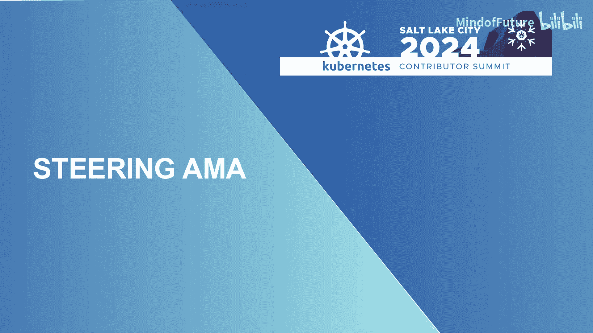
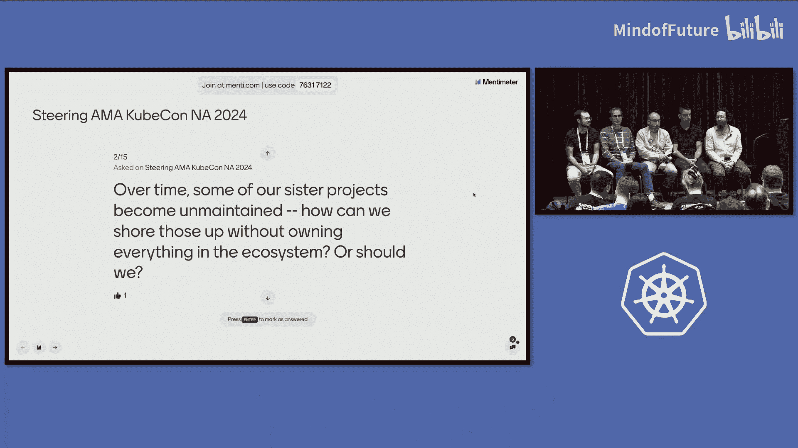

# 【Kubernetes】k8s贡献者峰会（2024北美）-p08-Steering-AMA--BV1kq6XYfEsx_p8-

So I think， you know， for you may not have met all of us。 So I mean。

 maybe you want to do a quick round of intros。Go down the line Beny you want to kick it off Sure Hi I'm Benjamin elderder you may know me as Ben the elderder I've been working in Kubernetes full time since 2017 and before that I did summer code in 2015 working on Q proxy I've mostly participated in SIG testing release contras working on like the infrastructure and the build and the things around the project kind of some of the meta stuff but I've also spent some time。

Pre 1。0 even hacking on Cu proxy。 And I really love this project and community。

my name is Patrick Woody。 I work on well， various six related to Kubernetes I started in six storage have very fond memories of being taught how to do PRs in that community and then moved on I did things in testing。

Logging， for example， and I'm driving one particular feature of over the last two years。

 that's called dynamic resource allocation。Yeah， and got elected into a steering committee1。

 one year ago。I still feel like I'm new to a project because I only started five years ago， but I。

It has been an interesting experience， and I certainly appreciate it。

 I want to make sure that it's the same experience for people who are starting out a new today。

 And but we still get new contributors， which is good。😊，My name is Antonio Haer。 I join it in 2019。

 I think。With Benjamin working onkind， since then I've been working in testing and network。

 I'm the guy that talk with protest when somebody breaks a test or something。

 so most people justt have a good impression on me。

By well and now I'm happy to work with all you in the committee， in the steering committee。😊，Hi。

 my name is Mace， youve probably seen my name popping up in various controllers related stuff。

In Ce cattle， where I started primarily， I've been part of the community for。10 years。

 I started in like， late2014。And finally put 10 years of Kubernetes on the resume， right？Yeah， yes。

 in a month， In a month， I'll be able to put a tenure。Knowledge of Kubernetes。I'm also。

 I was elected with Patrick last year and with Stephen。

I still feel that we have a lot of things to do。 and there's like so many different challenges。

Even though the past year has been somewhat calm， I would say， with regards to said。

I don't know whether that's good or bad， yeah， I can argue both ways and yeah。

 you've probably also seen my names popping up recently in the PRR approvals。

John and David took me under their wings， and I've managed to。To got to theappr level。

 so that's that。Hey everyone， Stephen Augustus， engineering director。

 I have been around a bit of different places in Kubernetes。 I really enjoy horizontal Sigs。

 but I started off in Sig dos。 I was previously co-chair for Sig Azure for Sig PM If you've heard of Keps。

 That was partially my fault。😊，I'm currently one of the co-chairs of SIG releaselease。

 created the releaselease engineering subproject and managed the team across release engineering tooling along with folks like Jeremy in the audience。

 and and yeah， I mean my passion has been release engineering and production engineering and things of that sort and now I kind of spend a lot of time on projects that are know not just Kubernetes but across kind of like the Open SSF and open API initiative in a few other places So that's me the first question the computer went to sleep。

 but the first question is the common first question。

 I will read out the first question since it's not on the screen anymore。

 What does the steering committee do。Great question， great question， I'm going Patrick。😊，Yeah。

 that's one of the questions that I had by myself when I looked into getting elected and then when I started。

 it turns out that ideally the steering committee shouldn't be doing much。

 we should delegate most of the authority about individual areas to special interest groups and then we only deal with the things that fall through the cracks and site needs special attention when it's not clear who should be handling it。

嗯。We do ultimately have authority of over resources。 We have。

 we need to make sure that fit financial aspects are O， that we can keep running the project。

 We have。The keys for signing things， we own document space where we place things。Yeah。

 so're if we're making statements as a project， the steering committee is usually approving those statements。

 if you've seen the banners that go up on Kubernetes。

 o those are things that we approve as well to make sure that the messages in line with how we're thinking as a community I would say that there's one really good example that Ben I'm sure you can speak to as well about what the steering committee does and Patrick to your point around delegation right very often emerging issues will come to us and we have to figure out what to do with them right if there is if there is a governance group so for folks who are not familiar Kubernetes has a few different governance groups we've got SGs special interest groups the working groups working groups are timebounded efforts that are supported by multiple SGs we've got subprojects within SGs and then we've got committees right so the steering committee kind of governs a little bit of all that but the idea is to make sure that the right。

Governance group is doing the right thing right So we had we had an instance we had a repo that used to be that is now archived。

 used to be called Kubernetes slash funding and people would would send funding requests to us like hey。

 I'm trying to do this。 I'm trying to test out this new project I would like to spin up a little bit of infrra and we noticed that like over time。

 we got a lot of requests that looked like hey this is inra shaped So if you've ever worked with Sig Kate's Infrra。

 we decided that we probably needed to create a governance group specifically to handle infrastructure requests to manage the infrastructure to manage costs over time for the community and Ben。

 you can。Chat a little bit about Kate's intro。Yeah， I'm a tech lead over there。

 one of the things we've been doing is making sure that everything that the Kubernetes project needs to run the CI systems in particular but also release hosting and other automation and tools that the project uses are hosted by places that are owned by the project and the CNCF and so that there can be continuity there and making sure that this is run sustainably。

 we actually spend millions of dollars a year in cloud credits just to run the CI。

I wanted to add that there are a couple other really important things for steering。

 you know making sure that part about the things that falls of cracks。

 there's also just like establishing where they are like that group but more generally reviewing changes to governance establishing what are the groups and making sure that there's no conflict between what they own and also liaising with the CNCF on things like the resources that we need for infrastructure or the requests from the project and also Kubernetes has a governing board seat。

 which is totally unique most of the governing board seats are from paid members from companies that are paying to be part of the CNCF。

 the Kubernetes project being the biggest and the original。

 we have one governing board seat that is appointed by the steering committee and has typically been current or former member of the steering committee that is going to those governing board meetings and making sure that the project is up to date on what's happening there and has at。

Some voice in this。Fun facts， one of the things that we handle that you may not be familiar with is occasionally we get visa support requests from contributors right so those are handled behind the scenes。

 there are lots of things that you know so committees are allowed to discuss private matters。

 spend time doing things in private， we have three committees， the steering committee。

 the Code of conduct Committee and then the security Res Committee right so those are all committees that are kind of chartered to do things that we may not be able to reveal to the public immediately right and so dealing with sensitive personnel things like like Vi requests something that we also handle。

Cool， any follow ups on what does steering do or should we move on to the next question。

Do we have any live questions， We can jump between。The computer and the live。Okay。

 let's go with a computer。 Co。 Al right， computer question。

 Kubernetes users depend on adjacent projects， some of which are consistently maintained。

 Do we have a framework for exploring adoption of projects like Sig S CD for other projects。

 should we。😊，That's kind of a big one I can talk chunky so we do have a just established process for what it looks like for projects to come into the community。

 but those are typically new projects it's a little bit different when you have an existing project because we need to make sure that everything is good with the folks who already own and run the project so like in the case of SXCD there was a very bespoke process to reach out to them I worked with。

Bob， especially in a couple of the folks on the etcCD side to talk to them a lot about what is that going to look like and that's how we wound up with doing the SIG as kind of a unique thing I think in most cases you would be able to take a project and nominate it for being sponsored by one of the existing SIGs but in this case API machinery is already so big。

 they just didn't want that and the SCCD folks wanted a little bit more self-governance but the support structure of being within the project。

 I think that weren't pretty well from everything I've heard from that CDD folks。

 I'm not sure if that's something that we want to repeat for a lot of projects。

 there are one or two that I'm going to be chatting with some of the steer folks about later。

 that have come up where I don't think maybe that's the right fit but it might be that we need to help get them resources or that they might need to have a discussion about if they fall under one of the existing SIG。

So there's not exactly a complete framework for adopting like a big ongoing project that has fallen upon issues。

 but we do have like if you have a project you want to bring it in。

 there is a documented process for requesting that a project be donated into the project and so then the other part of that that's not documented is just we have to talk to the folks on that currently on the project to make sure that makes sense to them。

So I think yeah so the person who mentioned the ECD that is a very， very unique use case。

 I think that is as a perfect example of an emergent issue where this is like this is a concern for the ecosystem because ECD acting as the brains of Kubernetes it matters us it matters to the CNncCF really so working with them I think that is very unique compared to the documented process for new donated projects we have for six sponsored projects we've run through this process quite frequently and it's usually easy to kind of like finger in the air understand where this project needs to go because again for one of the responsibilities for steering is to review and approve all the charters for the governance groups across the community so usually we either have an idea of where this should go who you should talk to next it's usually something that can fit within the context of a subproject within special interest group as opposed to。

Being its own governance group。Sos a question yes。Hang on。 Let's get the， let's get it on like。

So it's interesting to bring this up because I'm thinking about the example of Carpenter and how we kind of brought that one in and I'm just thinking like you know how could the you know and I'm also speaking from like the end user Tech advisory board and know I was one that was like trying to encourage them first to belonging to the CNf thats really belonging to Kubernetes org and there was a lot of back and forth there how would you like to see that type of feedback to drive because I know Sig autoto scaling had an existing roadmap of what they were trying to do there was a lot of level setting of strategically worded carpenter and Sig auto scaling of what they were doing with the cluster auto scaling so how can we as an org members help in this area because there was some motivation of why some what's wanted to see in New org but also to't want to be disruptive。

 we don't want I know that you have to be very selective with the steering committee about these things in here just curious how can we help here when we still see things like Carpenter I know it was probably an exception of the rule but I could see that maybe possibly happening again。

맞cha。I'm still struggling， I'll put my lead hat for either of the six。

 I'm not specifically familiar with the carpenter issue。But。

I don't want to throw anything in general at at this the。

 I would definitely start with talking with the。With a particular s， in your case。

 you've mentioned s autoto scaling。嗯。And that's usually where。I know that as a lead for SGs or6LL。

 I'm open to discussing any kind of projects that wants to be part of the overall SI as one of the subpro because both Sigaps and SixLI I have a few。

That we are overlooking and we've been adopting over the years。

 including one which was entirely driven by one of the companies and they eventually decided to move this over to6LI and specifically I'm talking about Coui。

 Coui was initially done by IBM and over some period of time Nick was working very hard with us to make sure that we are able to take ownership as a 6CLI of the project。

 the path wasn't easy or simple because when we are actually adopting a project。

 there's a lot of requirements especially around contributions。Which can be adopted and which cannot。

 I remember that there were some。And Coi wasn't the only one that I'm aware where we had to remove some of the comets for a particular project to be able to move them over for the adoption。

I don't think there's any。Path that we can always apply to any kind of project like that。

 It's always case by case。Definitely starting with a sick。

That's why we have the six in the first place， they are most familiar with a particular area。

They usually are aware also about the projects in。In the broader landscape， and if they are not then。

Talking with them， presenting the projects， presenting eventual pros and cons why we would want to do a particular project and how we would want to approach the process。

Is definitely the best， the best best path forward。

 And only if there are some obstacles or eventual problems with a sick， which。

They are eligible to do and say no because。Then you can go back and talk with this hearing。

 but one of the reasons and one of the question that the hearing will ask definitely the first time is。

 have you talked to， I don't know this particular sick？hy地 say得。

That they are not thinking that this is a right the right move and do we want to reconsider that option。

 but steering will always in those cases fall back the to a particular sick which usually knows best in a particular area。

 I'm not sure if that fully answers your question but。SoYeah。

 so I think what I will say there is that。We have a paved path if you understand how the community works。

 And it sounds like there is an open action item for us to figure out how to more easily deconflict situations where people are interested in doing the donation process。

 right， So how do you know that you're supposed to go to SG X in the first place， right， you know。

 we had the last steering committee meeting。 We actually had a request for a new architecture。

 which I'm not going get into here。 but we've been having conversations about architectures in across SG relief across across Siggarch across Kate's Infrra and basically what I said was pave。

 This is。You， you have gotten to the community， but you have， you're not in the right spot。

 And here is， you know， here is the next top， right。

 So I think I think there can be an easier process for like。

 how do I gather the information as someone who is not a community contributor day to day and get to the right place。

 right， You're not gonna know that you need to be in Sig fo until someone tells you， right。

 So that that flow chart could be expounded on。I want to ask because on the architectural thing is interesting。

 The other part is that we know that all the six are overwhelmed。

 and it's not now that we can accept any other thing， because sometimes there is the。

The the people asking for report is thinking that， are I going to land these in Kubernetes and this is going to be maintained by the community and the community all of us that were here。

 right， and we don't have all this time for maintaining new projects。 So thats all thing。

 it shape suits understanding。 they can。Deal with the laws。 Otherwise。

 we have a problem of arching new projects or projects that are supposed to do one thing。

 And they don't do that thing， so。It's a complicated topic。

 we need to think on the sustainability of the project。

So I engaged with that issue and I actually think that it worked relatively as intended。

 yes there was some conflict because there was an existing similar project with the roadmap。

 but folks had I don't know who to talk to who reached out。

 we plan them to talk to our you know it obviously falls under Segato scaling that is very clear that their charter would be the place where that would belong and I did a little bit of reaching out just to clarify the process and the things that needed to happen for a donation to be successful and once I got past the initial how do we sort out the conflicting with the existing roadmap I think the rest of it went pretty well。

So we're going to jump through， it looks like we've got a bit of a backlog。

 and I don't know how much time we have left。Allright， cool。 boom。 All right。

 What advice or plans do you， current steering committee members have to help the next steering committee members prepare for the role and run for election。

😊，嗯。We， as as steering members。Cannot promote anyone from the community to run or anything like that。

Having said that。啊。We and each of us has been doing that for years。 Trust me， I know。 I've been。

The reason that I'm here is because I've been talked by a couple of folks， not once。

 but multiple times。About running into steering？It's usually that we are talking between one another。

 It doesn't have to be that you're blessed by the steer member。

 and that's the only way to get into steering elections， each and every single one of us。

 each and every single one of you can actually run for a sea。

If you have some questions about particular issues， doubt about what the role is。

 how much time does it actually。Take to be this hearing what kind of requirements are there for becoming one。

 the best way for you is to reach out to any one of us if individually。

 we will be available throughout the entire conference throughout the entire day today。

If you have any specific questions， questions that you want to ask in private。

We are always each and every single one of you available for you to chat。If。

If some questions will pop up at any point in time in the future。Ping me on Slack。

 I can jump on any Zoom Google Me， whatever kind of medium you're comfortable with asking the questions。

 and I can answer whatever the questions you might have。

 And I know that all the other steering members will do something similar as long as within like the reasonable waking hours and I'm。

I will mention that I'm European， I've done meetings at midnight because yeah。

 Will batchch has one of the meetings at midnight， I've done that multiple times。

So that's not a problem。 But like 2 or 3 AM for me， is kind of。Rough， but yeah。

 so that's the best option， just talk to us。And。I know it's not easy。

 And there are multiple questions。 My hat is。I woke up today at four and I was going through what I'm going to say this morning。

What kind of potential questions I might have。 Yes， I'm a little bit jetlocked。 but between 4 and 5。

 somehow， I got like a ton of thoughts flowing through my head。

It's always when you want to be sleeping， right。So what I will say is I think， you know the you know。

 the Tamace's point， like trying to overpl this is is really tricky。 you。

 you actually don't know what's behind the curtain。 And like that question。

 what does steering do comes up in every steering AM M A right。

 there are a lot of things that you you won't know until you have the experience， right。

 So if it's something that you're generally interested in like let's chat about it。

 what I will say is for I feel like every steering election right in recent history。

There has pretty much always been some leadership from SG contributor experience on the steering committee。

 And more recently， it looks like SIig releases coming into play， which is pretty cool。😊，Testing。

 testing， you know， but I， I feel， I feel there's， there maybe a reason for that。 And it's that。

Those are some of the groups that have really good。Contributor ladders within the group， right。

 They have， they happen to be ingress points for the community。 So like。

 I would love to say that elections are not popularity contests。 I'm， I'm not going to say that。

 There is an aspect of。Who， who you're surrounding yourself with and the impact that you're having in those areas and that extends to the wider community。

 right， you， you were representative in that area。 you're representative for。

 they look at you as a potential representative for the entire community。

 So I think that like there are some Sigs that are doing a really good job of bringing people into the community and trying to。

 to keep them there。 And I think what we may you know， be able to do as steering is encourage。

encourage learnings from that are SigGs that seem to have traction doing that。

Across SigGs that may not， right to kind of widen the representation。I'll add that one more point。

We went through multiple election cycles， and multiple people have sat on the Syrian comedy。

And each and every single one of them。Is available for you to talk to them。

I know personally that I've reached out to so many folks after I got elected before the election last year and then eventually during QCon。

 after the election， I spent several hours talking with the past。

 the steering members that were actually leaving last year。And I searched for their advice。

 I was asking questions。And the question that I asked most always was like。

 what was the hardest thing， what is the thing that I should be prepared for？

And the answer every single time is， you don't know。

You don't know because every single time that's a different thing， different members will tell you。

That for them， it was something else。So。The ability to talk to people， the previous steering members。

 and they are all very approachable is super that's the best thing that we have。So， yeah。

So come talk to us as the TLR come talk to us actually we maintain a private contact list of all the past steering members that we use to collect this kind of information about like what's going hard and what's going on I think everyone who's been involved has been really happy to help so even if we feel like we can't answer it we have the whole backbech of all the past steer members to like。

Send those questions through to please just come chat with us also yeah to Steven's point both of these folks sitting next to me were folks that I nominated for tech lead in sick testing and I remember there starts in the project I think that one additional point is that a couple of groups even mentioned are really horizontal groups I think that's like the best thing to prepare get involved in one of those areas that's not like I'm shipping this feature because that's what I'm doing at work you know come help up with something like release where you're going to work with the whole project you're going to work with people all across the project on things that are happening all over the place that don't necessarily have to do with your focus area if you come first participateipate and like testing contributor experience release these groups that are really cross-cu you're gonna to get a lot more exposure to the rest of the project which will both prepare you for steering and help you have the visibility that folks know who you are and are confident voting for you。

So yeah，I used to give this speech every release cycle， which I haven't done it as frequently。

 But every now and again， someone will come up to me and go like。That speech， that like， rah， Rah。

 Ra， Like， let's do it。 Part of it is。Every document is living， right。

 You have the capability of changing。 if you were in this project。

 you have the capability of changing anything that that is currently written。hich is really cool。

 I think， I think part of it to my dream for the release team is for it to not exist。😊。

RightThat everything is such a well oiled machine like we have deleted release team roles in the past。

 which have been really cool。 people have come in and written so much automation that you're like oh。

 we don't need this role anymore but part of what I say is I would like you to this is being on one of the subteams for the release team gives you a lens into another part of the project if you're doing if if you're on the enhancement team you're looking at you're looking at enhancements across the entire project if you're doing release signal。

 you're coordinating with you're coordinating with folks in testing。

 you're coordinating with folks who are doing bug triage across their respective groups。

 if you're doing if you're doing docs， you're working with SIG docs quite tightly。

 if you're doing comms， you're actually working with some of the leadership of the SIG as well as CNncCF to coordinate a few things so what I tell people is as you're doing this role。

 try to find a problem that is bigger than this team and then go out。

So it right you shouldn't stay here。 I don't want to see long like I don't want to see longtime release team members like it's up and out。

 like let's figure out what the problem is。 Let's go solve it right we had problems with with the way we were doing futures collection and that is what that is what kind of catalyzed like。

 okay， let's actually ship the kept process right and I'm sure there will be a tomato that will come flying at me But like that was better than what we had before。

 but what we had before was a spreadsheet。So so find a problem。

 find a big juicy problem that is crosscutting for the community and try to go and solve it and we will help you get there I think that that the now I never thought about that but not than you mentioned is the people that is here is really people that is across all the projects or at least I think that all of us know everybody in every six right and that is also an observation I made recently that the sixs are getting more sides of。

I don't know what to say in English， right but more So new people is coming。

 And these are new generation。 And I was happy， I can say in second generation something。

 but I have think hockey when and all the people and that matter in this way that。

Connected me with other people。 And I found this in the new contributor， right。

 They are disconnected。 and we the senior people in the project。

 we need to do something right to create this bonding around6 again。

 right and that all thes are able to communicate with all the sea and all these new people then all these historical context and and create this horizontal for all the six right as to say。

 there are things that are more horizontal than others。

 But that doesn't mean that the six that is vertical。

 doesn't have to have all this visibility across the project。

 because we need this where I personally in the。 We need everybody to know everybody。Cool all right。

 oh wait， hold on， what happened here？我一会离开的慌。Okay。Further， yay， cool， okay。

I promise I know how computers work。Yeah， all right， cool， sweet。So， no no， no， no this。

That's number five。All right。Sweet， cool。 Thank you， everyone。 Live tech support。 Alright。

 what was the biggest challenge that steering was able to solve in 2024。😊。

We still have like nobody wants to do the mind fncing。

We still have Yeah well we still have like a month and a half and we will say something and then something will pop up in we got time we got time。

 does anyone want to bring us a big chunky problem like。😀Ha。😊。

I would say that theres one that we have not completed。

 but is coming up soon related to I think we're having。

 at least governance and election wise very recently there have been， or I mean。

 I think for you the history of these elections at least the steering and code of conduct committee elections run very close together。

And it means that sometimes people run for code of conduct and then the steering committee election will come up and they will run for steering and sometimes they will step down from code of conduct to run to serve on steering if you have noticed one the CNncCf code of conduct committee elections are active right now。

 the Kubernetes the Kubernetes Code of conduct election you may you may have noticed。

 has not been started， it will not be started until 2025 so we're kind of like bouncing around ideas to deconflict these two elections because one there's no better committee。

We're just different roles， right， You know， you， you wouldn't。

 you wouldn't necessarily step down from steering to go serve on。

 to go serve on security response Committee， right， Fundly different work so。The people。

 so I think you know part of what we've tried to fix is instead of rewriting a lot of things in the charter。

 we just are going to move the elections so so steering the code the code of conduct elections will be coming up in like February 2025。

 and that will give an opportunity steering committee members who are just coming in in kind of like November window to be able to to be able to onboard for about a quarter before we kick off the election。

 So they have context of the players in the space， maybe some of the problems that are coming through across that firewall between the two committees。

 we only talk about issues if we absolutely need to and even then it's with very little details involved。

 but that will allow people to get to get onboarded we've got a bunch of new steering committee members who have not been in seat for a long time。

 and and then we kick off。of conduct so that's one of the things that we're working on right now。

There's one sort of related one that again， since we said 2024 all it's in progress right now。

 there's actually a pull request open in the community repo to add email handles for all the chairs and tech leads and you might want to hear why are we collecting your emails well because the CNCF has a formal concept of a maintainer for a project and one of the things that that means is those are the folks who get to vote for the voted for technical oversight committee seats that's a really important part of how the organization works。

Do you know who does that， how many of you know who gets to vote？

Okay like two or three so the answer is steering， that's it。

 And if you look at some other projects in the CNCF ecosystem。

 it's like their root owners file and their main repo and there's like 40 people it didn't use to matter that much it was one project one vote so if you had more people you're just like sharding your vote more they changed at some point to one vote per person So Kubernetes is getting really tiny fraction of those developer representative seats on a technical oversight committee this is something we've been going back and forth with the CNCf for a while because you know you could start a bit of an escalation process here with everyone nadding all their but we said look like Kubernetes really should have a few more people on here we'd like to add our chairs and tech leads and we're planning to do that sync but first we need to have like authoritatively this is the contact info for all those people。

 they need to have your email address so they can add you to some lists and some things so that they can give you the access but where。

Hopefully by the end of the year we'll have all the chairs and tech leads added， so plug for that。

 I need folks to review that PR and then once that lands we're going to be asking all the chairs and tech leads and leads in the project to go add that additional field to the metadata in the community repo where we're tracking all the SGIfo so that we can compile that list of maintainers and for that to the CNCF and make sure that you all get a chance to vote for these technical oversight committee seats。

Folks had mentioned CigSCD， it is a very rare event that we introduce a new special interest group。

 so I would consider that a big win， especially in a crisis situation， I think。

 for both the maintainers of FD as well as people depending on ED。

I didn't want to say that one because we were involved。

 but I feel like it's wrong to say that steering solved this。 I think we participated in。

 I'll add the one that we have like an ongoing problem for years， which is the annual reports。

The annual reports will be starting next year again we've numberrun did a great job over his tenure to simplify the annual reports。

嗯。A lot of the data is pre generatedrated and prefiled。And yet， even though the actual work。

That we require out of the six and their leadership and the work groups。

To fill in the remaining data， not all of the six and not all the workersgroup are actually doing their assigned job。

So my ask here， which is very way in the future is that next time where we will be going through。

March， February， March， next year， probably， yeah， I know。嗯。

Please spend that couple of minutes it doesn't take， but we really want to make sure that。That data。

 which then helps the contributors to show what they are doing， what they are working。

 what the project is working on。Is extremely useful。How much we have 18 minutes？All right， cool。

 all right。Let's rock and roll。Now I know how it works。아。

So what will the future of Kubernetes look like Well there be significant changes。

 I'm curious about the main goals we should be considering and improving together。

 what do you think So I don't know if someone was trying to go us into Kubernetes 2。

0 discussion because I have opinions so I think were this is very very much not project specific。

 I think some of the I think some of the issues that we experience are endemic to any open source project right。

 it's just they get you know they get magnified because we're a project of so many people right and we are also the largest gol- based open source project in the world right so we second largest。

Yeah， so like this is this is stuff that you sometimes we see things that other people don't see。

 sometimes we run into things that people people but there is one there's one thing that you know lots of people have been talking about maintain or burnout you know。

 sustainability of projects overall right and I think that crops up in microcosms within Kubernetes because there are 30 something you know governance groups and。

Each of them will have their own issues， right， are there have been situations recently that we've seen where you know people have changed jobs or or companies have been acquired and and their contributors have not been allowed to contribute to the project。

 And then we're like， oh， wait that's a lot of our chair and technical leadership really interesting。

 how will we function So I think continuing one of the challenges that we really need to solve or this is never gonna to be solved。

 solved， is to think about if you are a maintainer of Kubernetes we were talking about how do we pass on the information that we have。

 how do we give people contextual awareness for problems that have have happened in the past。

 I kind of love when you know someone in the release team will have this amazing idea。

 And they're like， they're like hey， listen， I've been talking with my subteam。

 I had this really cool。ear。Check it out。And then， and then I'm like。

Let me show you the issue from three years ago where we had the same idea and we did not have the staffing to actually work on it。

 Let's reignite this discussion。 So there's lots of stuff that like as a maintainer like you may have the context。

 but someone new coming into your group may not have it right as maintainers。

 please write as much down as possible。 figure out what your contributor ladders look like for your individual groups figure out what the succession plan is。

 what happens when you go away， What happens when there are emergent events that you don't have control of right health issues。

 Jo changes right There's a lot of stuff that like we need to be focusing on the human angle。

 like this is not this is not tech。 are not this is not a technical project。

 we're using we're using Kubernetes for a purpose， but this project is people。

 This project works because it's a bunch of people collaborating。

We need to focus on the people right now。Yeah I think my understanding of a question was actually that it is more about the technical direction。

 but I think you already pointed out that this is not what Steing does。

 we are here to make sure that if people have great ideas that they want to do in the project。

 that the project is able to accommodate accommodate these ideas because we do still have the senior leaders around who can guide those new contributors with these new ideas and make sure that it doesn't break Kubernetes。

 that perhaps is we have a big thing that we need to be aware of。I see Jordan smiling。

 It is a big project。 A lot of things depend on us。 On the other hand。

 I'm guilty of introducing something that is perhaps a bit disruptive around managing devices in Kubernetes。

 This also needs to be possible going forward because the world is evolving So AI is a big topic。

 we haven't set the word yet here， Perhaps we don't need to welcome sorry AI chat。

 Yeah this is changing what people want to run on Kubernetes。

 and I think it's good for the project if we find a way to make that possible without breaking everyone else。

I have thoughts on this but I also just want to plug really quick。

 Tim proposed the session that I'm hopefully co-running later in the unconference about maintainers and what can we do to make this better。

 please come chat with us about that if you're interested in this topicm really passionate about that and I want to see if we can get some folks working on that problem or problems。

I think we do have a lot of opinions about where 2。0 or what that looks like。

 but the cool thing is we have everyone here to discuss that and to hear from the rest of the folks kind of don't want to overshadow that but that's fair I'll leave I think some areas we need to be thinking about。

Upgrades and beyond just AI and accelerators， nonuniform hardware and scheduling。

 we've got all kinds of different processors and things coming out where core isn't really just a core anymore and you know Kubernetes are just like oh' schedule a CPU I think there's a lot happening in those spaces that the project has to react to where the world is moving around us and make sure that we're providing a good stable experience with smooth upgrades while also bringing in these enhancements that let people work with the hardware they're trying to work with。

Like working group longterm support has also been revived right so one you that's one of the things that people like want stability they want to see。

 I think the first time around when we did working group LTS the outcome was the Kubernetes support cycle so it's like 12 months trailing two months of you critical updates for the running release branches and then we shut down the thing And now I think we've seen a revival of the conversation like let's go deeper so it's clear we want I think we've heard a lot of people say we want Kubernetes to be boring and stable and upgradable and et cea。

 et cetera， if you're interested in those discussions spend time and working group LTS。

I also think we have to be putting a little bit more thought into everyone says they want boring and stable。

 but they also want something like D。 Everyone has that one thing that they want and they're like everyone else's feature go away。

 make the project very stable， don't break me， but also I want this big feature I think that we have to do we have to keep working on how we you know manage that we've put a lot of process and things into how you ship a feature and I think a lot of it very important It's part of how we do things stable but also worry that we've become a little bit too intimidating to participate like okay you got sign up for like a three- year kept process good luck and that kind of drives people away I think we have to keep looking at what can we do to make sure that we're maximizing both of those directions that people can get things done and that they're not breaking things anywhere that we can。

Introduce process that makes things stable without being friction。Please think about that。

 I think that we need both and in some areas we're doing one and some areas we're doing the other。

So we've got about 10 minutes left。 we're going to start getting a little pitthier with our answers and speed round some of the stuff。

 here we go。All right， man。What are the project's biggest financial risks？

to keep talking all the time。 I really want the rest of the committee here， but yeah。

 I'mling Ka Zempra and hello， we are spending millions of dollars on infrastructure and we depend on people who continue donating that and there's always just the like up into the right everyone's like well let's run a new thing。

 I think we have to be a little bit more measured about that。

 We need to try to make sure that our own workloads are portable that we're really thinking about what provides the most value to the project。

 where can we make things cost effectiveff。 How can we make sure that this is sustainable a lot of the things that we do are effectively free and they're like pretty standard stuff we're using like Github or something it's not a big risk。

 but we have a really large cloud presence。 have $3 million a year from GCP for a long time now more recently we get $3 million a year from Amazon。

 We get like 500000 from Azure we get some bandwidth quota from fastly and I'm forgetting the exact number apologies but they give us a large volume of bandwidth。

😊，WithAnd we depend on all those things and it just only grows up like it's one of those things where not very many people are looking at。

 how do we bring it down instead people always coming to us like， here's another thing to run。

And the number only goes up， I think the project has done a really great job bringing that back down。

 but at the same time it's trending up again and we're spending we're on track to spend over $2 million on Amazon over 2 million on GCP than the FAly and the azure and everything else and we have more people coming to bring us more resources and I'm like happy to have more resources but I'm also concerned that we're just sort of feeding the monster and this is becoming this really enormous thing that depends on a massive amount of donations so TLDR is if you are getting ped about a flake。

Please drop everything。Figure out the flake， Because the flake。

Aside from being irritating to a lot of us。Because we're。

We have to retest and everyt is just bumping the numbers that Ben was talking about。

But in parallel to that， flakes is one。When there are issues where， for example。

 Antonio or people from sick testing are complaining that your tests are running for too long。

Please try to prioritize that work because every single time when we save that means that number that Ben was hawking isn't going up。

 but we're trying to keep it in like in manageable their years and for SIG leaders just think about I think this is like from the project perspective we're thinking about it on a global level but in in your own space think about cost control as well so like what are the biggest financial risks for the project again。

 one through 10 is infrastructure cost100% all right let's keep it moving。

Should we be worried about all of the dot IO removal shenanigans。

 is this something that searing handles？Again， we're going to keep it running。

 we' keep running out of time， what I will say is that。The， the horizon for that is a few years。

 It's not something we should be concerned with right now。 I， I'm a little concerned。

 I think I'm a little concerned that there's a lot of。

There's a lot of back and forth on the mailing list about handling this immediately。

I will say we went through moving people off of domains and Kate Simfer a few times now to try to cut costs and users don't switch so for a lot of the parts of the project it's fine。

 we don't need to do anything but I am actually engaging in discussions with folks about can we use our alternate devb domains move the con site to be on a subdomain or if CNCF can get us any other domains the answer is no that that's not happening we need to work with the ones we have so that we have an alternate in place because this is a cheap small thing we can do and don't worry about the terrifying things like are we going to move the go imports or something like that。

Punt that， but we can go ahead and get the things that serve traffic to users on an alternate now because we just don't know what's going to happen with that and we don't control it。

 but we do have the resources to know put something in place so it's not necessarily big problem all right five minutes we are running along。

How can how can steering help improve maintainers' lives by making improvements in processes like Kes metadata。

 syncnc and such those are mostly mechanical improvements that likely can be handled by vendors。Yeah。

 okay， one more time。 How can steering help improve maintainers lives by making improvements in processes like Keps。

 metadata sync and such， Those are mostly mechanical improvements that likely can be handled by vendors。

I'm not sure I agree with the second part is questionable， getting data out of CAs can be mechanical。

 putting that data into the CAs。Rrely so。 I mean， that was that was what was。

 what was Ben was talking。 And Antonio were also talking。 We need to balance the。

The stableness part of the project， oh and we need to make sure that this doesn't break。

Which usually。Forces us to put a lot of check marks in place like the PRR。

 like the fact that you have to write the cap so that you think through potential impact that this will have。

With the fact that there's a new person coming to the project。

And they are overwhelmed with with the fact that they have to write the cap in the first place。

 They have to go through the PRR review that they actually I'll be right then。

 And then that's where the oldest senior leadership is responsible for helping the newcomers start。

 We need to train more people to guide them and you know。

Help them go through the process that's the only way we can succeed and Conbeex is doing a lot of great work around the new contributor workshop。

 which is an ongoing thing， which is happening more and more often so if you're asked by the contributors to help with that please do so because that is a major thing。

That will help us in the long run。 So Ks are， I'm going to try to tell LDR this。

 If you are interested in contributing to the Kubernetes enhancement proposal process。

 Ks are a subpro of SG architecture， go to SG architecture and bring help。That's how you do it。

Also I work at a vendor and some of these vendors have been providing a ton of stuff for us like these million dollars of credits and that kind of thing。

 but at the end of the day they're already providing a lot of resources。

 they're not coming to save us， there's no magic infinite pool of more headcount like people are already engaged。

 it's all of you， we have to work on this together。

 we can't just expect that a company is going to drop in and solve it for us。All right， two minutes。

 all right。Okay， we did this one。We did this。There should be okay。

 there should be something like checkbox。 We did Yeah， no， So we didn't do this one。 Over time。

 some of our sister projects become unmaintained。 How can we shore up those without owning everything in the ecosystem or should we。

Yeah， this is。This is not a two minute answer。 for you you have a minute one minute。

 We've got one minute。 this is home。 This is related to the one that were talking before， right。

 how a sub project can go to the sick or how can we adopt new things。 I mean。

 we need to think we are person。 And we need to to do this exercise or saying， What is important。

 What is not important， This project is going to just throw the project for gaming the numbers and get adoption or are they really interested in contribute。

 Is the project able to evolve and be part of Kubernetes or there going to be a size in。😊。

Everybody and every people that is in the or is approved or is in any important file。

Needs to me and need to talk with the other people and we need to figure out the problem。

 It's not something that we are going to automate。 and we're here for the right we need to think about this and we need to make it sustainable and we need to make the right call。

 we are going to fail and we are going to do retrospective Im to say I thought that this was going to be good turned to be bad look was a good decision。

 I don't think that there is more magic than that。 I think we just needs a plan for this failure of projects should be in our model as a community that's what it comes down we're not modeling for that。

 we should plug for the code organization group undergar theyre doing a lot in the space already I think this is a very active emergent topic and there isn't a pitity answer for it。

Well， thank you everyone for the time， awesome to chat with you。

