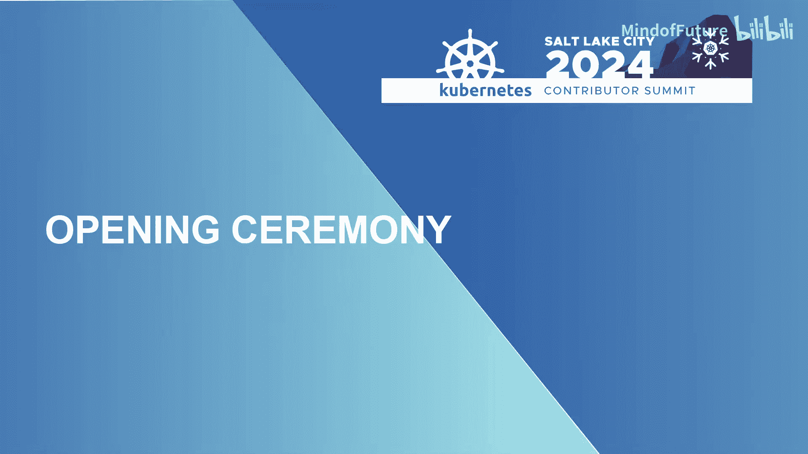
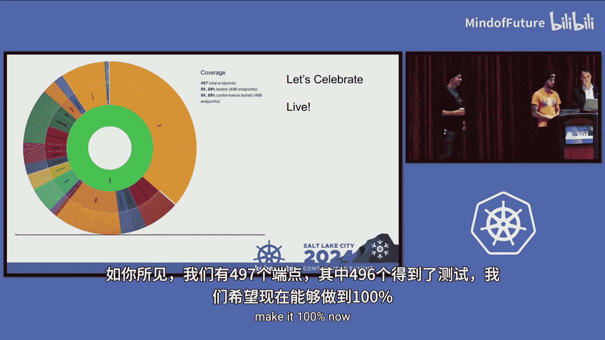
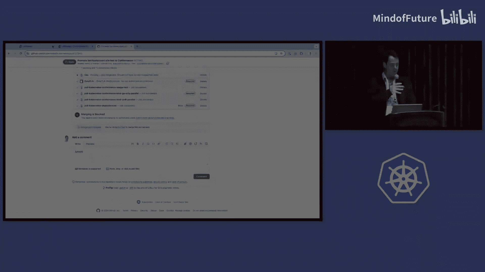
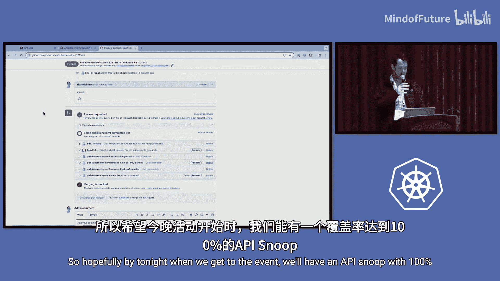

# 【Kubernetes】k8s贡献者峰会（2024北美）-p09-Opening-Ceremony--BV1kq6XYfEsx_p9-

Welcome to the Kes contributoror Summit 2024， in Salt Lake City。😊。

The most important thing， as always， please be advised that we have a code of conduct and that everyone is excellent to each other。

 If something should have happened， which we don't hope。

 there's the contact for our code of conduct team。 And we also have the CNNCF office。

 the CNNCF code of conduct office， if you want to ping someone write this side of the hall in room 2。

52 B。 So if anything should come up， just either approach one of us or go directly to the code of conduct。

And also today is the special day。 Yeah， so especially folks at the time。

 if you're not aware today is US holiday， it is Veterans Day。

 We recognize the the people that have made sacrifices to not only in the US。😊，But elsewhere。

 To keepto safe， thank you for your service。So during the event， just like if you need any help。

 have any questions。 Look for folks wearing these hats。嗯。Yeah， and also。

 thanks to all of the volunteers and all of the different summit staff。

 because otherwise that was this event would not have been possible。 So thanks for that。

So we have the schedule there。 If someone missed it， the unconfer sessions will happen in the 2。

55 rooms， which are down the hall and then on the left。 And we have a separate room for dock print。

 which will be a little bit further and then on the left side as well。

Then we have our social tonight。 So social will be at 6 PM at Fllanker。 That is。

If I have my orientation correct， it is that way， I think in the northwest that way。

 however you get out of the building。 Yeah， look at the map。 look at Google It's not too far away。

 but it is a little walk。 It'll be a little cooler。 make sure you bring warm clothes。

 And this is really， really important。😊，Bring an age identification。

Especially for the ones that are not US citizens， only the passport book will work。

 So bring your passport book。 They will check it and they will not let you in if you don't bring it。

 Give have your prop。Yeah， I have brought mine somewhere。 so bring this， bring that， not mine， yours。

😊，Alright， an update is also that all of the food and beverage richs will be served in room 255， B。😊。

In， in the back of the room。 So you need to look for it， but it's there。Also， after this。

 we will have the steering Q And A。We will have the sick call outs and because we are missed a little bit the people to call out。

 we will basically do it like we did it last year in Chicago， so just make a line。

 come up and say if your're sick needs help or support。

We have the CNCF Q And A in the afternoon in this room。

We will also have the awards in this room in the afternoon， and we will have the photo。

 and we will probably take the photo。On this ramp， when you go， when you go out on the left side。

 on this ramp， we will basically take the photo there。

 But as we will all come to the awards ceremony， we just take you with us to take the photo afterwards。

Don't forget， there will be the Kub meet and greet。

 And this time it will be at the project Pavilion on Thursday for lunchtime。

 So we would be happy if as many people of you can join us there as possible to potentially recruit some new contributors。

😊，Also， a big thank you for all of the T-shirt designs that were handed in this year。

 and to all of the folks who did this， we only selected one because we only can print one t-shir。

 So you will see it also in the rooms 2，55， where we have all all of the T-shirs placed。😊，😀Yeah。

We also like to get some feedback for the contributor sumummit。

 and maybe some of you folks have not heard it。 we will continue to have a contributor summit。

 but this will be part of the maintainer summit starting and kicking off with India this year and then continue to move this also in London so we also will ask the question if you have any special requests or ideas that you want to have for the maintainer summit in London where we can basically fit this in。

 for us won't change so much。 it will take some pressure of us so that we don't have to run the event anymore。

Speaking of registration for Main Smit India is open。 So if you are helping to be at Cucon India。

 you are eligible to register there and go to the maintainer summit。And as well。

 we have the CFP open for the Cicle Main Summit in London。And the good new thing is。

 if you are accepted as a speaker。For the maintenance summit， you will get a full couponcon pass。

Yeah。😊，😀。😊，And now I would like to bring Rihan on stage because we have a special treat。😊，U。I。

 I think most of you notice。 So this is API Snoop。 and this is our test coverage for conformance tests。

 And as you can see， we have 497 endpoints and 496 are tested。And we would like to make it 100%。

No。

So what a privilege to be up here。If you look at our graph。

 the amazing progress that has been made by this community over the last 10 years。Sorry。

 I'm getting a little bit of emotion here。 It's really exciting。

Thank you very much to everybody that worked on this。 I specifically want to call out。

The owner of the last PR， Stephen Howardwood， for amazing work that he's been doing， the II team。

Bpiakker。China Woodman。And all the people in the Kubernetes seek architecture that helped to get all these PRs merged。

Thank you for your patience while bugging you continually。And， let's do it。Let's count down。3。2，1。

😀Yeah。😊，Okay， as everybody know， this is not going to take five minutes。So hopefully by tonight。

 when we get to the event， we will have an API snoop with 1 coverage。

