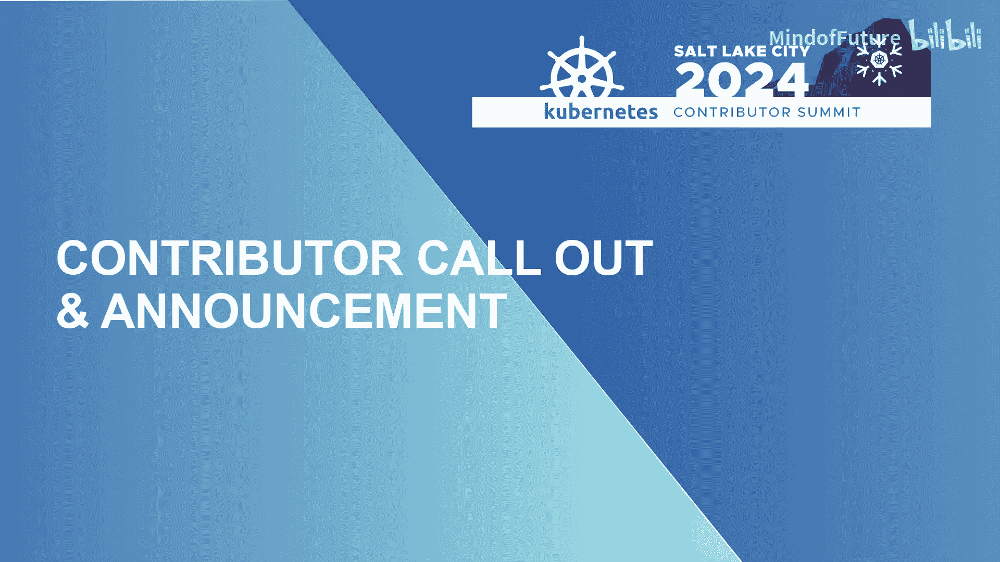

# 【Kubernetes】k8s贡献者峰会（2024北美）-p10-Contributor-Call-Out-and-Announcement--BV1kq6XYfEsx_p10-

Depending on the amount of people， one minute pitch where in in which area you need help。

Please come help us with Pro。别别。We've had a lot of great success with how we're funding it and whatever。

 but like the code for the tool itself， the thing that we're running all that CI on。

Yeah there's like one really active maintainer and almost everyone else has evaporated。

 the other folks in sick testing have a ton of things going on。

 we really need some more people to show up and like actively participate in that project and particularly we need people from the Kubernetes project。

 we've got some engagement from folks that are using it for other purposes outside of Kubernetes。

 we don't have enough representation from people who participate in the Kubernetes community that are thinking about how Kubernetes is using it and making sure that the project that we spawn for running CI is still serving our own needs。

Come talk to me afterwards if you're interested or at the Sig meeting greet or something。 Thank you。

Hello， I'm Kasn from Sig contributor Exper， and we do have the new contributor orientation initiative。

 which we have a session on right after this。 me and Mario are going be telling you about what that initiative is and how all of you can help。

 we really need help from especially Sig leaders， Mainers and any contributor can really have an impact on helping new contributors get involved in the community and we'll tell you more about it there。

 Also in the comm subproject。 we really want to do some work in the next year on our social media。

 we have a lot of social media accounts now and we are working on trying to make sure that we have sustainable strategies and work to do and folks who are learning how to do that work so come help us with social media and if you ever want to do blogging we have that as well and mentoring we have a new leader of our mentoring subproject。

 If you want to help new contributors get involved by mentoring。

 please get involved with the work going on with the mentoring subpro。😊，Hey， everybody。

 I'm John from S architecture， and。The big thing we could really use help with is， well。

 we can always use help with code organization， but also production readiness reviews， API review。

 all three of these production readiness review。 We have a shadow program in Bridget。

 who was around here earlier。 hass committed to participating next cycle。

 We have another number of other people who participate。

 and it's a great way to get a broad view of the whole project。 And， you know。😊。

You get to talk to a lot of people they might not like you。

 but you know at least you know get you get that exposure to the community。 So yeah' no。

 but's actually you learn so much of what's going on in the project。 you look across I mean the team。

 which is pretty small looks at all the enhancements across the entire release cycle。

 so it's pretty cool。😊，Also， I also am one of the folks involved with workgroup device management。

 we have quite a few people participating there， we're going to have it in place or in-person meeting later if you want to find out more about what we're doing there。

 but we have so much work to do in that space that we definitely can use more people coming in and contributing。

Thank you。Hello， I'm Soco。 I'm in Sgadox， and I'm currently one of code of Sgadox localization sub project。

😊，And I'm here to call some help for a localization aspect for the documentation， Kubernetes do I O。

 and we have several actually many localization teams to lead each language localization。

 and currently there are more than 10 teams。 but we need more help contributors for each language and someone who can lead the team itself。

 So if you are interested in localization of the documentation。

 please come to me or you can share it to your plan if they are interested in the localizing documentation。

 as well as contributing to Kubernetes。 I think。😊，This localization of project and those teams are very good place to。

😊，Initiate their post contribution。 So I， as a co of Se localization project。

I try to bring new contributor to our Kub community and push to anotherig fig so that they can be new contributor for all our Kub community。

 Thank you。😊，Hi， I'm Shane on the Gateway API subproject and SIG Network。

 we went GA at KubCon Chicago last year， but we are still in， thank you。

But we are still in quite a big growth period and we could use help feedback and in particular we have a survey that's up right now in the SIG network Gateway API channel on Slack we would like people to fill out we're particularly interested in feedback on user experience and everything else in between so if you've been thinking about using Gway API already using it your feedback would be very helpful thank you。

Okay， I have no data to back this up， but I'm going to assert anyway。

 the number one liability to getting your cap merged is。Anybody want to guess？No。APpiI reviews。

 how many people have gotten a cap in and run up against the， oh， I need to get an API reviewer。

 I need to get time from them right， how many API reviewers are here in the room today。

 people who are certified to do API review，1，2，3。 Michelle was here earlier。

F there are four because there's only four of us。So if you have a CAP that needs API。

 you're going through one of us to get it in。 and let me just tell you the last couple of weeks。

 kind of crazy。So this is my plea。 If you're， you know。

 a member of the project and you've been around for a while， you've seen the API。

 You've used the API and you might want to help review other people's API designs。

 We sure could use the help。 the more we can spread it around， the better off we're gonna be。

 it is sort of a journey。 So if you're interested， come and talk to one of us。

 and we will be happy to help onboard people。😊，Hey y'all。

 I was just here so in my capacity as a SIG releasease Co chair a lot of people think that SIG releasease is just the release team we actually have two subprojects。

 one of them is release engineering that project is responsible for handling all the release engineering tooling that actually clicks the button to release Kubernetes every recycle we are actively looking for people who are interested in working on that tooling there is a group of people who you know have who have the title of release manager for Kubernetes and we are always looking to build that contributor ladder up more so if you have release engineering backgrounds。

 if you've been an Sre production engineering Devops， etc cetera， etc cetera。

 and are kind of interested in releasing Kubernetes， come talk to us。H I'm Ricky。

 I'm a maintainer on the Hyrophone project， we're in newer。Project subproject of SIG testing。

 we're trying to make conformance and testing of Kubernetes a lot easier。

 we're looking for some more widespread adoption and testing on your platforms to help us figure out what our gaps are and where we can improve so any feedback is very welcome thank you。

Hello， everyone。 Did you know that Cube Cuddle has a plugin manager by any chance。Okay。

 any ideas how many plugins are distributed on that plugin manager， R guesses。8005， that's too much。

 okay。It's actually 275。 And I think that's a lot of plugins in the open source。

 And guess how many people are reviewing those plugins， the updates to them。 and yeah。

 just one person。 And that's me。 And I really can't get to it。

 So we're trying to establish some process around plugin curation。 And we're also trying to do crew1。

 you know， if we can get to it。 It's been the very same old code running very well for many years。

 But we want to make anvo stableple API。 And we wantna kind of， you know。

 put the project in a you know， successful feature。 So， yeah， time。😊，Hey everyone。

 did you know that Kubernetes has CVEs？not us， right， we're perfect。

So yeah so we have a security response committee and currently we have about eight members。

 most people from different companies， many are very senior members of the community and we are looking for help right much like any other on calls we also have on calls so every one of us on the committee has a weekly on call and so we're looking for people who are passionate about CVEs and working with the community like otherG maintainers as well as SIG release to get the triage security vulnerabilities。

 so please come and join us thank you。Hello， everyone。 My name is James Strong。

 I'm one of the maintainers for Ingress N genetic X。 Everyone's favorite Ingress controller。

 I am going to start something that's going to make also my company even more fun。

 How many people get a chance to start to do something from the ground up。😊。

How many people want that chance？No， a couple yeah， thank you Tim。

 we are going to for Ingress and Gen X， we're going to actually start the gateateway API implementation。

 I'm going that is about thank you for all the Us back there。

So we are going to start that implementation。Next week， so if you want to get started on that。

 we've been talking a lot with Sig network and the Gateway API community。 So， yeah。

 we're gonna need help doing that and be from the ground up。 We're gonna lots of conversations。

 lots of code and trying to fix those C Es was the security。

 But trying not to reproduce some of the sins of the past。 So anyway， thank you。😊。

