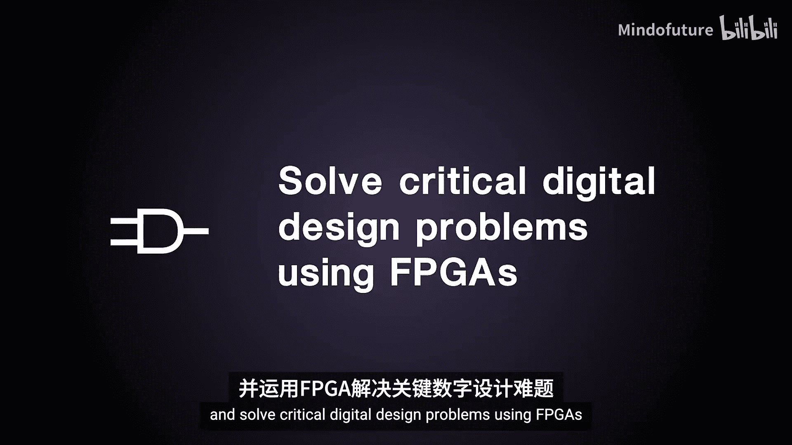
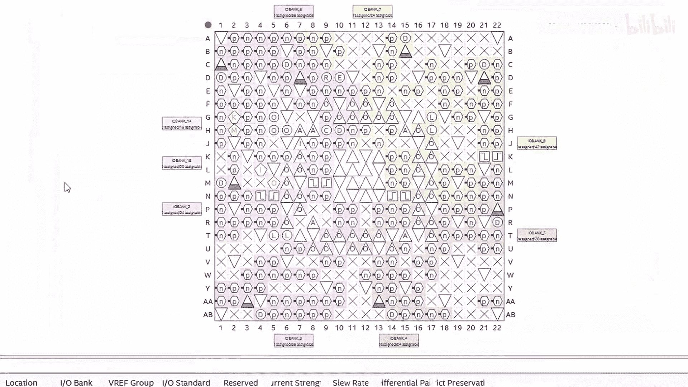
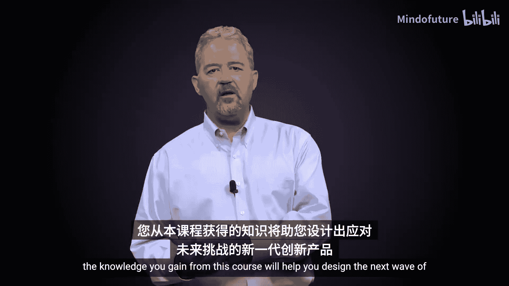

# 002：课程概述 🚀

在本节课中，我们将要学习FPGA（现场可编程门阵列）技术的基础知识，了解其在嵌入式系统中的核心作用，并预览整个课程的结构与目标。

## 欢迎来到FPGA的奇妙世界

欢迎来到嵌入式系统FPGA设计的奇妙世界。

FPGA是推动未来众多伟大新产品开发的关键技术。这些产品包括自动驾驶汽车、物联网、安全数据中心与云计算、机器人技术、机器视觉与学习、可再生能源、家庭自动化、8K视频与视频监控、面部识别与生物信息学、5G蜂窝网络以及智能医疗诊断。FPGA正迅速在大多数电子产品中普及。

可编程逻辑器件现已构成一个年产值60亿美元的产业，预计到2020年将增长至年产值100亿美元，并成为价值数千亿美元的终端产品的一部分。在大多数应用中，FPGA正在取代ASIC（专用集成电路），因为其上市时间更快，且功能几乎相同。

可编程逻辑为设计提供了终极的灵活性，允许器件实现几乎任何数字功能。结合硬核IP（知识产权核）以构成片上系统，这些器件使得以相对较低的成本快速开发非常复杂的产品成为可能。最新的FPGA拥有多达2000万门电路。如果你正在考虑从事电子设计职业，这门课程将极大地提升你的职业机会。

## 课程目标与内容

本课程将为你奠定嵌入式系统中FPGA设计的基础。你将学习什么是FPGA以及该技术是如何发展的，如何为特定应用选择最佳的FPGA架构，如何使用最先进的软件工具进行FPGA开发，以及如何利用FPGA解决关键的数字设计问题。

## 关于讲师

我在FPGA设计领域拥有广泛的背景，在多个行业拥有超过30年的设计经验。我叫Tim Shaer，我将作为你的讲师和向导，陪伴你完成这段旅程。除了作为设计工程师的经验外，我还拥有工程经理、工程总监的经验，并在两所主要大学拥有数年的教学经验。我目前就职于科罗拉多大学博尔德分校。

## 学习工具与资源

新工具使得FPGA设计比过去更容易。你可能听说过FPGA设计很难。确实如此，然而，我们的使命就是向你揭示FPGA设计的奥秘。

我们需要你加入我们的使命。请将自己想象成“女王陛下秘密情报局”的一名特工，为Q部门工作，为各种有趣的用途开发新产品。我们将称你为“特工你”。我们将尽力为你提供最好的资源和工具。有了这些工具，即使你以前觉得FPGA设计很困难，也能成功地进行设计。

我们将为你提供许多资源来帮助你成功。以下是课程大纲中列出的一些重要网站的部分列表，旨在激发你查看完整大纲的兴趣。我们将有推荐的参考教材：A. Hall和Furman所著的《数字系统快速原型设计：SOPC版》，以及Peter Wilson所著的《FPGA设计秘籍》第二版。我们将使用一些工具，例如Altera的FPGA设计工具Quartus，以及Altera的系统设计工具Qsys。

## 课程结构与学习方法

本课程的目标是让学生学会使用FPGA，为各种应用创建原型或产品。我的目标是帮助你在FPGA设计上取得成功。尽管FPGA设计可能是一个复杂的话题，但我们会以易于理解的方式介绍它，通过一点努力，基本概念将很容易掌握，同时也为更有经验的设计师提供挑战。我们不是来让你跌倒的，虽然材料有时很难，但如果你有任何数字逻辑设计的背景，我相信你有能力学会这些内容。

我想向你概述一下课程的方向以及你将学习的内容。本课程包含四个模块：
*   **模块一**：将向你介绍FPGA的历史与架构。
*   **模块二**：为你提供使用强大的、最先进的FPGA设计工具的重要实践经验。
*   **模块三**：描述当前的FPGA技术，并让你具备为任务选择最佳器件的能力。
*   **模块四**：你将练习并发展FPGA设计与分析的专长，包括创建一个基于FPGA逻辑的可定制处理器。

在每个模块中，我们将采用多种学习方法帮助你掌握材料，包括：
*   视频内测验，以检查你的学习成果。
*   练习，通过行业工具的引导实践来应用所学知识。
*   讨论论坛，以交流所学。
*   评估，以展示所学。

## 总结与展望

FPGA已成为电子世界中无处不在的技术。在本课程中，你将学习使用FPGA为各种应用创建原型或产品。由于这些产品具有极大的灵活性和广泛的能力范围，我相信你会发现用FPGA创建项目是一次有趣的体验。FPGA为释放你的创造力提供了绝佳的机会，并帮助你的设计产生影响。

这是一门实践性课程。当你付诸实践时，从本课程中获得的知识将帮助你设计下一波激动人心的新产品，以应对前方可能存在的任何挑战。

