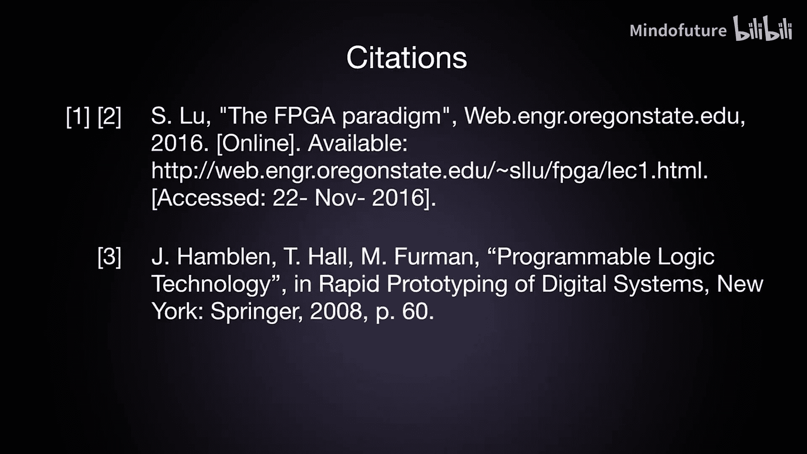

# 004：可编程逻辑简史 🧠

在本节课中，我们将学习可编程逻辑器件的发展历程。通过了解其历史，我们可以更好地理解什么是可编程逻辑，以及现场可编程门阵列（FPGA）在其中扮演的角色。

## 可编程逻辑的起源

你或许曾好奇，可编程逻辑究竟是什么？为了解答这个问题，让我们回顾一下可编程逻辑器件的发展史，这有助于我们理解可编程逻辑器件（PLD）的整体概念，特别是现场可编程门阵列（FPGA）。

FPGA是可编程逻辑器件的一个子集。以下是可编程逻辑器件发展的简要历史。

第一个可编程逻辑器件是PROM（可编程只读存储器），它于1956年发明，但直到1969年才商业化。随后，EPROM（可擦除可编程只读存储器）于1971年出现，接着是PLA（可编程逻辑阵列）于1975年问世，以及PAL（可编程阵列逻辑）于1978年诞生。本视频将解释这些器件之间的区别。

## 可编程硬件的需求与实现原理

自数字硬件诞生之初，人们就渴望拥有可编程的硬件。我们可以用两级“积之和”格式来实现任何逻辑方程。

为了便于说明“与”平面和“或”平面，我们采用一种特殊的表示法。左边是传统三输入“与”门的表示，右边是我们将用于两级可编程逻辑块的表示法：一个点表示硬连线，一个X表示可编程连接，空白表示无连接。正如你所见，可编程逻辑可以像ABC一样简单。

事实上，第一个可编程逻辑器件就是PROM。PROM有一个固定的“与”平面（即乘积项，也就是地址解码逻辑）。“或”平面（即和项）则可以通过改变存储器内容来编程。这里展示的是一个8x4的PROM。使用它，我们可以通过在第一列存储8位字`00000001`来实现逻辑函数`output1 = ABC`。这样，只有当A、B和C全为1时，输出`output1`才为1。

## 从PROM到PAL的演进

同样地，我们可以让“或”平面固定，而使“与”平面可编程。实际上，这是一种更高效的架构，因为我们感兴趣的大多数逻辑函数都具有有限数量的乘积项。

下图说明了PAL的通用方法，它拥有固定的“或”平面，但“与”平面是可编程的。PLD器件非常流行，至今仍用于许多设计中，常见的型号如22V10或16R8。

## 复杂可编程逻辑器件（CPLD）的出现

进一步的发展催生了CPLD，即在同一封装内包含多个PAL、具有寄存器输出和可编程互连结构的器件。CPLD是复杂可编程逻辑器件。你可以查看屏幕上的Altera链接，以获取更完整的CPLD历史。

## FPGA的诞生与发展

FPGA产业萌芽于20世纪80年代的可编程只读存储器（PROM）和其他可编程逻辑器件（PLD）。美国海军水面作战中心资助了由Steve Caselman提出的一项实验，旨在开发一台能实现60万个可重编程门电路的计算机。这开启了人们对可编程逻辑的兴趣。

Altera公司于1983年成立，并在1984年交付了业界首个可重编程逻辑器件EP300。该器件封装上有一个石英窗口，允许用户用紫外线灯照射芯片，以擦除保存器件配置的EPROM单元。多年来，Altera一直宣扬CPLD架构优于FPGA，但后来也妥协并开始生产FPGA。

Xilinx的联合创始人Ross Freeman和Bernard Vonderschmitt在1985年发明了第一个商业上可行的现场可编程门阵列——XC2064。XC2064具有可编程的门电路和门电路之间的可编程互连，从而开创了一项新技术和一个新市场。XC2064拥有64个可配置逻辑块（CLB），每个包含两个三输入查找表（LUT），这至今仍是FPGA架构中的重要组成部分。二十多年后，Freeman因此项发明被列入美国国家发明家名人堂。

在20世纪90年代初，FPGA主要用于电信和网络领域。到90年代末，FPGA已进入消费、汽车和工业应用领域。可编程逻辑器件构成了一个年产值60亿美元的产业，预计到2020年将增长至100亿美元。

## 数字逻辑器件的全景图

可编程逻辑只是数字逻辑器件殿堂中的一部分。此图来自推荐阅读书目中Hamblen的著作。标准逻辑的范围更广，如图所示。它包括额外的TTL系列（如LVTTL）、额外的CMOS系列（如HC、LVC等），以及BiCMOS（BT、HT等），还有差分逻辑系列（如ECL和LVDS）。顺便提一下，我刚才列出的所有逻辑类型都可以在FPGA的I/O接口中找到，这是FPGA灵活性的另一个例证。

标准逻辑、可编程逻辑和全定制器件也被称为通用集成电路。在ASIC和全定制之间，是现在被称为ASSP的器件，我稍后会描述。

## FPGA的核心概念

因此，FPGA在概念上比其他PLD更简单，它只由三个元素组成：**导线**、**门电路**和**寄存器（触发器）**。芯片由门电路和触发器的阵列组成，导线可以按特定模式将它们连接起来，这些模式为计数器、定时器、状态机、算术逻辑单元（ALU）甚至整个CPU等更大功能创建逻辑。**互连模式是FPGA设计的核心**，我们将在本课程中学习。

## 专用标准产品（ASSP）与片上系统（SoC）

ASSP（专用标准产品）是一种专用于特定应用市场并销售给多个用户（因此是标准的）的半导体集成电路产品。ASSP面向多个客户进行销售，就像通用产品一样，但由于针对特定应用，客户数量较少。与ASIC（专用集成电路）类似，ASSP用于特定应用，但销售给任意数量的公司，面向整个市场；而ASIC是为特定公司定制设计和制造的。ASSP通常提供与ASIC相同的性能特征并具有相同的芯片尺寸。

逻辑器件的终极表现形式是片上系统（SoC）。以下是SoC的两个定义，随着时间的推移，它们变得越来越普遍：
1.  片上系统（SoC）是一种将计算机的所有组件集成到一个电子系统中，并置于单个芯片上的集成电路。它可能包含数字、模拟、混合信号和射频功能。SoC因其低功耗在移动电子市场非常常见，另一个典型应用领域是嵌入式系统。
2.  片上系统（SoC）是一种将多个组件与CPU集成到单个芯片上的集成电路。典型的组件类型包括GPU、通信接口、模拟功能和无线电。如果它包含可编程逻辑，那么它就是可编程SoC或SoC FPGA。SoC的高度集成提供了比替代方案更低的成本、更小的尺寸和更低的功耗。

## 总结与展望

现场可编程门阵列（FPGA）是由门电路、寄存器和路由导线组成的可编程逻辑器件，这些元件在器件部署后可以通过编程连接在一起。**创建互连模式是FPGA设计的核心**。可编程逻辑器件（PLD）包括简单的PLD（如PROM和PAL）、复杂的PLD（CPLD）、FPGA和SoC FPGA。PLD是所有逻辑器件的子集，而FPGA是PLD的子集。

FPGA与专用集成电路（ASIC）和专用标准产品（ASSP）竞争，并在许多应用中成功取代了它们。在数字器件领域，FPGA似乎代表着未来。

---

本节课中，我们一起学习了可编程逻辑器件从PROM、PAL、CPLD到FPGA的演进历程，了解了FPGA的核心构成（导线、门、寄存器）及其设计本质（创建互连模式），并认识了ASSP、SoC等相关概念。通过这段历史，我们能够更清晰地把握可编程逻辑，特别是FPGA，在现代数字系统设计中的重要地位和灵活性。