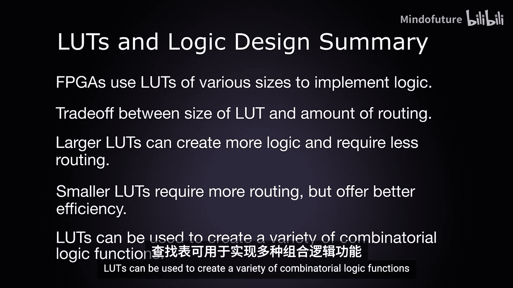

# 007：逻辑设计中的LUT应用 🧠

在本节课中，我们将学习如何使用查找表（LUT）进行逻辑设计。我们将探讨LUT在FPGA中的核心作用，理解其工作原理，并通过实例分析其在不同规模逻辑设计中的应用与权衡。

## 概述

FPGA使用查找表（LUT）作为其基础逻辑单元。LUT非常适用于逻辑设计，掌握其用法需要一些时间，但这项努力是值得的。

上一节我们介绍了LUT的基本概念，本节中我们来看看LUT在具体逻辑设计中的应用。

## LUT的工作原理

LUT可用于实现任何N输入的逻辑表达式，其中N是LUT的输入数量。例如，一个三输入LUT需要八个存储位置，一个四输入LUT则需要十六个存储位置，依此类推。

LUT通常由SRAM位单元构成，用于保存配置信息（即LUT掩码），以及一组多路复用器，用于选择驱动输出的SRAM位。

下图展示了一个四输入LUT，它由16位SRAM和一个实现为树状结构的16选1多路复用器（由多个2选1多路复用器组成）构成。

通过设置LUT掩码的适当值，这个四输入LUT可以实现输入A、B、C、D的任何函数。它也可以由两个三输入LUT通过一个2选1多路复用器连接而成。

## LUT规模与布线的权衡

我们可以在更大的LUT器件中实现更多逻辑。然而，LUT的规模与所需布线资源之间存在权衡。更大的LUT意味着更少的布线，但也需要更多的存储位置。

让我们通过一些例子来理解其中的原因。

如果我们使用一个**8输入LUT**来创建一个8位地址解码器，则只需要一个逻辑单元。下图展示了在FPGA中的实现方式（尽管图中为PAL实现，但8输入LUT的原理类似）。

然而，如果我们使用**三输入LUT**，则需要四级逻辑单元以及它们之间相关的布线，如下图所示。

这个对比清晰地展示了LUT规模对设计复杂性的影响。

## 实例分析：逻辑功能实现

接下来，我们通过具体计算，看看实现常见逻辑功能需要多少个LUT。

### 四比特比较器

让我们确定制作一个四比特比较器需要多少个LUT。

以下是实现步骤：
1.  前两个比特的**同或**（XNOR）运算可以在一个四输入LUT中实现。
2.  同样，比特3和比特4的**同或**运算也可以在另一个四输入LUT中实现。
3.  最后的**与**（AND）运算可以在第三个四输入LUT中实现。

因此，实现一个四比特比较器总共需要**三个**四输入LUT。

### 全加器

一个全加器需要多少个四输入LUT呢？

请思考一下这个问题。我们将在下一个视频中深入探讨全加器的LUT实现方案。

## 总结

本节课中我们一起学习了LUT在FPGA逻辑设计中的关键作用。

总结要点如下：
*   FPGA使用各种规模的LUT来实现逻辑。
*   **LUT的规模与所需布线资源之间存在权衡**：规模较大的LUT可以集成更多逻辑，从而减少布线需求；规模较小的LUT则需要更多布线，但能提供更好的逻辑效率。
*   LUT可用于创建多种组合逻辑功能。

通过理解这些基本原理和权衡，你可以更有效地利用FPGA中的LUT资源进行逻辑设计。

