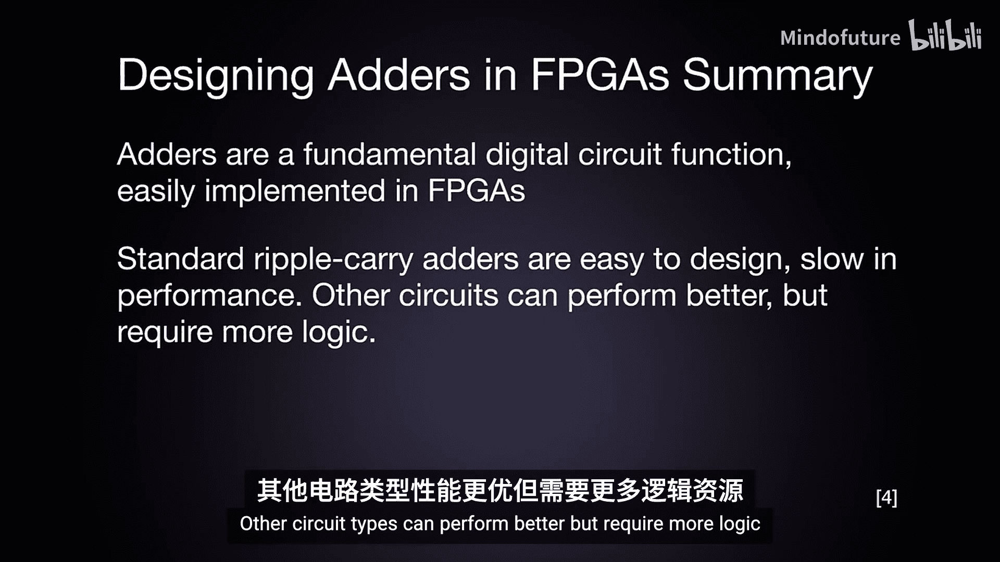

# 008：加法器设计 🧮

在本节课中，我们将要学习加法器在FPGA中的设计与实现。加法器是数字计算机的核心，理解其工作原理和实现方式对于掌握FPGA设计至关重要。

## 加法器的重要性

上一节我们介绍了FPGA的基本逻辑单元。本节中我们来看看加法器的基础地位。每个数字计算机的核心是CPU，每个CPU的核心是算术逻辑单元（ALU），而每个ALU的核心则是加法器电路。加法器是基础电路。一旦能够实现加法，就可以通过补码加法实现减法，也可以通过重复加法实现乘法。因此，FPGA内部集成了专门的结构来简化加法器设计并提升其性能。

## 基本加法器实现

一个全加器可以由少至五个逻辑门构成。在FPGA中，我们可以用一个三输入或四输入的查找表（LUT）来实现它，前提是LUT支持两个输出。在某些情况下，LUT架构会为进位输出提供一个独立的输出端口，与和输出分开。

以下是使用Altera Max 10 FPGA的RTL查看器工具（Quartus Prime FPGA设计套件的一部分）查看的加法器实现结果。RTL代表寄存器传输级，它是一种比门级更高层次的抽象，将数据在数字逻辑中的移动视为逻辑图，其中表达式代表存储在寄存器中的数据变量。

该实现看起来与之前展示的门级电路图完全一致。

## 从一位到多位：行波进位加法器

我们可以将多个一位全加器作为组件连接起来，构成N位加法器。下图展示了一个由四个全加器构成的四位加法器的连接方式。

这种结构被称为**行波进位加法器**。它的设计简单，但性能相对较慢，因为每个全加器都必须等待前一个全加器计算出的进位位。行波进位加法器从输入到最终和输出的总延迟可以用以下公式表示：

**T_adder(n) = (n-1) * T_carry + T_sum = (n-1) * 3D + 2D = (3n-1) * D**

其中，D是单个逻辑门的延迟，n是加法器的位数。

那么，一个用此方法构建的32位加法器会有多少级门延迟呢？根据公式计算，一个32位加法器将产生**95级门延迟**。

## 性能优化：超前进位加法器

为了获得更低的延迟和更好的性能，我们可以使用更复杂的电路，例如下图所示的**超前进位加法器**。

进位位可以通过生成项和传播项来计算。进位位 `C(i+1)` 的计算公式为：

**C(i+1) = G(i) + (P(i) · C(i))**

其中，生成项 `G(i)` 和传播项 `P(i)` 定义为：

**G(i) = A(i) · B(i)**
**P(i) = A(i) ⊕ B(i)**

这种加法器的延迟大致与位数 `n` 成正比，相比行波进位加法器有巨大改进，但代价是进位计算逻辑变得复杂得多。

## FPGA中的高效实现

当加法器在FPGA中实现时，我们还需要手动设计这些复杂电路吗？答案通常是否定的。

下图展示了4位行波进位加法器在Altera Max 10 FPGA中使用技术映射查看器工具的实现结果。它显示该电路是由四对三输入LUT级联实现的。通过此电路的延迟将仅为**4个LUT延迟**，而不是根据延迟公式计算出的11个门延迟。

如果我们使用更先进的FPGA架构，可能会获得更大的优势。下图展示了4位加法器在Altera Cyclone 5 FPGA中的实现结果。它显示该实现使用了三个六输入LUT，而不是多个一位加法器。其中一个六输入LUT用于实现一个两位加法器（针对第1位和第3位），另一个六输入LUT被拆分为两个三输入LUT，用于生成第0位和第2位的和。

那么，这个电路的延迟是多少？只有**2个LUT延迟**，比我们最初预想的要好得多。

## 设计权衡与总结

虽然在某些应用中使用超前进位或其他更复杂的加法器电路可能有益，但现代FPGA中粗粒度架构的存在使得这在许多情况下变得不必要。您选择的实现方式需要根据具体情况决定，因为其中涉及许多起初可能并不明显的权衡。这在FPGA设计中很常见，也是其魅力的一部分。

此外，Cyclone 5的逻辑单元（称为自适应逻辑模块，ALM）包含了快速进位链和全加器实现作为其逻辑单元的一部分，这使得加法器的实现特别快速和高效。

在本节课中，我们一起学习了：
*   加法器是基本的数字电路功能，可以轻松在FPGA中实现。
*   标准的行波进位加法器易于设计但性能较慢。
*   其他电路类型性能更好，但需要更多逻辑资源。
*   FPGA利用LUT以及额外的算术电路（如进位链和全加器）使得加法器实现特别高效。
*   即使在FPGA中实现标准设计，也能获得出色的性能。