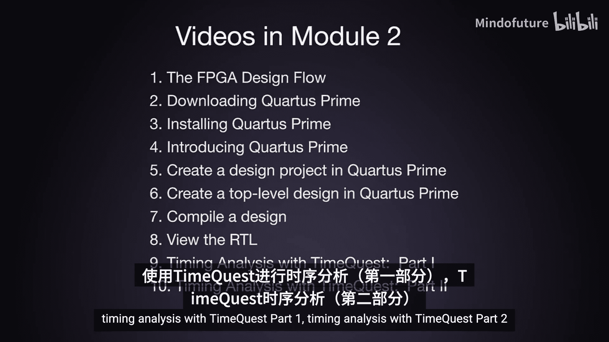

# 010：FPGA设计流程与示例设计 🚀

在本节课中，我们将学习完整的FPGA设计流程，并通过一个示例项目来实践。我们将使用Intel的Quartus Prime软件，从设计输入开始，经过仿真、综合、布局布线、时序分析，最终生成编程文件并下载到FPGA设备中。

## 概述

上一节我们介绍了可编程逻辑器件和FPGA的基本概念。本节中，我们将通过一个具体的设计示例，来详细讲解FPGA的标准设计流程。这个流程是开发任何FPGA项目的基础。

## FPGA设计流程详解

下图展示了我们将要遵循的完整FPGA设计流程：

### 1. 设计输入

设计流程始于设计输入。Quartus Prime提供了多种方法来描述FPGA需要实现的逻辑。

以下是Quartus Prime支持的主要设计输入方法：
*   **原理图输入**：包括原理图捕获。
*   **IP核导入**：导入预先设计好的功能模块。
*   **硬件描述语言文本输入**：支持VHDL、Verilog和SystemVerilog。
*   **状态机输入**：图形化状态机设计。
*   **EDIF文件导入**：导入标准格式的网表文件。

你可以在同一个项目中使用多种设计定义方法，并且这些方法可以混合搭配使用。

### 2. 仿真验证

在完成初步设计后，需要进行仿真来验证逻辑功能是否符合预期。这是一个关键的验证步骤。

### 3. 综合与映射

接下来，工具将执行综合（也称为映射），将设计逻辑映射到目标FPGA器件的具体架构资源上。Quartus Prime的分析与综合模块会检查设计源文件中的错误，构建一个包含所有设计文件的层次化数据库，并对逻辑设计进行综合与优化。

### 4. 布局布线

综合之后，工具需要通过布局布线（或称为适配）在器件内部创建单元之间的互连。将设计适配到尽可能小的器件中是FPGA设计的一个主要挑战。Quartus Prime允许通过选择不同的适配策略来控制此过程。

以下是主要的适配策略：
*   **平衡策略**
*   **高性能策略**（针对速度优化）
*   **低功耗策略**
*   **小面积策略**

### 5. 设计视图与分析

Quartus Prime能以多种图形化视图展示设计的不同方面，这有助于理解和调试。

以下是几种有用的设计视图：
*   **RTL视图**：展示综合前的寄存器传输级电路结构。
*   **技术映射视图**：展示综合后映射到具体器件资源的电路。
*   **芯片规划器**：展示芯片内部设计资源的使用情况，在调试时对定位问题区域非常有帮助。

这些视图可以让你对设计实现和技术建立信心，特别是对于有经验的硬件设计师，有助于培养对设计的直观感觉。

### 6. 时序分析

同步是可靠FPGA设计的基础，而时钟是同步信号。静态时序分析可以确定设计是否存在相对于时钟的时序违规（如建立时间或保持时间违规），它是实现时序收敛的主要工具，对所有FPGA设计都至关重要。

TimeQuest时序分析器使用一组**方程**来计算**裕量**，并确定**Fmax**（最大工作频率），这是衡量FPGA性能的一个重要指标。分析过程可以由一组称为约束的规则来指导，这些约束也有助于适配器优化时序驱动的设计。我们将学习如何编写有效的约束来提高Fmax。

### 7. 时序仿真

布局布线完成后再次进行仿真是一个好习惯，它可以发现潜在的时序问题。如果分析确认电路运行正常，就可以进行下一步。

### 8. 编程与测试

最后一步是使用工具生成编程文件，然后将其下载到FPGA设备中进行实际测试。

## 仿真工具：ModelSim

ModelSim是一个强大的仿真工具，与Quartus Prime集成。它可以为设计中的所有信号以及用于测试的激励信号创建精确的时序图。我们将使用这个工具来测试并更好地理解示例设计的操作。仿真结果将以时序图的形式显示，如下图所示。

## 本模块视频内容

在本模块的后续视频中，我们将通过实际操作详细学习FPGA设计流程，具体内容包括：
*   FPGA设计流程概述
*   下载Quartus Prime
*   安装Quartus Prime
*   Quartus Prime软件介绍
*   在Quartus Prime中创建设计项目
*   在Quartus Prime中创建顶层设计
*   编译设计
*   查看RTL视图
*   使用TimeQuest进行时序分析（第一部分）
*   使用TimeQuest进行时序分析（第二部分）
*   使用ModelSim仿真FPGA设计

## 总结

本节课中，我们一起学习了完整的FPGA设计流程。我们了解到，设计从输入开始，经过仿真验证、综合映射、布局布线、严格的时序分析，最终生成可下载到硬件中的编程文件。通过使用Quartus Prime软件的各种工具和视图，我们可以有效地完成设计、分析和调试工作。在接下来的实践中，我们将应用这个流程来完成一个具体的示例设计。