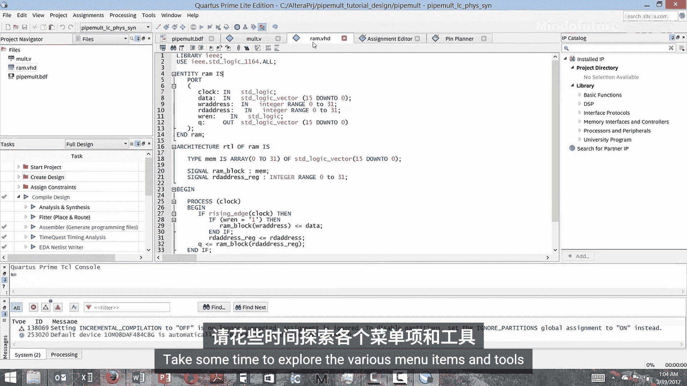

# 012：Quartus Prime简介 🚀

在本节课中，我们将要学习Altera（现为Intel）的FPGA开发工具——Quartus Prime的基本界面和核心功能。我们将了解其主要窗口、设计流程以及常用菜单选项，为后续的实际设计工作打下基础。

## 界面概览

Quartus Prime启动后，会呈现多个执行不同功能的窗口。

初始时，中心窗口包含“新建项目向导”、“打开项目”的按钮，以及一些指向Altera帮助网页的链接。

## 打开项目与导航

为了展示此工具的功能，我们打开一个最近的项目。

通常，在设计编译完成后，中心窗口会显示编译报告。该报告展示了编译结果，包括引脚分配和逻辑资源利用率。这份报告包含重要的性能和调试信息。

左上角是项目导航器。所有设计都按项目组织。此处会显示设计层次结构，我们也可以查看项目文件、设计单元、IP组件和设计版本。

回到层次结构窗口，如果我们点击顶层模块，其底层结构会展开，我们可以看到设计中的各个组件。

## 设计流程窗口

左下角是设计流程窗口，也称为任务窗口。它包含了FPGA设计流程中的所有步骤：
*   **分析与综合**：分析设计输入。
*   **布局布线**：或称为适配。
*   **汇编**：生成编程文件。
*   **时序分析**。
*   **网表编写**：生成适配后仿真文件。

以下是每个步骤的简要说明：
*   **分析**：检查设计源文件的语法和逻辑错误。
*   **综合**：将设计转换为器件特定的逻辑原语。它使用约束来指导生成综合后网表。
*   **适配器**：使用约束来指导如何将逻辑放置到FPGA的逻辑单元中，以及如何连接元件之间的布线。它生成适配后网表。
*   **汇编器**：生成编程和配置文件。
*   **TimeQuest时序分析器**：执行静态时序分析以确定设计的时序余量（如果成功也称为时序收敛）。它还确定最大可能时钟频率或Fmax。

只要前面的步骤已运行，其中任何一个步骤都可以单独运行。也可以通过“全编译”一次性运行整个流程。这些步骤也可以从工具栏图标或“处理”菜单中运行。

编译运行时，任务窗口会显示编译状态。

## 消息窗口与IP目录

屏幕底部是消息窗口。红色消息表示会停止编译的错误，绿色消息是信息提示，蓝色消息是警告。也可以在消息窗口中输入Tcl脚本命令。

右侧是IP目录，列出了Altera提供的所有IP核。如果关闭了IP目录，可以从“视图”菜单重新打开。

## 创建与编辑设计

要创建设计，可以从“文件”菜单中选择“新建”，点击工具栏中的“新建文件”按钮，或在任务窗口中双击“创建新设计”。

“新建文件”对话框会出现，提供多种设计输入方式的选择。

设计输入可以通过以下方式实现：
*   使用原理图输入。
*   使用HDL（AHDL、Verilog或VHDL）通过文本编辑器。
*   状态机编辑器。
*   使用Qsys系统编辑器进行系统创建。

整个设计不必只使用一种设计输入类型，可以混合搭配这些方法。

原理图通常用作顶层设计输入。AHDL和VHDL文件可以做成黑盒，作为块插入原理图中，然后IP核也可以被包含并与这些自定义块连接。状态机编辑器可用于创建状态机，然后生成代表该状态机的HDL代码。

现在，如果我们双击顶层模块，原理图编辑器会自动打开，显示`pipelined_multiplier.bdf`。

如果我们回到项目导航器的文件视图，会看到分别代表乘法器和寄存器的Verilog和VHDL文件。双击这些文件会在中心窗口打开它们，以便查看底层源代码。

每当打开VHDL或Verilog文件时，都会打开内置的文本编辑器。您可以使用此编辑器编辑和保存这些文件。

## 菜单功能详解

上一节我们介绍了如何创建和查看设计文件，本节中我们来看看Quartus Prime的主要菜单功能。

“编辑”菜单允许控制编辑过程。“视图”菜单允许您控制显示哪些窗口。任何窗口都可以分离以便更详细地查看，稍后再重新附着。

“项目”菜单允许您控制项目，可以添加或删除文件、添加或删除版本、归档项目以及生成PowerPlay早期功耗估算。

“分配”菜单功能特别强大，它允许您更改器件。您还可以看到各种开发板上使用的器件，包括我最喜欢的两个：BeMicro MAX 10和Odyssey MAX 10。“设置”对话框允许控制项目的许多方面，包括文件、编译设置、用于设计输入和仿真的EDA工具设置、编译器设置（这特别有趣，因为它控制设计的性能和功耗）以及许多工具的选项。“分配编辑器”是进行引脚分配的一种方法。“引脚规划器”也允许定义引脚分配，并提供器件的图片视图。

“处理”菜单允许控制编译过程并访问PowerPlay功耗分析器工具。

“工具”菜单是Quartus Prime的瑞士军刀。它允许您运行RTL或门级仿真、启动TimeQuest时序分析器、启动众多设计顾问中的任何一个、启动芯片规划器或设计分区规划器。

以下是“工具”菜单中部分重要功能的说明：
*   **芯片规划器**：提供器件资源的图形化视图，可以显示布线连接以及扇入和扇出。
*   **网表查看器**：网表查看器对于帮助理解综合器和适配器对设计做了什么非常有用。有时结果可能会让您感到惊讶。
*   **SignalTap逻辑分析仪**：启动SignalTap逻辑分析仪。
*   **编程器**：启动编程器。
*   **系统调试工具**：启动几种系统调试工具中的任何一种。
*   **Nios II处理器软件构建环境**：启动Nios II处理器软件构建环境。
*   **Qsys系统编辑器**：Qsys简化了复杂的系统设计，允许在框图级别进行设计，并轻松地将IP核包含在层次化设计中。
*   **自定义**：自定义和设置Quartus Prime的选项。

接下来，“窗口”菜单显示活动窗口。“帮助”菜单提供了许多获取帮助的途径，包括访问教程。

## 总结与探索

正如您所看到的，Quartus Prime是一个功能丰富的设计环境。花些时间探索各种菜单项和工具。一段时间后，您会发现使用该工具会变得直观且功能强大。

现在我们已经熟悉了Quartus Prime所提供的所有功能，在下一个视频中，我们将创建我们的第一个FPGA设计。