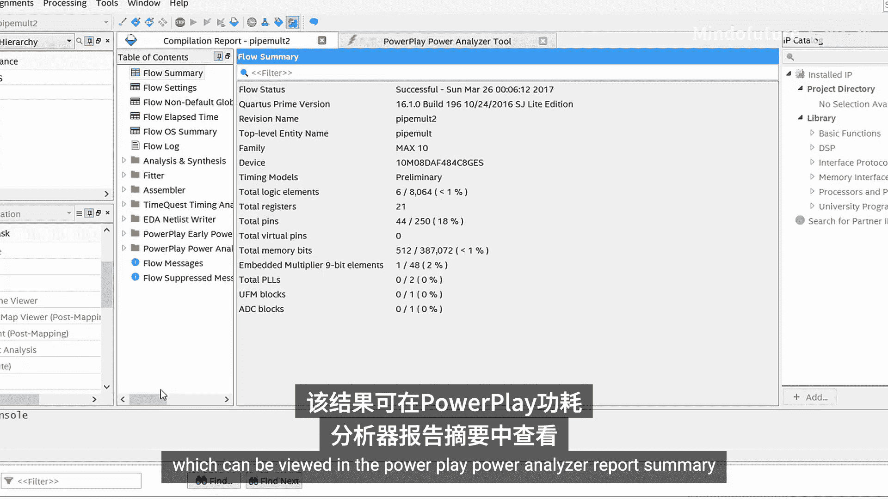

# 016：查看RTL与技术视图 🔍

在本节课程中，我们将学习如何使用Quartus Prime软件中的RTL查看器、技术映射查看器、芯片规划器和功耗分析器来分析一个FPGA设计。通过这些工具，你可以从逻辑层面、技术实现层面以及物理布局层面深入理解你的设计，并评估其功耗。

## 打开项目与工具概览

首先，在Quartus Prime中打开上一节视频中已编译完成的`Pipe_Mac`项目。Quartus Prime提供了多种分析工具，用于验证设计结果是否符合预期。有时编译器会产生意想不到的结果，FPGA设计师会利用这些分析工具来确认设计。

在“Tools”菜单下，点击“Netlist Viewers”，你将看到四个不同的查看工具：
*   **RTL Viewer**：从纯逻辑设计角度查看设计。
*   **Technology Map Viewer (Post-Mapping)**：查看综合后映射到FPGA基本单元的设计。
*   **Technology Map Viewer (Post-Fitting)**：查看布局布线后的设计。
*   **State Machine Viewer**：查看状态机。

这些网表查看器是图形化工具，让你能够直观地看到综合及布局布线的结果。你也可以在任务窗口的“Analysis & Synthesis”或“Fitter”部分找到它们。

## 使用RTL查看器

RTL查看器以最简单的原理图形式展示设计，可用于验证设计输入和逻辑。该工具在“Analysis & Elaboration”步骤后即可使用。

从“Tools”菜单，选择 **Netlist Viewers -> RTL Viewer**。查看器会显示乘法器、RAM和输出端的D触发器，这与你的原理图类似。输入端口在左侧，Q输出端口在右侧。

你可以通过展开左侧窗格的“Netlist Navigator”来检查每个主要模块由哪些组件构成。以下是导航器中的主要项目：
*   **Instances**：列出设计实例，如乘法器和RAM。
*   **Primitives**：列出FPGA架构中的基本单元。
*   **Ports**：列出所有输入和输出端口。

点击`mult_inst`模块右上角的加号(+)，可以逐级展开乘法器实例，直到看到最基本的原子单元（如`mac_mult1`和`mac_out2`块）。同样，展开RAM模块会显示同步RAM块本身、读地址寄存器和输出寄存器。完成查看后，通过“File -> Close”关闭RTL查看器。

## 使用技术映射查看器

上一节我们使用RTL查看器从逻辑层面审视了设计。本节中，我们来看看设计被映射到具体FPGA硬件单元后的样子。

**技术映射查看器（映射后）** 让你查看设计综合后被映射到FPGA基本单元（包括每个输入/输出到管脚的缓冲器）的结果。从“Tools”菜单，选择 **Netlist Viewers -> Technology Map Viewer (Post-Mapping)**。视图中细节更多，但乘法器和RAM的视图与RTL查看器非常相似，只是每个基本单元都被具体枚举。查看完毕后关闭它。

**技术映射查看器（布局布线后）** 让你查看布局布线后的最终设计。从“Tools”菜单，选择 **Netlist Viewers -> Technology Map Viewer (Post-Fitting)**。使用“View -> Zoom In”放大查看。滚动到底部，你会看到新增的JTAG和配置接口信号（如TMS、TDI、TCLK等）。对于这个相对简单的设计，此视图与其他视图差异不大。关闭查看器。

由于本设计中没有状态机，状态机查看器暂时没有帮助，因此我们跳过它。

## 使用芯片规划器进行分析

接下来，让我们看看芯片规划器。点击“Tools”菜单，然后选择“Chip Planner”。

芯片规划器以可视化方式展示器件资源在芯片上的实际布局。它可以用于分析设计、创建平面布局图，以及在设计中实施工程变更单（ECO）。结合其他Quartus Prime工具，你可以定位特定设计实体或时序路径在目标器件上的实际位置。

芯片规划器显示的细节级别取决于当前的缩放级别以及右上角“Layer Settings”选项卡中选择的模式。使用 `Ctrl + 空格` 放大，`Shift + Ctrl + 空格` 缩小。通常，逻辑阵列块（LAB）显示为蓝色，DSP块显示为白色列，RAM块显示为棕褐色列。规划器使用渐变色，资源利用率越高，颜色越深。

点击单个模块会在屏幕右侧的“Node Properties”窗口中显示其电路图。芯片规划器有两种编辑模式：
*   **Assignment模式**：允许进行在下一次布局布线操作中由适配器应用的更改（如管脚分配、位置分配）。
*   **ECO模式**：允许进行布局布线后更改（如逻辑布局或布线），这些更改在下次编译后不会保留。

你可以使用芯片规划器检查特定器件资源的扇入和扇出。点击一个RAM块，然后点击工具栏上的“Generate Fan-Out”图标或通过“View -> Generate Fan-Out”查看其扇出路径。同样，通过“View -> Generate Fan-In”可以查看扇入路径。使用“View -> Clear Unselected Connections”可以清除这些路径显示。分析完成后，通过“File -> Close”关闭芯片规划器。

## 进行功耗分析

最后，我们来学习如何进行功耗估算。准确的功耗信息对于电路板电源设计至关重要。

**早期功耗估算器（EPE）** 是一个基于电子表格的分析工具，可根据器件选型、资源利用率和操作条件进行早期功耗估算。虽然其内部模型很准确，但整体准确性依赖于对器件时钟速度和布线的估计，这可能并不完美。你可以从Altera官网下载EPE工具（如`max10_ep.xls`）。

EPE的数据可以手动输入，也可以从项目导入。在Quartus Prime的“Project”菜单中，点击“Generate PowerPlay Early Power Estimator File”可以生成一个`.csv`文件。在EPE工具中点击“Import CSV”即可导入此文件进行估算。为了电源设计，通常需要查看“最大”功耗值，并在右侧选择相应的电源轨配置以获取各电压的电流估算。

**PowerPlay功耗分析器** 在完成设计后使用，能提供更精确的功耗估算。该工具非常易用，几乎不需要用户输入。在Quartus Prime的“Tools”菜单下，选择 **PowerPlay Power Analyzer Tool**。最佳精度来自于使用门级仿真产生的信号活动数据。如果没有，可以使用无向量估算。在分析器窗口中向下滚动并点击“Start”。运行成功后，消息窗口会显示总功耗估算值（例如53.4 mW）。你还可以通过更改设置（如将功耗特性改为“Maximum”）来估算最大功耗。

---

本节课中，我们一起学习了如何使用RTL查看器和技术映射查看器从不同层面审视FPGA设计，如何利用芯片规划器分析设计的物理布局与连接，以及如何使用早期功耗估算器和PowerPlay功耗分析器来评估设计的功耗。掌握这些分析工具对于理解和优化FPGA设计至关重要。