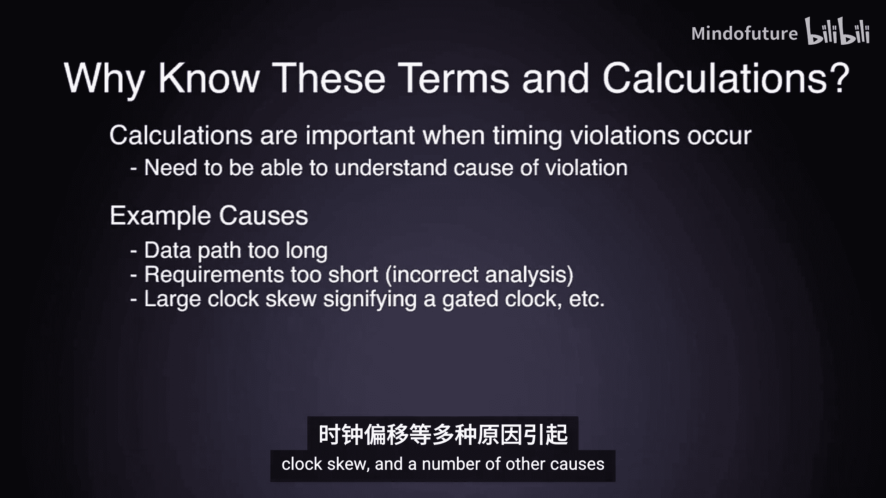
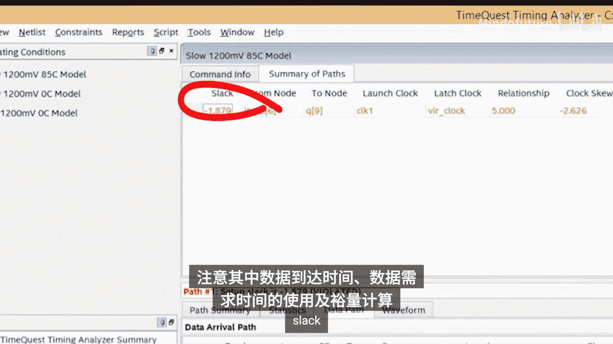
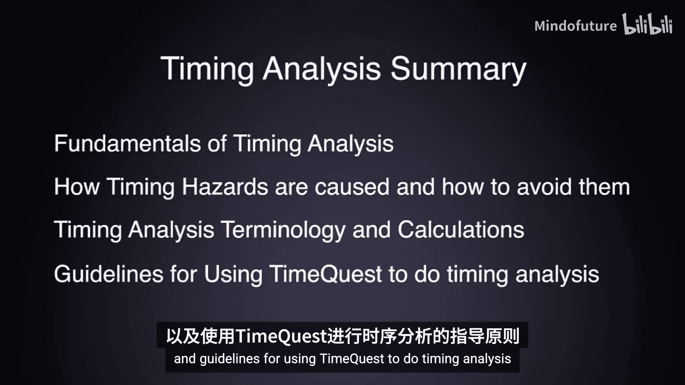

# 017：TimeQuest时序分析（一）⏱️

在本节课中，我们将要学习时序分析的基础知识，包括TimeQuest时序分析器所使用的计算方法和术语。

## 概述

时序分析是现代数字设计，尤其是FPGA设计中至关重要的一环。它确保数据在正确的时刻被可靠地捕获，从而避免系统出现错误。本节我们将探讨时序分析的基本原理、常见问题及其解决方法。

## 时钟与同步

时钟是现代数字电子学的基础。它们提供同步信号，这是实现无误数据传输的必要条件。

当数字线路上的数据从一个值转换到另一个值时，在转换期间数据值是不正确的。我们需要等待数据稳定后才能使用它。这个同步信号就是时钟。

数据必须在时钟边沿之前和之后保持稳定，才能被可靠地传输。如果未能正确同步，将会引发一系列设计问题。

## 时序问题与危害

如果未能正确同步，将会引发一系列设计问题，例如：

*   **时序冒险**：由路径延迟不等导致的意外或不需要的信号，例如毛刺。这是工程师们极力避免的情况。
*   **亚稳态**：由时序违规导致触发器输出处于不确定状态，从而引发错误数据。
*   **竞争条件**：根据操作条件出现的违规，导致错误时隐时现，是工程师们的主要困扰来源之一。
*   **时钟偏移**：另一个导致违规的意外来源。

## 静态冒险分析

静态冒险是不等逻辑延迟的后果。下图展示了使用卡诺图来最小化特定逻辑函数的逻辑。

你能看出由于路径延迟，这个电路可能存在什么问题吗？

使用时序图分析电路，揭示了在某个时间段内会产生一个毛刺脉冲，此时逻辑电路的输出与逻辑方程预期的结果不符。如果B和C始终为1，我们预期F应始终为1。但由于存在的延迟，事实并非如此。

一种消除冒险的方法是通过增加额外的逻辑，如下图所示增加一个与门。

然而，更好的方法是使用触发器和同步设计，它只允许在数据正确且稳定的时钟边沿进行数据传输。

## 同步电路与术语

以下是静态时序分析器能够分析的基本同步电路。时钟A和时钟B可能来自同一个源，但路径延迟可能不同，尤其是在路由可以改变的FPGA中。

在讨论时序分析时，我们需要一些通用的术语：

*   **发射沿**：激活源寄存器和寄存器间路径的时钟边沿。
*   **锁存沿**：激活目的寄存器并捕获数据的时钟边沿。

TimeQuest通过分析时序路径在发射沿和锁存沿之间的延迟来衡量性能。

## 建立时间与保持时间

*   **建立时间**：在时钟边沿之前，数据信号必须保持稳定的最短时间。
*   **保持时间**：在时钟边沿之后，数据信号必须保持稳定的最短时间。

如果这些最短时间未被满足，就会发生建立时间或保持时间违规，可能导致数据错误或寄存器亚稳态。

建立时间和保持时间共同构成了**数据需求窗口**，即数据必须在时钟边沿周围保持稳定的时间段。

## 时序计算

上一节我们介绍了基本概念，本节中我们来看看具体的时序计算。

**数据到达时间**是数据从公共时钟边沿到达目的寄存器D输入端的时间。

用公式表示，数据到达时间等于：
`数据到达时间 = 发射沿 + T_clock_A + T_clock_to_out + T_data`

核心概念是比较数据到达的时间与时钟到达的时间，以判断是否存在建立或保持违规。

**时钟到达时间**是时钟从公共时钟边沿到达目的寄存器时钟输入端的时间。

时钟到达时间等于：
`时钟到达时间 = 锁存沿 + T_clock_B`

你认为时钟路径中的延迟是有益还是有害？它会导致时序要求违规吗？

**建立时间需求的数据需求时间**是数据被锁存进目的寄存器所需的最短时间。

建立时间需求的数据需求时间等于：
`数据需求时间_建立 = 时钟到达时间 - T_SU`

T_SU是所有触发器器件的基本要求，在FPGA数据手册中指定。该值因FPGA系列而异。

**保持时间需求的数据需求时间**是数据被锁存进目的寄存器所需的最短时间。

保持时间需求的数据需求时间等于：
`数据需求时间_保持 = 时钟到达时间 + T_H`

FPGA触发器的典型保持时间通常为零或1纳秒。

## 时序裕量

**建立时间裕量**是满足建立时间要求的余量。

建立时间裕量等于：
`建立裕量 = 数据需求时间_建立 - 数据到达时间`

建立裕量也可以表示为：
`建立裕量 = 时钟周期 + T_clock_B + T_SU - T_clock_A - T_clock_to_out - T_data`

现在可以看出，时钟B路径的延迟实际上增大了建立裕量。所以有时延迟是件好事。然而，时钟A路径的延迟对我们不利，逻辑和触发器时钟到输出的延迟也是如此。

**保持时间裕量**是满足保持时间要求的余量。

保持时间裕量等于：
`保持裕量 = 数据到达时间 - 数据需求时间_保持`

这与建立裕量的计算正好相反。保持裕量等于：
`保持裕量 = T_clock_A + T_clock_to_out + T_data - T_clock_B - T_H`

在这里，时钟B的延迟对我们不利，但时钟A的延迟对我们有利。

## 约束与时序收敛

根据设计者输入的时钟和延迟约束形式的要求，TimeQuest可以生成供适配器使用的信息，以调整布线延迟来满足所有要求。

当所有时序要求都得到满足时，这种状态称为**时序收敛**。

实现时序收敛可能是FPGA设计中最困难的挑战之一，这就是为什么在时序分析上要花费大量时间和精力的原因。

## I/O时序分析

I/O时序分析使用相同的裕量方程，因为两个寄存器之间的数据传输仍然存在建立和保持要求。

下图显示了输入延迟的情况。数据输入相对于时钟的净到达时间称为**输入延迟**。输出的净延迟时间称为**输出延迟**。

## 为何需要了解这些术语和计算？

理解这些计算在发生时序违规时非常重要，因为你需要知道违规的原因才能修复它。

违规可能由以下原因引起：布线路径过长、约束定义不足、时钟偏移以及其他多种原因。时序分析帮助我们找到这些违规的根本原因。

TimeQuest分析器使用这些方程来计算裕量，并确定Fmax（FPGA性能的一个重要指标）。我们学到的术语用于时序报告中，因此在阅读报告之前，将这些术语牢记于心非常重要。

以下是一个时序报告示例。请注意数据到达时间、数据需求时间的使用，以及裕量的计算（本例中为负值，表示存在建立时间违规）。

## 使用TimeQuest进行时序分析

我们如何使用时序分析器TimeQuest进行时序分析？以下是使用时序分析器的基本步骤：

1.  生成时序网表。
2.  输入SDC约束。

你可以通过创建或读入一个SDC文件来完成此步骤，这是推荐的方法。或者，你也可以直接在控制台中约束设计。

接下来，你更新时序网表，然后生成时序报告并保存时序约束。

以下是使用时序约束的一些指导原则：

*   **总体原则**：用户必须为所有路径输入约束，以完全分析设计。这是因为时序分析器只对受约束的设计路径执行裕量分析。
*   **约束的作用**：约束指导适配器进行布局和布线，以满足时序要求。
*   **建议**：约束所有路径，或者至少约束时钟和I/O。

这听起来可能很困难，但实际上并非如此，因为通配符可以帮助匹配信号并将它们分组。一个单一的通用约束可以覆盖许多路径，甚至是整个时钟域中的所有路径。

我们将在下一个视频中使用TimeQuest来分析我们的PIPEM项目。

## 总结

本节课中我们一起学习了时序分析的基础知识、时序冒险的产生原因及避免方法、时序分析的术语和计算，以及使用TimeQuest进行时序分析的指导原则。掌握这些是进行可靠FPGA设计的关键。