# 019：使用ModelSim进行设计仿真 🧪

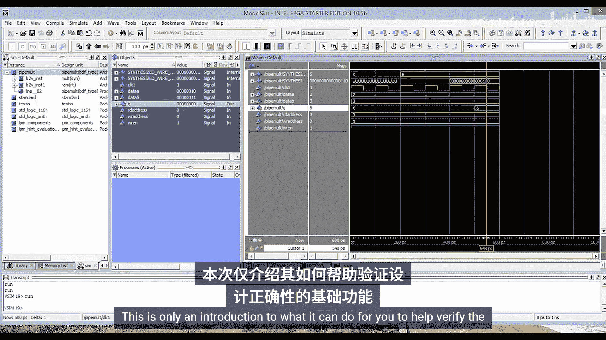

在本节课中，我们将学习如何使用Mentor Graphics ModelSim仿真器来仿真FPGA设计中的逻辑。ModelSim是一个非常强大的工具，本节内容仅作为入门介绍，帮助你验证设计的正确性。

我们将以一个已完成时序分析的现有项目为起点，逐步完成从原理图转换到VHDL文件、启动ModelSim、添加信号、创建激励以及通过仿真测试案例验证逻辑等任务。

---

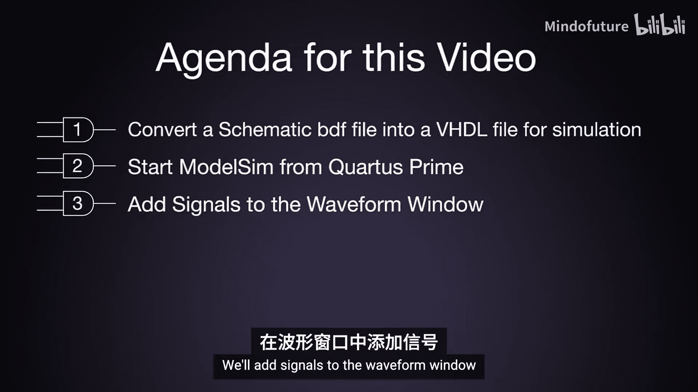

## 从原理图到VHDL文件转换 🔄

上一节我们介绍了仿真准备工作的目标，本节中我们来看看如何将原理图设计转换为仿真可用的VHDL文件。

首先，打开Quartus Prime并加载名为 `pipemult` 的项目。该项目应已完成时序分析。在项目导航器的“Hierarchy”选项卡中，双击 `pipemult` 项，原理图将显示出来。由于仿真器无法直接仿真原理图形式的电路，因此需要将其转换为HDL文件。

以下是转换步骤：
1.  点击 **File** 菜单，选择 **Create/Update**，然后选择 **Create HDL Design File from Current File**。
2.  在弹出的对话框中选择 **VHDL**，点击 **OK**。
3.  在消息窗口中，应看到“Quartus Prime create VHDL file was successful”的提示。
4.  此时，在项目导航器中再次双击 `pipemult`，编辑器窗口将显示生成的VHDL文件 `pipemult.vhd`。

查看此VHDL代码，其 `entity` 部分包含了所有预期的输入输出端口。`architecture` 部分则由一个乘法器、一个RAM组件以及连接它们和输出寄存器的信号（或连线）构成。

现在，我们可以使用这个设计版本进行仿真。但在将其加入项目前，需要手动添加：
1.  进入 **Project** 菜单，点击 **Add/Remove Files in Project**。
2.  在打开的对话框中，点击文件名框右侧的浏览按钮。
3.  选择 `pipemult.vhd` 并点击 **Open**。
4.  点击 **Apply**，然后点击 **OK**。
5.  转到项目导航器的 **Files** 选项卡，确认 `pipemult.vhd` 已包含在项目中。
6.  右键点击 `pipemult.vhd`，选择 **Set as Top-Level Entity**。
7.  右键点击原始的 `pipemult.bdf` 原理图文件，选择 **Remove File from Project**。
8.  在任务窗口中双击 **Analysis & Synthesis** 以重新编译。完成后，`pipemult.vhd` 即成为设计的顶层文件。

---

## 配置并启动ModelSim ⚙️

上一节我们完成了设计文件的转换，本节中我们来看看如何配置Quartus Prime以调用ModelSim，并启动仿真环境。

首先，验证仿真器设置：
1.  点击 **Assignments** 菜单，选择 **Settings**。
2.  在设置对话框的左侧窗格中选择 **EDA Tool Settings**。
3.  确保 **Simulation** 的工具名称为 **ModelSim-Altera**，格式为 **VHDL**。如果不是，请通过下拉菜单选择。
4.  点击 **OK** 关闭设置对话框。

接着，配置ModelSim可执行文件路径：
1.  点击 **Tools** 菜单，选择 **Options**。
2.  在选项对话框中，选择 **General** 下的 **EDA Tool Options**。
3.  确认底部 **ModelSim-Altera** 框中的工具路径正确，或点击右侧浏览按钮，导航至ModelSim可执行文件（通常位于 `C:\intelFPGA_lite\16.1\modelsim_ase\win32aloem\modelsim.exe`）。
4.  点击 **OK**。

现在，启动RTL仿真：
1.  在 **Tools** 菜单中，选择 **Run Simulation Tool**，然后点击 **RTL Simulation**。
2.  ModelSim Intel FPGA Starter Edition 软件窗口将打开。

ModelSim窗口顶部是包含文件、编辑、视图、编译、仿真等选项的下拉菜单栏。其下是工具栏，将鼠标悬停在图标上会显示其功能。主窗口区通常包括左侧的库窗口、右上角的对象窗口、右下角的进程窗口以及底部的命令窗口。这些窗口会随着仿真活动而变化。

库窗口中包含了工具支持的Altera FPGA系列的所有基本模型、标准HDL库以及IP组件库。其中应有一个名为 **work** 的库，里面包含了我们的 `pipemult` 实体。

---

## 解决编译错误与启动仿真 🛠️

上一节我们启动了ModelSim，但在仿真前可能会遇到编译错误。本节中我们来看看如何解决这些错误并成功启动仿真。

尝试右键点击 **work** 库中的 `pipemult` 实体并选择 **Simulate**。命令窗口可能会显示加载设计时出错的提示。这通常是由于 `ram.vhd` 和 `pipemult.vhd` 文件中关于写地址和读地址的信号类型不匹配造成的。从原理图到VHDL的转换程序并非完美。

以下是修复步骤：
1.  返回Quartus Prime，在项目导航器的 **Files** 选项卡中，双击打开 `pipemult.vhd` 和 `ram.vhd` 两个文件。
2.  在 `ram.vhd` 文件中，选中从 `clock` 到 `q` 输出的所有端口声明行，按 `Ctrl+C` 复制。
3.  切换到 `pipemult.vhd` 文件标签页。
4.  向下滚动到 `RAM` 组件声明部分，选中从 `clock` 到 `q` 的端口部分，按 `Ctrl+V` 粘贴替换。这确保了组件声明与实体定义一致。
5.  接下来，还需要修正顶层 `pipemult` 实体中的端口声明。从刚粘贴的 `RAM` 组件声明中，复制 `wraddress` 和 `rdaddress` 端口行。
6.  在 `pipemult` 实体声明中找到对应端口，用复制的内容覆盖它们。
7.  按 `Ctrl+S` 保存 `pipemult.vhd` 文件。
8.  返回ModelSim。在 **work** 库中，右键点击 `pipemult` 实体，选择 **Recompile**。
9.  此时，命令窗口应显示“编译成功，0个错误”的提示。
10. 再次右键点击 `pipemult` 实体，选择 **Simulate**。这次仿真应成功启动，命令窗口会出现 `VSIM>` 提示符。

此时，对象窗口会列出 `pipemult` 内部的所有信号。为了观察仿真结果，我们需要打开波形窗口：从顶部菜单选择 **View**，然后向下滚动并点击 **Wave**。

---

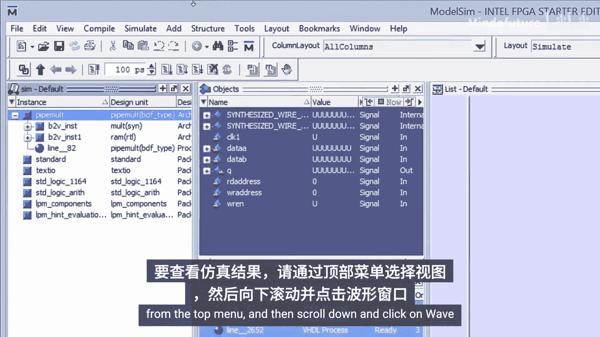

## 添加信号与创建激励 📈

上一节我们成功启动了仿真并打开了波形窗口，本节中我们来看看如何将信号添加到波形窗口并创建输入激励。

波形窗口出现后，默认时间尺度通常是100皮秒。将信号添加到波形窗口的方法如下：
1.  点击 **Objects** 窗口，按 `Ctrl+A` 全选所有信号。
2.  将这些信号拖拽到波形窗口的左侧窗格并释放。

接下来，我们需要创建一些激励（测试向量）来测试逻辑设计。有多种方法可以创建激励，最高效的是编写测试平台（Testbench），这是一种封装HDL代码，用于创建驱动被测设备输入端口的外部虚拟设备。测试平台将在专项课程的第三部分详细讨论。

另一种方法是直接在ModelSim中手动输入激励，这也是我们现在要使用的方法。

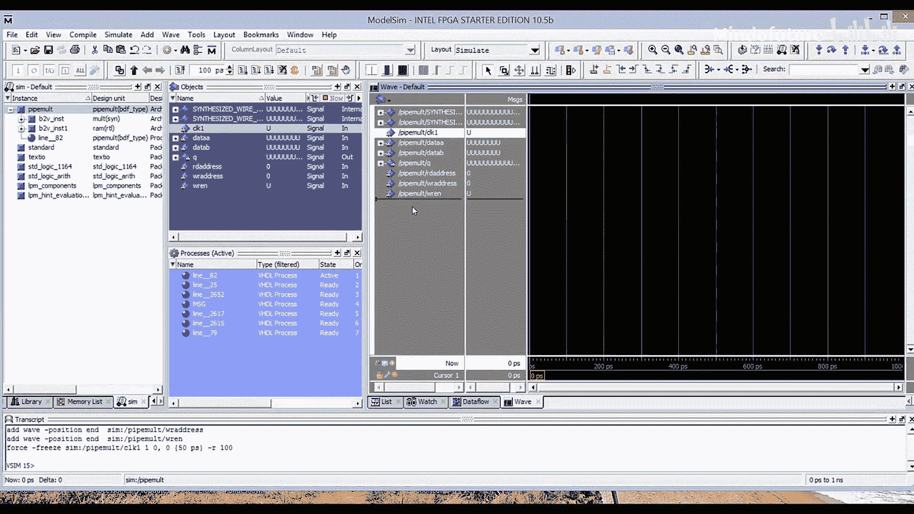

以下是手动创建激励的步骤，首先为时钟信号创建周期波形：
1.  在波形窗口的信号列表中，右键点击顶部的 `clock` 信号，在下拉菜单中选择 **Clock...**。
2.  “定义时钟”对话框会出现。默认占空比为50%，默认周期为100个仿真时间单位（本例中为皮秒）。时间尺度通常在仿真开始时通过 **Simulate -> Start Simulation** 设置，此处我们接受所有默认值，点击 **OK**。

接着，为其他输入信号强制赋值：
1.  右键点击 `wren` 信号，选择 **Force...**。在对话框中，将值从 `U`（未定义）改为 `1`，点击 **OK**。
2.  右键点击 `dataA` 信号，选择 **Force...**。在对话框中，将值改为二进制 `2`（写作 `8‘b00000010`），点击 **OK**。
3.  右键点击 `dataB` 信号，选择 **Force...**。在对话框中，将值改为二进制 `3`（写作 `8’b00000011`），点击 **OK**。
4.  地址信号暂时保持为0。其他信号是衍生输出，我们无需定义它们。

---

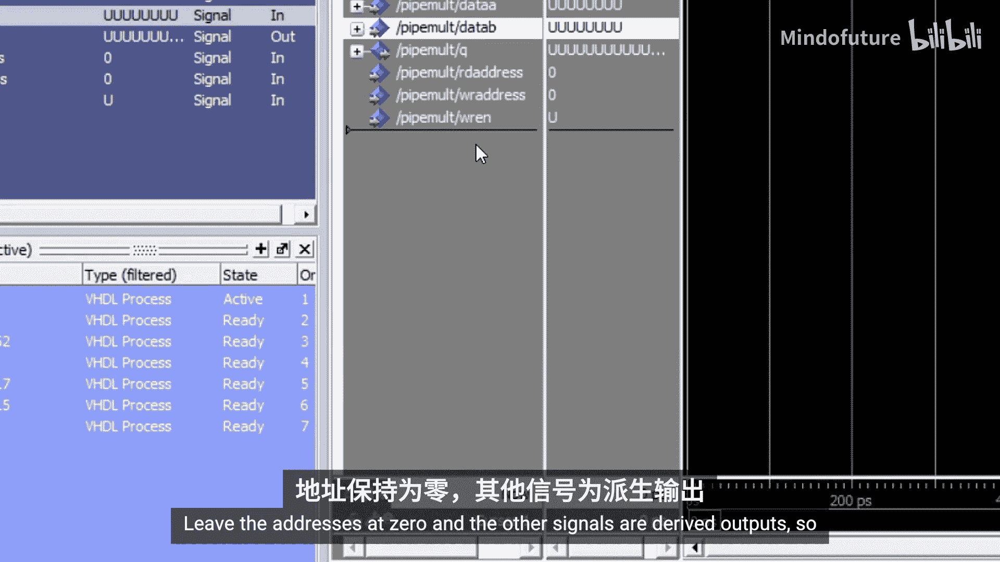

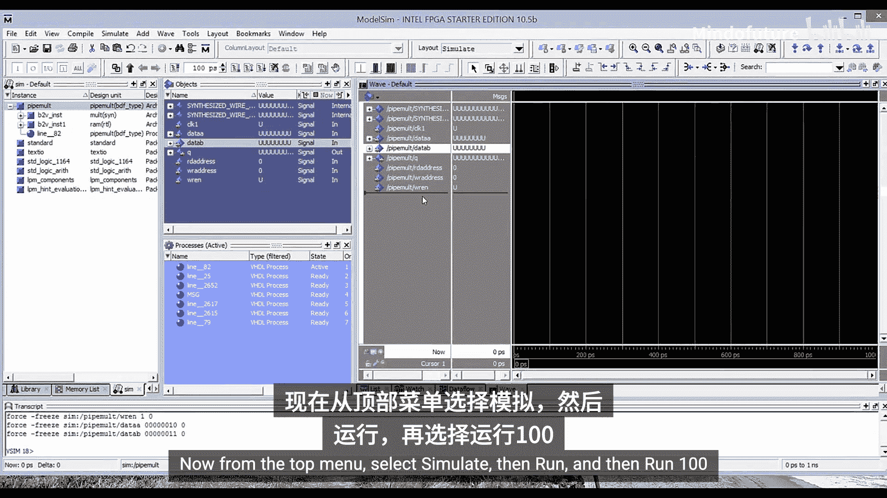

## 运行仿真与分析结果 🧮

上一节我们为输入信号创建了激励，本节中我们来看看如何运行仿真并分析波形结果以验证逻辑功能。

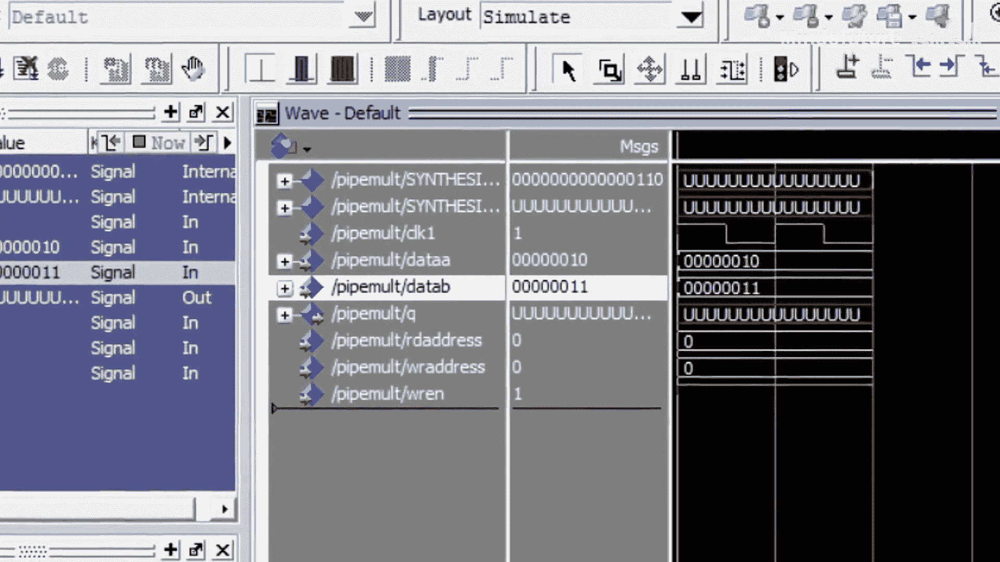

现在开始运行仿真：
1.  从顶部菜单选择 **Simulate**，然后 **Run**，再选择 **Run 100**。仿真将运行100个时间单位。

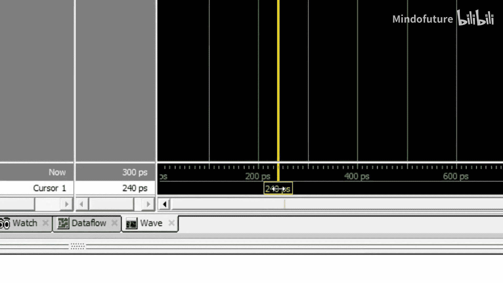

仿真运行后，你将看到一个时钟周期以及其他信号的值。`q` 输出显示为红色，表示其状态未知，因为它尚未被有效驱动。

你可以通过点击顶部中间时间框左侧的图标（看起来像一张带向下箭头的纸）再次运行100个单位。重复此操作几次，以观察多个时钟周期。

在波形窗口底部有一个游标，可以将其拖动到特定的仿真时间点，例如约250皮秒处。此时，一个名为 `mult_out` 的信号（乘法器输出）被驱动为二进制值 `6`（即 `2*3`）。

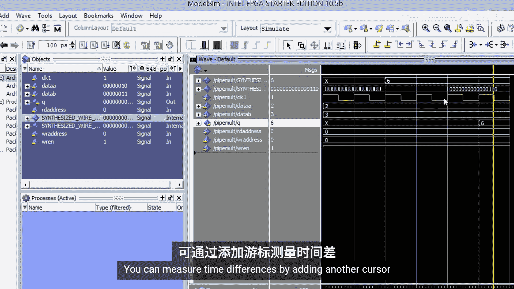

为了更好地观察数值，可以更改信号的显示基数：
1.  右键点击 `dataA` 信号的值区域，选择 **Radix**，然后选择 **Decimal**。对 `dataB` 以及最后三个输出信号进行同样操作。
2.  再次点击运行按钮，多仿真几百个单位。

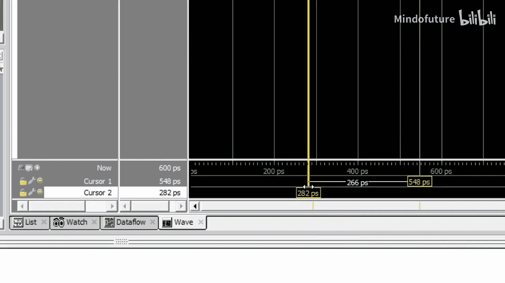

观察波形：乘法器输出被存储到RAM中，随后RAM输出被驱动，最终设备的 `q` 输出引脚被驱动。从时序图中可以看出，完成一次乘法需要两个时钟周期，从RAM存储和读取需要两个周期，然后一个周期用于输出寄存。

要测量时间差，可以添加第二个游标：
1.  右键点击现有游标下方的黑色空白区域，选择 **New Cursor**。两个游标之间的时间差将显示出来。

---

## 进行更多测试与保存结果 💾

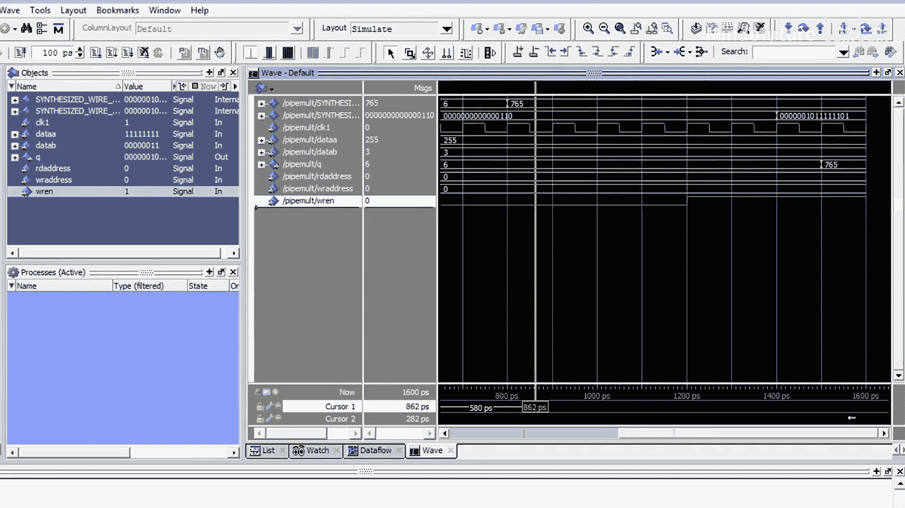

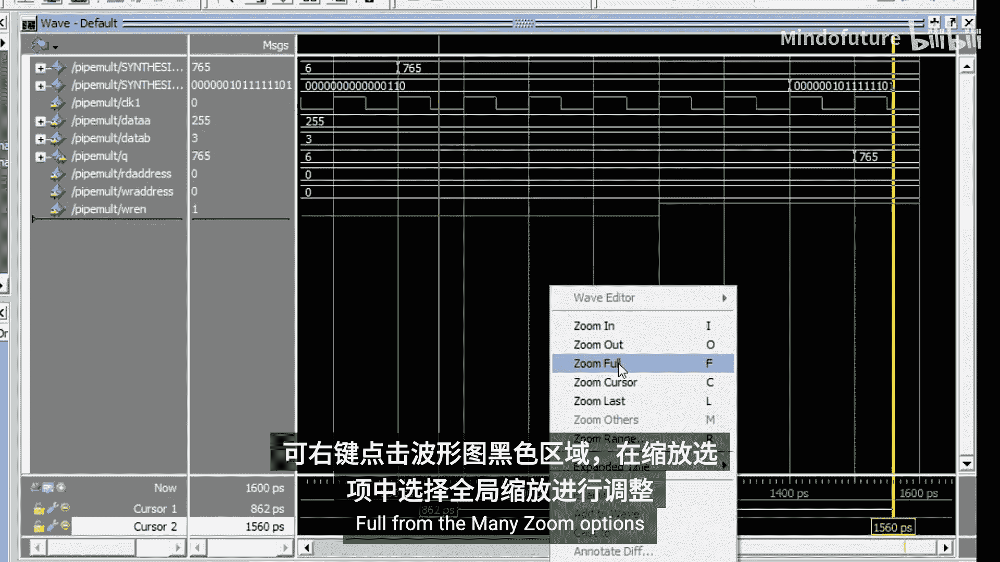

上一节我们进行了初步仿真验证，本节中我们通过修改测试值来进行更全面的验证，并学习如何保存仿真结果。

接下来，让我们改变测试值，验证乘法器对不同输入的处理：
1.  将 `wren` 的值强制改为 `0`。
2.  将 `dataA` 的值强制改为 `255`（二进制 `8‘b11111111`）。
3.  运行仿真。此时 `dataA` 可能显示为 `-1`（如果被解释为有符号数），而乘法器输出显示为 `765`。这合理吗？
4.  右键点击 `dataA` 信号，选择 **Radix -> Unsigned**，现在它显示为 `255`。`255 * 3 = 765`，乘法器工作正常。
5.  再运行几次仿真，使结果传播到输出。注意输出 `q` 并未变为 `765`，这是因为 `wren` 为 `0`，乘法器结果未被写入RAM。
6.  将 `wren` 重新强制为 `1`。
7.  再运行几次仿真，输出结果 `q` 最终变为 `765`。

此时，仿真的起始部分可能已不在屏幕显示范围内。可以通过右键点击波形窗口的黑色背景，从众多缩放选项中选择 **Zoom Full** 来调整视图。

再进行一次测试：
1.  将 `dataB` 也改为 `255`。
2.  运行仿真多次。如果未更改 `dataB` 的基数，它可能显示为 `-1`，乘法器输出显示为 `-511`。这可能是混合了有符号和无符号数表示法造成的。
3.  将 `dataB` 和后三个输出信号的基数改为 **Unsigned**。现在显示的值是 `65025`（即 `255*255`），这是正确的。

在命令窗口左下方，可以看到总仿真时间（例如2200皮秒）。这是一个寄存器传输级（RTL）仿真，不包含电路模型中的任何时序或传播延迟信息，其目的是验证逻辑、时序和顶层计算的正确性。包含时序信息的仿真（时序仿真或门级仿真）将在布局布线后进行，我们将在后续课程中探讨。

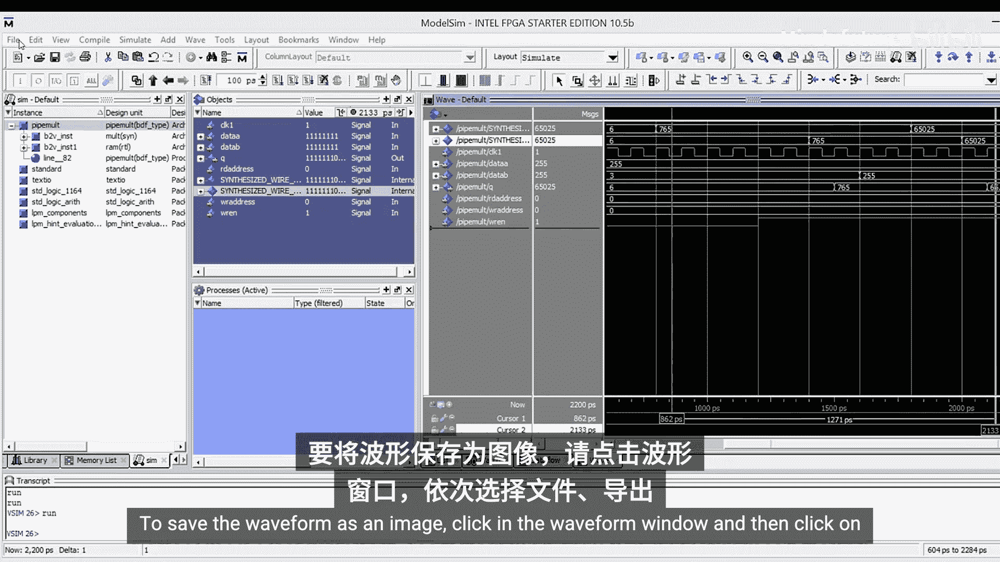

最后，可以保存仿真结果：
*   **保存波形图像**：点击波形窗口，然后选择 **File -> Export -> Image...**，输入文件名（如 `pipemult_wave`）保存为图片。
*   **保存信号列表**：点击对象窗口，选择 **File -> Save As...**，可将其保存为文本文件。
*   **保存仿真命令脚本**：右键点击命令窗口，选择 **Select All** 复制所有使用过的命令，然后粘贴到文本编辑器中。这些命令以后可以作为脚本重新运行，以复现仿真。

---

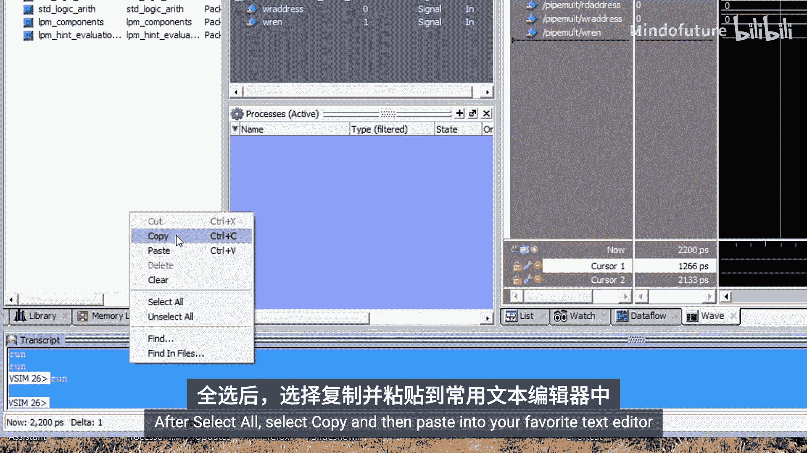

## 总结 📝

在本节课中，我们一起学习了使用ModelSim进行FPGA设计仿真的完整流程。

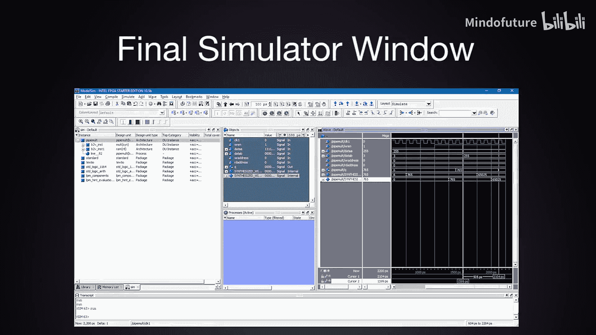

我们首先将原理图BDF文件转换为用于仿真的VHDL文件，然后从Quartus Prime中启动并配置了ModelSim。在ModelSim环境中，我们学会了如何将信号添加到波形窗口，如何通过手动强制赋值来创建驱动输入的激励，以及如何通过精心设计并应用于仿真的测试案例来验证逻辑设计的正确性。

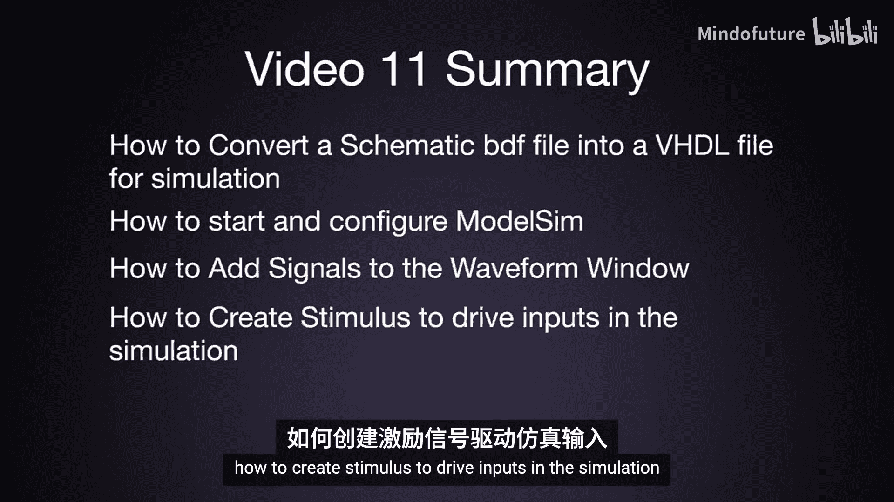

通过观察波形、更改数值基数、添加游标测量时间以及进行多组测试，我们验证了设计的功能和时序行为。这些技能是进行有效数字逻辑仿真和调试的基础。