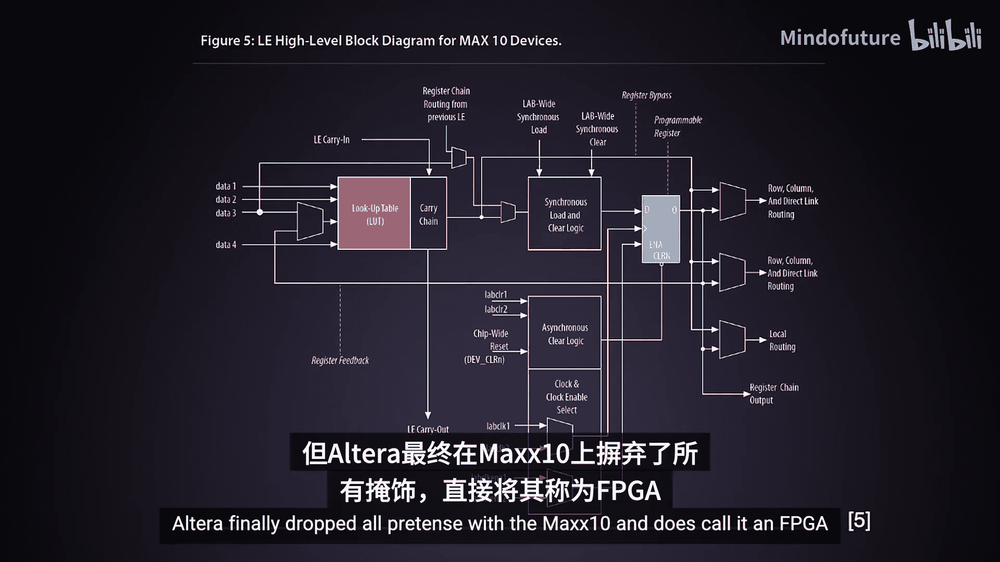
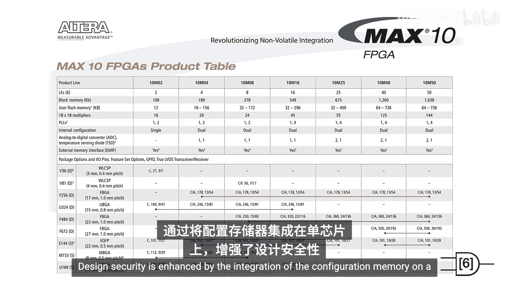

# 024：Altera CPLD与小型FPGA

## 概述
在本节课程中，我们将继续学习现代可编程逻辑器件，重点介绍Altera公司的CPLD和小型FPGA，包括MAX 5、MAX 10和Cyclone 5系列。我们将运用之前建立的选择标准来评估这些器件，目标是学会如何根据项目需求选择最合适的器件。

---

## Altera MAX 5 CPLD
上一节我们介绍了可编程逻辑器件的通用选择标准，本节中我们来看看Altera的MAX 5 CPLD。

以下是Altera MAX 5 CPLD系列器件手册的部分关键信息：
*   **配置与存储**：MAX 5采用可重编程的闪存配置和用户存储器。尽管其路由开关基于SRAM，但上电时，器件能在约0.5毫秒内将闪存中的配置信息传输到SRAM。
*   **逻辑规模**：逻辑单元（LE）数量高达2210个，比我们考虑过的其他CPLD更多。
*   **速度**：全局时钟缓冲器速度限制为304 MHz，与其他CPLD相当。
*   **功耗**：最大静态功耗在0.09至2毫安之间（取决于器件规模），属于低功耗器件。动态功耗未指定，需使用PowerPlay分析器工具确定。
*   **I/O**：最多支持271个I/O引脚，逻辑单元与I/O的比例约为8:1。支持9种I/O标准。
*   **数据保持与耐久性**：数据保持时间未指定。编程周期耐久性（10,000次）相对较低。
*   **时序**：具有确定性时序，引脚到引脚的延迟为7纳秒。
*   **设计安全性**：由于配置存储器集成在单芯片上，设计安全性得到增强。

下图展示了MAX 5的逻辑单元（LE）。其核心是一个4输入查找表（LUT）和一个触发器，这使得它看起来更像FPGA的逻辑单元，而非传统的CPLD。实际上，MAX 5是作为CPLD和FPGA之间的跨界器件设计的，本质上更接近FPGA。

下图展示了MAX 5器件的整体布局，其本质上是一个由行和列路由连接起来的逻辑阵列块（LAB）阵列，每个LAB包含10个逻辑单元。

---

## Altera MAX 10 FPGA
接下来，我们对比一下MAX 5与MAX 10的布局图。MAX 10的布局看起来更复杂（并且是彩色的）。MAX 10是更新一代的器件，顺应了集成更多硬核IP模块的趋势，例如锁相环（PLL）和模数转换器（ADC）。它是一个混合信号器件，在同一芯片上集成了模拟和数字功能。

以下是Altera MAX 10 FPGA系列器件手册的部分关键信息：
*   **配置与存储**：与MAX 5类似，采用可重编程的闪存配置。上电时，配置信息从闪存传输到SRAM约需0.5毫秒。
*   **逻辑规模**：逻辑单元数量高达50,000个，对于小型FPGA来说规模可观。
*   **速度**：全局时钟缓冲器速度限制为450 MHz，对于小型FPGA来说非常快。
*   **功耗**：功耗未指定，需使用PowerPlay分析器工具确定。该器件的功耗上限为5瓦。
*   **I/O**：最多支持500个I/O引脚，逻辑单元与I/O的比例约为10:1。支持31种I/O标准。
*   **设计灵活性**：注意，在不同逻辑规模但引脚兼容的部件之间存在迁移路径。这种安排非常有益，特别是在项目过程中需求发生变化时，即使使用的逻辑量增加，也无需重新设计电路板布局。
*   **硬核IP**：增加了许多硬核IP模块，包括块存储器、乘法器、PLL、ADC和外部存储器接口。
*   **数据保持与耐久性**：数据保持时间为20年，编程周期耐久性为10,000次，表现良好。
*   **设计安全性**：配置存储器集成在单芯片上，增强了设计安全性。

下图是MAX 10的逻辑单元图。其核心几乎与MAX 5相同，都是一个4输入LUT和一个触发器，并带有进位链和模拟信号选择功能。尽管MAX系列曾是CPLD家族，但Altera最终在MAX 10上不再掩饰，直接称其为FPGA。

---

## Altera Cyclone 5 FPGA
最后，让我们看看Cyclone 5小型FPGA的产品参数表。

以下是Cyclone 5 FPGA的关键信息：
*   **配置与存储**：Cyclone 5采用可重编程的SRAM配置和路由，因此需要外部非易失性配置存储器。上电时，配置信息被传输到内部SRAM。
*   **逻辑规模**：逻辑单元数量高达300,000个，对于小型FPGA来说是相当大的规模。
*   **速度**：全局时钟缓冲器速度限制为550 MHz，对于小型FPGA来说非常出色。
*   **功耗**：功耗未指定，需使用PowerPlay分析器工具确定。
*   **I/O**：最多支持480个I/O引脚，逻辑单元与I/O的比例约为600:1。支持34种I/O标准。
*   **硬核IP**：增加了大量硬核IP模块，包括块存储器、乘法器、PLL、DSP模块、高速收发器和外部存储器接口。

下图展示了Cyclone 5的整体布局，包括逻辑单元、RAM块、DSP块、PLL、收发器和存储器接口。

Cyclone 5的基本逻辑单元是自适应逻辑模块（ALM）。它由一个8输入自适应LUT、两个全加器和四个寄存器组成。这种寄存器丰富的逻辑单元比前几代器件具有更强的设计封装能力。该LUT还可以配置为32x2的双端口SRAM。通过将全加器与LUT算法结合，ALM可以变成一个三输入加法器。

下图是正常模式下的ALM示意图（这是同一ALM的另一种视图，展示了其在特定模式下的操作）。

---

## 逻辑单元能力对比
现在，让我们通过一个具体例子来对比这些器件的逻辑单元能力。回顾一下我们之前提到的4位比较器。

*   **在MAX 10中能实现多少位比较器？**
    MAX 10的LUT只有4个输入，因此可以创建一个**2位比较器**。要实现更大的比较器，需要级联多个LUT。虽然逻辑使用效率高，但相对于CPLD实现会引入额外的延迟。
    *代码示例：一个2位比较器（A1:A0 与 B1:B0）的逻辑可以在一个4输入LUT中实现。*

*   **在Cyclone 5中能实现多少位比较器？**
    Cyclone 5的ALM中的6输入独立LUT可以处理**3位比较器**。因此，构建更宽的比较器所需的延迟更小。

*   **在一个逻辑单元中能实现多少个全加器？**
    *   **对于MAX 10**：由于增加了进位链逻辑，每个LUT可以创建一个1位全加器。即：**1个LE = 1个1位加法器**。
    *   **对于Cyclone 5**：根据之前的课程，我们用3个Cyclone ALM实现了一个4位加法器。因此，每个ALM大约能创建 **1.33个加法器位**（4位 / 3个ALM ≈ 1.33）。

---

## 总结
本节课中，我们一起学习了Altera为小型逻辑设计提供的MAX 5 CPLD以及MAX 10和Cyclone 5 FPGA系列。
*   **MAX 5和MAX 10**是单芯片解决方案，提供了较多的I/O、合理的逻辑密度以及高效的4输入逻辑单元。
*   **MAX 10**额外增加了模拟信号处理功能，例如片内ADC。
*   **Cyclone 5**是一款优秀的入门级FPGA，具有良好的速度、逻辑密度，并集成了大量的硬核IP模块，包括块存储器、PLL、乘法器、DSP模块、高速收发器和外部存储器接口。

理解这些器件的特性和能力，将帮助您在未来的嵌入式系统项目中做出更明智的器件选择。