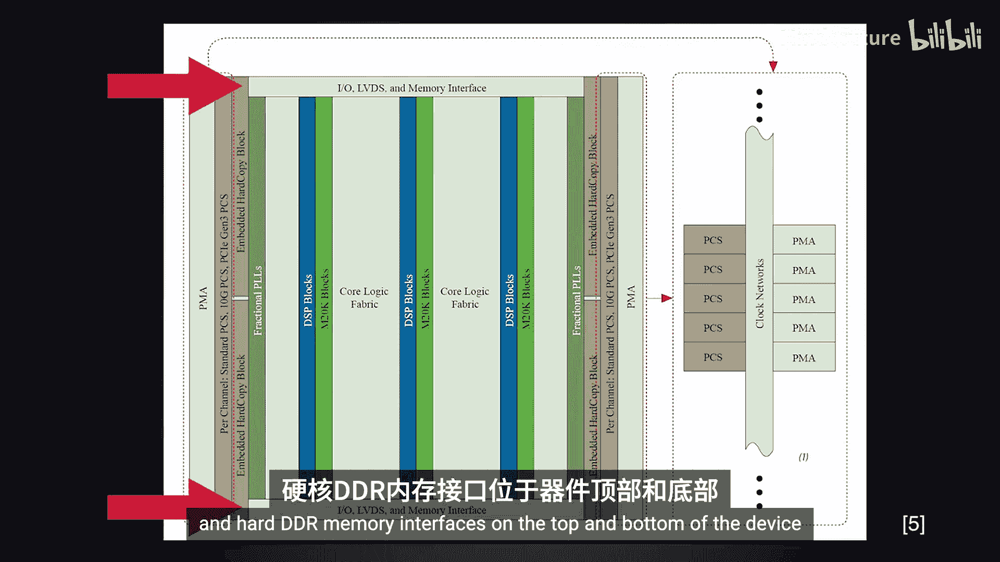
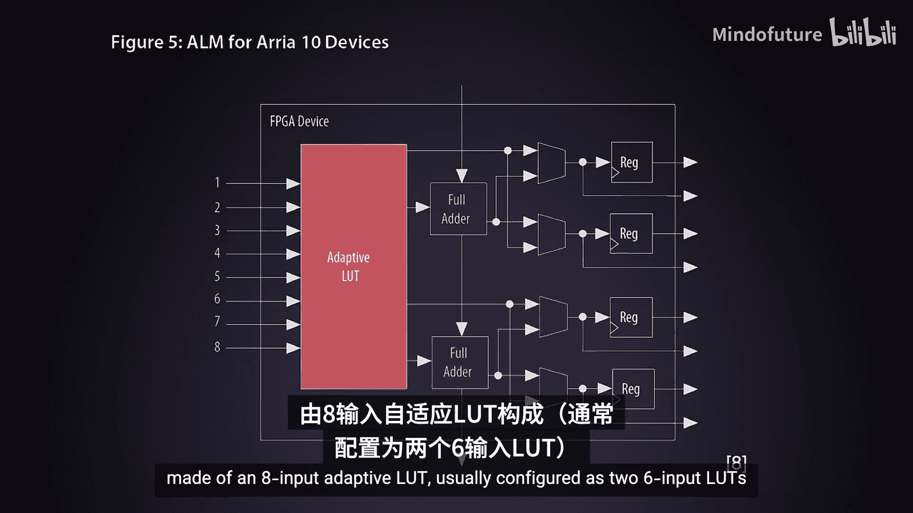
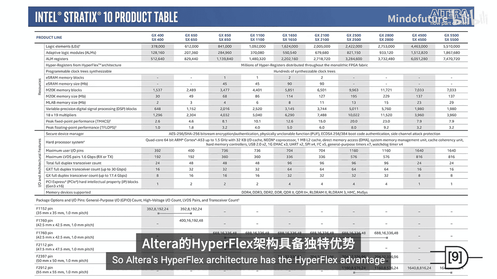
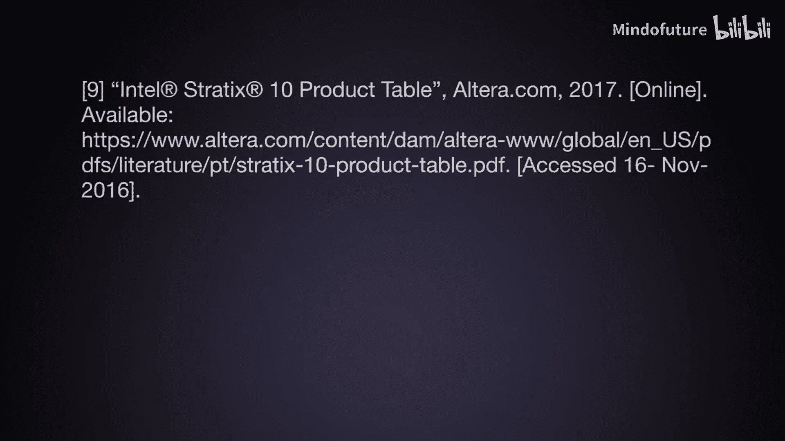

# 025：Altera大型FPGA 🚀

在本节课中，我们将继续学习现代可编程逻辑器件，重点介绍Altera公司的大型FPGA系列，包括Arria 5、Stratix 5、Arria 10和Stratix 10。

选择可编程逻辑器件的目标是为我们的需求找到最合适的型号。我们将使用之前建立的选择标准来评估这些器件。

## Arria 5中端FPGA

首先，我们来看Arria 5中端FPGA的产品规格表。

Arria 5采用可重编程的SRAM配置和布线，因此上电时需要外部非易失性配置存储器。器件会将配置信息传输到内部SRAM中。

以下是Arria 5的关键规格：
*   **逻辑单元**：最多可达500，000个，大约是Cyclone 5的两倍。
*   **速度**：全局时钟缓冲器速度最高为625 MHz。
*   **功耗**：未明确指定，需使用PowerPlay分析器工具来确定。
*   **I/O引脚**：最多可达704个，逻辑单元与I/O的比例约为715:1。
*   **硬核IP模块**：增加了多个硬核IP模块，包括：
    *   块存储器
    *   DSP模块
    *   高速收发器（标准为6.6 Gbps，部分型号可达12.5 Gbps）
    *   外部存储器接口（最高支持DDR3-1600）

下图展示了Arria 5的布局，其中逻辑块阵列中穿插着存储器和DSP模块，高速收发器和硬核DDR存储器接口位于器件外围。

这是Arria 5自适应逻辑模块（ALM）的示意图，它与Cyclone 5的ALM看起来完全一样，由两个6输入查找表（LUT）驱动四个触发器（Flip-Flop）寄存器构成。

一旦FPGA设计者确定了一种满意的逻辑单元架构，他们往往会重复使用它。

## Stratix 5大型FPGA

接下来，我们考虑Stratix 5大型FPGA。

Altera Stratix 5同样采用可重编程的SRAM配置和布线，需要外部非易失性配置存储器。上电时，配置信息被传输到内部SRAM。

以下是Stratix 5的关键规格：
*   **逻辑单元**：最多可达950，000个，大约是Arria 5的两倍。
*   **速度**：全局时钟缓冲器速度最高为717 MHz。
*   **功耗**：未明确指定，需使用PowerPlay分析器工具来确定。
*   **I/O引脚**：最多可达840个，逻辑单元与I/O的比例约为1100:1。
*   **硬核IP模块**：增加了多个硬核IP模块，包括：
    *   高速收发器（在GT型号中最高可达28.05 Gbps）
    *   块存储器
    *   高达27x27精度的乘法器
    *   DSP模块
    *   外部存储器接口（最高支持DDR3-1600）

下图展示了Stratix 5的布局，逻辑块阵列中穿插着存储器和DSP模块，高速收发器位于器件左右两侧，硬核DDR存储器接口位于器件的顶部和底部。

这是Stratix 5 ALM的示意图，它与Cyclone 5或Arria 5的ALM完全相同，由两个6输入LUT驱动四个触发器寄存器构成。得益于Altera的“缺乏想象力”，我们已经知道这个模块是如何工作的了。实际上，我们知道他们的想象力非常出色，但他们知道一个好的设计并会重复使用它。

## Arria 10大型FPGA

现在，我们来考察Arria 10大型FPGA。

Altera Arria 10采用可重编程的SRAM配置和布线，需要外部非易失性配置存储器。上电时，配置信息被传输到内部SRAM。

以下是Arria 10的关键规格：
*   **逻辑单元**：超过100万个，大约是Arria 5的两倍。
*   **速度**：全局时钟缓冲器速度最高为644 MHz，与Arria 5相比提升不大。
*   **功耗**：未明确指定，需使用PowerPlay分析器工具来确定。
*   **I/O引脚**：最多可达840个，逻辑单元与I/O的比例约为1100:1。
*   **硬核IP模块**：增加了多个硬核IP模块，包括：
    *   高速收发器（最高可达28.3 Gbps）
    *   块存储器
    *   乘法器
    *   DSP模块
    *   10千兆以太网接口
    *   外部存储器接口（最高支持DDR4-2666）

这是Arria 10 ALM的示意图，它与Cyclone 5的ALM相同，由一个8输入自适应LUT（通常配置为两个6输入LUT）驱动四个触发器寄存器构成。

## Stratix 10大型FPGA

最后，让我们看看Stratix 10大型FPGA。

Altera Stratix 10采用可重编程的SRAM配置和布线，需要外部非易失性配置存储器。上电时，配置信息被传输到内部SRAM。

以下是Stratix 10的关键规格：
*   **逻辑单元**：超过550万个，是Arria 10的五倍。
*   **速度**：全局时钟缓冲器速度最高为1100 MHz，是当时速度最快的FPGA。
*   **功耗**：未明确指定，需使用PowerPlay分析器工具来确定。
*   **I/O引脚**：最多可达1640个，逻辑单元与I/O的比例约为3300:1。
*   **硬核IP模块**：增加了多个硬核IP模块，包括：
    *   高速收发器（最高可达30 Gbps）
    *   块存储器
    *   乘法器
    *   DSP模块
    *   10千兆以太网接口
    *   外部存储器接口（最高支持DDR4-2666）

这个器件性能非常强大。想象一下，用如此强大的器件可以实现什么。Altera的HyperFlex架构具有“超灵活”优势。

以下是构成HyperFlex优势的关键创新：
*   **寄存器无处不在**：在互连布线中遍布的寄存器（称为Hyper-Register）与包含在自适应逻辑模块中的传统寄存器不同。每个器件中的单个布线段都关联一个Hyper-Register。
*   **增强型内核时钟**：可编程时钟树合成允许系统设计者创建局部化的时钟树，减少偏移和时序不确定性，以获得最大的内核时钟性能。此功能是HyperFlex架构实现两倍性能的关键特性。
*   **Hyper-Aware设计流程**：Hyper-Aware设计流程包括三项新改进：快速前向编译工具、Hyper-Aware步骤，以及利用Hyper-Register的增强型综合与布局布线算法。

下图展示了HyperFlex架构，其中橙色标记的寄存器位于每个布线节点上，这正是HyperFlex架构与传统架构的不同之处。

有关HyperFlex架构的更多信息，请参阅Altera官网上的HyperFlex视频。

## 性能示例分析

回顾一下4位比较器的例子。在一个查找表（LUT）中可以实现多少位比较器？

在Stratix 10的情况下，六个独立的LUT可以处理3位比较器，因此可以用更少的延迟实现更宽的比较器。

对于Stratix 10，一个逻辑单元可以制作多少个全加器？其ALM与Cyclone 5的ALM非常相似。在之前的视频中，我们使用三个Cyclone 5 ALM实现了一个4位加法器，因此每个ALM大约可以创建1.33个加法器。

## 总结

本节课中我们一起学习了Altera公司面向大型设计提供的Arria 5、Stratix 5、Arria 10和Stratix 10 FPGA系列。

*   **Arria 5和Stratix 5**是大型器件，拥有多达百万个逻辑单元，并集成了许多硬核IP模块，形成了具有强大处理能力的部件。
*   **Arria 10**进一步提升了处理能力，配备了28 Gbps的串行收发器和2666 Mbps的DDR4 DRAM接口。
*   **Stratix 10**是当时正在生产的最大、最快的FPGA，拥有超过550万个逻辑单元，内核时钟速度高达1100 MHz。
*   Altera的**HyperFlex架构**是一项革命性的变革，将在同等功耗水平下将FPGA性能进一步提高一倍。

