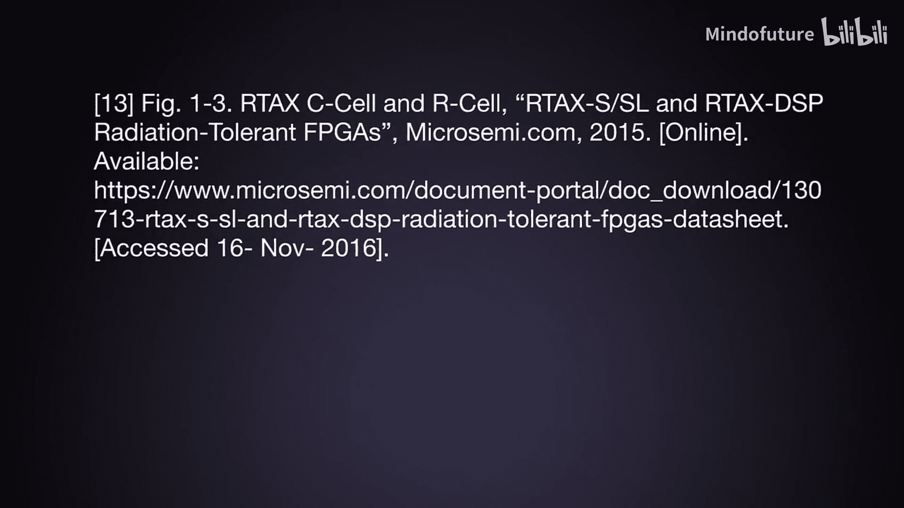

# 026：Microsemi单芯片FPGA解决方案 🧩

在本节课中，我们将继续探讨现代可编程逻辑器件，这次聚焦于Microsemi公司的FPGA产品，包括Igloo、Igloo2和Accelerator系列。在深入了解具体器件之前，先了解一些关于FPGA工艺技术和互连的背景知识会很有帮助。

## 概述：FPGA工艺技术

选择可编程逻辑器件的目标是为我们的需求找到最合适的部件。我们将使用之前建立的选择标准来评估这些器件。

Microsemi公司同时提供基于闪存（Flash）和基于反熔丝（Antifuse）的FPGA。正如我们从图表中看到的，基于互连方式的不同，它们在性能上存在差异。

反熔丝器件是一次性可编程（OTP）的，而闪存器件可以多次重新编程。闪存器件不具备高速性能，但非常适合低功耗应用。反熔丝器件非常坚固，可用于最极端的条件。

如果我们更仔细地观察这些技术，就能更好地理解这些性能差异是如何产生的。

在SRAM型FPGA中，SRAM单元可以被编程为在FPGA的布线路径之间闭合或打开一个开关。类似地，在闪存FPGA中，布线开关由一个被编程为1或0的闪存单元控制。在反熔丝器件中，布线之间的连接是通过在编程过程中熔断一个互连点来永久固定的，这种连接不可逆转。

闪存单元可以编程一次，并且由于是非易失性的，它们将永久保持这种状态，直到被重新编程。SRAM单元是易失性的，断电时会丢失信息，因此每次上电时都必须重新编程。

除了易失性和可重编程性之外，互连类型还有许多其他影响，接下来我们将探讨其中一些。

## 深入比较：SRAM与Flash单元

如果我们更仔细地观察一个SRAM单元，它通常由六个晶体管组成，如左侧电路图所示。这个电路在电源和地之间存在多条通路，即使单元处于静态工作状态，也会有有限的电流流过。这种泄漏电流很显著，可能导致功耗达到数瓦，在大型SRAM FPGA中尤其如此。

相比之下，闪存单元的路径更少，泄漏电流低1000倍，静态功耗非常低，在毫瓦量级。Microsemi的闪存工艺还允许器件进入一种称为“Flash Freeze”的挂起状态，这可以将功耗进一步降低到微瓦范围。由于这种低功耗能力，Microsemi将首批此类器件命名为“Igloo”（冰屋），因为它们几乎不因功耗而产生热量。

## Flash FPGA的优势

Microsemi基于闪存的FPGA具有许多直接源于该技术的固有优势，包括：
*   **真正的闪存技术**：它们可重编程且非易失性，无需额外存储器来创建互连。
*   **即时启动**：上电即用，无启动延迟。
*   **集成度高，降低总系统成本**：可添加其他IP核以创建SoC器件，替代设计中的多个IC。
*   **全面的低功耗**：所有部件功耗都较低，部分还具有额外的超低功耗Flash Freeze工作模式。
*   **最佳设计安全性**：无需外部程序存储器，逆向工程器件程序文件更加困难。
*   **卓越的可靠性**：闪存单元不受辐射效应影响，更容易进行抗辐射加固。

## Microsemi FPGA系列详解

上一节我们介绍了FPGA的基础技术差异，本节中我们来看看Microsemi的几个具体产品系列。

### Igloo FPGA系列 ❄️

以下是Microsemi Igloo FPGA系列的总结。
*   **技术基础**：基于闪存，可重编程且非易失性，意味着上电即用，无需外部存储器，是单芯片解决方案。
*   **密度**：属于较小密度部件，最多只有6，000个触发器单元。
*   **速度**：全局时钟缓冲器速度限制在250 MHz，与其他FPGA相比较慢，但仍可使用。
*   **功耗**：这些器件最有趣的方面是低功耗，在Flash Freeze模式下功耗在微瓦量级。
*   **I/O**：最多77个I/O引脚，逻辑单元与I/O的比例为80:1，在这方面更像CPLD。
*   **硬IP核**：添加了一些硬IP块，包括块存储器、闪存ROM和PLL。

下图展示了Microsemi Igloo Nano FPGA的结构，包含可配置的通用逻辑单元阵列、顶部的RAM块、外围的I/O块，以及可用于保护可编程内容读取的AES解密模块、用户闪存ROM、Flash Freeze控制和用于实现器件在系统编程的电荷泵。

Microsemi Igloo Nano使用“通用逻辑单元”作为主要逻辑元素。这是一个比其他FPGA厂商所见更细粒度的逻辑元素，可以带来更好的逻辑利用率，但也可能增加布线需求。架构之间总是存在权衡。

在这里，通用逻辑单元可以配置为任何三输入组合逻辑、一个D触发器或一个带使能的D触发器。这比我们考虑过的其他逻辑元素要简单得多。当用作组合逻辑时，通用逻辑单元可以实现任何三输入函数，包括此处显示的所有函数，它可以是一个或门、与门、异或门、多路选择器等。

### Igloo2 FPGA系列 ⚡

以下是基于65纳米工艺制造的Microsemi Igloo2 FPGA系列的总结。
*   **技术基础**：基于闪存，可重编程且非易失性，意味着上电即用，无需外部存储器，是单芯片解决方案。
*   **密度**：属于中等密度部件，最多15万逻辑单元。
*   **速度**：全局时钟缓冲器速度限制在400 MHz，与其他FPGA相比足够。
*   **功耗**：这些器件的一个有趣方面是低功耗，即使在最大部件上，Flash Freeze模式下的功耗也低于11毫瓦。
*   **I/O**：最多574个I/O引脚，逻辑单元与I/O的比例为250:1，比同尺寸的其他FPGA更偏向I/O密集型。
*   **硬IP核**：区别于前代器件的一个特点是，它相对于其前身充满了硬IP块。新增的IP包括DSP数学块、DMA、嵌入式非易失性存储器（eNVM）、三种不同类型的RAM、DDR/DDR2/DDR3控制器，以及最多16通道的5 Gbps串行收发器和PCIe控制器。

对于这个部件，器件布局变得非常复杂，因此我们首先看其框图。它由五个主要部分组成：高速存储器子系统（包括667 Mbps DDR控制器）、FPGA架构（最多15万逻辑单元）、收发器（包括PCIe和串行接口）、带设计安全特性的系统控制器以及GPIO块。

Igloo2的设计不仅旨在提供一款低功耗的中端FPGA，还具备出色的设计和数据安全性与可靠性，如下所列：
*   **设计安全特性**：包括程序数据加密、篡改检测和归零。
*   **数据安全特性**：包括非确定性随机比特生成器（NRBG）和物理不可克隆功能（PUF）。
*   **可靠性**：FPGA架构具有单粒子翻转免疫能力，存储器包含单错校正双错检测（SECDED）保护。

Igloo2的逻辑元素可用作组合逻辑元素（CLE）或时序逻辑元素（SLE）。每个逻辑元素由一个四输入查找表（LUT）、一个基于超前进位技术的专用进位链，以及一个可独立于LUT使用的独立触发器组成。四输入LUT可以配置为实现任何四输入组合函数，或实现算术函数，其中LUT输出与进位输入进行异或以生成和输出。

### Accelerator 与 RTAX FPGA系列 🛡️

以下是Microsemi Accelerator FPGA系列的总结。
*   **技术基础**：基于反熔丝，是非易失性单芯片解决方案，但不可重编程。你只有一次机会正确编程这些器件，这在生产中不是问题，但可能妨碍开发。
*   **密度**：属于较小密度部件，最多21，000个触发器单元。
*   **速度**：全局时钟缓冲器速度限制在870 MHz，与其他FPGA相比非常快。
*   **功耗**：功耗相当低，小部件的静态功耗低于50毫瓦，大部件低于300毫瓦，尽管远不及闪存部件那么低。
*   **I/O**：最多684个I/O引脚，逻辑单元与I/O的比例为30:1，因此这是一个I/O丰富的部件。
*   **硬IP核**：添加了一些硬IP块，包括最多292 Kb的块存储器和最多8个PLL。

下图展示了Microsemi Accelerator FPGA的布局。它由一个超级单元阵列组成，每个超级单元由四个组合单元和两个寄存器单元以及布线发送器和接收器构成，外围有几列块RAM和I/O块。

Accelerator有两种类型的逻辑元素：寄存器单元（R单元）和组合单元（C单元）。C单元可以实现超过4，000种最多五输入的组合函数。

Microsemi RTAX FPGA系列与Accelerator系列类似，也是基于反熔丝，是非易失性单芯片解决方案但不可重编程。RTAX系列的布局和逻辑元素与Accelerator家族相同。Accelerator家族可用于开发中模拟昂贵得多的RTAX部件，这通常是为了节省这些OTP器件的成本。

## 应用示例：逻辑资源估算

回顾我们之前提到的4位比较器。在一个逻辑单元中可以实现多少位比较器？

在Igloo2的情况下，独立的四输入LUT将处理2位比较器，制作这个4位比较器将需要3个LUT。在Igloo中，将需要5个通用逻辑单元。

对于Microsemi Igloo，一个逻辑单元中可以制作多少个全加器？每位加法器需要两个通用逻辑单元，其中图中的单元是与或阵列，红色高亮显示的是三输入异或门。那么一个4位加法器将需要8个通用逻辑单元，如图所示。

Igloo2的四输入LUT架构也需要8个逻辑元素（本例中是8个LUT）。其他四输入LUT架构仅需要4个LUT，而六输入ALM架构仅需要3个ALM。

## 总结

本节课中我们一起学习了Microsemi提供闪存和反熔丝两种FPGA。每种类型都有不同的能力和限制。

Microsemi当前的闪存FPGA产品，Igloo和Igloo2，是即时启动的单芯片解决方案，可重编程，具有非常好的低功耗性能、高可靠性和安全性。

Microsemi反熔丝FPGA专为恶劣环境和高可靠性设计，包括Accelerator家族和RTAX抗辐射家族。

Microsemi Igloo2拥有丰富的硬IP核，包括存储器控制器、高速收发器、RAM、DSP块和许多安全增强功能。

如果安全性、可靠性或低功耗是设计需求，Microsemi FPGA值得考虑。

