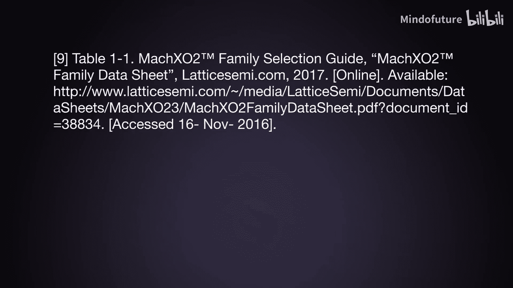

# 027：Lattice单芯片FPGA解决方案 🧩

在本节课中，我们将继续学习现代可编程逻辑器件，这次重点介绍来自Lattice公司的FPGA和CPLD产品，包括ECP5、ECP3、MachXO2、MachXO3和iCE40系列。我们将按照从大到小的顺序来了解这些器件。选择可编程逻辑器件的目标是为我们的需求找到最合适的型号。我们将运用之前建立的选择标准来评估这些器件。

Lattice公司提供低成本、低功耗的小型CPLD和中端FPGA产品，有时封装尺寸非常小。其典型应用包括便携式消费电子产品和移动设备。

## Lattice ECP5 FPGA系列概述

ECP5 FPGA系列采用40纳米工艺制造。由于基于SRAM结构，它们可重复编程但具有易失性，因此需要外部存储器来保存配置数据。这些器件针对成本和低功耗进行了优化，具有中等密度。

以下是ECP5系列的关键参数：
*   **逻辑密度**：中等密度，最多85K逻辑单元。
*   **速度**：全局时钟缓冲器速度最高40MHz，与其他FPGA相比足够。
*   **功耗**：相当低，即使在最大型号上功耗也约为250毫瓦。
*   **I/O数量**：最多365个I/O引脚，逻辑单元与I/O的比例为230:1，比同尺寸的其他FPGA更偏向I/O密集型。
*   **硬核IP**：包含多个硬核IP模块，如DSP数学模块、RAM模块、DDR DRAM存储器支持以及最多4通道的5Gbps SERDES收发器。

ECP5器件包含一个由可编程I/O单元（PIO）环绕的逻辑块阵列。在逻辑块行之间，散布着嵌入式块RAM（EBR）行和数字信号处理（DSP）切片行。

在ECP5中，基本的逻辑单元是**切片（Slice）**。每个切片包含两个LUT4，驱动两个寄存器。在分布式SRAM模式下，切片0到切片2被配置为分布式存储器，而切片3用作逻辑或ROM。

ECP5的DSP切片功能非常多样，支持以下功能：
*   全双倍数据速率支持，以实现更高的工作频率，吞吐量最高可达370Mbps。
*   双乘法器架构。与单乘法器架构相比，可将累加器开销和延迟降低一半。
*   支持跨切片完全级联的DSP。
*   支持对称、非对称和非对称滤波器。
*   每个切片支持1个18x36乘法、或2个18x18乘法、或4个9x9乘法。通过跨两个DSP切片级联，可以实现36x36乘法。
*   乘累加操作，支持1个18x36乘法器结果累加或2个18x18乘法器结果累加。

## Lattice ECP3 FPGA系列概述

上一节我们介绍了较新的ECP5系列，现在来看看其前代产品ECP3。ECP3 FPGA系列采用65纳米工艺制造，因此成本会高于同等的ECP5。与ECP5一样，它们基于SRAM，可重复编程且具有易失性，需要外部配置存储器。

以下是ECP3系列的关键参数：
*   **逻辑密度**：中等密度，最多150K逻辑单元，比后来的ECP5更大。
*   **速度**：全局时钟缓冲器速度最高500MHz，与其他FPGA相比足够。
*   **功耗**：中等，即使在最大型号上功耗也约为450毫瓦。
*   **I/O数量**：最多586个I/O引脚，逻辑单元与I/O的比例为250:1，比同尺寸的其他FPGA更偏向I/O密集型。
*   **硬核IP**：包含多个硬核IP模块，如DSP数学模块、RAM模块、DDR DRAM存储器支持以及最多16通道的3.2Gbps SERDES收发器。

每个ECP3器件包含一个由可编程逻辑单元环绕的逻辑块阵列。在逻辑块行之间，散布着嵌入式块RAM（EBR）行和数字信号处理（DSP）切片行。

在ECP3中，基本的逻辑单元是切片。切片0到切片2包含两个LUT4，驱动两个寄存器；而切片3仅包含两个LUT4。只有切片0到切片2可以配置为分布式存储器。

Lattice ECP3的DSP切片支持许多功能，包括：
*   每个切片支持1个18x36、或2个18x18、或4个9x9乘法。通过跨两个DSP切片级联，可以实现36x36乘法。
*   乘累加操作，最多支持18x36乘法器馈入一个分辨率最高可达54位的累加器。

## Lattice MachXO2 CPLD系列概述

接下来，我们转向更小、更集成的CPLD解决方案。MachXO2 CPLD系列采用65纳米工艺制造。它们基于SRAM，因此可重复编程且具有易失性。然而，它们集成了非易失性配置存储器，可在上电时加载SRAM单元，这意味着它们不需要外部存储器，是单芯片解决方案。

以下是MachXO2系列的关键参数：
*   **逻辑密度**：小密度器件，最多7K逻辑单元。虽然采用类似FPGA的架构，但通常与CPLD竞争。产品名中的“XO”代表“跨界”，意指这些器件旨在从CPLD跨界到FPGA。
*   **速度**：全局时钟缓冲器速度最高388MHz，与其他CPLD相比足够。
*   **功耗**：静态功耗非常低，即使在最大型号上也仅约200微瓦。
*   **I/O数量**：最多334个I/O引脚，逻辑单元与I/O的比例为20:1，是一款I/O非常丰富的器件，类似于其他CPLD。
*   **封装**：这些器件的最佳特点之一是封装，尺寸可小至2.5mm x 2.5mm（边长十分之一英寸）。
*   **硬核IP**：对于如此小尺寸的可编程器件，其硬核IP数量是一个有趣的特点。增加的IP包括RAM块、用户闪存、I²C和SPI串行端口以及DDR DRAM存储器支持。

MachXO2系列架构包含一个由可编程I/O（PIO）和非易失性配置存储器块环绕的逻辑块阵列。该系列中逻辑密度较大的器件包含PLL和嵌入式块RAM（EBR）块。嵌入式功能块包括串行端口硬核IP。

MachXO2的逻辑单元是一个包含两个LUT4和两个触发器的切片。切片中的寄存器可配置为上升沿触发、下降沿触发或电平敏感时钟。所有切片都有15个来自布线的输入和1个来自相邻切片或PFU的进位链输入。有7个输出，6个用于布线，1个用于向相邻PFU传递进位。它与ECP3的切片非常相似。

## Lattice MachXO3 CPLD系列概述

在了解了MachXO2之后，我们来看看其升级版MachXO3。MachXO3 CPLD系列同样采用65纳米工艺制造。它们基于SRAM，因此具有易失性。然而，它们集成了非易失性配置存储器，可在上电时加载SRAM单元，这意味着它们不需要外部存储器，是单芯片解决方案。在某些情况下，非易失性存储器是可重复编程的闪存；在其他情况下，它是一种成本较低、可编程两次的存储器。型号以“F”结尾的是闪存版本。

以下是MachXO3系列的关键参数：
*   **逻辑密度**：小密度器件，最多9K逻辑单元，比MachXO2多，但通常与CPLD竞争。虽然采用类似FPGA的架构，但产品名中的“XO”代表“跨界”。
*   **速度**：全局时钟缓冲器速度最高388MHz，与其他CPLD相比足够。
*   **功耗**：功耗低，即使在最大型号上也仅约20毫瓦。
*   **I/O数量**：最多384个I/O引脚，逻辑单元与I/O的比例为25:1，是一款I/O非常丰富的器件，类似于其他CPLD。
*   **封装**：这些器件的最佳特点之一是封装，尺寸可小至2.5mm x 2.5mm（边长十分之一英寸）。
*   **硬核IP**：对于如此小尺寸的可编程器件，其硬核IP数量是一个有趣的特点。增加的IP包括RAM块、用于视频接口的MIPI D-PHY、I²C和SPI串行端口以及DDR DRAM存储器支持。

MachXO3L/LF系列架构包含一个由可编程I/O（PIO）和非易失性配置存储器块环绕的逻辑块阵列。该系列中逻辑密度较大的器件包含PLL和嵌入式块RAM（EBR）。嵌入式功能块包括串行端口和MIPI视频端口硬核IP。MachXO3的逻辑单元是一个包含两个LUT4和两个触发器的切片，与MachXO2的切片相同。

## Lattice iCE40 Ultra FPGA系列概述

最后，我们来看Lattice最小、功耗最低的系列。iCE40 Ultra FPGA系列采用40纳米低功耗工艺制造。它们基于SRAM，因此具有易失性。然而，它们集成了非易失性配置存储器，可在上电时加载SRAM单元，这意味着它们不需要外部存储器，是单芯片解决方案。从NVCM加载配置可能需要几十毫秒。

以下是iCE40 Ultra系列的关键参数：
*   **逻辑密度**：小密度器件，最多3K逻辑单元。虽然采用FPGA架构，但通常与CPLD竞争。
*   **速度**：全局时钟缓冲器速度最高185MHz，与其他器件相比较慢，但对于针对低功耗优化的器件来说是可以预期的。
*   **功耗**：正如其名“iCE”所示，功耗非常低，即使在最大型号上，静态功耗也仅约95微瓦，动态功耗约11毫瓦，更小的型号功耗甚至更低。
*   **I/O数量**：最多39个I/O引脚，逻辑单元与I/O的比例为90:1，是一款I/O丰富的器件。
*   **封装**：这些器件的最佳特点之一是封装，尺寸可小至2mm x 2mm（边长十分之一英寸）。
*   **硬核IP**：对于如此小尺寸的可编程器件，其丰富的硬核IP块是一个有趣的特点。增加的IP块包括RAM块、DSP块、I²C和SPI串行端口、片上振荡器、24mA LED驱动器、红外LED驱动器和PWM模块IP。

iCE40 Ultra架构包含一个由可编程I/O环绕的可编程逻辑块（PLB）阵列、两个振荡器发生器、两个用户可配置的I²C控制器、两个用户可配置的SPI控制器、DSP块、LED驱动器以及嵌入式块RAM（EBR）。iCE40的基本逻辑单元是一个LUT4和一个D触发器，每个可编程逻辑块由八个逻辑单元组成。

## 逻辑资源估算示例

现在，让我们运用对Lattice逻辑单元的了解进行一些简单的资源估算。

回顾一下四位比较器，在典型的基于LUT4的Lattice逻辑单元中可以实现多少位比较器？一个四输入LUT可以处理两位比较器，因此制作这个四位比较器需要三个LUT。

`所需LUT数 = 比较器位数 / 每LUT处理位数 = 4位 / 2位每LUT = 2个LUT？` 等等，这里需要澄清：一个4输入LUT可以实现2个1位比较器（即比较两个1位输入是否相等，需要检查A0==B0和A1==B1，这通常需要两个2输入函数，但一个4输入LUT可以组合这些）。更准确地说，一个4输入LUT可以生成一个2位比较的结果（例如，两位相等）。对于一个4位比较器（输出1位，表示4位全等），通常需要组合多个LUT。简单估算：一个n位比较器（逐位比较后相与）大约需要n-1个LUT来组合结果。对于4位，大约需要3个LUT。原文提到“it will take three LUTs to make this four bit comparator”，这与我们的分析一致。

在Lattice MachXO2的一个逻辑单元中可以实现多少个全加器？每位加法器需要两个LUT来生成和与进位输出，因此一个四位加法器将使用八个LUT。在一个包含两个LUT的切片中，可以实现一位全加器。

`每个切片实现的全加器位数 = 切片内LUT数 / 每位加法器所需LUT数 = 2个LUT / 2个LUT每比特 = 1位`

## 课程总结

本节课中，我们一起学习了Lattice公司的可编程逻辑器件。Lattice专注于低成本、高价值的中小型可编程逻辑部件，包括iCE40、MachXO2、MachXO3、ECP3和ECP5系列。

*   **MachXO2和MachXO3系列**是单芯片解决方案，具有片上非易失性配置存储器，但由SRAM单元控制布线，这些SRAM单元必须在上电时加载。这些器件特点是低功耗、尺寸极小（可小至2.5mm x 2.5mm）并集成了多个硬核IP块。
*   **iCE40系列**在如此小的器件中包含了丰富的硬核IP功能，并且功耗极低。
*   **Lattice器件**的逻辑单元均基于四输入LUT和一个寄存器，功能足够但与其他FPGA产品相比能力稍弱。

总的来说，Lattice为需要低成本、低功耗、小尺寸或单芯片解决方案的应用提供了有吸引力的选择。

