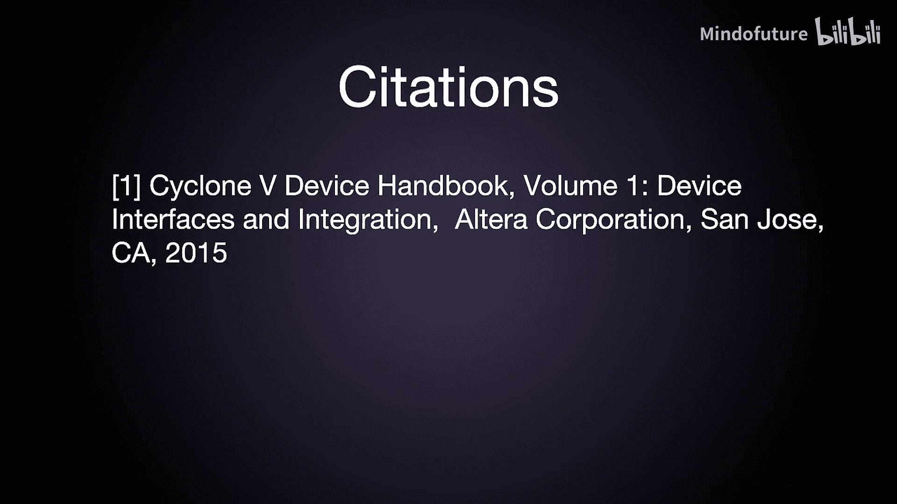

# 028：FPGA设计专业技能

## 概述

在本节课中，我们将学习一系列提升FPGA设计效率与专业性的核心技能。我们将从基础原理图设计入手，逐步探索IP核应用、时序优化、I/O管理、器件编程以及Qsys系统设计等高级主题，帮助你构建完整的FPGA设计知识体系。

---

## 模块回顾与学习路径

上一模块中，我们深入了解了FPGA的架构与功能，为设计工具箱增添了许多新工具。

本模块中，我们将通过实践练习来运用这些工具，并借助更多设计工具来扩展我们的FPGA设计知识。

以下是本模块将要学习的核心内容列表：

*   **高级原理图设计**：学习为流水线乘法器设计添加加法器电路。
*   **使用IP核提升效率**：对比原理图设计，学习如何利用IP核快速构建设计。
*   **通过流水线优化时序**：学习如何通过插入寄存器来分割组合逻辑延迟，从而提高设计最大频率。
*   **FPGA I/O管理**：学习处理丰富的I/O选项，包括差分逻辑标准。
*   **精确的引脚分配**：学习使用引脚规划器和分配编辑器进行引脚分配。
*   **FPGA编程**：学习创建编程文件、设置硬件链并将设计下载到目标器件。
*   **Qsys系统设计**：学习创建Qsys系统，构建Nios II软核处理器并添加外设。

---

## 详细技能解析

### 高级原理图设计

在接下来的视频中，你将通过为流水线乘法器设计添加一个加法器电路，来深化对FPGA原理图设计的理解。

你将学习以下内容：

*   如何在原理图中添加输入和输出端口。
*   如何使用基本符号库来创建底层电路。
*   如何在原理图设计中创建层次结构。

### 使用IP核提升设计效率

我们将对比你之前使用原理图进行设计输入的经验，学习如何使用IP核来更快速地创建设计。

你将通过添加IP核来为设计增加类似基本ALU的功能。

### 通过流水线优化时序

输入与输出之间过大的组合逻辑延迟会显著降低设计的最大工作频率。

在某些情况下，可以通过插入寄存器（称为重定时或流水线）来将这些延迟分割成多个小段。

我们将学习流水线原理如何应用于改善FPGA设计的时序，以及如何在IP核中使用流水线来优化时序。

### FPGA I/O：输入与输出管理

FPGA拥有丰富的I/O功能，包括多种I/O标准和可控的电路特性。

但管理众多的选项可能导致错误。我们可以通过使用有助于记录和跟踪I/O使用情况的方法来减少引脚分配错误。

像LVDS和LVPECL这样的差分逻辑标准在FPGA中越来越流行，因为它们能在相同条件下提供更高的速度和更好的抗噪性。

我们将学习如何处理这些接口。

### 精确的引脚分配

为了实现精确的引脚分配，你将学习以下内容：

*   如何使用引脚规划器和分配编辑器进行引脚分配。
*   如何使用分配编辑器来满足I/O标准并控制I/O属性。
*   如何使用I/O分配分析器来检查I/O分配。

### FPGA编程

Quartus Prime软件包含一个用于创建编程文件的汇编器，以及一个使用下载电缆（如USB-Blaster II、ByteBlaster II或Ethernet Blaster II）下载文件的编程器。

你将学习以下内容：

*   如何为特定情况创建正确类型的编程文件。
*   如何为编程设置硬件链。
*   应使用哪种编程模式。
*   如何将编程文件下载到目标器件中。

### 掌握Qsys系统设计

你的培训将继续，介绍一个系统设计工具：Qsys。

你将学习以下内容：

*   如何创建一个Qsys系统。
*   如何构建一个Nios II软核处理器。
*   如何在Nios II Qsys设计中添加存储器和外设。
*   如何在处理器和FPGA fabric之间构建桥梁。
*   如何将Qsys设计引入顶层进行编译。

---

## 总结

本节课中，我们一起学习了通过使用Quartus Prime软件详细完成更多示例设计，来掌握FPGA设计流程。

本模块的视频将涵盖：FPGA设计专业技能、用于FPGA设计的高级原理图输入（包括绘制和层次结构）、使用IP块提高生产力、通过流水线规划改善时序、FPGA I/O管理、精确的引脚分配、FPGA编程、掌握Qsys系统设计以及为Qsys系统设计添加收尾工作。

希望你已准备好迎接挑战，充分利用这一系列工具，成为一名FPGA设计专家。