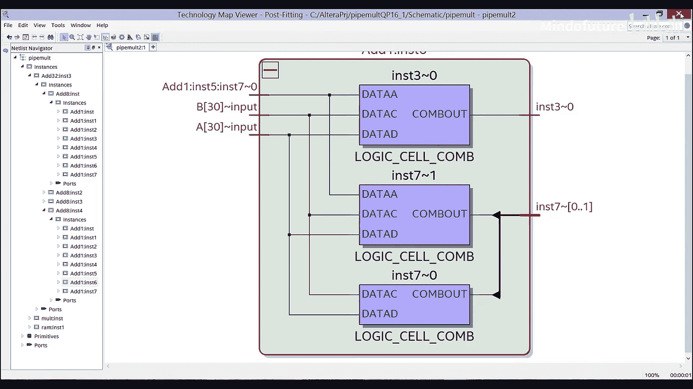

# 029：原理图绘制与层次化设计 🧩

在本节课中，我们将深入学习FPGA的原理图设计输入方法。具体来说，我们将为流水线乘法器设计添加一个加法器电路。你将学习如何为原理图添加输入/输出端口、如何使用基本符号库创建底层电路，以及如何在原理图设计中创建层次结构。

## 概述

上一节我们介绍了基本的原理图设计。本节中，我们将通过一个实践项目来巩固这些知识。我们将从构建一个1位全加器开始，逐步将其扩展为32位加法器，并将其集成到现有的流水线乘法器项目中。最后，我们将使用RTL查看器和编译工具来验证设计。

## 准备工作

在开始之前，请完成以下准备工作：
*   启动Quartus Prime软件。
*   打开在Module2中创建的`PipeMult`项目。
*   确保项目目录中包含本教程所需的附加文件。如果尚未存在，请下载并解压`pipemult_qp16_under1_timing2.zip`文件到`C:\Colen\Altera\PRJ`目录。

## 创建1位全加器电路

我们的目标是向`PipeMult`项目添加一个32位加法器。我们将从最基本的单元——1位全加器开始构建。

一个全加器可以由最少5个基本逻辑门构成，其逻辑表达式为：
*   **Sum = A ⊕ B ⊕ Cin**
*   **Cout = (A · B) + (Cin · (A ⊕ B))**

以下是创建该电路的步骤：

1.  **新建原理图文件**：在Quartus Prime中，点击 `File` -> `New`，选择 `Block Diagram/Schematic File`。
2.  **放置逻辑门**：
    *   在原理图编辑区右键，选择 `Insert` -> `Symbol`。
    *   在符号库中，展开 `Libraries` -> `primitives` -> `logic`。
    *   分别选择并放置以下门电路：两个 `XOR`（异或门）、两个 `AND2`（两输入与门）、一个 `OR2`（两输入或门）。
3.  **连接导线**：使用工具栏中的 `Orthogonal Node Tool`（正交节点工具）按照全加器逻辑图连接所有门电路。
4.  **保存设计**：将文件保存为 `add1.bdf`。

现在，我们需要为这个全加器模块添加输入输出端口（在FPGA设计中常称为“引脚”，但更准确地说，它们是设计实体的“端口”）。

5.  **添加输入端口**：
    *   使用工具栏的 `Pin Tool`，选择 `Input`。
    *   将输入引脚连接到顶部异或门的两个输入，分别命名为 `A[0]` 和 `B[0]`。
    *   添加第三个输入引脚连接到最右侧异或门的输入，命名为 `Cin[0]`。
6.  **添加输出端口**：
    *   使用 `Pin Tool`，选择 `Output`。
    *   将一个输出引脚连接到异或门的输出，命名为 `Sum[0]`。
    *   将另一个输出引脚连接到或门的输出，命名为 `Cout[0]`。
7.  **再次保存**：点击 `File` -> `Save`。

至此，你已完成了一个功能完整的1位全加器原理图。这个过程展示了Quartus Prime原理图工具不仅能绘制美观的逻辑图，更能生成可被综合、仿真和实现的“活”的电路设计。

## 构建层次化设计：从1位到32位加法器

直接绘制32位加法器非常繁琐。利用层次化设计，我们可以用已完成的模块快速构建更大规模的电路。

首先，我们需要将 `add1.bdf` 转换为一个可重复使用的符号（Symbol）。

1.  **创建符号**：打开 `add1.bdf`，点击 `File` -> `Create/Update` -> `Create Symbol Files for Current File`。这将生成 `add1.bsf` 符号文件。
2.  **构建8位加法器**：
    *   新建一个原理图文件（`add8.bdf`）。
    *   插入符号，在 `Project` 库中找到并选择刚创建的 `add1` 符号。
    *   放置8个 `add1` 符号，并将前一个全加器的 `Cout` 连接到下一个的 `Cin`，形成行波进位加法链（Ripple Carry Adder）。
    *   为整个8位模块添加总线形式的输入端口（`A[7..0]`, `B[7..0]`, `Cin`）和输出端口（`Sum[7..0]`, `Cout`）。
3.  **构建32位加法器**：
    *   同理，新建 `add32.bdf`。
    *   插入4个 `add8` 符号（需先完成 `add8.bsf` 的创建），并将它们级联起来。
    *   添加32位的输入/输出总线端口。

**注意**：为了节省时间，教程提供了已完成的 `add8.bdf` 和 `add32.bdf` 文件。你可以跳过手动绘制，直接将它们添加到项目中。

## 将加法器集成到主项目

现在，我们将这个32位加法器加入到之前的流水线乘法器电路中。

1.  **打开主原理图**：在项目导航器中，双击打开 `pipemult.bdf`。
2.  **添加加法器模块**：
    *   右键点击原理图空白处，选择 `Insert Symbol`。
    *   从 `Project` 库中选择 `add32` 符号，将其放置在原理图中。
3.  **连接端口**：
    *   为 `add32` 模块添加输入引脚：`Cin`, `A[31..0]`, `B[31..0]`。
    *   添加输出引脚：`Sum[31..0]`, `Cout`。
    *   使用工具栏的 `Orthogonal Bus Tool`（正交总线工具）将引脚与模块的端口连接起来。总线连接允许一次性连接多位信号。
4.  **保存并编译**：保存 `pipemult.bdf` 文件。在任务窗口中，双击 `Compile Design` 进行全编译。编译成功后，状态栏会显示绿色对勾。

## 使用查看器验证设计

编译完成后，我们可以使用查看工具来直观地验证设计的结构。

1.  **RTL查看器**：
    *   点击 `Tools` -> `Netlist Viewers` -> `RTL Viewer`。
    *   在RTL视图中，你可以看到设计的层次结构。点击 `add32` 模块前的加号，可以看到它由4个 `add8` 模块构成。继续展开，最终能看到你亲手绘制的 `add1` 门级电路。这与你设计的原理图完全一致。
2.  **技术映射查看器**：
    *   点击 `Tools` -> `Netlist Viewers` -> `Technology Map Viewer (Post-Fitting)`。
    *   这个视图展示了设计如何映射到FPGA芯片的实际物理资源（如查找表LUT、寄存器等）。你会发现，为了优化性能，综合工具可能将你的门级电路（如两个LUT3）转换成不同的结构（如两个LUT4）。这体现了RTL描述与实际硬件实现之间的差异，是工具为了提升性能（如减少进位链延迟）所做的优化。

## 总结

本节课中我们一起学习了FPGA原理图设计的进阶技巧。我们回顾了如何添加输入输出端口、使用基本符号库创建底层门电路。更重要的是，我们实践了**层次化设计**方法：从1位全加器开始，逐步构建出8位和32位加法器模块，并将它们集成到主系统中。这种方法极大地简化了复杂系统的设计和管理。最后，我们利用 **RTL查看器** 验证了逻辑设计的正确性，并通过**技术映射查看器**观察到综合工具为了适应目标FPGA架构而进行的优化。原理图输入作为一种直观的设计方法，非常适合用于探究底层电路结构和管理由基本模块构建的复杂系统。