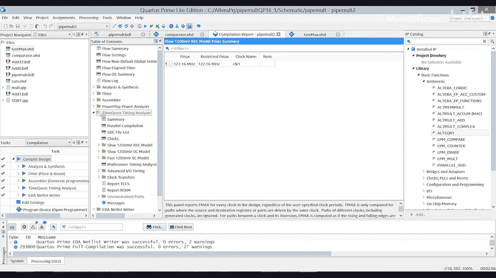

# 030：利用IP模块提升效率 🚀

在本节课程中，我们将学习如何利用IP模块来提升FPGA设计的效率。我们将对比之前使用原理图进行设计输入的方法，展示如何通过IP模块更快地构建设计。你将学会添加一个类似基础ALU的功能，具体包括添加和配置库IP模块、从HDL代码创建自己的IP模块，以及在原理图设计中连接和拆分总线。

以下是本视频将涵盖的内容：
*   完成我们的原型ALU，添加一个比较器、一个平方根函数以及一个由指令码驱动的多路复用器。
*   在RTL查看器中审查设计结果。
*   编译新设计。

## 准备工作 🛠️

在开始之前，你需要完成以下准备工作：
1.  启动Quartus Prime。
2.  打开我们在模块4视频2中最后使用的PipeMult项目。
3.  下载并添加额外的文件 `genmux.vhd` 和 `comparator.vhd`（如果它们尚未存在于项目中）。

为了确保所有人使用相同的设计文件，请在启动Quartus Prime之前，将提供的 `pipeMult_QP16_under1_M4V2.zip` 文件解压到 `C:\Altera\PRJ` 目录中。你的目录结构应与屏幕上显示的类似。

启动Quartus Prime并打开PipeMult项目。在项目导航器中双击 `PipeMult`。如果VHDL文件被打开，请通过文件菜单打开原理图文件 `pipeMult.bdf`。如果在项目导航器的文件选项卡中未列出 `pipeMult.bdf`，请通过点击项目菜单 -> 添加/移除文件到项目来添加它。点击文件名框右侧的浏览按钮，选择 `PipeMult.bdf`，点击打开，然后点击添加，最后点击设置对话框底部的确定。在项目导航器的文件选项卡中，右键点击 `PipeMult.bdf` 并选择“设置为顶层实体”。

返回项目导航器的层次结构选项卡，双击 `PipeMult`，原理图应该会出现。

## 添加平方根函数 ➕➖✖️➗

接下来，我们将为设计添加一个平方根函数。与乘法器类似，在原理图或HDL中创建平方根函数将是一项相当繁重的工作。然而，在这种情况下，我们可以使用Altera提供的IP在几分钟内创建一个。

使用“视图 -> 实用工具窗口 -> IP目录”打开IP目录。选择“基本功能” -> “算术”，然后双击 `Altera Square Root`。在IP变体文件名中添加 `sqrt`，选择VHDL，然后点击确定。`Altera Square Root` 对话框会出现。将总线输入改为32位，点击下一步，再次点击下一步。确保 `docmpP.bsf` 和 `_bb.v` 文件被勾选，点击完成。当询问是否将Quartus Prime IP文件添加到项目时，选择“是”。如果你查看项目导航器中的IP组件，应该能看到 `alt_sqrt` 文件已被添加。

在原理图窗口中向下滚动，在32位加法器下方为新区块创建空间。双击原理图的空白区域，符号编辑器会出现。你应该能看到项目和Intel FPGA库。点击项目目录，然后选择 `sqrt`。点击确定开始放置平方根模块。将其放置在 `add32` 模块下方居中位置，大约在其下方四个网格标记处。从平方根模块的 `radical` 输入端口开始，向左移动约两个网格，然后将其连接到 `add32` 的 `A` 输入。点击空白处完成连接。我们将在添加更多功能后连接输出。

## 添加比较器 ⚖️

现在，我们向设计添加一个比较器，这是ALU中常见的底层功能。从项目菜单中，点击“添加/移除文件到项目”。点击文件名框右侧的浏览按钮，导航到你放置 `comparator.vhd` 的位置（通常在项目目录中）。选择并打开此文件以将其添加到项目，然后点击确定。查看项目导航器的文件选项卡，`comparator.vhd` 现在应该已添加。双击 `comparator.vhd` 在编辑器中打开它。从文件菜单中，选择“创建/更新” -> “为当前文件创建符号文件”。你应该在消息窗口中看到符号文件已创建的消息。

返回原理图窗口，双击空白区域，符号编辑器会出现。点击项目目录，然后选择 `Binary_Comparator`。点击确定开始放置比较器模块，将其放置在平方根模块下方居中位置，大约在其下方四个网格标记处。从二进制比较器的 `A` 输入端口开始，向左移动约四个网格，然后将其连接到 `add32` 的 `A` 输入。对 `B` 输入重复此操作，再向左移动几个空格。点击空白处完成连接。其他连接将在我们添加一个用于保存指令的寄存器和一个用于选择输出的多路复用器后进行。

## 添加指令寄存器和多路复用器 🔄

要添加指令寄存器，双击原理图的空白区域，符号编辑器会出现。在左侧的库下，选择最底部的 `Intel FPGA` 目录，然后 `primitives`，向下滚动到 `storage`。选择 `DFF`。点击确定并将 `DFF` 放置在比较器下方居中位置。重复此过程，在比较器顶部水平位置右侧约10个网格标记处添加另一个 `DFF`，如图所示。

接下来，我们将添加多路复用器来选择输出。从项目菜单中，点击“添加/移除文件到项目”。设置对话框会出现。点击文件名框右侧的浏览按钮，导航到你放置 `genmux.vhd` 的位置（通常在项目目录中）。选择并打开此文件以将其添加到项目，然后点击确定。查看项目导航器的文件选项卡，`genmux.vhd` 现在应该已添加。双击 `genmux.vhd` 在编辑器中打开它。从文件菜单中，选择“创建/更新” -> “为当前文件创建符号文件”。你应该在消息窗口中看到符号文件已创建的消息。

返回原理图窗口，双击空白区域，符号编辑器会出现。在库窗口中向上滚动，点击项目目录，然后选择 `MUX4X`。点击确定开始放置多路复用器模块，将其放置在平方根模块右侧约20个标记处并与之水平对齐。

## 连接所有模块 🔌

你已经完成了此设计的模块添加，现在是时候将它们全部连接起来了。

向上滚动到圆形器件左侧的时钟线位置。将光标放在这条线的拐角处，向下画一条线，然后向右连接到IR触发器。继续这条线，连接到比较器右侧的条件码触发器。

在IR触发器的左侧，双击原理图的空白区域，符号编辑器会出现。在左侧的库下，选择最底部的 `Intel FPGA` 目录，然后 `primitives`，向下滚动到 `pin`。选择 `input`，点击确定，并将引脚放置在IR触发器D输入的左侧并与之水平对齐。双击该引脚，输入 `IR[1..0]` 作为引脚名称，点击确定。从引脚画一条线连接到IR触发器的D输入。

在此输入引脚正下方添加另一个引脚，双击并命名为 `Rst_n`。从该引脚画一条线连接到两个D触发器的 `clrn` 引脚。从RAM D触发器，向下画一条线，然后向右，再向下连接到复位引脚。

现在，将IR D触发器的输出连接到多路复用器的输入 `S`。这将允许编码的指令操作码输入来选择哪个操作（乘法、加法、比较或平方根）作为输出。右键点击这条线，确认它是一条总线，而不是节点线，如果需要，将其更改为总线。

将平方根模块的 `Q` 输出延伸到多路复用器的 `D` 输入。

现在，我们将使用比较器的输出创建一个条件码寄存器。将每个比较器输出线延伸几个网格标记。你可能需要放大视图来操作。右键点击 `greater` 线，选择属性，输入名称 `CC[0]`。右键点击 `equal` 输出延伸线，选择属性，输入名称 `CC[1]`。重复此操作再命名四个输出，依次命名为 `CC[2]` 到 `CC[5]`。在比较器的输出端，使用工具栏中的正交总线工具绘制一条短垂直总线。将每条CC线延伸连接到这段总线。从这段总线画一条线连接到右侧的D输入。

在CC触发器右侧约40个网格标记处添加一个输出引脚：双击空白区域，选择最底部的 `Intel FPGA` 目录，然后 `pin`，再 `output`，点击确定。将CC触发器的输出连接到此引脚。右键点击该引脚，选择属性，输入名称 `CC_out[5..0]`。

在多路复用器左侧添加另一个输出引脚，并将多路复用器的输出连接到它。右键点击该引脚，选择属性，输入名称 `ALU_out[15..0]`。

我们快完成了。将 `add32` 模块的 `sum` 和 `cout` 输出引脚进一步向右拉。对于多路复用器的 `C` 输入，画一条线连接到 `add32` 模块的 `B` 输入。右键点击这条线，输入名称 `B[31..16]`。从多路复用器的 `B` 输入，画一条线连接到 `add32` 模块的 `sum` 输出。右键点击这条线，输入名称 `sum[31..16]`。

最后，观察到乘法器的输出引脚使用了不同的位排序约定。为了使之一致，点击该引脚并按删除键以删除乘法器上的输出引脚。现在双击空白区域，选择输出引脚，并将其放置在乘法器触发器的右侧。右键点击该引脚，输入名称 `Q[15..0]`。将引脚连接到触发器。从多路复用器的 `A` 输入，连接到输出引脚之前的乘法器输出线。

恭喜，你已经完成了此设计的输入。从Quartus工具栏的视图菜单中，选择“适合窗口”来查看并欣赏你的完整作品。按 `Ctrl+S` 保存 `pipeMult.bdf`。

## 编译与审查 ✅

在任务窗口中，双击“编译设计”。如果你有任何连接错误，它们将在编译过程中被识别，你需要编辑原理图来修复它们。

一旦你的设计编译完成，你可能会注意到编译报告中的时序条目是红色的。这是因为你添加了许多引脚，并且设计中存在未约束的路径。我们将在未来的视频中解决这个问题。

编译后，你的设计应该看起来像这样，一个完整的电路。

## 总结 📝

使用IP模块可以通过简化设计输入来极大地提高生产力。Altera为你的设计提供了大量免费可用的IP模块，你也可以从HDL代码创建自己的模块。

在本节课中，我们一起学习了：
*   如何添加和配置库IP模块。
*   如何从HDL代码创建自己的IP模块。
*   如何在原理图设计中连接和拆分总线。