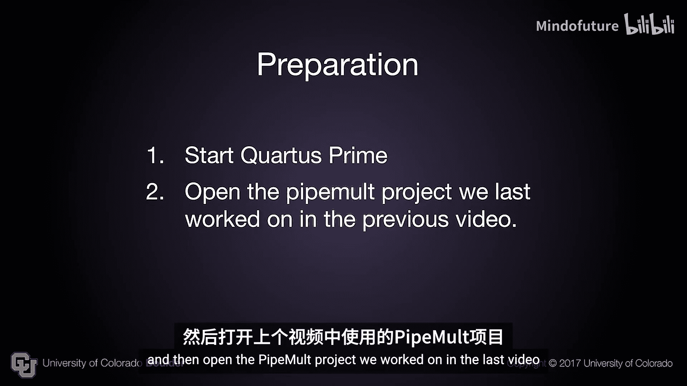
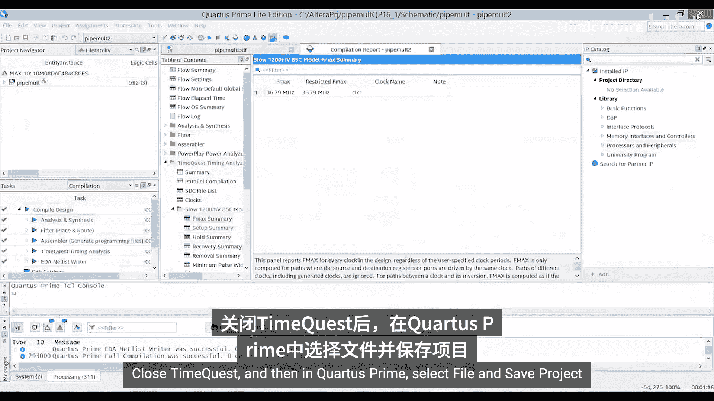

# 031：通过流水线优化时序 🚀

在本节课中，我们将学习如何通过流水线技术来优化FPGA设计的时序性能。我们将使用时序约束来约束设计，分析结果，并应用流水线以获得更好的性能。

## 概述 📋

上一节我们介绍了时序分析的基本概念。本节中，我们来看看当设计存在时序问题时，如何通过流水线技术来改善它。我们将学习流水线原理，以及如何利用流水线和IP核来提升设计速度。

## 流水线原理简介 ⚙️

如果存在时序问题，我们可以通过流水线技术来改善。下图有助于描述长逻辑路径的问题，以及如何通过流水线来缓解。

在上方电路中，时钟的最大速度受到逻辑传播长延迟的限制。例如，如果延迟为100纳秒，那么在不导致寄存器B建立时间违规的情况下，最快时钟频率为10MHz。

我们可以通过插入触发器来将长逻辑延迟分割成两个较小的延迟，从而提高最大时钟频率。在我们的例子中，如果能够均匀分割，每个延迟将为50纳秒，那么最大时钟速度现在为20MHz。

**公式**： 一般来说，如果我们插入 `n` 个触发器，那么速度将提升 `n` 倍。

缺点是，数据从首次出现在输入到到达输出所需的时间现在将增加 `n` 个时钟周期，这带来了我们可能不希望的额外延迟。然而，这种延迟并不像乍看起来那么糟糕，因为时钟可以驱动得更快，并且一旦数据进入流水线的左端，在每个时钟周期，新数据都会在流水线中推进，使得输出端像以前一样每个时钟周期都产生新数据。

在实践中，速度与延迟之间的权衡通常是值得的，尽管我们通常无法均匀分割逻辑延迟，或者如果逻辑功能改变导致输出无效，可能根本无法进行分割。流水线技术只能在某些情况下应用，但在适用时非常有用。

## 准备工作 🛠️

以下是您需要先完成的一些准备工作。

首先启动Quartus Prime。然后打开我们在上一个视频中使用的 `PipeMt` 项目。

在启动Quartus Prime之前，为了确保每个人使用相同的设计文件，请将提供给您的 `pipepeMt_QP16_under1_M4v3.zip` 文件解压到 `C:\AlTra_PRJ` 目录。

启动Quartus Prime并打开 `PipeM` 项目。在项目导航器中双击 `PipeM`，原理图应该出现。

## 添加时序约束并分析 🔍

接下来，我们将完成对原型ALU电路的时序分析。

通过点击顶部菜单的 `Processing -> Compilation Report` 打开编译报告。注意，TimeQuest时序分析显示为红色。如果我们展开此项，会看到问题是“未约束路径”。在设计升级时添加了许多输入和输出，我们将使用TimeQuest为所有新路径添加约束。

打开TimeQuest，点击 `Tools -> TimeQuest Timing Analyzer`。在TimeQuest的任务窗口中，双击 `Create Timing Netlist`。完成后，向下滚动到诊断部分，双击 `Report Unconstrained Paths`。

这里我们看到有许多输入和输出路径未被约束。

添加输入延迟：点击顶部菜单 `Constraints -> Set Input Delay`。在 `Set Input Delay` 对话框中，为时钟选择 `clock1`，为输入延迟选择 `Maximum`。输入延迟值 `3` 纳秒。点击目标框右侧的浏览按钮。在 `Name Finder` 对话框中，点击 `List`。向下滚动到 `a0`，点击它，然后向下滚动到 `b31`，按住 `Shift` 并点击。点击右箭头添加选定的名称。继续向下滚动，然后按住 `Ctrl` 并点击 `C_in`、`IR0` 和 `IR1`，再次点击右箭头添加这些名称。向下滚动，在 `N` 下选择 `reset`，然后将其移动到选定窗口。点击 `OK`，然后点击 `Run`。

在Tcl控制台中，在刚刚输入的命令行后点击，按上箭头键复制该命令。按 `Home` 键将光标移动到行首，然后将 `max` 改为 `min`，将 `3` 改为 `2`，然后按回车。现在最大和最小输入延迟都已添加。

接下来，添加输出延迟。从 `Constraints` 菜单中，选择 `Set Output Delay`。在 `Set Output Delay` 对话框中，选择 `clock1` 和 `Maximum`。输入延迟值 `2`，然后点击目标框右侧的浏览按钮。在 `Name Finder` 对话框中，点击 `List`。点击 `ALU_out0`，向下滚动到 `ALU_out15`，然后按住 `Shift` 并点击它。点击右箭头将这些名称移动到选定的名称框。进一步向下滚动到 `CC_out` 总线以及 `see_out` 并选择这些信号。向下滚动并选择并移动 `sum` 信号。点击 `OK`，然后点击 `Run`。

在Tcl控制台中，在刚刚输入的命令行后点击，按上箭头键复制该命令。按 `Home` 键将光标移动到行首，然后将 `max` 改为 `min`，将 `2` 改为 `1`，然后按回车。现在最大和最小输出延迟都已添加。

在任务窗口中，双击 `Report SDC` 以验证约束的输入。在报告窗口中，点击 `SDC Assignments`，然后点击 `set_input_delay` 查看这些约束，同样查看 `set_output_delay`。

## 识别关键路径 🕵️

现在让我们戴上“侦探帽”做一些调查工作。向下滚动到测试窗口底部，点击 `Report All Summaries`。您应该看到时钟约束仍设置为125MHz。如果在报告窗口中向上滚动，请注意建立时间摘要现在显示为红色。双击此项，最坏情况的裕量出现在视图窗口中。

哇！😮 这是什么？大约负66.39纳秒的裕量。怎么会变得这么糟糕？Fmax大约是14MHz，而我们想要的是125MHz。对于你们中的一些人来说，这可能感觉像是一个“考验”时刻。然而，您可以将其视为一个机会，通过理解并改进它来证明您的“真本事”。

输入延迟假设一个外部设备有一个由您的时钟驱动的输出触发器，将数据传送到FPGA的输入。输出延迟假设您的输出驱动另一个外部电路的输入触发器，该电路也参考同一时钟。本质上，时序分析器假设有一个时钟延迟将数据从FPGA的输入移动到输出。

在这个设计中，有两个具有较大组合逻辑延迟的电路：平方根IP块和Add 32电路。如果您能确定最长路径在哪里，您或许可以改进它。滚动到测试窗口底部，双击 `Report Top Failing Paths`。从A或B输入总线到ALU输出的路径将被列出，其负裕量大于60纳秒。您现在对问题的根源有了一些了解。

接下来，在任务窗口中向上滚动，在自定义报告下，双击 `Report Timing`。在打开的对话框中，在 `From Clock` 框中选择 `C1`，向下滚动并点击 `Report Timing`。您应该看到数据需求路径是6纳秒，但数据到达路径是72纳秒，相差负66纳秒。如果您向下滚动数据到达路径，您将看到该路径经过 `alt_square_root` 块。

啊哈！最坏的延迟是通过平方根函数。我们能做些什么来改进这一点呢？碰巧的是，平方根IP块可以进行流水线处理。

## 应用流水线优化 🚄

为了保存到目前为止在TimeQuest中的工作，选择 `Constraints` 菜单，然后选择 `Write SDC File`。删除对话框中出现的文件名中的 `.out`，然后点击 `OK`。点击 `File -> Close` 关闭TimeQuest。如果询问是否写入另一个SDC文件，请点击 `No`。

返回Quartus Prime并查看 `pipepemt.bdf`。双击平方根块。当 `alt_square_root` 的对话框出现时，对问题“您想对函数进行流水线处理吗？”回答“是”，然后为延迟的时钟周期数输入 `8`。这意味着您有效地在平方根逻辑路径中插入了8个触发器。点击 `Next` 两次，验证 `square_root.bsf` 框被选中，然后点击 `Finish`。点击 `OK` 覆盖。点击 `Yes` 更新平方根块，并为所选块点击 `OK`。

平方根块现在有一个时钟输入。将其连接到左侧的时钟线。从顶部菜单中，选择 `File -> Save` 保存 `pipepemt.bdf`。现在编译设计。

编译后，您将看到TimeQuest时序分析仍然是红色。但是，如果您展开此项并查看 `Slow 85 degrees C Model`，您将看到裕量已改善到负19纳秒，比以前好了三倍，Fmax现在约为37MHz。改善很大，但仍未达到预期。

## 进一步分析与总结 📊

要理解原因，请再次启动TimeQuest。双击 `Create Timing Netlist`。向下滚动并双击 `Report All Summaries`。查看建立时间摘要，裕量现在约为负19纳秒。双击 `Report Top Failing Paths`。现在您应该看到像以前一样来自A和B输入的路径，并且可能还将 `C_in` 作为源输入，输出是 `sum` 或 `ALU_out`。这表明限制性的关键路径现在在 `add_32` 块内，而不是平方根块。

向上滚动，在自定义报告下，双击 `Report Timing`。选择 `clock1`，然后向下滚动并点击 `Report Timing`。现在最坏情况的路径经过实例 `add_32` 块，到达 `sum` 或 `ALU` 输出。

我们能否通过流水线加法器来改进这一点？答案是肯定的，但这有点超出了我们目前想要做的范围。对于平方根函数来说很容易，因为流水线是IP块配置内置的——这是使用IP块的另一个原因。对加法器做同样的事情将需要大量的电路重新设计。

然而，我们可以进行其他改进。您可以在顶层通过寄存 `ALU_out` 和 `sum` 输出来流水线化设计路径，就像流水线乘法器有寄存器输出一样。这将划分输出缓冲器的延迟。同样，您可以寄存 `A`、`B` 和 `C_in` 输入，这将分离输入缓冲器的延迟。可以在Mux块的所有输入处放置寄存器。

但查看之前的数据到达路径，通过Mux的延迟是亚纳秒级的，所以这不会有太大帮助。您还可以在TimeQuest中编辑时钟约束，这可能会使Fmax稍微快一些。在寄存器更改之后，50MHz可能是一个不错的目标。如果不流水线加法器，这可能是我们在这个FPGA中能达到的最快速度。

我们今天已经做了足够多的调查工作。与其现在添加输入和输出寄存器，我们将把这留作学生练习。关闭TimeQuest，然后在Quartus Prime中选择 `File -> Save Project`。

## 总结 🎯

本节课中我们一起学习了如何通过流水线技术优化FPGA设计的时序。

总结本视频，输入和输出之间较大的组合延迟会显著降低设计的最大频率。在某些情况下，可以通过插入触发器将组合延迟分割成若干部分，这被称为重定时或流水线，具体取决于如何实现。IP块在某些情况下可以配置为使用流水线，这将增加延迟但提高设计的整体速度。

在本视频中，我们学习了：
*   流水线原理如何应用于改善FPGA设计的时序。
*   如何使用流水线和IP块来改善时序。
*   如何分析时序分析器结果，以识别可能从流水线中受益以改善时序的关键路径。