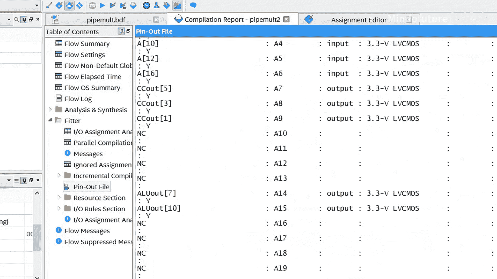

# 033：精准引脚分配

在本节课程中，我们将学习如何将FPGA设计中的内部信号分配到外部引脚上。引脚分配决定了你的设计如何与外部世界交互，因此正确操作至关重要。我们将学习使用引脚规划器和分配编辑器进行引脚分配，如何满足I/O标准并控制I/O属性，以及如何使用I/O分配分析器检查引脚分配。

以下是本视频将涵盖的内容：
*   使用引脚规划器为设计分配引脚。
*   使用分配编辑器为设计分配引脚。
*   使用I/O分配分析器检查引脚分配。

## 引脚分配方法概述 📋

在Altera FPGA中，有五种方法可以进行引脚分配：
1.  使用Quartus GUI工具，即引脚规划器或分配编辑器。
2.  从SDC文件或Excel电子表格文件导入。
3.  在HDL文件（如Verilog或VHDL）中编写指令。
4.  使用Tcl脚本和Tcl命令自动化操作。
5.  从PCB布局工具导入。

本视频将展示第一种方法，即如何使用引脚规划器和分配编辑器。

## 准备工作与项目打开 🛠️

在启动Quartus Prime之前，请将提供的 `pipeline_QP16_under_one_M4V4.zip` 文件解压到 `C:\Altera_prj` 目录下，以确保大家使用相同的设计文件。

启动Quartus Prime并打开 `Pipeline` 项目。在项目导航器中双击 `Pipeline.bdf`，原理图应会显示。在进行分配之前，必须执行编译的第一步：分析与综合。如果尚未完成，请现在执行。

在此之后可以随时进行分配，但任何更改都需要重新运行综合之后的流程步骤，以使设计更新反映这些更改。

## 使用引脚规划器进行分配 🗺️

引脚规划器是一个用于进行引脚分配和设置I/O约束的交互式图形工具。它使得为设计中所有I/O进行分配变得容易。可以从“Assignments”菜单、工具栏或任务窗口访问它。

点击“Assignments”菜单并选择“Pin Planner”。规划器会在中心窗口显示器件引脚布局图，底部窗口列出需要分配引脚的信号或节点（称为“All Pins”列表），右侧窗口是引脚图例，左下角是任务窗口，左上角窗口是信号组列表。如果缺少任何窗口，可以从“View”菜单添加。

有多种方法可以进行引脚分配：
*   可以从信号列表中将节点名称拖放到封装视图中的某个引脚上。
*   也可以双击“Location”单元格，为信号分配一个位置（引脚或I/O Bank）。

但是，必须确保正确的信号连接到正确的引脚，尤其是时钟信号。请查阅评估板用户手册或用户指南中的器件引脚排列，或查看所用电路板的原理图。正确完成引脚分配非常重要，否则在电路板上电时可能会损坏FPGA，特别是如果将输入信号连接到输出引脚。全局信号（通常是时钟和复位）也必须正确连接。还必须确保所分配引脚的I/O电压和标准正确。

### 分配时钟与复位信号 ⏰

假设你使用的是BeMicro MAX 10板。通过查看BeMicro MAX 10的原理图，可以确定哪些引脚和信号应该连接在一起。在原理图第2页，你会发现一个50 MHz时钟连接到引脚N14，一个24 MHz时钟连接到引脚N15。

在“All Pins”列表中，向下滚动到 `clock1` 信号，点击它并将其拖到部件布局图中的N14引脚上。符号会先变成蓝色，然后在点击空白处后变成棕色，表示该节点已被分配。注意引脚符号是一个上升沿，表示该引脚连接到内部时钟网络。

选择“View”菜单并点击“Zoom In”几次，以查看每个引脚的不同属性。每个引脚的形状、颜色和文本都提供了该引脚属性的信息。例如，独特的颜色有助于识别每个I/O Bank。三角形代表电源和地引脚，圆形代表特殊功能引脚，正方形是时钟引脚，五边形是JTAG引脚，六边形是通用I/O引脚。这些及更多信息显示在引脚图例窗口中。

如果双击N15，你将看到引脚属性窗口，它允许你为这个引脚分配一个节点（与将节点拖到引脚上相反）。我们没有更多时钟了，所以关闭引脚属性窗口。

你可以通过转到任务窗口并点击“Highlight Pins”，然后选择“Clock Pins”，再选择“Clock”，来查看此器件上所有可用的时钟引脚。由此，你可以看到有8个专用时钟引脚。在报告窗口中取消选中“Clock Pins”框以移除高亮显示。

回到“All Pins”窗口，`clock1` 节点现在已用I/O Bank 6的颜色着色，并且位置也已显示。你还需要设置I/O标准和驱动强度。

在“I/O Standard”列中，双击 `clock1` 条目，会出现一个下拉菜单。选择 `3.3-V LVCMOS`，因为原理图中使用的就是这个电压。双击 `clock1` 的“Current Strength”条目，从菜单中选择 `2 mA`。

另一个全局信号是 `reset`。引脚D9连接到一个全局复位网络。在“All Pins”窗口中向下滚动找到 `reset`（在“N”下），并将其拖放到芯片布局图的D9引脚上。将I/O标准更改为 `3.3-V LVCMOS`。

### 批量分配I/O标准与总线引脚 🚌

与其逐个更改I/O标准分配，不如在“Groups”窗口中点击I/O标准，一次性为整个总线设置标准。在“Groups”窗口中，滚动到“I/O Standard”列，选择 `3.3-V LVCMOS`。

引脚规划器会在你操作时保存更改。你不能认为退出时更改未保存，因为它们在你操作时就已经保存了。现在，通过将所有I/O总线分配给 `3.3-V LVCMOS` 来重复分配I/O标准。

要为总线分配引脚，请从“Groups”窗口中选择总线，并将其拖放到芯片布局图外部的I/O Bank框上。如果看不到I/O Bank，请在空白处右键单击并选择“Show I/O Banks”。

将 `A` 总线分配到一个I/O Bank：将其拖到I/O Bank 8，释放，然后在空白处单击以完成此总线的放置。这允许适配器在Bank内分配各个引脚。如果将鼠标悬停在Bank框上，可以看到I/O使用情况。在“All Pins”窗口中，位置被列为 `IOBANK_8`。

继续为剩余的总线分配引脚：
*   将 `ALU_out` 总线拖到Bank 7。
*   将 `B` 总线拖到Bank 6。
*   将 `C_out` 拖到Bank 7。
*   将 `Data_A` 和 `Data_B` 拖到Bank 5。
*   将 `IR` 拖到Bank 6。
*   将 `Q` 拖到Bank 4。
*   将 `Sum` 拖到Bank 3。

要查看所有这些工作的结果，请从“View”菜单中选择“IO Banks”。你还可以通过右键单击空白处并选择“Rotate”或“Top/Bottom View”来更改器件的视图，例如旋转芯片或从顶部/底部查看。

## 使用分配编辑器进行分配 📝

我们也可以使用分配编辑器进行引脚分配。要启动分配编辑器，请返回Quartus，从顶层菜单点击“Assignments”，然后选择“Assignment Editor”。分配编辑器应出现在中心窗口。

分配编辑器看起来像一个电子表格。每一行代表一个分配。可以在分配编辑器中进行许多类似电子表格的操作，如复制和粘贴等。条目可以直接输入或从下拉菜单中选择。

你可以输入信号名称，或使用节点查找器查找信号。滚动到底部并双击“To”列。点击双筒望远镜图标打开节点查找器。你可以使用通配符：问号 `?` 代表单个字符，星号 `*` 代表多个字符。在“Named”框中输入 `RD*` 并按回车。在“Matching Nodes”中，`RD_address` 应该出现，点击它，然后点击右箭头将其移动到“Nodes Found”框中，点击“OK”。

双击“Assignment Name”并向下滚动选择 `Location`。双击“Value”，为“Element”选择 `IOBANK`，然后为“Location”选择 `BANK 5`。点击“OK”。

你也可以从其他窗口交叉探查，以在分配编辑器中获取特定信号或实体。点击 `Pipeline.bdf` 原理图选项卡。右键单击 `WR_address` 信号端口，然后选择“Locate Node”，再选择“Locate Node in Assignment Editor”。`WR_address` 信号会单独出现在分配编辑器中，因为它被自动过滤出来了。

点击“To”列顶部的 `WR_address`。按 `Ctrl+C`，然后点击底部“To”列中显示“new”的行。在此旁边的“Assignment Name”中，输入 `Location`。在此旁边的“Value”列中，双击并为“Element”选择 `IOBANK`，为“Location”选择 `IOBANK_5`。

清除“Filter on node name”复选框以查看分配编辑器中的所有信号。在下一行的“To”列中输入 `WREN`。在此旁边的“Assignment Name”中，输入 `Location`。在此旁边的“Value”列中，双击并为“Element”选择 `IOBANK`，为“Location”选择 `IOBANK_5`。

我们还有两个引脚要分配：`C_in` 和 `C_out`。在接下来两行的“To”列中，输入 `C_in` 和 `C_out`。向上滚动到 `Sum` 的 `Location` 条目，点击并选择 `Location` 和 `IOBANK_3` 条目，然后按 `Ctrl+C`。选择 `C_in` 右侧的两个单元格，按 `Ctrl+V` 粘贴 `Location` 为 `IOBANK_3`。对 `C_out` 重复此操作。

在“File”菜单中，选择“Save”以保存在分配编辑器中所做的分配。分配可以直接保存，或者在执行编译时会自动保存到 `.qsf` 文件中。你也可以直接在Quartus设置文件（`.qsf`）中输入引脚分配，或者创建一个包含所有引脚分配的单独Tcl文件，然后在 `.qsf` 文件中引用此文件。

你可以将引脚分配导出到Excel CSV文件，以供当前或其他设计以后使用。为此，从“File”菜单点击“Export”，并保存为 `.csv` 文件。如果进行了更改，你可以在Quartus中更新约束。

## 检查与验证引脚分配 ✅

现在I/O分配已完成，你可以进行I/O分析，以检查所有引脚分配相对于彼此和器件是否合法。你可以在Quartus中，通过点击“Analysis & Synthesis”下的任务窗口中的“I/O Assignment Analysis”来完成此操作，或者从引脚规划器的“Processing”菜单中执行。

分析完成后，你可能会看到一个关于I/O Bank 8中引脚过多的错误消息。让我们回到引脚规划器修复这个问题。在引脚规划器中，通过点击下拉菜单，将 `A[31]` 的位置更改为 `IOBANK_6`。

现在你必须通过将 `A[30]` 更改为 `IOBANK_8`，然后按 `Ctrl+C`，选择其余的 `A` 信号并按 `Ctrl+V` 粘贴 `IOBANK_8` 给它们，来重置总线 `A` 的其余部分为 `IOBANK_8`。

完成后，从引脚规划器的“Processing”菜单中，选择“Start I/O Assignment Analysis”。成功！你现在已经为FPGA完成了完整的引脚分配。

引脚分配也记录在 `.pin` 文件中。通过查看Quartus中编译报告下的“Fitter” -> “Pin-Out File”，你可以看到 `.pin` 文件，其中列出了每个引脚的分配。

## 课程总结 📚

总结本视频，在Quartus Prime中，可以轻松地使用引脚规划器图形工具或分配编辑器电子表格进行引脚分配。将时钟和复位等全局信号分配到全局网络引脚非常重要。I/O分配分析器可以检查引脚分配，确保其完整且正确。

在本节课中，我们一起学习了：
*   如何使用引脚规划器和分配编辑器进行引脚分配。
*   如何使用分配编辑器满足I/O标准并控制I/O属性。
*   如何使用I/O分配分析器检查引脚分配。

