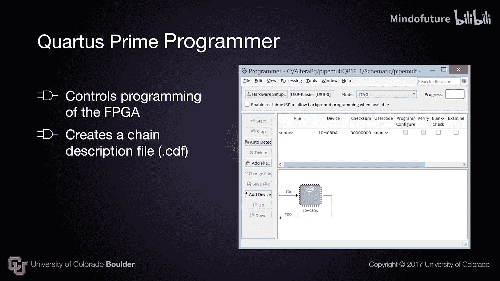
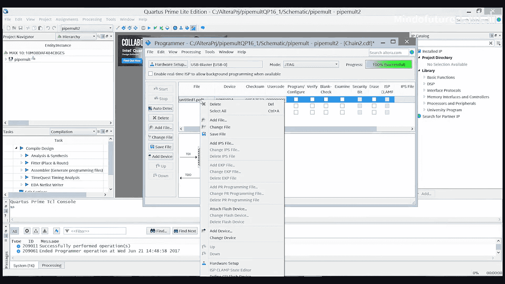

# 034：FPGA编程配置 🚀

在本节课中，我们将学习如何对FPGA进行编程和配置，使其能够在硬件中运行。你将了解FPGA的各种配置方案、所需的硬件设计与软件、不同场景下使用的编程文件类型，以及如何使用Quartus Prime Programmer工具来检查和编程链式连接的FPGA与PLD设备。

---

## 配置与编程的基本概念

上一节我们介绍了FPGA的逻辑设计流程。完成设计后，自然希望将其在硬件中实现。为此，你需要对FPGA进行**编程**或**配置**。

*   **编程**通常指将定义设备行为的文件内容存入存储器的过程，无论设备是微控制器还是可编程逻辑器件。
*   **配置**则是将该存储器内容加载到设备中，以建立其特定行为的过程。

---

## FPGA的配置模式

为了适应不同的配置场景和需求，FPGA支持多种配置模式。对于Altera FPGA，配置存储器通常通过JTAG编程电缆直接加载，或通过板载的、连接到FPGA的存储器加载。

以下是Cyclone V器件支持的几种配置模式示例：

| 模式 | 描述 |
| :--- | :--- |
| **JTAG** | 必须使用编程电缆。 |
| **主动串行 (AS)** | FPGA从板载串行闪存加载配置镜像。 |
| **被动串行 (PS)** | 外部主机（如微处理器）通过串行接口配置FPGA。 |
| **快速被动并行 (FPP)** | 外部主机通过并行接口高速配置FPGA。 |
| **配置协议 (CVP)** | 通过PCIe等协议进行配置。 |

JTAG模式必须使用电缆。其他模式通常从板载存储器、CPLD或微处理器加载FPGA。显然，并行模式比串行模式速度更快，但需要更多的板载资源。某些模式还支持特殊功能，如部分重配置和远程系统更新。

---

## 配置模式的硬件设计

每种配置模式的硬件设计各不相同。

### JTAG配置接口

这里展示的部分原理图描述了JTAG配置接口的典型设计，这在评估板上很常见。JTAG配置可以与其他配置模式结合使用，但它始终具有最高优先级。

在JTAG配置中，JTAG命令和数据被直接发送到FPGA，以编程其内部配置存储器。传输完成后，FPGA即被配置并准备运行。

### 主动串行 (AS) 配置

在主动串行模式中，串行闪存器件存储配置镜像，FPGA在上电时将其加载到配置存储器中。

其原理图通常与JTAG电缆连接器一同展示，后者在此用于对存储器器件进行编程。通常，该连接器在生产板上可能不焊接，仅用于开发。生产用的闪存通常已预编程，无需通过电缆编程。有些板卡设计会采用单个大容量闪存存储多个镜像，以支持链式连接的多个FPGA。

### 快速被动并行 (FPP) 配置

另一种常见配置方案是快速被动并行模式，如图所示。连接到存储器器件的CPLD或微处理器在上电时主动将数据传输给FPGA。这允许对配置过程进行更多控制，且速度更快。

---

## MAX 10 FPGA的独特配置

MAX 10是Altera的一款独特产品，它拥有用于配置的内部闪存，因此有两种编程方式：

1.  使用JTAG，像其他FPGA一样，通过`.sof`文件直接编程SRAM配置单元。
2.  同样使用JTAG，但编程的是配置闪存，该闪存内容会在上电时传输到SRAM配置单元。

JTAG编程需要编程电缆，如USB-Blaster 2或Ethernet-Blaster 2。

---

## 编程文件类型

除了为特定配置方案正确设计硬件外，还必须拥有用于编程器件的编程文件。

编程文件有几种类型：

*   **`.sof` (SRAM Object File)**：用于通过Quartus Prime软件和下载电缆直接配置FPGA。这是最常见的编程文件类型，在开发阶段通过JTAG电缆直接下载设计进行首次测试时使用。
*   **`.pof` (Programmer Object File)**：用于编程CPLD、闪存FPGA和配置闪存。
*   **`.jam` 或 `.jbc` (JAM Byte-Code)**：一种由处理器和测试设备通过JTAG编程器件时使用的ASCII文件。
*   **`.jic` (JTAG Indirect Configuration File)**：用于通过FPGA的专用配置连接来编程EPCS系列Altera串行配置器件，因为配置器件本身没有JTAG接口。

---

## 使用Quartus Prime Programmer

Quartus Prime Programmer是一个控制FPGA编程的软件工具。当你从工具栏的“Tools”菜单打开Programmer时，它会创建一个链描述文件 (`.cdf`)，用于存储设备编程链信息，因为一个编程链中可以有多个FPGA。

编程窗口中会显示该链的图示。让我们看一个例子。

### 操作步骤示例

1.  **打开Programmer**：打开Quartus Prime，选择 `Tools` -> `Programmer`。编程器窗口将打开。
2.  **连接硬件**：此时，应连接好待编程的板卡。演示中我们使用MAX 10板。注意，编程前板载LED以特定模式闪烁。
3.  **硬件设置**：点击左上角的 `Hardware Setup` 按钮，选择要使用的硬件（如USB-Blaster电缆），然后点击 `Close`。编程设备必须已安装驱动并能被正确检测到才会出现在列表中。
4.  **选择编程模式**：接下来选择编程模式，最常见的是JTAG。JTAG链可以包含非Altera和Altera设备。
5.  **使用工具栏命令**：硬件设置完成后，编程器中的工具栏提供了控制设备编程所需的所有命令。例如，可以安排链上设备的编程顺序。其他常见操作包括：
    *   `Auto-Detect`：扫描链并报告发现的设备。
    *   `Change File`：为选定的目标设备选择新的编程文件。
6.  **自动检测设备**：点击 `Auto-Detect`，编程器将显示设备链。
7.  **其他操作**：你还可以在编程后验证设备、进行空白检查、擦除设备或设置安全位（如果可用）。
8.  **选择编程文件**：点击 `Add File`，选择文件（例如 `led_blinker.pof`），然后点击文件名。可能需要删除列表中已有的其他文件。
9.  **开始编程**：当所有设备定义完毕且选项设置正确后，点击左上角的 `Start`。进度条显示编程状态，信息窗口提供详细状态和可能出现的错误信息。
10. **完成与观察**：当进度条达到100%时，编程完成。观察板卡，在编程期间LED停止闪烁，编程完成后重新开始闪烁。
11. **上传编程文件**：你还可以通过选择 `Examine` 来上传编程文件。在上传过程中，注意LED会停止闪烁，因为它处于上传状态。上传后，可以保存此文件并用于编程其他板卡。

---

## 总结

本节课中，我们一起学习了FPGA如何通过各种配置方案进行配置，从JTAG到主动串行，再到快速被动并行。每种方案都有其独特的硬件设计和所需的软件。我们还了解了在不同配置情况下应使用哪种编程文件类型，以及如何使用Quartus Prime Programmer工具来检查和编程链式连接的FPGA与PLD设备。