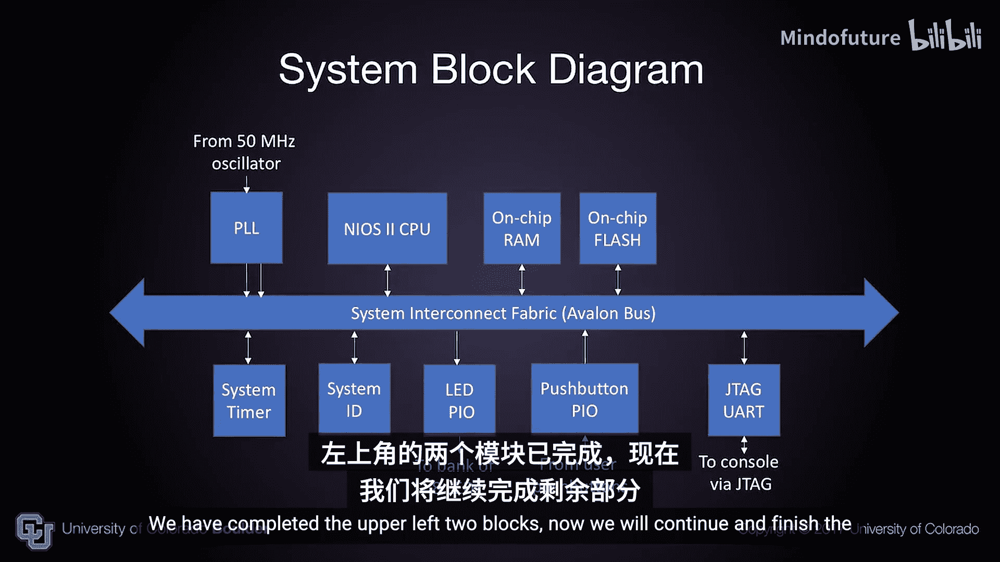
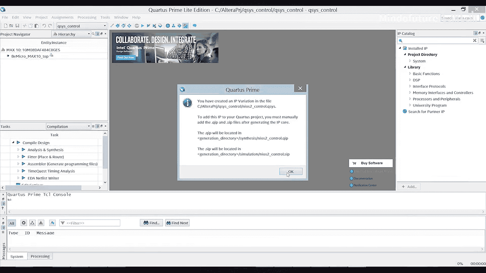
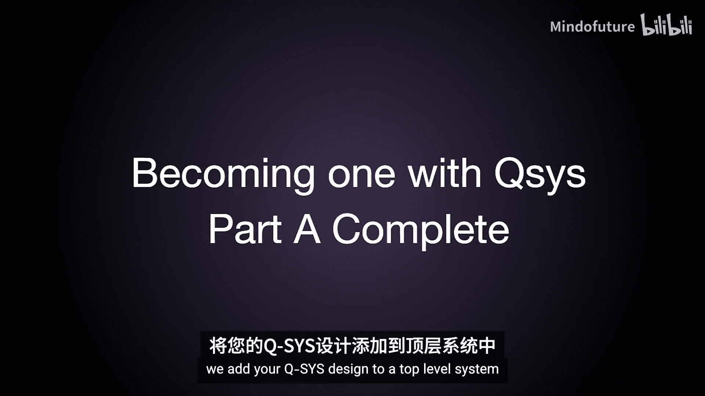

# 036：Qsys 系统设计精修（第二部分）🔧

在本节课中，我们将继续完成一个基于 Nios II 软核处理器的 Qsys 系统设计。上一节我们介绍了 Qsys 设计工具并创建了处理器。本节中，我们将为嵌入式系统添加内存和外设，并对最终设计进行分析。你将学习如何为 Nios II Qsys 设计添加内存与外设、总线桥的作用及其在 Qsys 中的实现方法，以及如何将 Qsys 设计集成到顶层模块中进行编译。

以下是本视频将要涵盖的内容：
*   我们将通过添加内存和几个简单外设（包括 UART 和定时器）来完成 Qsys 项目。
*   我们将通过创建原理图符号，在顶层实例化 Qsys 设计。
*   我们将编译 Qsys 设计，并使用 RTL 查看器分析设计。

下图描绘了典型的 Nios II 系统设计流程。我们正处于 Qsys 中“定义系统”阶段的中间，我们将完成此阶段，然后进入 FPGA 设计阶段。通过使用项目模板，引脚分配已为我们处理妥当，时序约束则由包含的 SDC 文件提供。

这是我们正在构建系统的框图。我们已经完成了左上角的两个模块，现在我们将继续完成其余部分。

## 启动 Qsys 并添加片上 RAM

启动 Quartus，打开 `Cusis_under_control` 项目，它应该会列在最近的项目中。通过选择 `Tools` 菜单，然后选择 `Qsys` 来启动 Qsys。选择 `Nios_II_under_control.qsys` 并点击 `Open`。

我们之前在 Qsys 中已经完成了四个步骤，现在进行第五步：添加片上 RAM。Altera FPGA 提供了内部片上存储器块，可用于构建内部 RAM 或 ROM 内存块。这为处理器提供了访问极低延迟、高速内存的途径，用于存储代码或变量。

在左侧的 IP 库中，展开 `Basic Functions`，然后展开 `On-Chip Memory`，双击 `On-Chip Memory (RAM or ROM)`。在出现的对话框中，取消勾选 `Initialize memory content` 框，接受所有其他默认设置，然后点击 `Finish`。

回到 Qsys 窗口，右键单击名称字段，从弹出菜单中选择 `Rename`。将此 RAM 组件命名为 `onchip_under_RAM`。将内存的 `clk` 输入连接到 `altpll_under_0` 的 `c0` 时钟。同时，将内存的 `reset1` 信号连接到 `clk_under_reset` 输出。

在 `Connections` 列，将 `onchip_under_RAM` 的 `s1` Avalon 内存映射从接口连接到 `nios2_under_cpu` 的 `instruction_master` 和 `data_master`。将 `onchip_under_RAM` 的 `s1` 基地址设置为 `0x10000`。

## 添加片上 Flash

下一步，添加片上 Flash。MAX 10 FPGA 包含一个片上 Flash，用于存储 FPGA 配置，也可用于存储 Nios II 代码或其他非易失性数据。

在库中，展开 `Basic Functions`，展开 `On-Chip Memory`，双击 `Altera On-Chip Flash`。将时钟频率更改为 80 MHz。将 `CFM access mode` 更改为 `Read and Write`，然后点击 `Finish`。

在 `Clock` 列，选择 `altpll_under_0.c0` 作为 `onchip_flash` 的时钟。将 `onchip_flash` 的 `reset` 连接到 `clk_under_resets` 信号。将 `data` 接口连接到 `nios2_under_cpu` 的 `data_master` 和 `instruction_master`。将 `csr`（控制和状态寄存器）接口仅连接到 `nios2_under_cpu` 的 `data_master`。

将 `onchip_flash` 的 `data` 基地址更改为 `0x00200000`。将 `onchip_flash` 的 `csr` 基地址更改为 `0x00300000`。

## 为慢速外设添加 Avalon 内存映射时钟交叉桥

下一步，我们将为慢速外设添加一个 Avalon 内存映射时钟交叉桥。我们将把几个慢速外设放在与 Nios II 处理器不同的时钟域中。通过使用桥接器，系统为所有慢速外设构建了一个单一的时钟交叉桥。

外设通常需要工作在不同的时钟下，为它们创建一个桥接器是处理不同时钟域的通用技术。桥接器接收 Avalon 总线上的数据、地址和控制信号，并将其转换为外设所需的信号，以便在设备之间交换数据。

从 IP 目录菜单，展开 `Basic Functions`，展开 `Bridges and Adapters`，展开 `Memory Mapped`，双击 `Avalon-MM Clock Crossing Bridge`。将地址单位更改为 `Words`。将命令 FIFO 深度更改为 8，响应 FIFO 深度更改为 32。点击 `Finish`。

将内存映射桥的 `m0` 时钟连接到 `PLL.c1` 时钟，`s0` 时钟连接到 `PLL.c0` 时钟。像往常一样，将两个复位都连接到 `clk_under_reset`。将 `nios2_under_cpu` 的 `data_master` 端口连接到此桥的 `s0` Avalon 内存映射从端口。`m0` 主端口将在后续步骤中连接。

将 `Avalon_MM_Clock_Crossing_Bridge` 的 `s0` 基地址更改为 `0x00002000`。

## 添加用于 LED 的 GPIO 外设

现在是第八步，添加用于 LED 的 GPIO 外设。DE10-Max 10 开发板有 8 个 LED。你可以使用输出 PIO 外设来集体或单独驱动这些 LED。

从 IP 目录菜单，展开 `Processors and Peripherals`，展开 `Peripherals`，双击 `PIO (Parallel I/O)`。将宽度设置为 8 位。确保方向设置为 `Output only`，点击 `Finish`。将此外设重命名为 `LED_PIO`。

将此外设 `s1` 从端口的连接更改为连接到 `slow_peripheral_bridge` 的 `m0` 主端口。在 `Clock` 列，选择 `altpll_under_0.c1` 作为其 `clk` 输入时钟。使用 `clk_under_reset` 作为其复位输入。将其基地址更改为 `0x00000050`。

最后，双击 `external_connection` 端点旁边的 `click to export` 字段，将名称更改为 `LED_PIO_external`。

## 添加用于按钮开关的 PIO 外设

第九步，添加用于按钮开关的 PIO 外设。DE10-Max 10 有四个标记为 SW1、SW2、SW3 和 SW4 的按钮开关，连接到 FPGA 的四个 I/O 引脚。你可以使用输入 PIO 外设来检测这些按钮何时被按下，并向处理器发出中断信号。按下时，这些信号是低电平有效的。

从 IP 目录菜单，展开 `Processors and Peripherals`，展开 `Peripherals`，双击 `PIO (Parallel I/O)`。将宽度设置为 4 位，方向设置为 `Input`。在 `Edge Capture Register` 部分，勾选 `Synchronously capture` 和 `Rising Edge` 选项。在 `Interrupt` 部分，勾选 `Generate IRQ` 和 `Edge` 选项。在 `Test Bench` 选项中，勾选 `Hardwire PIO inputs` 并将输入驱动为 `0xF`。点击 `Finish`。

将此外设重命名为 `button_PIO`。将此外设 `s1` 从端口的连接更改为连接到 `slow_peripheral_bridge` 的 `m0` 主端口。在 `Clock` 列，选择 `altpll_under_0.c1` 作为其 `clk` 输入时钟，`clk_under_reset` 作为其复位输入，如前所述。将其基地址更改为 `0x00000040`。

最后，双击 `external_connection` 端点旁边的 `click to export` 字段，命名为 `button_PIO_external`。

## 添加 1 毫秒间隔定时器外设

下一步是第十步，添加一个 1 毫秒间隔定时器外设。许多软件应用程序需要周期性中断来维护应用程序内的各种时间基准和时序要求，定时器是大多数处理器系统中常见且必不可少的外设。

从 IP 目录菜单，展开 `Processors and Peripherals`，展开 `Peripherals`，双击 `Interval Timer`。确认间隔时间为 1 毫秒。点击 `Finish`。

将此外设的 `s1` 从端口连接更改为连接到 `slow_peripheral_bridge` 的 `m0` 主端口。在 `Clock` 列，选择 `altpll_under_0.c1` 作为其 `clk` 输入时钟，并将复位连接到 `clk_under_reset`。将其基地址更改为 `0x00000020`。当鼠标光标移开时，连接应如图所示，请仔细检查这些连接。

## 添加 JTAG UART 外设

现在是第十一步，添加 JTAG UART 外设。许多软件开发人员希望从目标设备访问调试串口，以便利用 `printf` 调试、输入控制命令、记录状态信息等。JTAG UART 外设连接到调试控制台，对于这些目的非常有用。

从 IP 目录菜单，展开 `Interface Protocols`，展开 `Serial`，双击 `JTAG UART`。默认设置可以接受，点击 `Finish`。

将此外设的 `avalon_jtag_slave` 端口的连接更改为连接到 `slow_peripheral_bridge` 的 `m0` 主端口。在 `Clock` 列，选择 `altpll_under_0.c1` 作为其 `clk` 输入时钟。将复位连接到 `clk_under_reset`。将其基地址更改为 `0x00000060`。

## 添加系统 ID

好的，现在是第十二步，添加系统 ID。原因在于，这是系统中一个非常重要的外设，它允许 Nios II 开发工具验证软件应用程序是否正在为正确的硬件系统构建。

从 IP 目录菜单，选择 `Basic Functions` -> `Simulation; Debug and Verification` -> `Debug and Performance`，然后选择 `System ID Peripheral`。双击将其添加到系统中。出现 `System ID` 对话框，点击 `Finish`。

将其重命名为 `sysid`。该组件必须命名为 `sysid` 才能与 Nios II 软件驱动程序和构建工具兼容。将此外设 `control_slave` 端口的连接更改为连接到 `slow_peripheral_bridge` 的 `m0` 主端口。

在 `Clock` 列，选择 `altpll_under_0.c1` 作为其 `clk` 输入时钟。将复位输入连接到 `clk_under_reset`。将其基地址更改为 `0x00000068`。

## 确认系统配置

我们现在已经完成了构建系统的第一部分，现在是第二部分：确认系统配置。

对于时钟，只有 PLL 应该有 `clk_under_0`，外部时钟在 `Clock` 列有一个输入。只有 Nios II CPU、桥接器和片上存储器应使用 `altpll_under_0.c0` 作为时钟。所有其他组件应使用 `altpll_under_0.c1`。

在右侧的 `IRQ` 列，点击定时器 IRQ 旁边的圆圈将其连接到处理器，然后连接 JTAG UART IRQ，最后连接按钮 PIO IRQ。

接下来，创建全局复位网络。Qsys 提供了一个简单的菜单项来完成此操作，这将使我们免于手动将复位输入连接到每个组件。从 `System` 菜单中，选择 `Create Global Reset Network`。该工具将自动连接系统中的所有复位，此复位由处理器以线或方式生成，并与外部复位结合。

## 设置基地址和中断优先级

接下来，我们将设置基地址和中断优先级。Qsys 提供了两个简单的菜单项，有助于清理地址映射问题和中断优先级问题。虽然我们可以手动输入，但我们也可以跳过此步骤，让 Qsys 自动分配，两种方式都可以。

从 `System` 菜单中，选择 `Assign Base Addresses`。该工具将根据组件的宽度为其分配适当的基地址。我使用了撤销（`Ctrl+Z`）来恢复到手动分配。从 `System` 菜单中，选择 `Assign Interrupt Numbers`。该工具将相应地更新 IRQ 映射，在本例中，与手动分配相比没有变化。

## 建立 Nios II 启动配置

现在，我们将建立 Nios II 启动配置。在复位事件发生时，软件必须从预定义的内存位置开始执行。这是通过设置复位向量来完成的。同样，当发生软件异常事件时，软件必须跳转到预定义的位置，该位置存放着异常处理软件。此位置通过设置异常向量来定义。

双击 CPU 外设以启动 Nios II Gen2 处理器参数设置 GUI。点击 `Vectors` 选项卡。将复位向量设置为指向 `onchip_under_RAM`，偏移量为 `0x0`。当 Nios II 处理器退出复位时，它将从此内存位置开始执行软件。将异常向量设置为指向 `onchip_under_RAM` 内存，偏移量为 `0x20`。当 Nios II 处理器遇到软件异常或中断时，它将跳转到内存中的此位置。最终结果应如下图所示。

选择 `File` 并点击 `Save` 以保存此时的设计。选择 `Generate` -> `Generate HDL...`，然后点击 `Generate` 按钮。如果询问是否保存，请选择 `Yes`。

Qsys 现在将创建：第一，系统中各种组件的 HDL（Verilog 或 VHDL，默认为 Verilog）；第二，连接组件的系统互连；第三，用于包含在原理图中的块符号文件；第四，供 Nios II 软件开发工具（Nios II SBT）用于构建软件项目的系统描述文件。

HDL 生成过程将需要几分钟。一旦系统成功生成，你将看到信息消息 `System generation was successful`。点击 `Close`，然后点击右下角的 `Finish`。恭喜，你刚刚构建了你的第一个 Qsys 系统！

你已经完成了本视频的 A 部分，保存 Quartus 项目，因为我们将在本视频 B 部分开始时再次打开它，届时我们将把你的 Qsys 设计添加到顶层系统中。

## 总结

本节课中，我们一起学习了如何在一个 Nios II Qsys 系统中逐步添加关键组件。我们添加了片上 RAM 和 Flash 作为内存，引入了时钟交叉桥来处理不同时钟域的外设，并具体添加了 LED 控制、按钮输入、定时器、JTAG UART 和系统 ID 等多个外设。最后，我们配置了处理器的启动向量并生成了整个系统的 HDL 描述。通过这个过程，我们构建了一个功能完整的嵌入式处理器子系统，为后续的软件开发和系统集成打下了坚实的基础。