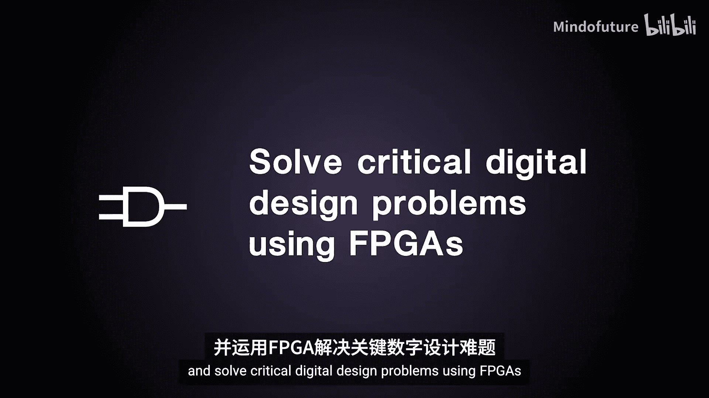
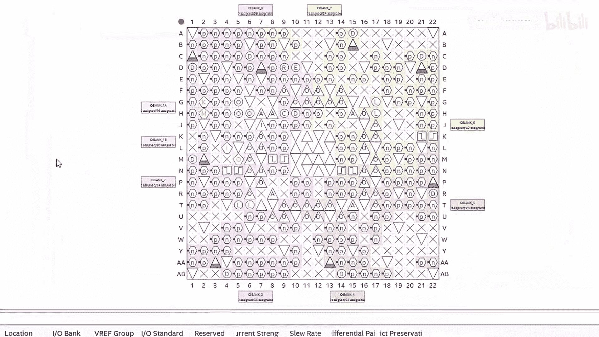
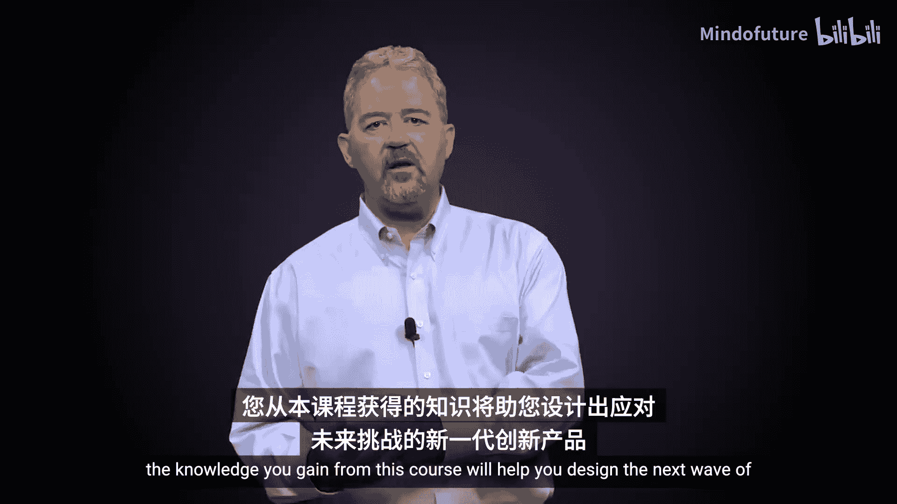

# 【科罗拉多大学】嵌入式系统-FPGA-设计入门-｜-intro-fpga-design-embedded-systems-p02-P02_01_01_02_课程概述--BV19Tu6zGEMD_p2-

Hi and welcome to the wondrous world of FPGA Design for embeddedd systems。😊。

FPGAs are the key technology enabling many of the great new product developments in the near future。

Including autonomous vehicles， the Internet of things， secure data centers and cloud computing。

 robotics， machine vision and learning， renewable energy， home automation。

 8K video and video surveillance， facial recognition and bioinformatics， 5G cellular networks。

 and smart medical diagnostics。FPGAs are rapidly becoming prevalent in most electronic products。

Programmologic devices now constitute a $6 billion a year business and are expected to grow to $10 billion a year by 2020 as part of hundreds of billions of dollars in finished products。

They are displaceacing AsIics in most applications because time to market is faster and capability is nearly the same。

Programmable logic provides the design with ultimate flexibility。

 allowing the part to provide almost any digital function。

Combined with hardcore IP to make a system on a chip。

 these devices allow quick development of very sophisticated products at relatively low cost。

The latest FPGAs have as many as 20 million gates。If you are thinking of a career in electronic design。

 this is a great course to enhance your career opportunities。

This course will give you the foundation for EGA design in embedded systems。

You'll learn what an FPGA is and how the technology was developed。

 how to select the best FPGA architecture for a given application。

 how to use state of the art software tools for FPGA development。

 and solve critical digital design problems using FPGAs。

I have extensive background in FPGA design with over 30 years of design experience in a variety of industries。

My name is Tim Shaer， and I'll be your instructor and guide in this journey。

In addition to my experience as the design engineer。

 I also have experience as an engineering manager， director of engineering and several years teaching experience at two major universities。

I'm currently with the University of Colorado at Boulder。

New tools make FPD design easier than it was in the past。

You may have heard that FPGA designed is difficult。It is， however。

 it is our mission to help reveal the secrets of FBGA design to you。

We need you to join our mission。Think of yourself as an agent in your Majesty's Secret Service。

 working for Q to develop new products for a whole variety of fun uses。We'll call you Agent you。

We'll do our best to give you the best resources and tools。With these tools。

 you can be successful designing with FEDAs， even if you found them hard to design with before。

We will provide you with many resources to help you be successful。

The syllabus see the long list of important websites。A partial list is shown here not for use。

 but to interest you in looking at the serviceyll。We will have recommended reference texts。

Rapid prototyping of digital systems SOPC edition by A Hall and Furman。

 and design recipes for FPGAs by Peter Wilsons second edition。We'll have some tools， Cors。

 the FPJ Design tool from Altra， and QsIS， the system design tool from Altra。

The objective of this course is for the student to learn to use FPGAs for the purpose of creating prototypes or products for a variety of applications。

My objective is to help you be successful with FBGAs。Although FBJA design can be a complex topic。

 we will introduce it so that with a little bit of effort。

 the basic concepts will easily be learned while also providing challenge for the more experienced designer。

We are not here to make you stumble， although the material is difficult at times。

 I expect that you are capable of learning this material if you have any prior background in digital logic design。

I'd like to give you an overview of the course where we're going， what you're going to learn。

The course consists of four modules， the first will' introduce you to FPJ history and Architecture。

The second gives you important hands on experience with powerful state of the art FPGA design tools。

The third describes current EPGA technology and gives you the ability to select the best device for the job。

Lastly， in the fourth module， you will practice and develop expertise in FPGA design and analysis。

 including the creation of a customizable processor built in FPGA logic。In each module。

 we will use several learning approaches to help you master this material。

 including in video quizzes to check what you've learned， exercises。

 to practice what you've learned with guided hands on experience with industry tools。

Discussion forums to exchange what you've learned。And assessments to demonstrate what you've learned。

The FPGA is a technology that has become pervasive in the world of electronics。In this course。

 you will learn to use FPGAs for the purpose of creating prototypes or products for a variety of applications。

I think you will find creating projects with FPGAs to be a fun experience because of the great flexibility and range of capability of these products。

FPGAs provide great opportunity to unleash your creativity and help you make an impact with your designs。

This is a practical course。When put into practice， the knowledge you gain from this course will help you design the next wave of exciting new products for whatever danger lies ahead。

