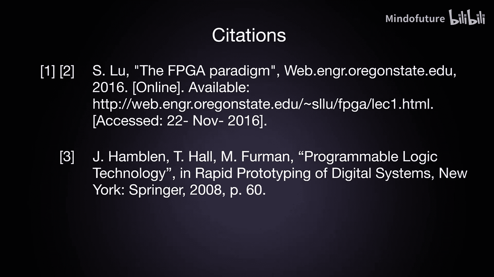

# 【科罗拉多大学】嵌入式系统-FPGA-设计入门-｜-intro-fpga-design-embedded-systems-p04-P04_01_03_01_2-可编程逻辑简史--BV19Tu6zGEMD_p4-

You may have wondered， what's all this programmable logic stuff about anyway？

To help answer that question， let's look at a history of programmable logic devices to give us some perspective on programmable logic devices。

 PLDs in general， and field programmable Gators or FPGAs in particular。

EPGAs are a subset of programmable logic devices here's a brief history of the development of programmable logic devices。

The first programmable logic device was a prom or a programmable Read only memory。

 it was invented in 1956， but not commercially available until 1969。

 followed then quickly by Eproms or erasable programmable Read only memoryory in 1971 and then PL's programmable logic Ars in 1975 and PALs。

 programmable Array logicic in 1978。We'll explain the difference between these in this video。

The desire to have for gramable hardware has been in existence ever since the very beginning of digital hardware。

 We can realize any logic equation in a two level sum of product format。

Let us denote the and logic in a format which is easy for us to illustrate the and and ore planes to the left is a traditional notion for a three input and gate to the right is the notion that we will adopt for two level programmable logic blocks。

A dot for hardwired， an X for programmable link， and a blank for NoCon。As you can see。

 programmmo logic as easy as ABC。In fact， the first programmable logic is a prom。

 The prom has a fixed and plane or product terms， which is the address decoding logic。

 The or plane or the sum terms is programmable through the change of memory contents。

 This is an 8 by4 prom depicted here。 using this。 we could implement the logic function output 1 equals ABC by storing in the first column of the prom the8 bit word 00。

0，0，0，0，01。Then only when A， B and C are all ones， will the output output 1 be a1。

In the same way we can make the orplan fixed and make the anplan programmable， in fact。

 this is a more efficient architecture since most of the logic functions we are interested in have a limited number of production terms。

The following figure illustrates the general approach of a pal， which has a fixed orplan。

 but has a programmable andplan。 PL devices are very popular and theyre still used in many designs with common part numbers like 22 v10 or 16 R8。

Further development led to CPLDs， which were devices with multiple pals in the same package with registered outputs and interconnecting programmable fabric。

A CPLD is a complex， programmable logic device。You can look at the Altura link on your screen for a more complete history of the CPLD。

Here's a brief history of the FPGA。The EGA industry sprouted from the programmable Read only memory pros and other programmable logic devices。

 PLDs In the 1980s， the Naval Service Warfare Center funded an experiment proposed by Steve Caselman to develop a computer that would implement 600。

000 reprogrammable gates。This began the interest in programmable logic。

AlTra was founded in 1983 and delivered the industry's first reprogrammable logic device in 1984。

 the EP300， which featured a quartz window in the package that allowed users to shine an ultravit lamp on the dye to erase the Eprom cells that held the device configuration。

For many years， Altra touted the benefits of the CPLD architecture over that at FPGAs。

 but later relented and began making FPGAs as well。Xillink's cofounders。

 Ross Freeman and Bernard Vander Schmidt， invented the first commercially viable fill programmable G array in 1985。

 the XC 2064。The XC2064 had programmable gates， programmable interconnects between the gates。

 and therefore the beginnings of a new technology in a new market。

 the XC 2064 had 64 configurable logic blocks or CLBs， which two three input lookup tables or Lus。

 which are still important in FPGA architecture today。More than 20 years later。

 Freeman was entered into the National Inventors Hall of Fame for this invention。In the early 1990s。

 FPGAs were primarily used in telecommunications and networking。

 by the end of the decade FPGAs found their way into consumer automotive and industrial applications。

Programmable logic devices constitute a $6 billion a year business that's expected to grow to $10 billion a year by 2020。

Programmable logic is just one part of the pantheon of digital logic devices。

 This depiction is from Hambllin's book on the recommended reading list。

 Standard logic has much more breadth ands depicted here。

 It includes additional T TL families like LvTT L， additional Cmos families like HC， LVC， etc cetera。

 and bysemos， BT， HT， et so on， as well as differential logic families like ECL and LVDS。

Incidentally， all the logic types I just listed can be found in IO interfaces in FPGAs。

 and that's another example of how flexible FPGAs are。Standard logic， programmable logic。

 full custom devices are also known as General purpose integrated circuits。

In between AsIs and full custom， our device is now known as ASSPs， which I will describe in a moment。

So FBGAs are simpler in concept than other PLDs， that consist of only three elements， a wire， a gate。

 and a register a flipflop。The chip is made of an array of gates and flip flops with wires that can connect them together in patterns。

 and these patterns create the logic for larger functions like counters， timers， state machines。

 AluUs and even whole CPUs， C the interconnecting pattern is the heart of FPGA design。

 which we will learn in this course。An ASSP or application specific standard product is a semiconductor device integrated circuit product that is dedicated to a specific application market and sold to more than one user。

 and thus standard， the ASSP is marketed to multiple customers just as a general purpose product is。

 but it's to a smaller number of customers since this is for a specific application。

Like an ASIC or an application specific integrated circuit。

 the ASSP is for a specific application but it's sold to any number of companies to an entire market。

 and ASI is designed and built to order for a specific company。

An ASSP generally offers the same performance characteristics and has the same dye size as an AsI。

The ultimate expression of logic devices is the system on a chip。

Here are two definitions for an SOC or system on a chip。

 which are becoming more and more common as time goes on。A system on a chip or a system on chip。

 SOC is an integrated circuit that integrates all components of a computer into an electronic system into a single chip。

It may contain digital， analog， mix signal and other radio frequency functions all on a single chip substrate。

 SOCs are very common in the mobile electronics market because of their low power consumption。

 Another typical application is in the area of embedded systems。

Another definition for a system on a chip or system on chip is an integrated circuit that integrates more than one component into a single chip along with a CPU。

 typicalical component types are GPUs， communication interfaces。

 analog functions and radios if it includes programmable logic then it is a programmable SOC。

 or an SOC FPGA。The higher integration of an SOC provides lower cost， smaller size。

 and lower power than alternatives。Field programmable gateator arrays。

 FPGAs are programmable logic devices made of gates。

 registers and routing wires connected together in a pattern that can be programmed after the device is deployed。

 creating the interconnecting pattern is the heart of FPGA design。Programmable logic devices。

 PLDs include simple PLDs like pros and pals， complex PLDs， CPLDs， FPGAs。

 and SOC FPGAs PLDs are a subset of all logical devices and FPGAs are a subset of PLDs。

FPGAs compete with application specific integrated circuits or AsIs。

 and application specific standard products or ASSPs。

 successfully displacing them in many applications when it comes to digital devices。

 FPGAs appear to be the future。

