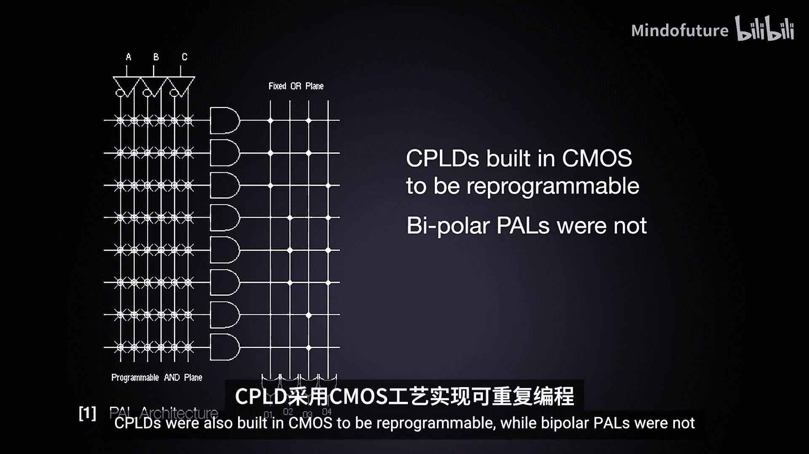
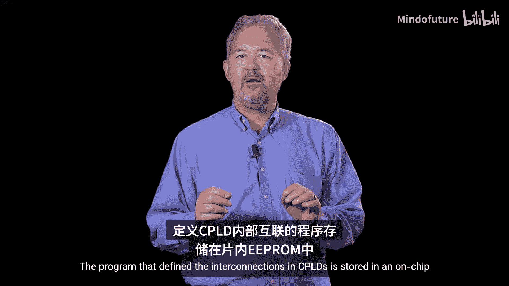
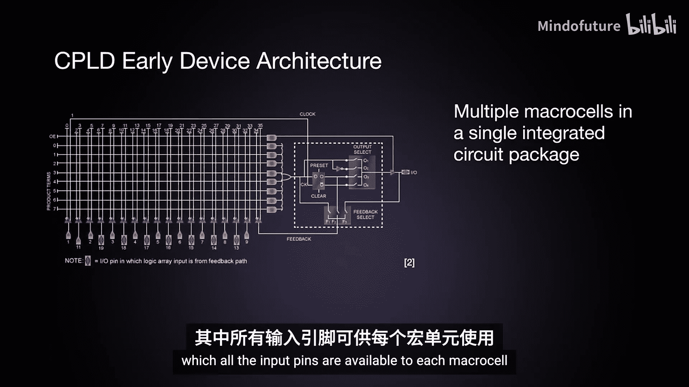
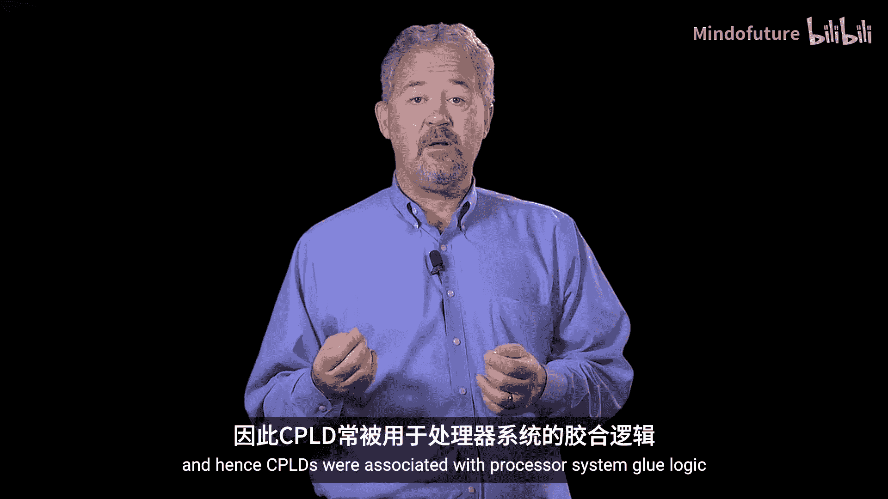
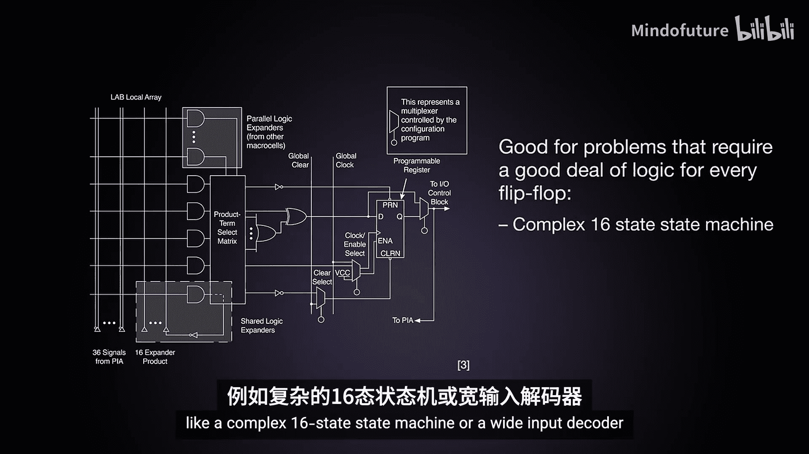
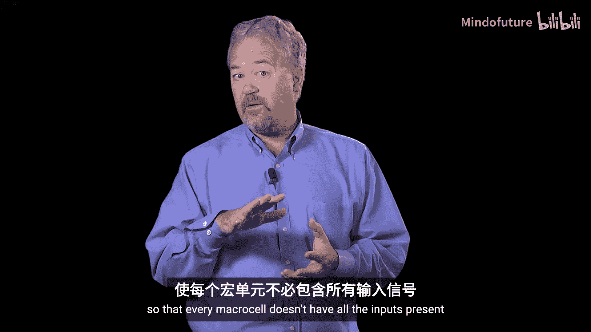
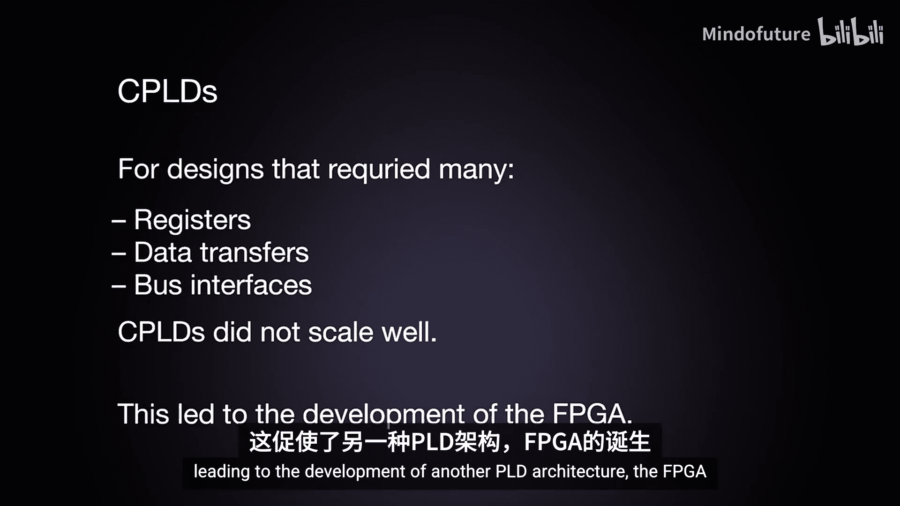
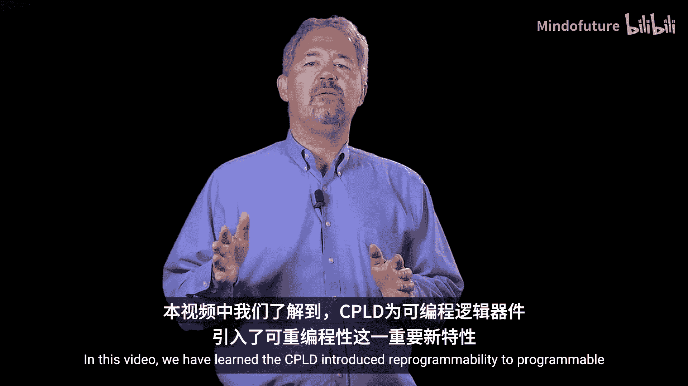
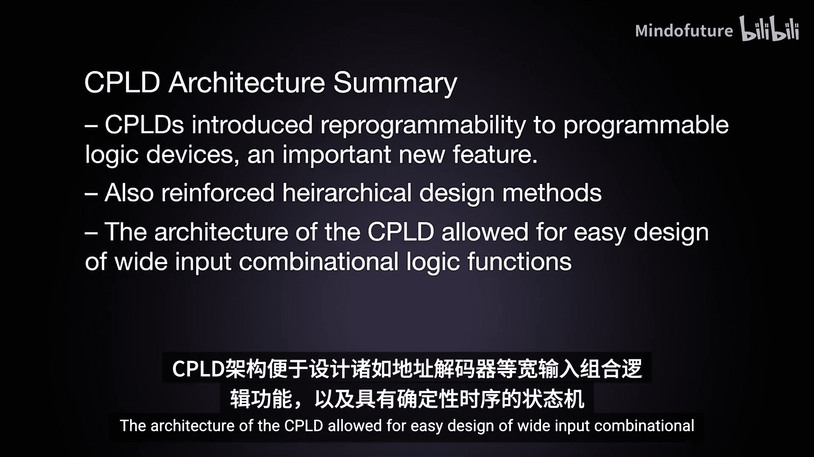
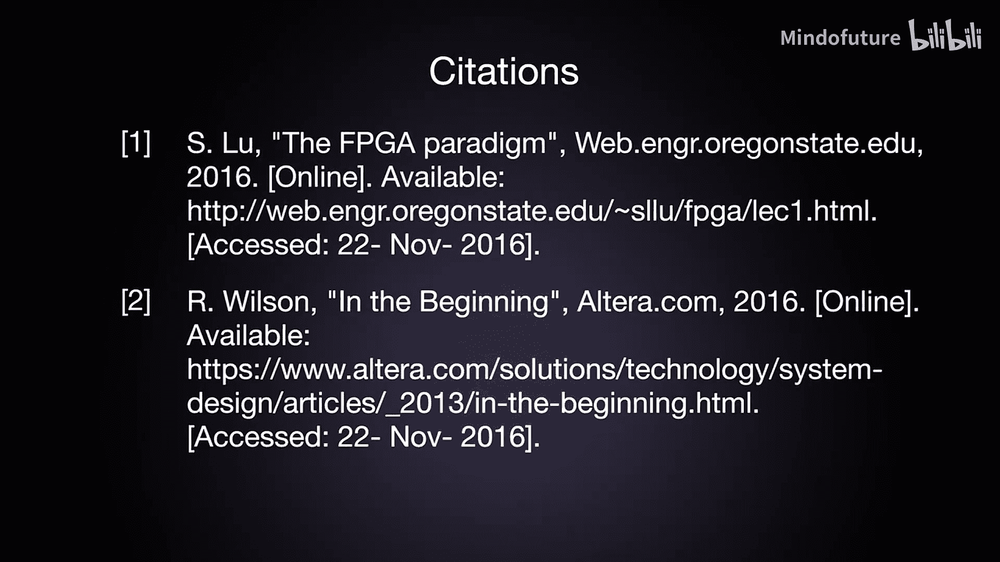

# 【科罗拉多大学】嵌入式系统-FPGA-设计入门-｜-intro-fpga-design-embedded-systems-p05-P05_01_03_02_3-CPLD架构--BV19Tu6zGEMD_p5-

The complex programmable logic device or CPLD was the forerner of the IPGA and is still useful today in certain applications。

 we will examine the historical development of the CPLD in order to understand the limitations and advantages that flow from the architecture of these devices。

Most major PLD vendors， including Xylelinkx， Altra， lattice。

 offer a wide range of CPL devices for sale， so recall the PAow。

 which created a sum of products logic functions using a programmable and array followed by a fixed or array。

 this allowed the replacement of up to a dozen different logic packages with a general logic solution。

 because arbitrary logic functions could be implemented in the destructnctive normal form。

AlTra extended this concept by putting multiple pile structures called macroce into a single integrated circuit package in which all the input pins were available to each macroce and any output pin could be driven by any macroce。

CPLDs were also built in CMmoOSs to be reprogrammable while bipolar pals were not。

 although it didn't seem to be a major attribute at the time。

 reprogrammability is now considered a very important aspect of PLD devices。

The program that defined the interconnections in CPLDs is stored in an on chip EEprom Alterra extended this concept by putting multiple macrocell in a single integrated circuit package in which all the input pins were available to each macroce and each macroce had a dedicated output pin which then could be fed back to the input array。

With the ability to look at 16 digital inputs at a time。

 each macroce could decode a 16 bit address from a processor and generate a chip selectlect in this way a single chip with eight or 16 macrocell could create chip selects for an entire microprocessor system and hence CPLDs were associated with processor system glue logic。

Here's a picture of another CP PLD macrocell。 You can see that a CPLD macrocell is just basically a registered pal array。

 The mug symbols represent programmable configuration switches present in the device。

 The PIA is a matrix of interconnecting wires that connects the macroce together。

 feeding the output of the cells to the inputs of other cells。

 This structure is good for problems that require a good deal of logic for every flipflop like a complex 16 state state machine or a wide input decoder。

The CPOD top level architecture is P macrocells connected with interconnection wires。

 the number of wires tend to increase at a rate of n squared。

 making the cost of interconnections rise exponentially to mitigate this problem。

 the interconnect was partitioned so that every macroce doesn't have all the inputs present。

Here we see the CPLD is made of bigger groups of circuits called labs， what is a lab。

 a lab is a logic array block made of 16 macrocell with local routing between the macrocell。

The programmable interconnect arrayray or PIA is a routing network between labs。

 so it is apparent that CPLDs are inherently higher arch devices。Hierarchy。

 which creates larger logical systems out of many smaller logical functions。

 is an important concept in logic design。 The designer now had to plan which macro cells would implement a particular logic equation and which ones need the result and also take into account the delays possible through the interconnections in the hierarchy。

 better software tools were developed to assist in this planning。

CPLDs have several useful characteristics， including easy generation of wide input functions and easy to calculate timing that is very predictable。

 It's said to be deterministic。 they are still a good choice for Gulogic applications today， however。

 for designs that required a lot of registers， data transfers， bus interfaces。

 these logic intensivesive flipflop scarce devices did not scale well。

 leading to the development of another PLD architecture， the FPGA。

In this video we have learned the CPLD introduced reprogrammability to programal logic devices an important new feature。

 CPLDs also reinforced highererarchical design methods。

 the architecture of the CPLD allowed for easy design of wide input combinational logic functions like address decoders and state machines with the deterministic timing。

 however， the CPLD architecture did not scale effectively for designs that required many flipfls。

This has become the province of the FPGA。

Yeah。