# 嵌入式系统FPGA设计入门：P05：CPLD架构 🏗️

在本节课中，我们将学习复杂可编程逻辑器件（CPLD）的架构。CPLD是FPGA的前身，至今仍在某些特定应用中发挥作用。我们将通过回顾其历史发展，来理解这种架构所带来的优势与局限。

## 概述

CPLD是一种基于可编程逻辑阵列（PLD）发展而来的器件。它通过将多个被称为“宏单元”的PAL结构集成到单个芯片中，实现了更复杂的逻辑功能。理解CPLD的架构有助于我们认识其在“胶合逻辑”等应用中的价值，以及为何它最终被FPGA架构所补充。

## CPLD的起源与发展

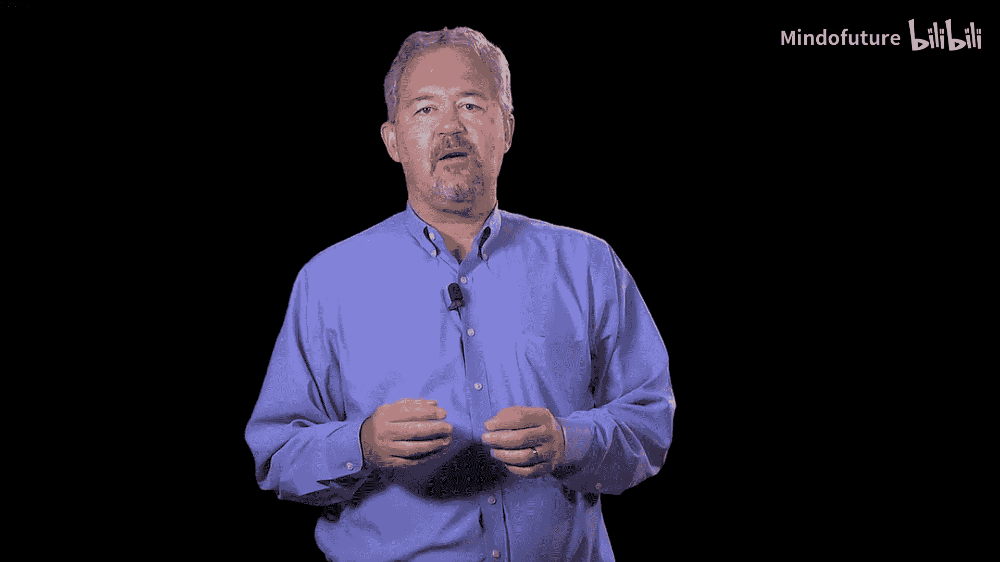

上一节我们介绍了基础的PAL结构。本节中我们来看看CPLD是如何在此基础上演进的。

最初的PAL（可编程阵列逻辑）器件使用一个**可编程的“与”阵列**后接一个**固定的“或”阵列**，实现了积之和（SOP）的逻辑函数。其逻辑功能可以用以下布尔表达式表示：

```
F = Σ (Product Terms)
```

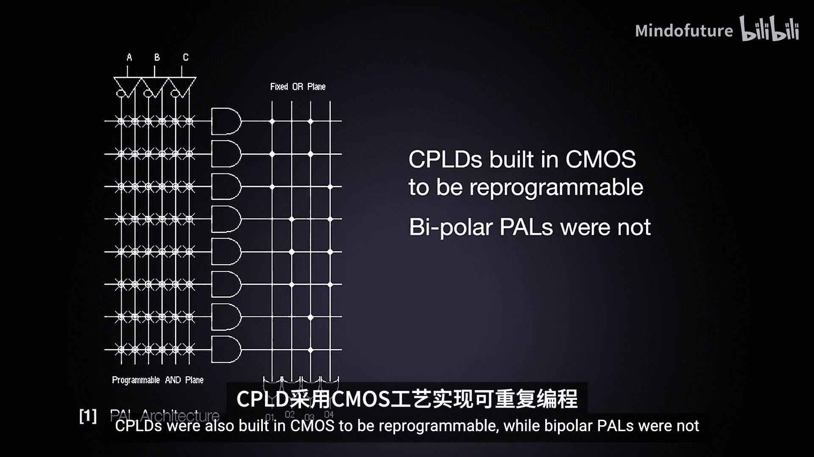

这使得一个通用逻辑器件可以替代多达十几个不同的专用逻辑芯片。

Altera等公司扩展了这一概念，将多个PAL结构（即宏单元）集成到单个集成电路封装中。在这个架构中，所有输入引脚对每个宏单元都可用，并且任何输出引脚都可以由任何宏单元驱动。

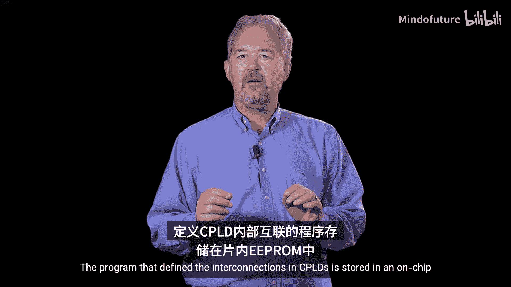

## CPLD的关键特性

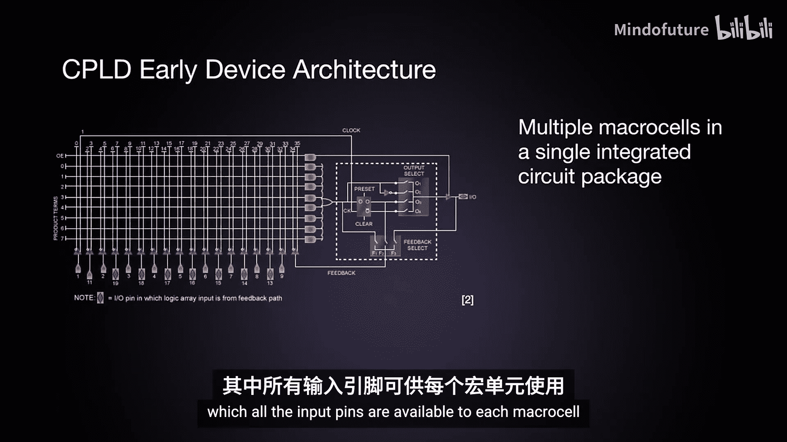

CPLD在CMOS工艺中制造，使其具备可重复编程能力，而早期的双极性PAL则不具备此功能。尽管在当时看来这并非主要特性，但**可重复编程性**如今已成为PLD器件一个非常重要的属性。

定义CPLD内部互连的程序存储于片上的EEPROM中。Altera进一步扩展了此概念：在单个芯片封装中集成多个宏单元，每个宏单元都有专用的输出引脚，该输出可以反馈回输入阵列。

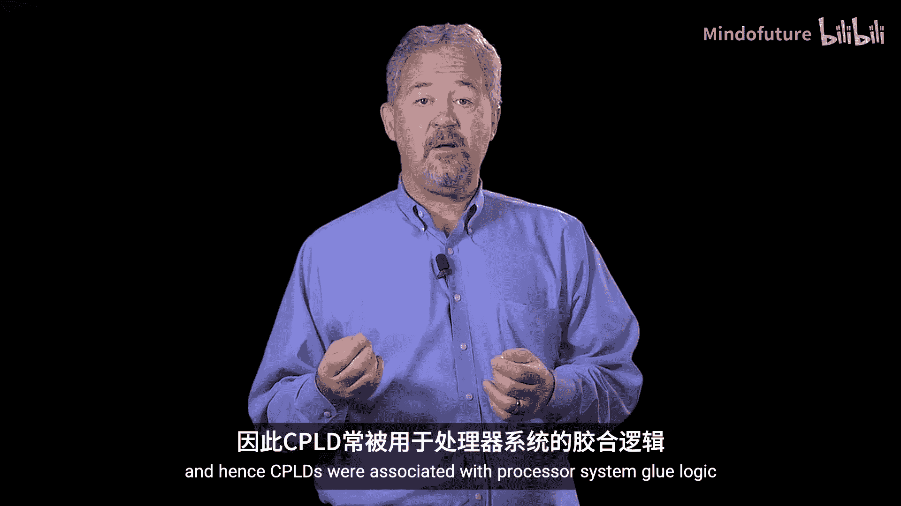

## CPLD的典型应用：地址解码与胶合逻辑

由于其架构特点，CPLD非常适合需要大量组合逻辑的设计。

每个宏单元能够同时处理多个数字输入（例如16个）。这使得单个宏单元可以解码来自处理器的16位地址并生成片选信号。因此，一个拥有8个或16个宏单元的芯片就能为整个微处理器系统生成所有片选信号。CPLD也因此常与处理器系统的“胶合逻辑”相关联。

## CPLD的宏单元与互连结构

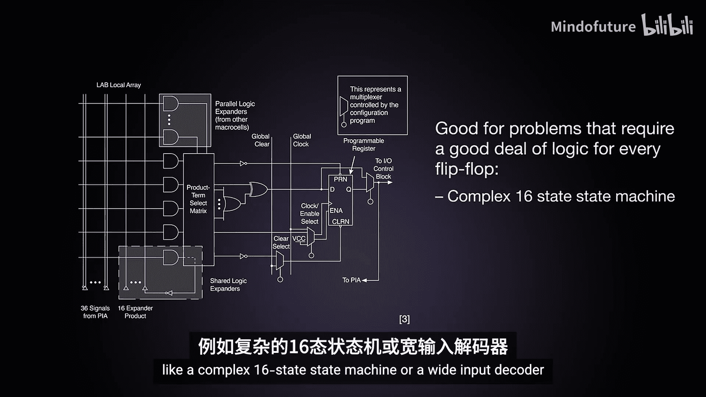

以下是CPLD内部架构的核心组成部分：

*   **宏单元**：本质上是一个带寄存器的PAL阵列。图中的“熔丝”符号代表器件内部可编程的配置开关。
*   **可编程互连阵列（PIA）**：一个连接宏单元的互连导线矩阵，它将某些宏单元的输出馈送到其他宏单元的输入。

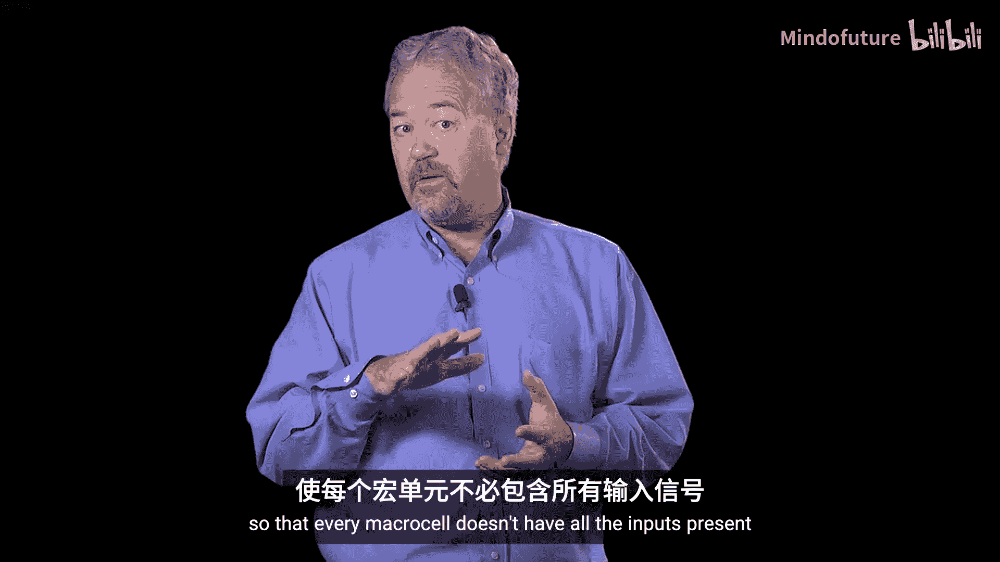

这种结构非常适合那些每个触发器都需要大量逻辑的问题，例如复杂的16状态状态机或宽输入解码器。

## CPLD的层次化架构与挑战

CPLD的顶层架构是由互连导线连接的P个宏单元。随着宏单元数量n的增加，所需的互连导线数量倾向于以n²的速率增长，导致互连成本呈指数级上升。

为了缓解这个问题，互连结构被分区，使得并非每个宏单元都能访问所有输入。

于是，CPLD演变为由更大的电路组——“逻辑阵列块（LAB）”构成。一个LAB是由16个宏单元组成的逻辑阵列块，宏单元之间存在本地路由。而**可编程互连阵列（PIA）** 则是LAB之间的路由网络。

由此可见，CPLD本质上是层次化更高的器件。**层次化**——即用许多较小的逻辑功能构建更大的逻辑系统——是逻辑设计中的一个重要概念。设计师需要规划哪些宏单元实现特定的逻辑方程，哪些宏单元需要其结果，同时还要考虑层次化互连中可能产生的延迟。更好的软件工具随之被开发出来以协助这种规划。

## CPLD的优势与局限

CPLD有几个有用的特性：
*   易于生成宽输入函数。
*   时序易于计算且非常可预测，这被称为**确定性时序**。

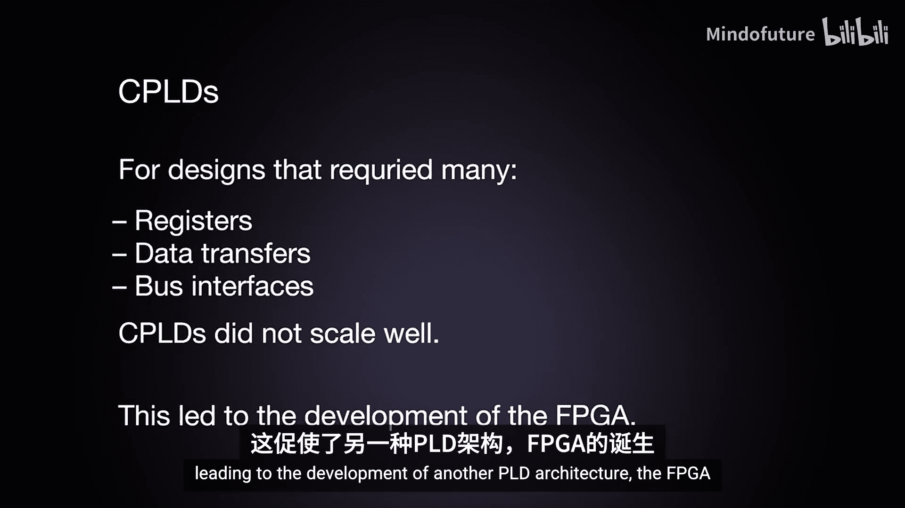

因此，对于胶合逻辑应用，CPLD至今仍是很好的选择。

然而，对于需要大量寄存器、数据传输或总线接口的设计，这种**逻辑密集但触发器稀缺**的器件扩展性不佳。这促使了另一种PLD架构——FPGA的发展。

## 总结

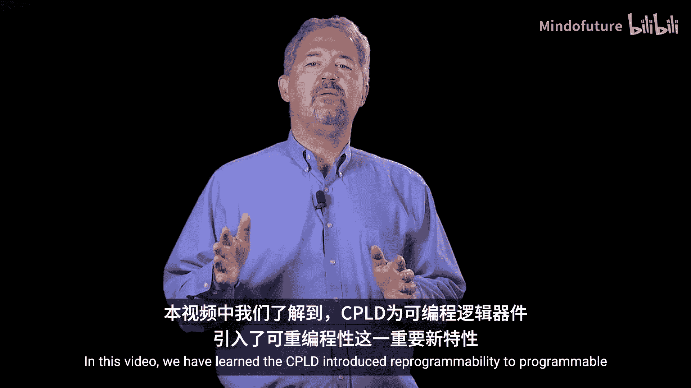

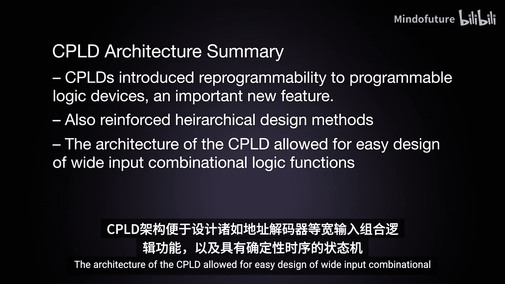

本节课中，我们一起学习了CPLD的架构。CPLD为可编程逻辑器件引入了**可重复编程性**这一重要新特性，并强化了层次化设计方法。其架构使得设计宽输入组合逻辑函数（如地址解码器和状态机）变得容易，且具有确定性时序。


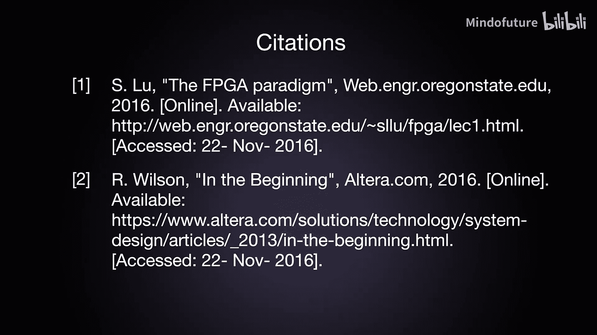

但是，CPLD架构对于需要大量触发器的设计扩展效率不高，这已成为FPGA的应用领域。