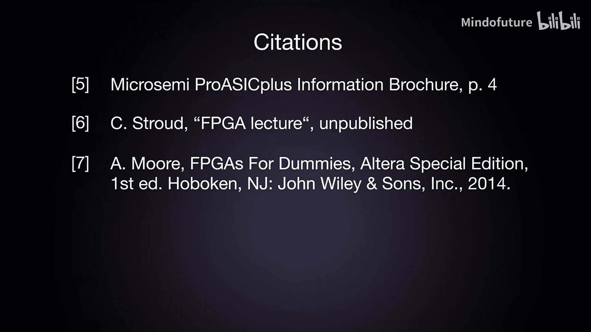

# 【科罗拉多大学】嵌入式系统-FPGA-设计入门-｜-intro-fpga-design-embedded-systems-p06-P06_01_03_03_4-LUT与FPGA架构--BV19Tu6zGEMD_p6-

Now let's look at Lutz and FBGA architecture。

The field programmable Gateatorway or FPGA was invented to provide a general purpose digital logic device with great flexibility and utility。

 It has succeeded beyond the inventor's greatest dreams。

Here we will learn about the development of the FPGA。

 how the fundamental logic cells work using lookup tables or Luts。

 and how routing becomes a bigger factor in performance。

With the intent to create a more flexible general purpose logic device。

 FPJAs were first designed to imitate gateator arrays。

Integrated circuits with a sea of gates that were connected by added metal layers or wire routing to define the functionality of the device。

However， instead of implementing the logic using transistor gates。

 the logic was in many cases implemented by memory fashioned as lookup tables。

This demonstrates how the LuT can be used to implement any four input one output logic device。

Here note the regular methodical way that the table is created。A has all zeros， and then all ones。

Variable B has four zeros， and then four1s， et cetera。 Then to create the output F。

 note that if A and B are true， F is true， This is the last four rows of the table。

 which implements the top end gate。Also， if C is true and D is not true， then F is true。

So given all the possible combinations of the inputs are listed。

 we can create any logical expression for four inputs by how we program F。

These expressions can also be implemented as and or circuits as shown。

Semicconductor companies were good at making memories， which had regular。

 highly optimized structures that were easily replicated。

The first F PGs were an array of logic cells consisting of three input Luts。

 FPGA architecture is different from CPLDs， as the logic element is smaller。

 usually implemented as a lut。 In this example， the micro semiigo versatile can be either a three input gate of any type or a sequential def flip flop or a latch。

The schematic depicts the structure of the logic element。

 each L labeled switch is controlled by the configuration bits when the FPGA is programmed。

Here is a simplified schematic of an FPGA logic cell。 A typical cell consists of a four input Lut。

 a full adder， the FAA， and a D type flipflop。 The lus in this figure are split into2，3 input Lus。

In normal mode， they are combined into a four input lut through the left mugs。In arithmetic mode。

 their outputs are fed to the FAA。 the selection of the mode is programmed into the middle of multipleer。

This is a schematic of the Alererocyclone logic element or L E inputputs are on the left。

 outputputs are on the right。 The core of this L is a four input Lut。

 which can be used to create any four input logic combinatorial circuit。

The Lt output is part of a carry ta structure used to speed up arithmetic computations。

 the Lt output can be routed out directly or registered by the flipfl。As you can see。

 this circuit is designed with versatility in mind。

The EG user could determine the function of small clusters of gates。

 the logic cell and how that cluster is connected to other clusters on the chip。

 gradually building up a circuit by connecting logic cells。 However。

 to implement a high fan in function like an address decoder。

 Fgas need to cascade many stages of logic elements。

 This can lead to excessive and somewhat unpredictable delays。

Timing analyzer tools and the design software help resolve these problems to some extent。

The routing in an FPGA is hierarchical at the lowest level we have routing switch that is controlled by a bit of SRAM or a flash bit or a fuse。

 there are many routing switches in the local routing to connect various logic elements or blocks。

The FPGA is made up of a C of logic blocks。 Groups of the blocks are connected by long lines or very long lines。

 Common signals like clocks are routed on special routing networks called global networks。

This slide shows the evolution of the Ega architecture。 In 1995。

 xinlinks made epigas with an n by n array of cells with global routing down the centers spines。

 By 2000， they had added block 4K Rams in 2005 multipliers were added along with hardcore processors of power PC in this case。

 among the earliest true peock parts。In 2007， they added DSP cores from this evolution。

 it can be seen that FPGs no longer operate in the realm of glue logic。

 but are becoming subsystems or complete systems in and of themselves。

 This development is fueled in part by the use of SM memory for the routing switches。

 which has higher density than E Eprom。RAM processes are the first ones proven in a new semiconductor process geometry。

 so they have highest density available at the time。

The other development was the use of new means of design entry other than Boolean expressions。

 including schematic entry and HDL languages like Verrlo and BHDL。

The type of configuration memory used to create routing switches is the most important aspect in determining differences in performance and capabilities in FGAs。

Antifuse FPGAs are known for reliability， but they are one time programmable and expensive。

 Flask FPGAs are also very reliable and they're also reprogrammable， but higher price than SRAM FPGs。

SRAM FPGs are programmable with highest density and lowest cost for equivalent logic。

 The four major PD vendors have a variety of offerings that include many configuration types。

 Zylinkx offers flash CLDs and FPGs and SRAM FPGs。 Altro provides flash CLds and SRAM FPGs。

 lattice sells SRAM CLDs and FPGs， and microcrosemi offers antifuse and flash FPGs。Given all this。

 why use a CPOD instead of an FPGA？Remember， if you need just a little logic。

 the CPOD can be a less expensive option。It may also allow more IO in the same space with less logic cost CPLDs may also be the best choice if you have to meet very tight and deterministic timing requirements。

In module2， you will learn how to create an FPGA design using FPGA design tools。

 the tools you use a process flow like one depicted in the picture。

The design begins with design entry continues with simulation to verify the logic as implemented as expected。

 and then the tool will perform synthesis also called mapping to map the logic to the device architecture。

 Next， the tool will create the interconnection between the cells by place and routing or fitting the design。

It is good practice to run another simulation after the fitting is completed， if this all looks good。

 the next step is to use the tool to create a programming file which is then downloaded into the FPGA device for testing。

Here's a good free recommended resource for learning about FPGAs， a short book， FPGAs for dudes。

In this video， we have learned FPGAs or highly flexible general purpose digital logic devices due in part to the clever use of memory elements as lots for the base logic cell。

EPGA scale better than CPLDs， creating lower cost solutions for larger designs and designs that require many flipfls。

Because FPG architecture is finer grain than CPLDs， routing has more impact on performance。

EPGA configuration memory can be implemented using one of several different technologies including SRAM。

 flash， and anfuses， this choice impacts cost and performance。

FPGAs provide a myriad of ways to create your next logic design。

