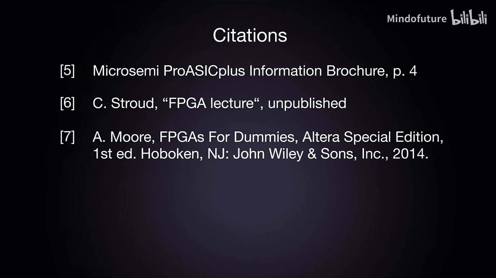

# 嵌入式系统FPGA设计入门：P06：LUT与FPGA架构 🧠

在本节课中，我们将要学习现场可编程门阵列（FPGA）的基本架构及其核心组成部分——查找表（LUT）。我们将了解FPGA的发展历程、LUT的工作原理，以及布线如何影响FPGA的性能。

## FPGA的发明与发展

上一节我们介绍了可编程逻辑器件的基本概念，本节中我们来看看FPGA的诞生。现场可编程门阵列（FPGA）的发明，旨在提供一种具有高度灵活性和实用性的通用数字逻辑器件。它的成功甚至超出了发明者最宏伟的梦想。

FPGA最初的设计意图是模仿门阵列，以创造更灵活的通用逻辑器件。门阵列是一种具有大量门电路的集成电路，通过添加金属层或布线来定义器件的功能。然而，FPGA在许多情况下并非使用晶体管门来实现逻辑，而是使用配置为查找表（LUT）的存储器来实现。

## 查找表（LUT）的工作原理

现在，让我们深入了解FPGA的基本逻辑单元——查找表（LUT）是如何工作的。下图展示了LUT如何用于实现任何四输入单输出的逻辑器件。

请注意创建真值表时规律性的方法。变量A的取值先是全0，然后是全1。变量B的取值是四个0，然后是四个1，依此类推。要创建输出F，例如，当A和B都为真时，F为真，这对应了真值表的最后四行，实现了顶部的与门。同样，如果C为真且D不为真，则F也为真。

**核心概念**：由于列出了所有可能的输入组合，我们可以通过编程F的值来为四个输入创建任何逻辑表达式。这些表达式也可以实现为与门、或门等电路，如图所示。

半导体公司擅长制造存储器，存储器具有规则且高度优化的结构，易于复制。最早的FPGA就是由三输入LUT组成的逻辑单元阵列。

## FPGA逻辑单元架构

FPGA架构与CPLD不同，其逻辑单元更小，通常由LUT实现。以下是一个逻辑单元的简化示意图。

一个典型的逻辑单元由一个四输入LUT、一个全加器（FAA）和一个D型触发器组成。图中的LUT被拆分为两个三输入LUT。在正常模式下，它们通过左侧的多路复用器组合成一个四输入LUT。在算术模式下，它们的输出被馈送到全加器（FAA）。模式的选择通过中间的多路复用器进行编程。

这是Altera Cyclone系列逻辑单元（LE）的示意图，输入在左侧，输出在右侧。该逻辑单元的核心是一个四输入LUT，可用于创建任何四输入组合逻辑电路。LUT输出是进位链结构的一部分，用于加速算术计算。LUT输出可以直接路由出去，也可以通过触发器寄存。可以看出，该电路设计时充分考虑了多功能性。

## 布线结构与性能影响

由于FPGA架构比CPLD更精细（粒度更细），布线对性能的影响更大。FPGA中的布线是分层的。

*   在最底层，有由SRAM位、闪存位或熔丝控制的布线开关。
*   局部布线中有许多布线开关，用于连接各种逻辑单元或模块。
*   FPGA由逻辑块阵列组成。逻辑块组通过长线或超长线连接。
*   时钟等公共信号通过称为全局网络的特殊布线网络进行路由。

为了实现高扇入功能（如地址译码器），FPGA需要级联多个逻辑单元级。这可能导致过度且有些不可预测的延迟。时序分析工具和设计软件在一定程度上帮助解决了这些问题。

## FPGA架构的演进

下图展示了FPGA架构的演进过程。

*   1995年，Xilinx的FPGA采用N x N单元阵列，全局布线沿中心脊柱分布。
*   2000年，增加了4K位块RAM。
*   2005年，增加了乘法器以及硬核处理器（本例中为PowerPC），这是最早的真SoC部件之一。
*   2007年，增加了DSP核心。

从这一演进可以看出，FPGA不再局限于“胶合逻辑”的领域，而是正在成为子系统或完整的系统本身。这一发展部分得益于使用SRAM存储器作为布线开关，其密度高于EEPROM。RAM工艺通常是最先在新半导体工艺节点上得到验证的，因此能提供当时最高的密度。另一项发展是采用了新的设计输入方法，如原理图输入和Verilog、VHDL等硬件描述语言（HDL）。

## 配置存储器类型

用于创建布线开关的配置存储器类型，是决定FPGA性能和能力差异的最重要方面。

以下是主要的配置技术：

*   **反熔丝FPGA**：以可靠性著称，但只能一次性编程，且成本昂贵。
*   **闪存FPGA**：也非常可靠，且可重复编程，但价格高于SRAM FPGA。
*   **SRAM FPGA**：可编程，在同等逻辑规模下密度最高、成本最低。

四大FPGA供应商提供多种配置类型的产品：
*   Xilinx提供闪存CPLD和FPGA，以及SRAM FPGA。
*   Altera（现为Intel PSG）提供闪存CPLD和SRAM FPGA。
*   Lattice销售SRAM CPLD和FPGA。
*   Microsemi（现为Microchip）提供反熔丝和闪存FPGA。

## FPGA与CPLD的选择

考虑到以上所有信息，为什么有时会选择CPLD而不是FPGA呢？请记住，如果只需要少量逻辑，CPLD可能是成本更低的选择。在相同空间内，CPLD也可能允许更多的I/O，而逻辑成本更低。如果需要满足非常严格且确定性的时序要求，CPLD也可能是最佳选择。

## FPGA设计流程简介

在模块2中，您将学习如何使用FPGA设计工具创建FPGA设计。您使用的工具遵循如下图所示的设计流程。

设计从设计输入开始，接着进行仿真以验证逻辑是否符合预期。然后，工具将执行综合（也称为映射），将逻辑映射到器件架构。接下来，工具将通过布局和布线（或适配）来创建单元之间的互连。在适配完成后，最好再运行一次仿真。如果一切顺利，下一步就是使用工具创建编程文件，然后将其下载到FPGA器件中进行测试。

这里推荐一个很好的免费学习FPGA的资源：一本简短的书《FPGAs for Dummies》。

## 总结 🎯

本节课中我们一起学习了：
1.  FPGA是高度灵活的通用数字逻辑器件，这部分归功于其巧妙地将存储单元用作基本逻辑单元的LUT。
2.  FPGA比CPLD具有更好的扩展性，能为大型设计和需要大量触发器的设计提供成本更低的解决方案。
3.  由于FPGA架构比CPLD更精细，布线对性能的影响更大。
4.  FPGA配置存储器可以使用SRAM、闪存和反熔丝等多种技术之一实现，这一选择影响着成本和性能。
5.  FPGA为您的下一个逻辑设计提供了无数种实现方式。