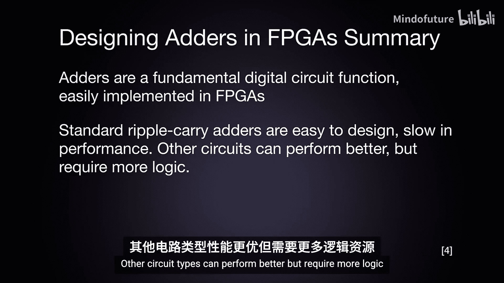

# 【科罗拉多大学】嵌入式系统-FPGA-设计入门-｜-intro-fpga-design-embedded-systems-p08-P08_01_04_02_6-加法器设计--BV19Tu6zGEMD_p8-

Let's talk about designing adders and FPGAs。The heart of every digital computer is the CPU。

 the heart of every CPU is the ALU， and the heart of every ALU is the adder circuit。

Adders are fundamental。Once you can add， you can subtract by adding a compliment。

 and you can also multiply by counting how many times you add。

It's no surprise then that FPGAs are infused with structures to ease the design and improve the performance of adders。

A full bit adder can be constructed of as few as five gates as shown here。In an FBGA。

 we could implement this in a three input lot or four input lot if we had two outputs。In some cases。

 the lu architecture will have an additional output for the carry outfit separate from the sum outfit。

This is the result of implementation of an adder in an AlterM X10 FPGA shown here using the RTL viewer tool。

 which is part of the Qs Prime FPGA design suiteite。

It looks just like the gate diagram shown previously。

RtL stands for Register Trans Lo or Reg Trans level。

 RTL is based on the concept that movement of data through digital logic can be viewed as logic diagrams with expressions representing the data variables that are stored in registers。

 It is generally a higher level representation than the gate level。

So this is the result of an implementation of an adder in an Altraaxin FPGA shown here using the technology mapp viewer tool。

It shows the implementation is made using two， three input lets。

We can use full one bit adders of components to create end bitit adders by connecting them together。

 Here we see the connection for a four bit adder made up of four full1 bit adders。

This is known as the ripple carry adder。 It is fast design。 However。

 the ripple carry adder is relatively slow in performance。

 since each full adder must wait for the carry bit to be calculated from the previous full adder。

 The total delay through the ripple carry adder to the sum out is expressed by the equation。

 T of the adder of n is equal to n -1 times the time to the carry plus the time to the sum。

 which is equal to n -1 times 3 d plus 2 D， which equals 3 n-1 times d。

 where d is the delay through one gate， and n is the number of bits in the adder。

How many gate delays would there be for a 32 B ater constructed this way？

So if you go through the equation， you'll find that there are 95 gate delays through a 32 bit adder。

We can use more sophisticated circuits to create better performing adders with less delay。

 one such possibility is the carry look ahead adder shown here。

The carry bit can be calculated as generate and propagate terms。 If you have carry of I plus 1。

That's going to be equal to the generative I plus the propagate of I ended with the carry of I in which the generate of I is equal to the a input of I ended with the B input of I and the propagative I is equal to A X or B。

 Now the delay is roughly equal to n， a big improvement over the ripple carry adder。

 but at the cost of a much more complex carry bit calculation。

Do we need to do this when the adder is implemented in the FPGA？

This is the result of the implementation of the4 bit Rple Car adder in the Altra Max 10 FPGA shown here using the technology mapp viewer tool。

It shows the implementation is made of a cascade of four pairs of three input Lus。

 The delay through this circuit will be only four lu delays。

 not 11 gate delays is based on the delay equation。Furthermore。

 we may get more of an advantage if we use a more advanced FPGA architecture。

This is the result of the implementation of the 4 bit adder in the Alterocyclone 5 FPGA shown here using the technology mapp viewer tool。

 it shows the implementation is made using three6 input Lus instead of one bit adders。

 the six input Lu is used to implement a two bit adder in two cases for the one bit and for the three bit。

The other six input Lu is broken into two， three input lets to generate sums for the bit0 and the bit2。

 so what is the delay through this circuit？There's only two lut delays considerably better than what we may have originally thought。

Although the use of the carry look ahead or other more sophisticated ater circuits may be beneficial in some applications。

 the presence of coarar grainined FPG architectures may make this unnecessary in many cases。

 the implementation you choose needs to be determined on a case by case basis。

 as there are many trade offs that may not be obvious at first。This is not unusual in FPGA design。

 this is part of what makes it so interesting。Furthermore。

 the cycl5 logic cell called the adaptive logic module or ALM。

 includes fast carry chains and full adder implementations as part of the logic cell。

 which makes implementation of adders particularly fast and efficient。In this video。

 we have learned adders are a fundamental digital circuit function that can easily be implemented in FPGAs。

 Standard Rple carry adder circuits are easy to design but slow in performance。

 other circuit types can perform better but require more logic。

 The use of Luts and additional arithmetic circuits like carry chains and full adders make FPGs particularly efficient implementing adders。

 Even standard designs can have excellent performance when implemented in an FPGA。

