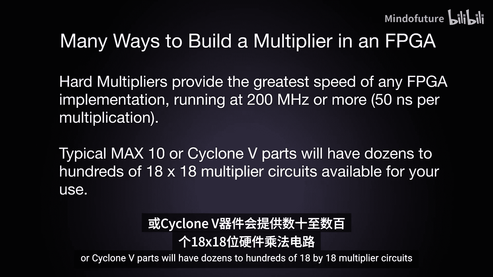
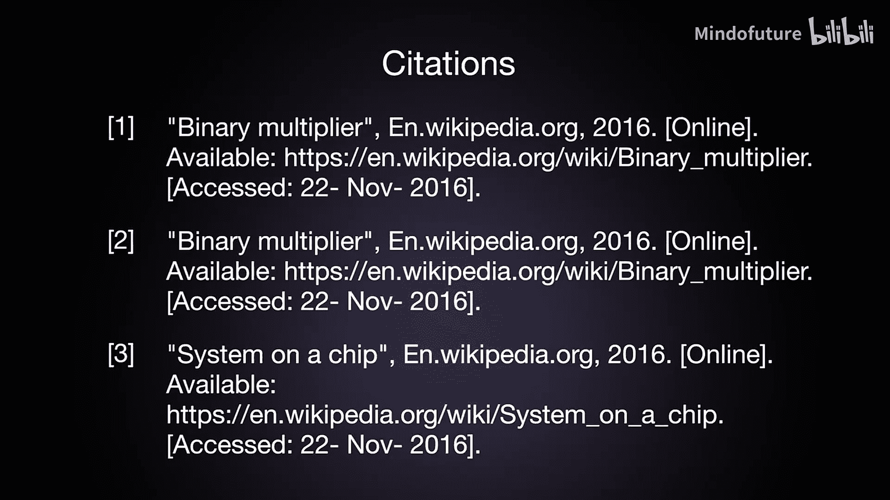

# 【科罗拉多大学】嵌入式系统-FPGA-设计入门-｜-intro-fpga-design-embedded-systems-p09-P09_01_04_03_7-乘法器设计--BV19Tu6zGEMD_p9-

Let's talk about designing multipliers and FGAs。

Multiplying two numbers is a common digital logic or ALU function that can take considerable amounts of circuitry This has been a problem for designers for years。

 Fortunatelyly there are a variety of ways to implement multiplier circuits within FPGAs。

Adds are built with gates， can we build multipliers with the gates as well？Here is an example。

 a two bit by2 bit binary multiplier。Can we in general make multipliers with gates， yes。

 using array multipliers， it works like multiplication by hand。

 which includes partial product generation and partial product summation。

But the number of gates increases as n squared。Beyond4 by four bits。

 a sequential design is more efficient than the adder multiplier。

There are many ways to build a multiplier in an FPGA， combinational circuits， fast， but big。

Sequential shift and add， a state machine approach。That is small but slow。

Specialty algorithms like booth algorithm， the data multiplier or the Wallace tree multiplier。

 fast and small， but complex。You can use memories as lookup tables， simple， but does not scale well。

Or you could use some combination of the above。There are also hard multiplier blocks。

 if available built within the FPGA， this is the best solution in most cases。

Consider the sequential shift and add state machine approach This is smaller an area than combinational multipliers beyond 4 by 4 bit multiplies。

 but slower as two n clock cycles are required for shifting and adding。For smaller inputs。

 memories for multiplication can be a good solution。

 a 4 by4 bit multiplication can be achieved by using a memory with an eight bit address。

 The addresses a7 to a4 can represent the multiplier while a3 to a0 is the multi can。

Two to the8 or 256 locations are needed in the memory。

 although memory cells are relatively inexpensive beyond  eight by8 bits。

 this becomes too large and costly。Hard multipliers provide the greatest speed of any FPGA implementation。

 running at 200 megahertz or more， so 50 nanoseconds per multiplication。

Typical Max 10 orcycl 5 parts will have dozens to hundreds of 18 by 18 multiplier circuits available for your use。

In this video， we have learned。

Creation of digital multipliers is a challenging design problem。

 most solutions have significant drawbacks。There are many ways to implement multipliers and FPGAs。

 including combinational circuits， sequential circuits or state machines。

 specialty circuits like booth algorithm， etc， memories and hard multiplier blocks。

Many FPGs contain multiple hard multiplier buck， which allow very fast 18 by 18 multiplication。

 providing perhaps the best solution for implementing multipliers in digital logic。

